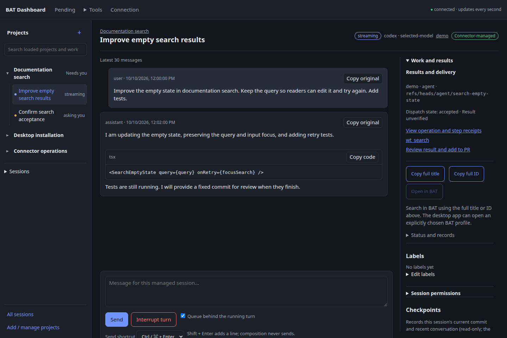
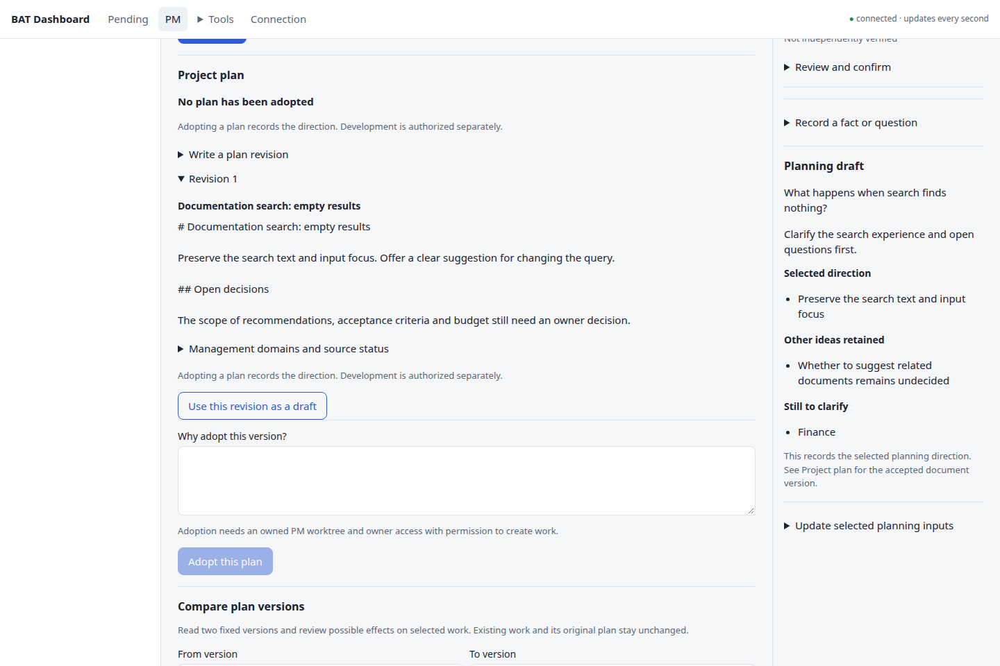
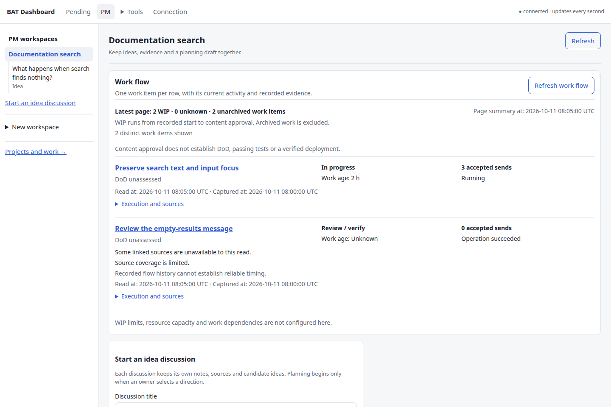
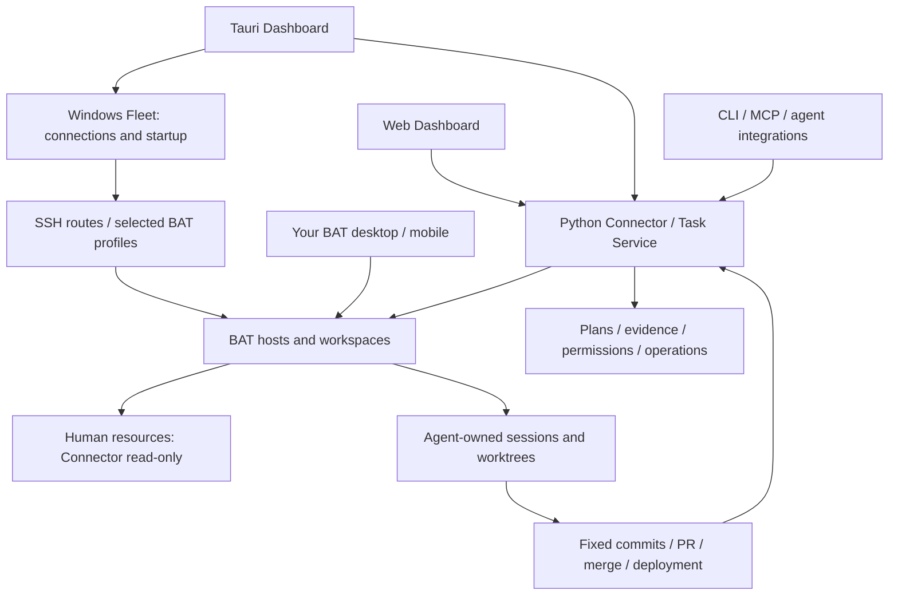

# Better Agent Dashboard

**Keep the plan, agent work and delivery evidence together.**

**English** · [繁體中文](README.zh-TW.md) · [Website](https://teddashh.github.io/bat-agent-connector/) · [Install and start](docs/getting-started.md) · [Progress](docs/product/progress-2026-10-12.md)

Better Agent Dashboard is a project workspace for people working with coding agents. Discuss an idea, review a proposed plan, dispatch work into the agent's own workspace, and follow the result back to its requirements, tests and delivery. After release, adopted maintenance policies govern observations, repair work and review.

The **Web and Tauri desktop apps share one interface and one Python backend**. You keep using [Better Agent Terminal (BAT)](https://github.com/tony1223/better-agent-terminal) for your own coding. Windows Fleet manages local connections and startup. Connector keeps project history, permissions and operations consistent across the Dashboard, CLI and MCP.

> **Development preview.** This introduction describes merged source, with screenshots captured from `c0027daa` (October 12, 2026). PM v1.2 is still being integrated. The [progress report](docs/product/progress-2026-10-12.md) separates the public baseline, M4/M5 candidates and remaining work. Choose a successful package for an exact source commit; a newer draft PR is not a released build.



*Actual shared frontend with synthetic demonstration data. All public screenshots were refreshed for this baseline; [source and reproduction instructions](site/images/README.md). Screenshots do not establish native installation or live acceptance.*

## What it helps you answer

| Your question | Product workflow |
| --- | --- |
| What did we agree to build? | Idea discussions, source records, reviewable plan proposals and explicit adoption into the PM's own versioned documents. |
| What should happen next? | Roadmap, Sprint commitments, Kanban and engineering packages reference the adopted requirements and fixed code destinations. |
| What needs a decision? | Follow-up analysis presents sourced findings, open questions and candidate updates. You review the meaningful changes before adopting them. |
| Does the result satisfy the plan? | Verification and responsible quality review record fixed evidence, criteria, reasons and acceptance. Passing tests alone does not accept a requirement. |
| Can dependent work continue? | Explicitly selected accepted requirement evidence can satisfy a package's dependency; missing or inaccessible evidence remains a blocker. |
| What actually shipped? | Integration, PR merge, deployment verification and release baselines retain their own evidence and history. |
| What happens after release? | An adopted policy bounds maintenance sources, schedules, repair scope, budget and delivery. Findings and repair receipts feed Maintenance Review. |
| Where did that session go? | The project tree connects work, conversations and results. Original operation IDs support recovery after refresh or a lost reply. |

Project Brief, Sprint and Kanban already consume fixed quality records. The M4 candidate extends Roadmap quality and Brief deviation explanations, and verifies the joined lifecycle. See [current limitations](#current-scope-and-limits) before treating the whole workflow as complete.

## Try one small project

1. **Discuss the goal.** Create a PM workspace and an Idea thread. For a membership project, start with login and password reset; record what is outside the first release.
2. **Review the plan.** Prepare a PM-owned Git worktree at a fixed revision. Ask for a proposal, inspect its sources, requirements and open questions, then explicitly adopt it.
3. **Start bounded work.** Select the engineering package, repository, BAT host and workspace. Agents use their own managed resources; your checkout stays read-only to Connector.
4. **Evaluate the result.** Run the configured verifier or select original GitHub checks. Record a quality review against the fixed acceptance criteria and Definition of Done, then select that evidence for the work and dependencies.
5. **Deliver and maintain.** Review the integration and PR, verify the release baseline, and adopt the maintenance policy. Review findings and repairs before deciding the next plan change.

Each stage uses the same project history. Discussion does not automatically adopt a plan; adopting a plan does not start work. A maintenance finding does not itself authorize a repair. [Step-by-step PM guide](docs/getting-started.md#try-one-pm-workflow).





## Install and connect

Use the [desktop workflow on main](https://github.com/teddashh/bat-agent-connector/actions/workflows/desktop.yml?query=branch%3Amain). Choose a successful platform job, match its source commit and validation records, then download that run's artifact. GitHub may require sign-in, and artifacts expire. These are validation packages, not a stable signed update channel.

| Entry | Package / local features | Boundary |
| --- | --- | --- |
| Windows x64 | `desktop-Windows-unsigned`: NSIS, bundled central, tray, Credential Manager and Fleet | Unsigned validation package. Windows Fleet manages connections and BAT startup. |
| macOS Apple Silicon / Intel | `desktop-macOS-arm64-validation` / `desktop-macOS-x64-validation`: DMG, bundled central, menu bar and Keychain | Ad-hoc signing; Windows Fleet is not ported to Mac. |
| Linux | `desktop-Linux-unsigned`: Debian package and bundled central | External-central native credentials remain memory-only; persistent native vault is excluded. |
| Browser | Open the central's `/dashboard/`, or use the desktop's browser entry | Same project data and UI; no browser-native Fleet or credential vault. |

The desktop package prepares a matching Python runtime, private background central, data and personal identity. Complete the guided BAT trust, repository binding and verification setup. **Joining an existing central is an explicit advanced option.** A failed connection never creates a replacement project database. Closing the Dashboard window does not stop central work.

**PM analysis has separate runtime requirements.** The current bounded analysis paths run on a configured Linux central or eligible Linux BAT host, using the pinned PM Codex runtime and confinement described in the guide. A Windows or Mac client can use those remote capabilities; its local desktop installation does not provide native Windows/Mac PM execution. PM analysis support is distinct from a general coding CLI adapter.

[Installation and first use](docs/getting-started.md) · [Windows guide and resources](docs/windows.md) · [Recovery and upgrades](docs/design/managed-installation.md)

## How the parts fit



- **Connector is the authority.** Python owns project state, policy, dispatch and the durable journal. Tauri owns local windows, credentials and transport; it does not duplicate the business backend.
- **Work stays on the chosen host.** Same-host continuation can use a fixed checkpoint. Cross-host code synchronization uses an explicitly bound GitHub repository and published commits.
- **Windows Fleet remains a distinct layer.** Select background connections, BAT profiles and Dashboard startup independently. Route/readiness checks, Tailscale entry, configured central bootstrap and explicit Rust/PowerShell migration preserve ownership.
- **Clients share state.** Web and Tauri use `desktop/src`; drafts and reading positions remain local to each client. Hermes, Grokbot and other MCP/CLI clients use their own principals and scopes.

## Current scope and limits

| Status | Scope |
| --- | --- |
| Merged baseline | Desktop/central foundation; PM discussions and plan adoption; engineering packages and bounded dispatch; verification, requirement acceptance and dependency evidence; policy-bounded maintenance repairs; BAT proposals/Follow-up; AHP read-only observation. |
| M4 candidate | Joined Idea → delivery → maintenance → Review → new Idea flow; original runtime completion, manual single-input activity observation, Roadmap quality and Brief deviations. Candidate checks and failures are recorded separately. |
| M5 local candidate | Persistent workspace analysis-adapter choice and read-only observation of serial manual inputs. Focused checks passed; full candidate/platform validation remains. |
| Remaining PM v1.2 | General native coding adapter, AHP create-own/write support, remaining document views and presentations, wider CLI support and cross-CLI usage/efficiency reporting. |

Cross-CLI token collection is **planned, not running**. Its purpose is to relate usage to accepted delivery and avoid redundant work. Missing usage must remain unknown; token traffic, estimated API prices and subscription quota are different measures. Model or effort changes need adopted policy and apply to future owned work. [Progress and priorities](docs/product/progress-2026-10-12.md).

Formal signing, Mac notarization, production update channels and Linux persistent native credential storage are outside the agreed delivery. Real-environment acceptance belongs to the owner and has not been claimed as passed. The full [PM v1.2 plan](docs/product/pm-v1.2-plan.md) remains the scope; M4 is one milestone.

## Ownership and recovery

Human sessions and worktrees remain read-only through Connector. Unknown resources need original creation evidence before managed recovery. Reading another session never transfers control of it.

A lost reply does not prove an action failed. Recover the original operation and key; uncertain work keeps its evidence and reservations. Current permissions and source availability are checked before effects. Connector policy complements host accounts and confinement; it is not an operating-system sandbox.

[Security model](SECURITY.md) · [Resource policy](docs/design/resource-policy.md) · [Operations](docs/design/operations-unification.md)

## Documentation and development

| Need | Start here |
| --- | --- |
| Use the product | [First use](docs/getting-started.md) · [Windows Fleet](docs/windows.md) |
| Understand progress | [Progress report](docs/product/progress-2026-10-12.md) · [PM status](docs/product/pm-v1.2-status.md) · [Implementation history](docs/product/implementation-status.md) |
| Continue development | [Sprint handoff](docs/handoff/2026-10-12-pm-v1.2.md) · [Adopted plan](docs/product/pm-v1.2-plan.md) · [Architecture decisions](docs/product/realignment-v2.md) |
| Integrate an agent | [Agent skills](docs/agent-skills.md) · [API](docs/design/api-v1.md) · [Protocol](docs/PROTOCOL.md) |
| Follow results | [Artifacts](docs/design/artifacts.md) · [Delivery](docs/design/delivery.md) · [Cleanup](docs/design/cleanup.md) |

```bash
uv sync --locked --extra dev
uv run ruff check .
pytest-disktmp uv run pytest -q

cd desktop
npm ci
npm run build:all
npm test
npm run test:ui
```

Use a disk-backed pytest temporary directory and remove it after the run. `pytest-disktmp` is the development host wrapper; if unavailable, supply a unique disk-backed `--basetemp`. Never use `/dev/shm` or another tmpfs. Backend changes also require the Python 3.10 suite. Follow [CONTRIBUTING](CONTRIBUTING.md) and [AGENTS.md](AGENTS.md).

Edit the shared UI in `desktop/src` and regenerate browser assets. The [public website](site/README.md) is generated from repository source. Tests use mock BAT/providers and temporary repositories, without live-host writes.

## Credits

An unofficial MIT-licensed companion to BAT, not affiliated with or endorsed by its authors. [BAT](https://github.com/tony1223/better-agent-terminal) is by TonyQ and contributors. Selected organization and interaction patterns reference [Project Hub](https://github.com/kieiken/project-hub); no Hub importer or runtime dependency is included. See the [adoption review](docs/product/project-hub-frontend-audit-2026-10-09.md).

[License](LICENSE) · [Third-party notices](THIRD_PARTY_NOTICES.md) · [Changelog](CHANGELOG.md)
