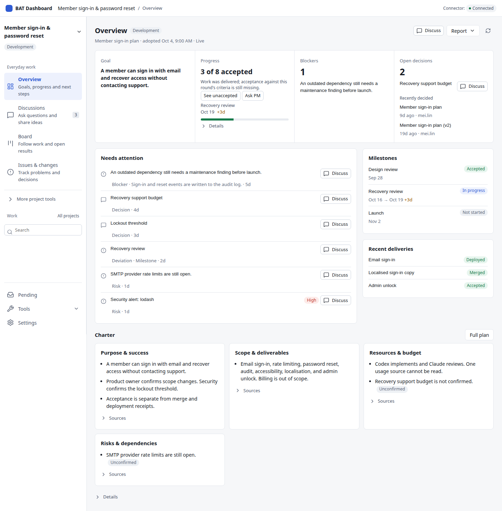
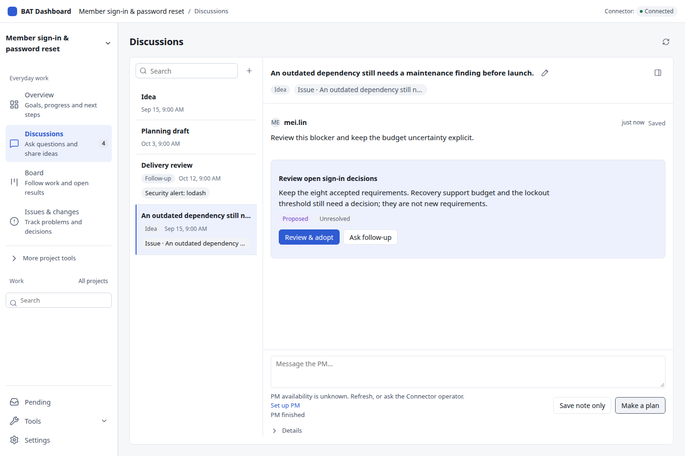
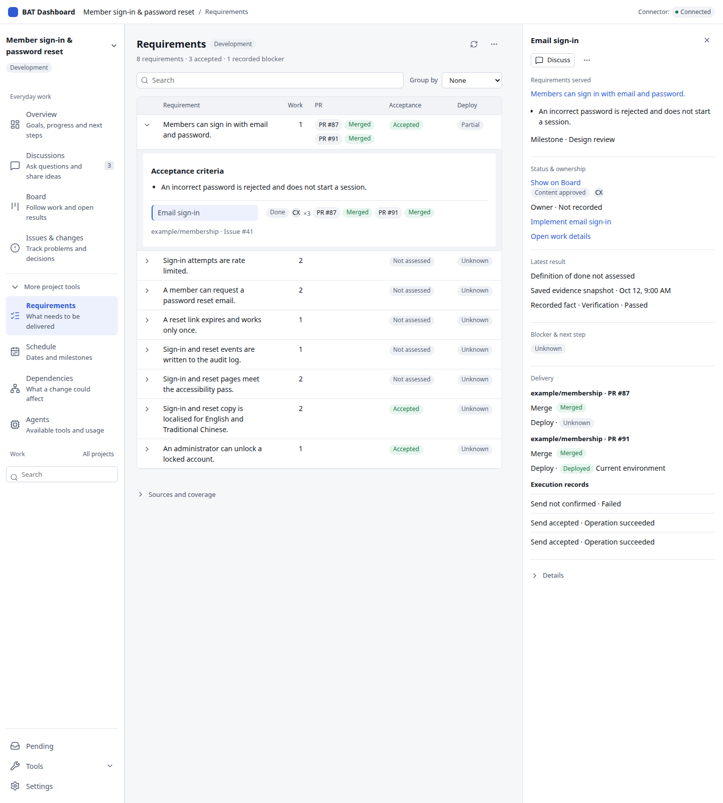
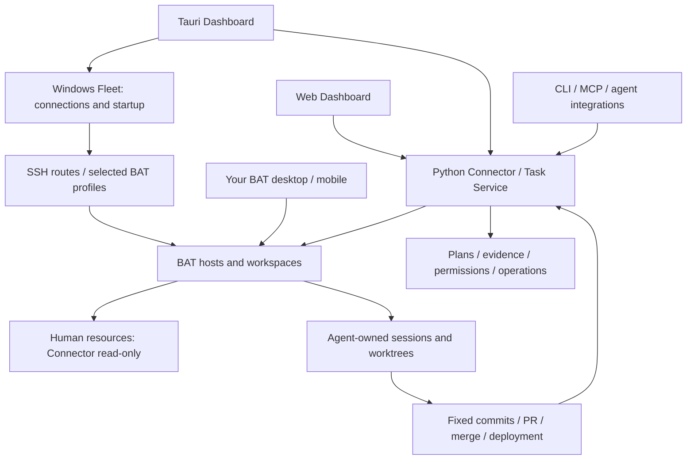

# Better Agent Dashboard

**Understand the project. Discuss the problem. Decide with the PM.**

**English** · [繁體中文](README.zh-TW.md) · [Website](https://ted-h-com.github.io/bat-agent-connector/) · [Install and start](docs/getting-started.md) · [Progress](docs/product/implementation-status.md)

Better Agent Dashboard keeps project state, PM discussions and decisions in one workspace.
Start with the live Overview, open a problem's original record, and discuss it with the PM without rebuilding the context.
Review the proposed update and explicitly adopt it; requirements, work and delivery keep their own evidence.

[Open the interactive Dashboard demo](https://ted-h-com.github.io/bat-agent-connector/demo/?lang=en).
Explore the actual shared interface with synthetic, read-only project data: search work,
expand requirements, inspect delivery evidence and browse sessions. The demo also links to
the v1.3 workflow preview, which simulates the proposed start, follow-up and decision flow.
Neither example connects to a BAT host or model.
The real Start work panel is on `main` and needs a configured BAT host and a bound repository.
Published preview source `437ee6a7` (through #395, October 22, 2026) connects reviewed plans to Work, queued follow-ups, fixed Results, verification and PR delivery. Workbench provides mobile navigation and foreground recovery; profiles show route limits before start. PM can discuss two fixed assessments, save continuation briefs and explicitly assess the Overview. Resources reads separately authorized local Codex/Claude histories. Lists load summaries first; unsent instructions can return to Idea. Core UI actions share HTTP/MCP contracts. Classic remains the default. Integration fixtures use real Connector and disk Git with mock BAT/providers; live BAT/model and physical-device acceptance remain separate.



*Actual shared UI · synthetic demonstration data · merged-main preview · [capture source](site/images/README.md).*

The **Web and Tauri desktop apps share one interface and one Python backend**. You keep using [Better Agent Terminal (BAT)](https://github.com/tony1223/better-agent-terminal) for your own coding. Windows Fleet manages local connections and startup. Connector keeps project history, permissions and operations consistent across the Dashboard, CLI and MCP.

> **Development preview.** The screenshots come from the published prerelease source `437ee6a7` (October 22, 2026, through #395).
> The gallery uses synthetic data; release, installation and live acceptance have separate evidence.
> The [progress report](docs/product/implementation-status.md) separates branch, merged, installed and live-tested status.
> Match a successful package to its exact source; screenshots and CI do not establish native or live acceptance.

## What it helps you answer

| Your question | View and workflow |
| --- | --- |
| Where does the project stand? | **Overview** shows the live goal, accepted requirements, blockers, open decisions and Recently decided history. Needs attention lists each record with one Discuss action. Unread sources stay Unknown; complete empty lists say None recorded. Saved reports retain their fixed snapshots. |
| What needs a decision? | Open a record and **Discuss with PM**. **Discussions** opens with its context chip and automatic title. Search threads, save a note, and review a proposed update. Context, Inputs and Plan open in **Discussion info**. An adopted discussion can offer an authorized, editable Resolve issue step; reported resolution remains unassessed. |
| What is this work meant to satisfy? | **Requirements** shows adopted requirements with work, PR, Acceptance and Deploy columns. Expand a row for criteria and work; open the inspector for evidence. Unchanged refreshes keep rows and focus stable. |
| What is still unresolved? | **Issues & changes** keeps risks, issues, actions, changes and decisions in a filterable register with original timelines and named maintenance findings. |
| Which dates changed? | **Schedule** compares recorded baseline, forecast and actual dates on a labelled axis. Missing dates stay unknown. |
| What could a dependency change affect? | **Dependencies** shows pinned inventories, evidence and bounded impact in a matrix or graph. |
| What are the agents using? | **Agents** keeps sourced usage, rows and daily trends on one consistent read, with reported quota windows. Unavailable data stays unknown. |
| What should happen next? | **Board** offers search, requirement and agent filters, plus the shared work inspector. When the workspace can start work, that inspector includes Start work and, for a started attempt, a read-only Result section. Content approval, requirement acceptance, merge and deployment remain separate. |
| What needs a recorded response? | Open **Governance** or **Follow-ups** from **Issues & changes**. Meeting threads have a **Meeting** tab in Discussion info. Saved outcomes keep their original sources. |
| What may maintenance do? | **Dependencies** holds **Release baselines** and **Maintenance policy**. Preview a release source before registration; policy adoption and enabled repair limits remain explicit. |
| Where are the work tools? | **Requirements → More actions** opens quality, evidence, specification, package, handoff and issue publication tools; **Board → More actions** opens **Work batches**. |
| What happened in that session? | **Session** keeps the conversation and results together. Authorized managed controls are available; manual BAT sessions remain read-only. |

These are views of the same project, with secondary tools available on demand.
The [current scope](#current-scope-and-limits) distinguishes the merged workspace from the full PM v1.2 backlog. The [progress report](docs/product/implementation-status.md) lists work still in review.

## Try one small project

1. **Understand the state.** Create a workspace from the workspace switcher and start an Idea in Discussions. For member sign-in and password reset, record the goal and exclusions; use Overview once a plan is adopted.
2. **Find one problem.** Open its record in Requirements, Issues & changes or Schedule. Inspect the linked evidence and what is still unknown.
3. **Discuss with PM.** Use that record's Discuss action. Its source chip and title follow you into Discussions. Save a note, then ask the PM for a proposed update.
4. **Review and adopt.** Prepare the PM-owned Git worktree at a fixed revision. Check sources, proposed wording, retained requirements and open questions. An authorized workspace owner explicitly adopts the reviewed update.
5. **Follow the evidence.** Inspect the adopted requirements and their work in Requirements, Board and Session. Verification, requirement acceptance, PR merge and deployment each need their own record.

A discussion does not automatically adopt a plan; adoption does not start work or resolve its source issue. After adoption, an authorized person can explicitly report the issue resolved; this does not accept a requirement.
Policy-bounded delivery and maintenance remain available through the project's secondary tools.
[Step-by-step PM guide](docs/getting-started.md#try-one-pm-workflow).





| More views from the same synthetic project | Screenshot |
| --- | --- |
| Issues & changes | [Register with filters](site/images/issues-en.png) |
| Schedule | [Baseline, forecast and actual](site/images/schedule-en.png) |
| Dependencies | [Pinned partial inventory graph](site/images/dependencies-en.png) |
| Board | [Work lanes with search and filters](site/images/board-en.png) |
| Session | [Read-only manual session; host not set up for managed work](site/images/session-en.png) |

## Install and connect

The latest [stable download](https://github.com/TED-H-com/bat-agent-connector/releases/tag/v0.2.12) is Connector **0.2.12** / desktop **0.1.8**, pinned to `14c62830`. The [published prerelease](https://github.com/TED-H-com/bat-agent-connector/releases/tag/v0.2.13-preview.20261022) is Connector **0.2.13** / desktop **0.1.9**, pinned to `437ee6a7143a82e32eae1d6a008203b2df072aaf` (`437ee6a7`). Each release has eight assets: a Python wheel and sdist, a Linux deb, two macOS DMGs, a Windows installer, `release-manifest.json` and `SHA256SUMS`. Choose the desktop asset on the release page and check its manifest and checksums. These remain unsigned or ad-hoc-signed development builds, not a stable signed update channel.

For Connector, follow the [verified installer instructions](docs/getting-started.md#2-install-connector). Use `--tag v0.2.12 --channel-check stable` for stable, or `--tag v0.2.13-preview.20261022 --channel-check preview` for this preview, with the bootstrap from the same tag. The installer requires a tag; its default channel check is `preview`, which accepts stable releases and prereleases. `stable` refuses a preview. On Linux, `--enable-updates` enrolls and schedules that same channel; without it, installation alone does not enable updates. See the [installer source](scripts/install_connector.py) and [update guide](docs/connector-updates.md).

The enrolled updater offers eligible newer stable releases on `stable`, and eligible newer stable releases or prereleases on `preview`. It does not offer this preview to the stable channel. For later development builds, match a successful [desktop workflow on main](https://github.com/TED-H-com/bat-agent-connector/actions/workflows/desktop.yml?query=branch%3Amain) to its source; Actions artifacts can expire.

| Entry | Package / local features | Boundary |
| --- | --- | --- |
| Windows x64 | `desktop-Windows-unsigned`: NSIS, bundled central, tray, Credential Manager and Fleet | Unsigned validation package. Windows Fleet manages connections and BAT startup. |
| macOS Apple Silicon / Intel | `desktop-macOS-arm64-validation` / `desktop-macOS-x64-validation`: DMG, bundled central, menu bar and Keychain | Ad-hoc signing; Windows Fleet is not ported to Mac. |
| Linux | `desktop-Linux-unsigned`: Debian package and bundled central | External-central native credentials remain memory-only; persistent native vault is excluded. |
| Browser | Open the central's `/dashboard/`, or use the desktop's browser entry | Same project data and UI; no browser-native Fleet or credential vault. |

The desktop package prepares a matching Python runtime, private background central, data and personal identity.

[Connector automatic updates](docs/connector-updates.md) are available for verified per-user Linux installations. Once enrolled, the hourly timer installs eligible releases for future launches; existing MCP, central and BAT processes keep running.

First use opens **Get ready to work → 1. Connect BAT**. Paste BAT’s connection URL, check the **Host ID**, then **Verify and save host**. After success, choose **View sessions**. Repository binding and verification commands are optional collapsed steps; configure them when the work needs them.

For managed work, keep `BATC_TASK_SETTINGS` private with mode 0600. Configure `[task_service.base_branches]` per project, `[verification.ssh_hosts]` per task host (required when using configured base branches), and `[verification.commands]` for trusted tests.

**Joining an existing central is an explicit advanced option.** A failed connection never creates a replacement project database. Closing the Dashboard window does not stop central work.

**PM analysis has separate runtime requirements.** The current bounded analysis paths run on a configured Linux central or eligible Linux BAT host, using the pinned PM Codex runtime and confinement described in the guide. A Windows or Mac client can use those remote capabilities; its local desktop installation does not provide native Windows/Mac PM execution. PM analysis support is distinct from a general coding CLI adapter.

[Installation and first use](docs/getting-started.md) · [Windows guide and resources](docs/windows.md) · [Recovery and upgrades](docs/design/managed-installation.md)

## How the parts fit



- **Connector is the authority.** Python owns project state, policy, dispatch and the durable journal. Tauri owns local windows, credentials and transport; it does not duplicate the business backend.
- **Work stays on the chosen host.** Same-host continuation can use a fixed checkpoint. Cross-host code synchronization uses an explicitly bound GitHub repository and published commits.
- **Windows Fleet remains a distinct layer.** Select background connections, BAT profiles and Dashboard startup independently. Route/readiness checks, Tailscale entry, configured central bootstrap and explicit Rust/PowerShell migration preserve ownership.
- **Clients share state.** Web and Tauri use `desktop/src`; drafts and reading positions remain local to each client. Hermes, Grokbot and other MCP/CLI clients use their own principals and scopes.

## Current scope and limits

| Status | Scope |
| --- | --- |
| Merged baseline | Desktop/central foundation; PM discussions and plan adoption; engineering packages and bounded dispatch; verification, requirement acceptance and dependency evidence; policy-bounded maintenance repairs; BAT proposals/Follow-up; AHP read-only observation. #132 adds central Overview, discussion context and renames, register, Schedule, Dependencies and daily resource buckets. #134 adds adopted goals, recent decisions and the guided close of a resolved issue. |
| Merged workspace | Published preview source `437ee6a7` (through #395, October 22, 2026) connects reviewed plans to Work, queued follow-ups, fixed Results, verification and PR delivery. Workbench provides mobile navigation and foreground recovery; profiles show route limits before start. PM can discuss two fixed assessments, save continuation briefs and explicitly assess the Overview. Resources reads separately authorized local Codex/Claude histories. Lists load summaries first; unsent instructions can return to Idea. Core UI actions share HTTP/MCP contracts. Classic remains the default. Integration fixtures use real Connector and disk Git with mock BAT/providers; live BAT/model and physical-device acceptance remain separate. |
| Remaining PM v1.2 | General native coding adapter, AHP create-own/write support, remaining document views and presentations, wider CLI support, remote usage collection and delivery-efficiency attribution. |

Local Codex/Claude usage collection exists; the redesign's Agents view adds sourced daily trends and reported quota windows.
Remote collection and delivery-efficiency attribution remain planned.
Missing usage stays unknown; observed tokens, API price estimates and subscription quota are different measures.
No usage-driven model policy is active. [Progress and priorities](docs/product/implementation-status.md).

Formal signing, Mac notarization, production update channels and Linux persistent native credential storage are outside the agreed delivery. Real-environment acceptance belongs to the owner and has not been claimed as passed. The full [PM v1.2 plan](docs/product/pm-v1.2-plan.md) remains the scope; M4 is one milestone.

## Ownership and recovery

Human sessions and worktrees remain read-only through Connector. Unknown resources need original creation evidence before managed recovery. Reading another session never transfers control of it.

A lost reply does not prove an action failed. Recover the original operation and key; uncertain work keeps its evidence and reservations. Current permissions and source availability are checked before effects. Connector policy complements host accounts and confinement; it is not an operating-system sandbox.

[Security model](SECURITY.md) · [Resource policy](docs/design/resource-policy.md) · [Operations](docs/design/operations-unification.md)

## Documentation and development

| Need | Start here |
| --- | --- |
| Use the product | [First use](docs/getting-started.md) · [Windows Fleet](docs/windows.md) |
| Understand progress | [Progress report](docs/product/implementation-status.md) · [PM status](docs/product/pm-v1.2-status.md) · [October 17 report](docs/product/progress-2026-10-17.md) |
| Continue development | [Documentation handoff](docs/handoff/2026-10-14-docs-ux-v2.md) · [Adopted plan](docs/product/pm-v1.2-plan.md) · [Architecture decisions](docs/product/realignment-v2.md) |
| Integrate an agent | [Agent skills](docs/agent-skills.md) · [Automation API](docs/automation-api.md) · [API](docs/design/api-v1.md) · [Protocol](docs/PROTOCOL.md) |
| Follow results | [Artifacts](docs/design/artifacts.md) · [Delivery](docs/design/delivery.md) · [Cleanup](docs/design/cleanup.md) |

```bash
uv sync --locked --extra dev
uv run ruff check .
pytest-disktmp uv run pytest -q

cd desktop
npm ci
npm run build:all
npm test
npm run test:ui
```

Use a disk-backed pytest temporary directory and remove it after the run. `pytest-disktmp` is the development host wrapper; if unavailable, supply a unique disk-backed `--basetemp`. Never use `/dev/shm` or another tmpfs. Backend changes also require the Python 3.10 suite. Follow [CONTRIBUTING](CONTRIBUTING.md) and [AGENTS.md](AGENTS.md).

Edit the shared UI in `desktop/src` and regenerate browser assets. The [public website](site/README.md) is generated from repository source. Tests use mock BAT/providers and temporary repositories, without live-host writes.

## Credits

An unofficial MIT-licensed companion to BAT, not affiliated with or endorsed by its authors. [BAT](https://github.com/tony1223/better-agent-terminal) is by TonyQ and contributors. Selected organization and interaction patterns reference [Project Hub](https://github.com/kieiken/project-hub); no Hub importer or runtime dependency is included. See the [adoption review](docs/product/project-hub-frontend-audit-2026-10-09.md).

[License](LICENSE) · [Third-party notices](THIRD_PARTY_NOTICES.md) · [Changelog](CHANGELOG.md)
