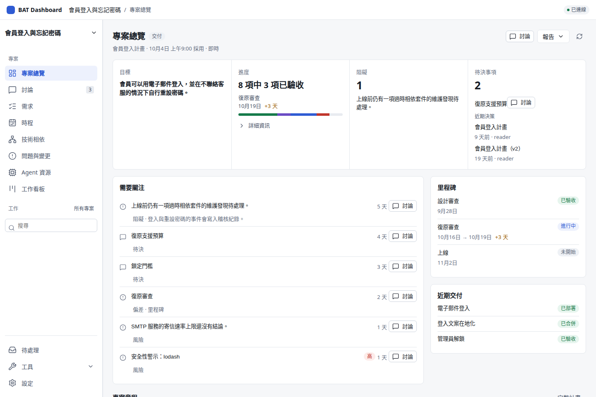
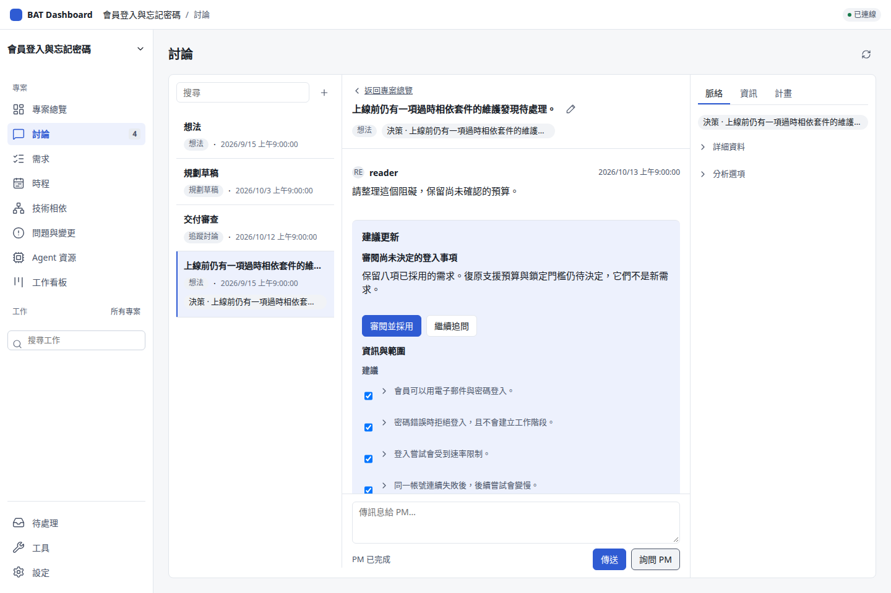
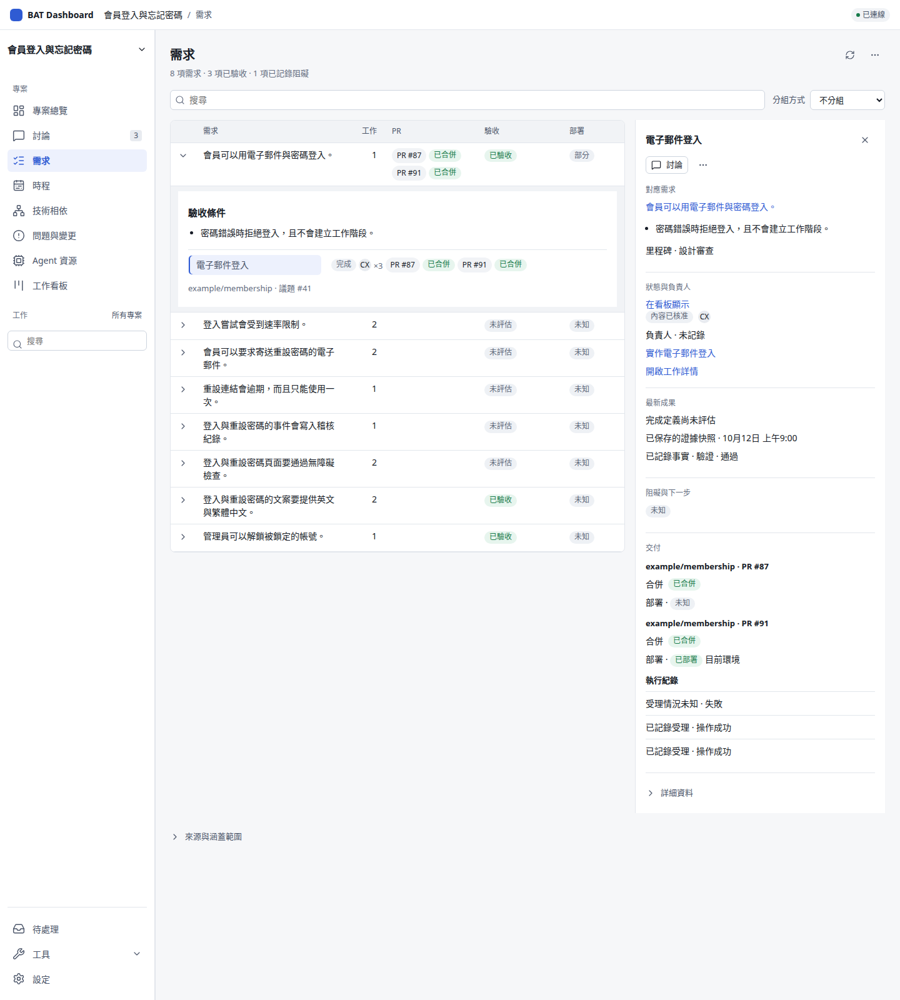
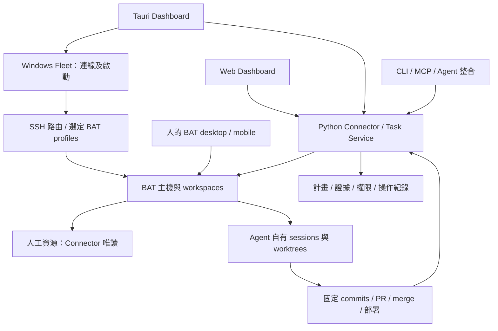

# Better Agent Dashboard

**看懂專案、找到問題，與 PM 完成一次決策。**

[English](README.md) · **繁體中文** · [網站](https://teddashh.github.io/bat-agent-connector/?lang=zh-TW) · [安裝與開始使用](docs/getting-started.zh-TW.md) · [進度報告](docs/product/progress-2026-10-14.md)

Better Agent Dashboard 把專案狀況、PM 討論與決策放在同一個工作空間。
先看即時總覽，找到問題，再從原紀錄直接與 PM 討論，不必重新整理脈絡。
審閱提案後明確採用；需求、工作與交付仍各自保留證據。



*實際共用介面 · 合成展示資料 · 候選預覽 · [截圖來源](site/images/README.md)。*

**Web 與 Tauri 桌面版共用介面及 Python 後端。**你照常在 [Better Agent Terminal（BAT）](https://github.com/tony1223/better-agent-terminal) 開發；Windows Fleet 管理本機連線與啟動，Connector 則讓 Dashboard、CLI、MCP 使用同一份專案歷史、權限和操作紀錄。

> **開發預覽。** 這組截圖來自候選 commit `944a854f`，尚非主線。
> 後端 #132、決策流程 #134、前端 #133 都尚未合併。
> 整合者會在發布前改釘合併後的主線，重新產生圖庫。
> [進度報告](docs/product/progress-2026-10-14.md)分開列出分支、合併、安裝與實機驗收狀態。
> 下載時請核對套件的精確來源；截圖與 CI 不能代替原生或實機驗收。

## 它幫你回答什麼

| 你想知道 | 檢視與操作 |
| --- | --- |
| 專案現在怎麼樣？ | **專案總覽**顯示即時目標、已驗收需求、阻礙與待決事項；已存報告保留當時的固定快照。 |
| 哪一件事需要決定？ | 開啟紀錄並按**與 PM 討論**，**討論**會帶入來源標籤與標題，讓你審閱提案後明確採用。 |
| 這份工作要滿足什麼？ | 在**需求**的追溯表與詳情面板，對照已採用需求、工作、驗收條件、PR 與交付。 |
| 哪些事還沒處理完？ | **問題與變更**用可篩選的登記表保留風險、問題、行動、變更、決策與原處理時間線。 |
| 哪些日期變了？ | **時程**對照已記錄的基準、預測與實際日期；沒有日期就保持未知。 |
| 相依套件改了，會影響哪裡？ | **技術相依**用矩陣或相依圖呈現固定清冊、證據與有界影響。 |
| Agent 用了哪些資源？ | **Agent 資源**顯示有來源的用量、可用的每日趨勢與回報配額窗；讀不到的資料不當成零。 |
| 接下來該跟進哪份工作？ | **工作看板**按階段追蹤；內容核准、需求驗收、合併與部署是不同事實。 |
| 那個工作階段發生了什麼？ | **工作階段**一起呈現對話與成果；自有工作依權限操作，人工 BAT 工作階段保持唯讀。 |

這些檢視都屬於同一個專案，次要工具需要時再展開。
[目前範圍](#目前範圍與限制)分開列出這輪改版候選與完整 PM v1.2 待辦。

## 先試一個小專案

1. **看懂狀況。** 從工作空間切換器建立 workspace，在討論開始 Idea。例如會員登入與忘記密碼，先記下目標及不做的範圍；計畫採用後再用專案總覽掌握狀態。
2. **找到一個問題。** 從需求、問題與變更或時程開啟原紀錄，查看關聯證據與未知事項。
3. **與 PM 討論。** 按紀錄上的討論入口，來源標籤與標題會一起帶入。寫下想法並傳送，再請 PM 提出更新。
4. **審閱並採用。** 在固定版本準備 PM 自有 Git 工作區。核對來源、建議文字、保留需求與未決問題，再由有權限的 workspace owner 明確採用。
5. **追蹤證據。** 在需求、工作看板與工作階段對照已採用需求及工作。驗證、需求驗收、PR 合併與部署各自需要紀錄。

討論不會自動採用計畫，採用也不會直接開工或將來源問題結案。
有界交付與維護仍可從專案的次要工具操作。
[逐步 PM 使用指南](docs/getting-started.zh-TW.md#試跑一條-pm-工作流程)。





| 同一個合成專案的其他檢視 | 截圖 |
| --- | --- |
| 問題與變更 | [登記表](site/images/issues-zh.png) |
| 時程 | [基準、預測與實際日期](site/images/schedule-zh.png) |
| 技術相依 | [固定版本的部分清冊相依圖](site/images/dependencies-zh.png) |
| 工作看板 | [按階段追蹤工作](site/images/board-zh.png) |
| 工作階段 | [人工 BAT 工作階段唯讀閱讀](site/images/session-zh.png) |

## 安裝與連線

從 [main 的 desktop workflow](https://github.com/teddashh/bat-agent-connector/actions/workflows/desktop.yml?query=branch%3Amain) 選成功的平台 job，核對來源 commit 與驗證紀錄後，下載該 run 的 artifact。GitHub 可能要求登入，artifact 也會到期；這些是驗證套件，尚非穩定的簽章更新通道。

| 入口 | 套件／本機能力 | 界線 |
| --- | --- | --- |
| Windows x64 | `desktop-Windows-unsigned`：NSIS、打包中央、系統匣、Credential Manager、Fleet | 未正式簽署的驗證包；Windows Fleet 負責連線及 BAT 啟動。 |
| macOS Apple Silicon／Intel | `desktop-macOS-arm64-validation`／`desktop-macOS-x64-validation`：DMG、打包中央、選單列、Keychain | 採 ad-hoc 簽署；Windows Fleet 沒有移植到 Mac。 |
| Linux | `desktop-Linux-unsigned`：Debian 套件及打包中央 | 連外部中央的原生憑證仍只留在記憶體；持久原生 vault 已排除。 |
| 瀏覽器 | 開中央的 `/dashboard/`，或從桌面開啟瀏覽器入口 | 共用資料及介面；沒有瀏覽器原生 Fleet 或 credential vault。 |

桌面包會準備相符 Python runtime、私人背景中央、資料與個人身分。接著依引導完成 BAT 信任、repository 綁定及驗證設定。**加入既有中央是明確選擇的進階路徑。**連線失敗不會另外建立專案資料庫，關閉 Dashboard 視窗也不會停止中央工作。

**PM 分析另有 runtime 前提。**目前有界分析在已配置的 Linux 中央，或合格的 Linux BAT 主機執行，需要指南指定的 PM Codex runtime 及隔離環境。Windows／Mac client 可以使用這些遠端能力，但桌面安裝本身不提供原生 Windows／Mac PM 執行。PM 分析與一般 coding CLI adapter 是不同能力。

[安裝與首次使用](docs/getting-started.zh-TW.md) · [Windows 使用與資源](docs/windows.zh-TW.md) · [恢復及升級](docs/design/managed-installation.md)

## 各部分如何分工



- **Connector 是中央權威。** Python 管專案狀態、政策、派工與持久帳本；Tauri 管本機視窗、憑證和傳輸，不另造業務後端。
- **工作留在選定主機。** 同主機可從固定 checkpoint 接續；跨主機同步程式碼使用明確綁定的 GitHub repository 與已發布 commit。
- **Windows Fleet 保留獨立職責。** 背景連線、BAT profiles、Dashboard 啟動各自選擇；路由與就緒檢查、Tailscale 入口、固定中央 bootstrap、Rust／PowerShell 明確遷移都保留 ownership。
- **各入口共用資料。** Web／Tauri 使用 `desktop/src`；草稿與閱讀位置各 client 保存。Hermes、Grokbot 及其他 MCP／CLI client 使用自己的身分與 scopes。

## 目前範圍與限制

| 狀態 | 範圍 |
| --- | --- |
| 已合併主線 | 桌面／中央底座；PM 討論及計畫採用；工程包及有界派工；驗證、需求接受與依賴證據；政策內維護修復；BAT 提案／Follow-up；AHP 唯讀觀察。 |
| 改版候選 | 即時總覽、來源討論與採用、需求詳情、登記表、時程、技術相依、Agent 資源、看板及工作階段。#132／#134／#133 都尚未合併。 |
| M4 候選 | Idea → 交付 → 維護 → Review → 新 Idea 完整流程；原 runtime 完成、人工單次輸入活動觀察、Roadmap 品質及 Brief 偏差。候選檢查與失敗另有紀錄。 |
| M5 本機候選 | workspace 持久分析 adapter 選擇、人工循序輸入的唯讀觀察；範圍檢查通過，完整候選與平台驗證仍待完成。 |
| PM v1.2 剩餘工作 | 一般原生 coding adapter、AHP 自建／寫入、其餘文件視圖與簡報、更多 CLI 支援、遠端用量收集與交付效率歸因。 |

已有 Codex／Claude 本機用量收集；這輪 Agent 資源改版補上有來源的每日趨勢與回報配額窗。
遠端收集與交付效率歸因仍待做。
缺資料不能當零，觀測 token、API 估價與訂閱配額也不能混算。
尚未啟用依用量自動改模型的政策。[進度與優先順序](docs/product/progress-2026-10-14.md)。

正式簽章、Mac 公證、正式更新通道與 Linux 原生憑證持久儲存，已排除於本次交付。實際環境驗收由使用者執行，尚未宣稱通過。[完整 PM v1.2 計畫](docs/product/pm-v1.2-plan.md)仍是範圍依據，M4 是其中一個里程碑。

## 歸屬與恢復

Connector 對人工 session 與 worktree 保持唯讀。Unknown 資源必須有原建立證據，才能恢復 managed 身分；讀到別人的對話不會取得控制權。

回覆遺失不代表操作失敗。先查回原 operation 與 key，結果未知的工作保留證據及 reservation。每次效果前仍核對目前權限與來源。Connector 政策與主機帳號、隔離機制一起運作，本身不是作業系統 sandbox。

[安全模型](SECURITY.md) · [資源政策](docs/design/resource-policy.md) · [操作與恢復](docs/design/operations-unification.md)

## 文件與開發

| 需要 | 入口 |
| --- | --- |
| 使用產品 | [首次使用](docs/getting-started.zh-TW.md) · [Windows Fleet](docs/windows.zh-TW.md) |
| 了解進度 | [進度報告](docs/product/progress-2026-10-14.md) · [PM 狀態](docs/product/pm-v1.2-status.md) · [實作歷史](docs/product/implementation-status.md) |
| 接續開發 | [本輪交接](docs/handoff/2026-10-12-pm-v1.2.md) · [已採用計畫](docs/product/pm-v1.2-plan.md) · [架構決策](docs/product/realignment-v2.md) |
| 接入 Agent | [Agent skills](docs/agent-skills.md) · [API](docs/design/api-v1.md) · [Protocol](docs/PROTOCOL.md) |
| 查交付能力 | [Artifacts](docs/design/artifacts.md) · [Delivery](docs/design/delivery.md) · [Cleanup](docs/design/cleanup.md) |

```bash
uv sync --locked --extra dev
uv run ruff check .
pytest-disktmp uv run pytest -q

cd desktop
npm ci
npm run build:all
npm test
npm run test:ui
```

pytest 臨時資料使用磁碟，結束後清除。`pytest-disktmp` 是開發主機的 wrapper；其他環境請自行指定唯一的磁碟 `--basetemp`，不要使用 `/dev/shm` 或 tmpfs。後端變更另需 Python 3.10 完整測試。遵守 [CONTRIBUTING](CONTRIBUTING.md) 與 [AGENTS.md](AGENTS.md)。

共用 UI 修改 `desktop/src` 後重新產生 browser assets。[公開網站](site/README.md)也由 repository 來源產生。測試使用 mock BAT／providers 與臨時 repositories，不寫入實際主機。

## 致謝

本專案是 MIT 授權的非官方 BAT companion，未與 BAT 作者隸屬或獲其背書。[BAT](https://github.com/tony1223/better-agent-terminal) 由 TonyQ 與貢獻者開發。部分整理與互動方式參考 [Project Hub](https://github.com/kieiken/project-hub)，沒有 Hub importer 或 runtime 依賴。[採用審查](docs/product/project-hub-frontend-audit-2026-10-09.md)。

[授權](LICENSE) · [第三方聲明](THIRD_PARTY_NOTICES.md) · [變更紀錄](CHANGELOG.md)
