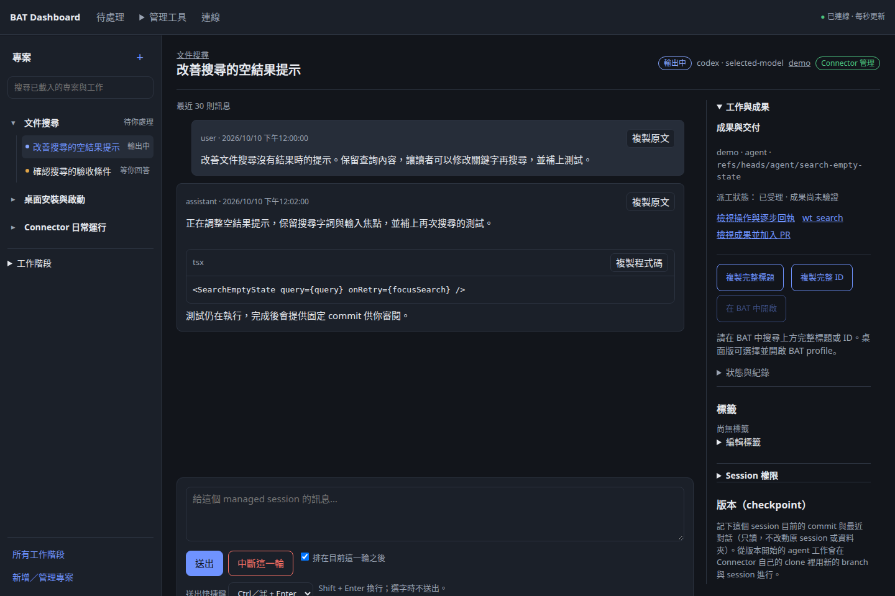
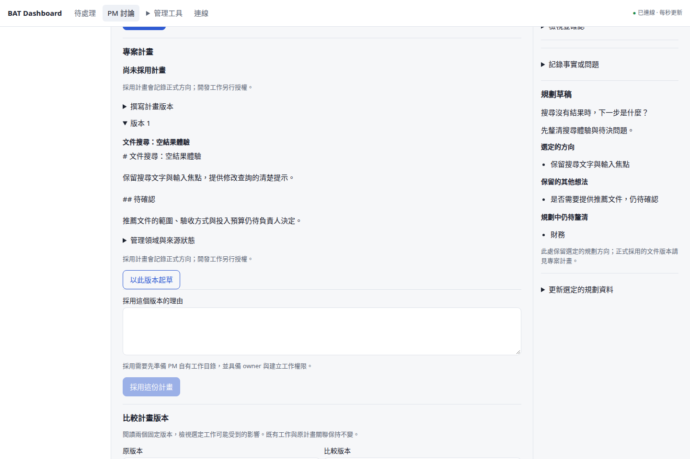
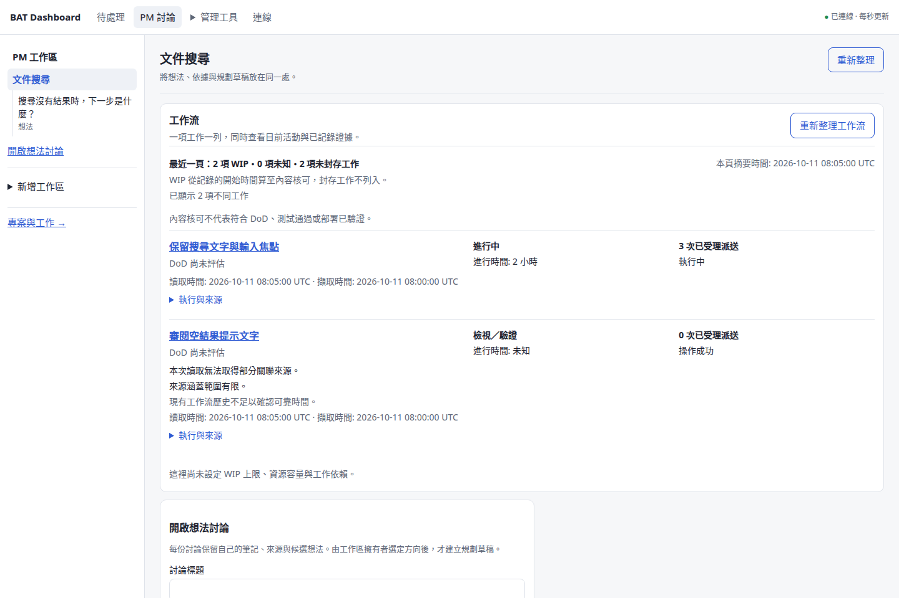
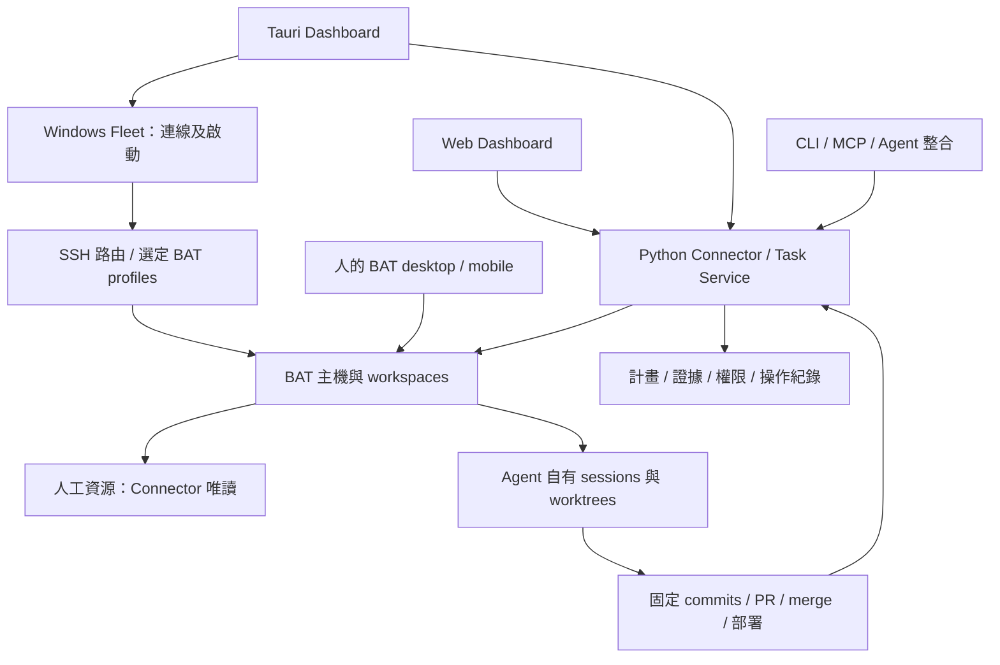

# Better Agent Dashboard

**把計畫、Agent 工作與交付證據放在一起。**

[English](README.md) · **繁體中文** · [網站](https://teddashh.github.io/bat-agent-connector/?lang=zh-TW) · [安裝與開始使用](docs/getting-started.zh-TW.md) · [進度報告](docs/product/progress-2026-10-12.md)

Better Agent Dashboard 是人與 coding agents 一起工作的專案工作空間。從討論構想、審閱計畫，到派工給 Agent 的自有工作區，都能把成果接回原需求、測試與交付紀錄。發布後，再依已採用的維護政策觀察問題、處理修復與進行 Review。

**Web 與 Tauri 桌面版共用介面及 Python 後端。**你照常在 [Better Agent Terminal（BAT）](https://github.com/tony1223/better-agent-terminal) 開發；Windows Fleet 管理本機連線與啟動，Connector 則讓 Dashboard、CLI、MCP 使用同一份專案歷史、權限和操作紀錄。

> **開發預覽。** 本頁介紹已合併的功能，截圖來自 `c0027daa`（2026 年 10 月 12 日）。PM v1.2 仍在整合；[進度報告](docs/product/progress-2026-10-12.md)分開列出主線、M4／M5 候選與剩餘工作。下載時請核對精確來源及成功的套件驗證，較新的草稿 PR 不等於已發布版本。



*實際共用介面，使用合成展示資料。本次已更新全部公開截圖；[來源與重拍方式](site/images/README.md)。截圖不代表已完成原生安裝或實際環境驗收。*

## 它幫你回答什麼

| 你想知道 | 對應工作流程 |
| --- | --- |
| 當初到底答應做什麼？ | Idea 討論、來源紀錄、可審閱的計畫提案，明確採用後保存到 PM 自有的版本化文件。 |
| 接下來該做什麼？ | Roadmap、Sprint 承諾、Kanban 與工程工作包，引用已採用需求及固定程式碼目的地。 |
| 哪些事需要我決定？ | Follow-up 分析整理有來源的發現、未決問題與候選更新，讓你審閱有意義的變更後再採用。 |
| 成果符合計畫嗎？ | 驗證及責任審閱者的品質評估保存固定證據、條件、理由與接受結果；測試通過不會自行接受需求。 |
| 相依工作可以繼續嗎？ | 明確選定已接受的需求證據，可滿足工作包的前置條件；缺少或無法讀取的證據仍會阻擋。 |
| 實際交付了什麼？ | 整合、PR merge、部署驗證與發布基準，各自保留證據及歷史。 |
| 發布後誰來照顧？ | 已採用政策限定維護來源、排程、修復範圍、預算與交付上限；發現與修復回執進入 Maintenance Review。 |
| 那個 session 跑去哪了？ | 專案樹串起工作、對話與成果；刷新或回覆遺失後，可用原操作身分查回。 |

Project Brief、Sprint 與 Kanban 已能引用固定品質評估。M4 候選再補上 Roadmap 品質、Brief 偏差說明及完整流程驗證；使用前請看[目前範圍與限制](#目前範圍與限制)，避免把部分完成當成整條流程已交付。

## 先試一個小專案

1. **討論目標。** 建立 PM workspace 與 Idea。例如會員系統先做登入和忘記密碼，同時記錄第一版不做什麼。
2. **審閱計畫。** 在固定版本準備 PM 自有 Git worktree；請 Agent 提案，檢視來源、需求與未決事項，再明確採用。
3. **派出有界工作。** 選工程工作包、repository、BAT 主機與 workspace。Agent 使用自己的 managed 資源，Connector 對人的 checkout 保持唯讀。
4. **評估成果。** 執行已配置的驗證器或選原始 GitHub checks，依固定接受條件與 Definition of Done 記錄品質審閱，再將評估選入工作及依賴條件。
5. **交付與維護。** 審閱整合與 PR、核對發布基準、採用維護政策；閱讀發現和修復結果，再決定下一次計畫變更。

每一步保留在同一份專案歷史。討論不會自動採用計畫，採用不會直接開工，發現維護問題也不會自行授權修復。[逐步 PM 使用指南](docs/getting-started.zh-TW.md#試跑一條-pm-工作流程)。





## 安裝與連線

從 [main 的 desktop workflow](https://github.com/teddashh/bat-agent-connector/actions/workflows/desktop.yml?query=branch%3Amain) 選成功的平台 job，核對來源 commit 與驗證紀錄後，下載該 run 的 artifact。GitHub 可能要求登入，artifact 也會到期；這些是驗證套件，尚非穩定的簽章更新通道。

| 入口 | 套件／本機能力 | 界線 |
| --- | --- | --- |
| Windows x64 | `desktop-Windows-unsigned`：NSIS、打包中央、系統匣、Credential Manager、Fleet | 未正式簽署的驗證包；Windows Fleet 負責連線及 BAT 啟動。 |
| macOS Apple Silicon／Intel | `desktop-macOS-arm64-validation`／`desktop-macOS-x64-validation`：DMG、打包中央、選單列、Keychain | 採 ad-hoc 簽署；Windows Fleet 沒有移植到 Mac。 |
| Linux | `desktop-Linux-unsigned`：Debian 套件及打包中央 | 連外部中央的原生憑證仍只留在記憶體；持久原生 vault 已排除。 |
| 瀏覽器 | 開中央的 `/dashboard/`，或從桌面開啟瀏覽器入口 | 共用資料及介面；沒有瀏覽器原生 Fleet 或 credential vault。 |

桌面包會準備相符 Python runtime、私人背景中央、資料與個人身分。接著依引導完成 BAT 信任、repository 綁定及驗證設定。**加入既有中央是明確選擇的進階路徑。**連線失敗不會另外建立專案資料庫，關閉 Dashboard 視窗也不會停止中央工作。

**PM 分析另有 runtime 前提。**目前有界分析在已配置的 Linux 中央，或合格的 Linux BAT 主機執行，需要指南指定的 PM Codex runtime 及隔離環境。Windows／Mac client 可以使用這些遠端能力，但桌面安裝本身不提供原生 Windows／Mac PM 執行。PM 分析與一般 coding CLI adapter 是不同能力。

[安裝與首次使用](docs/getting-started.zh-TW.md) · [Windows 使用與資源](docs/windows.zh-TW.md) · [恢復及升級](docs/design/managed-installation.md)

## 各部分如何分工



- **Connector 是中央權威。** Python 管專案狀態、政策、派工與持久帳本；Tauri 管本機視窗、憑證和傳輸，不另造業務後端。
- **工作留在選定主機。** 同主機可從固定 checkpoint 接續；跨主機同步程式碼使用明確綁定的 GitHub repository 與已發布 commit。
- **Windows Fleet 保留獨立職責。** 背景連線、BAT profiles、Dashboard 啟動各自選擇；路由與就緒檢查、Tailscale 入口、固定中央 bootstrap、Rust／PowerShell 明確遷移都保留 ownership。
- **各入口共用資料。** Web／Tauri 使用 `desktop/src`；草稿與閱讀位置各 client 保存。Hermes、Grokbot 及其他 MCP／CLI client 使用自己的身分與 scopes。

## 目前範圍與限制

| 狀態 | 範圍 |
| --- | --- |
| 已合併主線 | 桌面／中央底座；PM 討論及計畫採用；工程包及有界派工；驗證、需求接受與依賴證據；政策內維護修復；BAT 提案／Follow-up；AHP 唯讀觀察。 |
| M4 候選 | Idea → 交付 → 維護 → Review → 新 Idea 完整流程；原 runtime 完成、人工單次輸入活動觀察、Roadmap 品質及 Brief 偏差。候選檢查與失敗另有紀錄。 |
| M5 本機候選 | workspace 持久分析 adapter 選擇、人工循序輸入的唯讀觀察；範圍檢查通過，完整候選與平台驗證仍待完成。 |
| PM v1.2 剩餘工作 | 一般原生 coding adapter、AHP 自建／寫入、其餘文件視圖與簡報、更多 CLI 支援，以及跨 CLI 用量與效率報告。 |

跨 CLI token 收集**仍在規劃，尚未啟用**。目的在於把用量接回合格交付、減少重複工作；缺資料不能當零，token 流量、API 估價與訂閱配額也不能混算。模型或 effort 調整需有已採用政策，並套用於未來的自有工作。[進度與優先順序](docs/product/progress-2026-10-12.md)。

正式簽章、Mac 公證、正式更新通道與 Linux 原生憑證持久儲存，已排除於本次交付。實際環境驗收由使用者執行，尚未宣稱通過。[完整 PM v1.2 計畫](docs/product/pm-v1.2-plan.md)仍是範圍依據，M4 是其中一個里程碑。

## 歸屬與恢復

Connector 對人工 session 與 worktree 保持唯讀。Unknown 資源必須有原建立證據，才能恢復 managed 身分；讀到別人的對話不會取得控制權。

回覆遺失不代表操作失敗。先查回原 operation 與 key，結果未知的工作保留證據及 reservation。每次效果前仍核對目前權限與來源。Connector 政策與主機帳號、隔離機制一起運作，本身不是作業系統 sandbox。

[安全模型](SECURITY.md) · [資源政策](docs/design/resource-policy.md) · [操作與恢復](docs/design/operations-unification.md)

## 文件與開發

| 需要 | 入口 |
| --- | --- |
| 使用產品 | [首次使用](docs/getting-started.zh-TW.md) · [Windows Fleet](docs/windows.zh-TW.md) |
| 了解進度 | [進度報告](docs/product/progress-2026-10-12.md) · [PM 狀態](docs/product/pm-v1.2-status.md) · [實作歷史](docs/product/implementation-status.md) |
| 接續開發 | [本輪交接](docs/handoff/2026-10-12-pm-v1.2.md) · [已採用計畫](docs/product/pm-v1.2-plan.md) · [架構決策](docs/product/realignment-v2.md) |
| 接入 Agent | [Agent skills](docs/agent-skills.md) · [API](docs/design/api-v1.md) · [Protocol](docs/PROTOCOL.md) |
| 查交付能力 | [Artifacts](docs/design/artifacts.md) · [Delivery](docs/design/delivery.md) · [Cleanup](docs/design/cleanup.md) |

```bash
uv sync --locked --extra dev
uv run ruff check .
pytest-disktmp uv run pytest -q

cd desktop
npm ci
npm run build:all
npm test
npm run test:ui
```

pytest 臨時資料使用磁碟，結束後清除。`pytest-disktmp` 是開發主機的 wrapper；其他環境請自行指定唯一的磁碟 `--basetemp`，不要使用 `/dev/shm` 或 tmpfs。後端變更另需 Python 3.10 完整測試。遵守 [CONTRIBUTING](CONTRIBUTING.md) 與 [AGENTS.md](AGENTS.md)。

共用 UI 修改 `desktop/src` 後重新產生 browser assets。[公開網站](site/README.md)也由 repository 來源產生。測試使用 mock BAT／providers 與臨時 repositories，不寫入實際主機。

## 致謝

本專案是 MIT 授權的非官方 BAT companion，未與 BAT 作者隸屬或獲其背書。[BAT](https://github.com/tony1223/better-agent-terminal) 由 TonyQ 與貢獻者開發。部分整理與互動方式參考 [Project Hub](https://github.com/kieiken/project-hub)，沒有 Hub importer 或 runtime 依賴。[採用審查](docs/product/project-hub-frontend-audit-2026-10-09.md)。

[授權](LICENSE) · [第三方聲明](THIRD_PARTY_NOTICES.md) · [變更紀錄](CHANGELOG.md)
