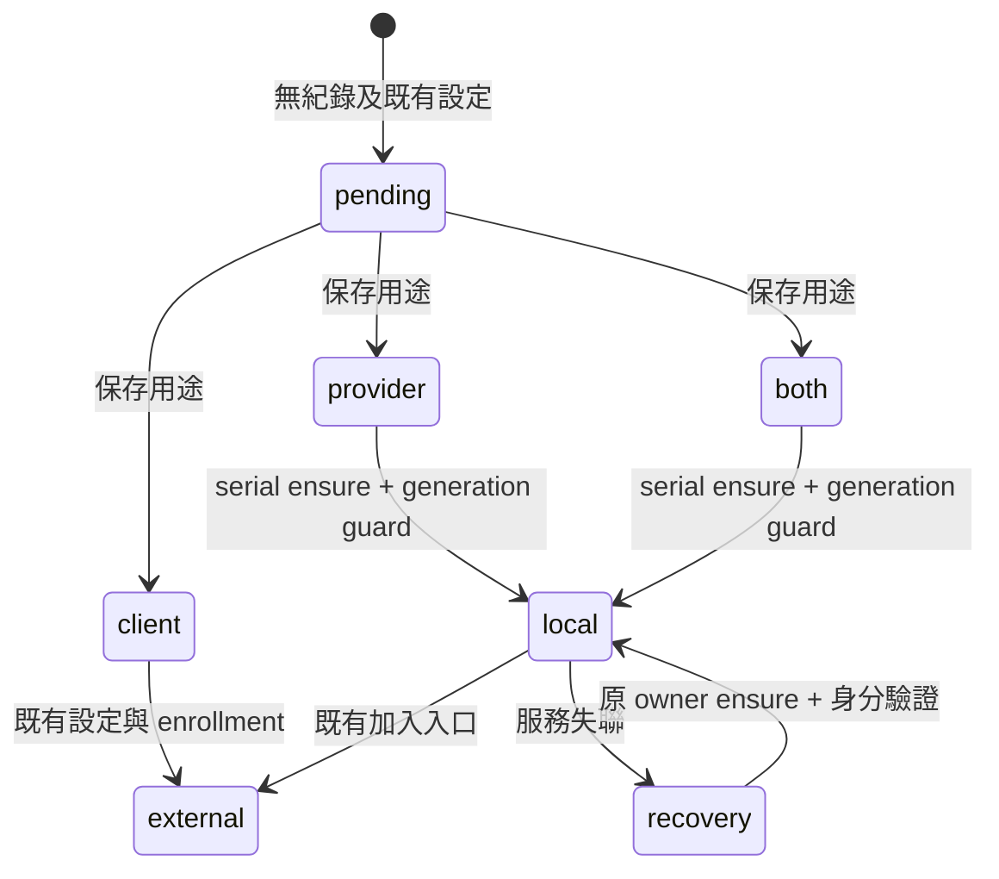

# Public Windows Fleet configuration

[Windows guide](../windows.md) · [繁體中文摘要](#繁體中文設定摘要)

「加入機器」的共用契約及已實作用途選擇、連線預覽、來源政策、純產生器與逐檔發布核心（native apply 與 UI 接線尚未完成）見[下方章節](#加入機器共用契約)。下列手動設定
仍作現有格式的參考；新流程的完成條件是退休重複填寫，不是另加一份設定表單。

The packaged Windows client contains the Rust Fleet runtime. A new installation can
use the public [configuration example](../../desktop/fleet.example.json) and
[example data directory](../../desktop/fleet.example/README.md) without another repository,
PowerShell Fleet scripts or VBS launchers. Windows OpenSSH and BAT remain separate
installed tools. This is the optional native connection layer; the bundled central
and shared Web Dashboard do not require Fleet configuration.

## New Rust installation

1. Copy `desktop/fleet.example/client` into a new private local directory, for example
   `C:\Tools\ConnectorFleet\client`. Use a directory controlled by your Windows account.
   Do not overwrite an existing Fleet installation or its ownership records.
2. Edit the three example files below for **your** BAT host. The documentation-only
   `192.0.2.10` address, SSH user and fingerprint placeholder cannot connect to a real
   deployment. The placeholder fingerprint intentionally fails profile validation.
3. Make the reviewed aliases available to Windows OpenSSH. The native SSH command uses
   your normal `%USERPROFILE%\.ssh\config`; it does not pass `-F`. Add an explicit
   `Include C:/Tools/ConnectorFleet/client/ssh-config` there, or keep matching literal
   host entries in both files. Preserve existing SSH settings. Verify the server's
   host key and that the alias works noninteractively with your chosen key before
   enabling its Fleet connection. Fleet neither creates keys nor approves host keys.
4. In BAT, configure the matching remote profile and its token using BAT's own trusted
   connection setup. Match the profile ID, tunnel loopback address/port, remote workspace
   profile ID and certificate fingerprint to the example index. Fleet checks the live
   BAT profile against this index; editing only the Fleet index cannot establish trust.
5. Save the example `fleet.json` in `%APPDATA%\io.betteragent.dashboard\fleet.json`,
   beside `central.json`, with the actual local root and explicit `"backend":"rust"`.
   `kit_root` is a compatibility field name for this configuration root; no Kit checkout
   is needed. Keep the `client` subdirectory. Absolute local paths are required; mapped
   network drives, UNC and device paths are refused.
6. Reopen Dashboard and inspect **Connection / Fleet**. Review background connections,
   BAT windows and Dashboard separately before starting. Validate configuration and
   read distinct tunnel, TLS, BAT and central readiness results. Startup is optional:
   preview and apply the Rust login choice through the existing native controls.

The initial example defines one BAT host and disables the external-central route
(`connector.ssh_alias: null`). The bundled central's normal **Open Dashboard** flow is
independent. To use Fleet's external-central connection or Dashboard selection, add
an explicitly trusted SSH alias, set its loopback forwarding endpoints, and configure
its separate observe-only credential as described below. Do not reuse the bundled
central's mutation credential or choose an already occupied local listener.

## Files and schema

All JSON uses UTF-8, exact field names and no duplicate keys, including case variants.
Unknown inventory fields refuse. See the public
[parser](../../desktop/fleet-core/src/inventory.rs) for bounded validation and the
[configuration loader](../../desktop/fleet-core/src/configuration.rs) for byte binding.

| File | Contents and required relationship |
| --- | --- |
| `fleet.json` | `kit_root`: absolute root containing `client`; `backend`: explicit `rust` for a new standalone installation. Omitted backend means legacy PowerShell. |
| `client/fleet-inventory.json` | Version-1 inventory with `fleet_version`, `direct_probe_ms` (1–5000), `cloudflare_access_hosts`, `credentials`, `fingerprints`, nonempty `hosts`, `provisioning_profiles`, and `connector`. |
| `client/bat-profiles/index.json` | `profiles` and `activeProfileIds`. Each selected remote profile has `id`, `type: "remote"`, `remoteHost`, `remotePort`, `remoteProfileId` and a trusted `remoteFingerprint` (64 hex digits or colon-separated SHA-256). IDs and endpoint/pin values must match the inventory and live BAT profile. No token belongs here. |
| `client/ssh-config` | Literal `Host` aliases referenced by inventory routes. This file and the user's SSH config are bound into the configuration snapshot. The validator does not expand `Include` directives. |

Each `hosts` entry has these fields:

| Fields | Meaning |
| --- | --- |
| `name`, `profile`, `label` | Stable logical host ID, BAT profile ID and display label. Host names/profile IDs are unique ignoring case; `connector`/`default` are reserved. |
| `local`, `target` | Client IPv4 loopback `address:port` and the BAT endpoint reached from the SSH server. Each BAT host needs a distinct local loopback address. |
| `probe`, `routes`, `provision_route` | Optional top-level probe (`null` allowed); ordered routes (`direct`, `lan`, `cf`) with a literal SSH `alias`; and one configured route kind. `lan` needs a probe endpoint. `direct` is the Tailscale route, requires a `100.64.0.0/10` IPv4 probe, and must match the top-level probe. `cf` needs `access_host` listed in `cloudflare_access_hosts`; configure its SSH ProxyCommand separately. No fallback route is invented. |
| `bat` | `remote_profile_id`, `credential_ref`, `fingerprint_ref`, `protocol: "bat-remote/v2"`, and `min_version`. Credential/pin references must resolve to the same BAT profile. |
| `workspace_bindings` | Array of `{id, workspace_id, required}` using actual BAT workspace IDs; empty is allowed. |
| `connector_endpoint` | Optional additional BAT endpoint metadata (`null` in the example); when present requires `endpoint`, `remote_profile_id`, `credential_ref`, `fingerprint_ref`. This is separate from the central HTTP connector below. |

`provisioning_profiles` lists every host's profile exactly once. `credentials` maps
logical references to `{kind:"bat-profile-token", profile_id}` or
`{kind:"windows-dpapi", name}`. `fingerprints` maps references to
`{kind:"bat-profile-pin", profile_id}`. No literal token or private key is stored in
these documents.

The `connector` object requires `name:"connector"`, `label`, `local`, `target`,
`ssh_alias` (a configured literal alias or `null`), `dashboard_path`, `credential_ref`,
`supported_api_versions:[1]`, `min_contract_version`, and nonempty `required_features`.
The example's required features are `inventory` and `events_stream` with contract
`2026-10-08`. A configured central credential must reference `windows-dpapi` and its
API identity must have **exactly observe scope**. A running service or listening port
alone does not establish API readiness.

## Durable configuration publisher — native core only

[`connection_publish::Publisher`](../../desktop/fleet-core/src/connection_publish.rs)
is the single writer for a `connection_setup::build()` plan. It resolves kit files
through `Artifact::location()` and takes the separate native application-data
`fleet.json` path from its caller. It retains migration's existing launcher and
monitor guards in that order (Windows `LauncherMutex` / `MonitorMutex`, also used
by installation), checks `migration::Store::pending()`, current login and monitor
absence, and requires fresh `FileOwnership::Owned` evidence before each effect.
An absent file still needs independent creation authority. The mandatory native
adapter must re-read creation evidence and prove protected state ancestors; this
core supplies no path-based ownership adapter or enrollment flow.

Publication refuses a symlinked or reparse-point ancestor of any kit, pointer,
startup or user path, checking all ancestors up to the filesystem root, with
`connection_publish::Error::Gate("MIGRATION_INVALID_PATH")`. `Snapshot::load`
resolves such ancestors for reading, so an installation that loads may still be
refused for publication. That installation keeps the manual configuration path.

Publication writes one file at a time in plan order. Before publishing the pointer,
the three kit files must match their output digests and pass `Configuration::load`
together, including an empty issues list. These checks repeat before and after
staging the pointer. `Snapshot::load` verifies the final installation. External
SSH files are read by the existing loader and never written. Plans keep an internal
binding from `build()` so changing public inspection fields cannot re-author a review.

The migration-journal pattern is reused alongside the native pointer:
`fleet-publications/<review_digest>.json`. Each bounded, versioned journal retains
the full step sequence and one receipt per reached step, including version, review
digest, generator version, artifact, before/after digest, owner and `intended` or
`published` state. Receipts are written before replacement and after matching
read-back. POSIX directories/files are 0700/0600; Windows uses a protected
owner/SYSTEM DACL with explicit current-user ownership, and refuses existing broad
ACLs or reparse points. Creation evidence and native ancestor privacy remain
separate mandatory checks, not properties inferred from these permissions.

The same plan resumes from disk bytes: after bytes reconcile a lagging receipt;
before bytes permit replacement; any third bytes stop with `ThirdBytes { artifact }`
and retain completed receipts. An unfinished journal, including the gap between
two steps, blocks a different review with `UnfinishedPlan { review_digest }`.
The `fleet-publications` directory permits at most 1024 entries; beyond that,
publication refuses with `ReceiptConflict`. Completed journals remain available;
their retention policy is follow-up work. The shared `compare_replace` primitive also
serves profile, migration and supervisor writes, preserving their error codes,
read policies and creation/deletion behavior. Each replacement is durable on its
own; neither a cross-file transaction nor a filesystem compare-and-swap against a
non-cooperating editor is claimed.

This module has no Tauri/IPC, UI, Python, durable-operation participant, enrollment,
startup, tunnel or monitor-launch wiring. The native ownership adapter and live
acceptance remain follow-up work. Linux fixtures run real generator/loaders and
filesystem IO with synthetic native ownership/lock authorities. Windows CI's
**Fleet contracts and owned Windows fixtures** additionally exercises real DACL,
owner/reparse and replacement behavior; Linux tests do not prove those semantics.

Recovery remains native-only: `publish_authorized` checks caller authority before
artifact directory creation, each artifact effect and both replacement guards;
`Authorization { code }` stops effects while private evidence remains writable.
`inspect` reads all four states without modifying artifacts or journals.
`abandon_remaining` creates one immutable decision under
`fleet-publication-decisions/<review>/`, binding the journal hash, native scope,
caller reference/time and observations; the original journal stays unchanged.
A valid decision permits a fresh review, still subject to ownership and byte checks.
Older publishers ignore this sibling directory and keep blocking: safe mixed-version
behavior. `export_plan`/`load_plan` use private, create-only `fleet-publication-plans`
snapshots (version 1, at most 32 MiB), retaining complete original generator inputs.
Reload verifies the saved file hash, supported generator, input hash, review and
rebuilt outputs before recovering the seal. These files never enter frontend diagnostics.

**復原摘要：** 授權回呼在建目錄、逐檔效果及替換 guards 內檢查，拒絕後仍可記錄
私有證據；inspect 完全唯讀。放棄決策綁定原 journal 雜湊、native 範圍、呼叫端
參照／時間及觀察，另存不可覆寫的 sibling 記錄，不改原 journal 或第三種內容。
有效決策才允許新審閱，仍須重證 ownership；舊版忽略該目錄並繼續阻擋。
私有 frozen plan 上限 32 MiB，保存完整原輸入；重載須核對檔案與輸入雜湊、支援的
generator、review 及重建輸出，不能由公開欄位取得 seal，也不提供給前端診斷。

**繁體中文摘要：** 發布核心沿用既有安裝／遷移 guards 與 pending gate，持鎖重查
建立證據、owner 和目前位元組，逐檔寫入 intended／published 回執。第三種內容立即
停止；同 plan 依磁碟恢復，未完成 plan 阻擋另一份審閱。三個 kit 檔讀回並通過既有
loader 後才寫 native application-data 指標。kit、指標、startup 或使用者路徑直到
檔案系統根目錄的任一祖先若是 symlink／reparse point，發布即以
`connection_publish::Error::Gate("MIGRATION_INVALID_PATH")` 拒絕。
`Snapshot::load` 讀取時會解析這些祖先，因此能載入的安裝仍可能無法發布，須保留
手動設定路徑。`fleet-publications` 最多容許 1024 個目錄項目，超過即以
`ReceiptConflict` 拒絕；已完成 journal 的保留政策仍待後續實作。一般使用者流程
仍待接線；不宣稱 E01／E03／E11、R0–R5 或 A01–A40 的實機驗收完成。

## Pure configuration generator — implemented; native apply and UI wiring pending

The native-only [generator](../../desktop/fleet-core/src/connection_setup.rs) accepts a
reviewed setup: a selected [BAT catalog](bat-source-catalog.md) profile with admission
policy 1, credential/pin reference keys, an explicit literal SSH `Host`/`LocalForward`
association, an authorized route reference, stable workspace bindings, label and four
independent preferences (background connections, BAT windows, Dashboard, login).
The caller supplies the protected installation root, exact existing bytes/digests,
creation/owner evidence, configured BAT addresses and listening IPv4 sockets. The generator does no IO,
enrollment, environment expansion or process execution, and accepts no token body.

| Output | Generated or preserved source (A); remaining user choice (U) |
| --- | --- |
| `fleet.json` | A: native-selected root and explicit Rust backend for a new installation; an existing root/backend, including omitted legacy backend, stays unchanged. The pointer belongs at the existing native application-data location, separately from `kit_root`. |
| `client/fleet-inventory.json` | A: stable host/reference keys, catalog profile/remote profile, `source_policy:1`, explicit forwarding local→target, reviewed route/probe/access-host, supplied binding IDs and workspace IDs, derived provisioning profiles, shipped compatibility policy. U: label, authorized profile/route/workspaces and `required`. Existing policy and `connector_endpoint` metadata are retained. New external Connector routes stay inactive: null alias and explicit parser-required template values, including an inactive DPAPI reference, are not live endpoints or enrolled credentials. |
| `client/bat-profiles/index.json` | A: selected catalog profile, endpoint/pin and BAT metadata (`remoteProfileName`, `createdAt`, `updatedAt` when present); existing root metadata and unrelated profiles are retained. U: the selected BAT window independently controls its `activeProfileIds` membership. No BAT live index is written. |
| `client/ssh-config` | A: an owned alias-only validation/reference artifact, with no copied key, login, forwarding or security directives. Existing bytes are retained as a prefix; every external SSH byte remains with its original authority. No manual `Include` is needed by this artifact. |

Compatibility values come from the [shipped inventory example](../../desktop/fleet.example/client/fleet-inventory.json)
at compile time: only `fleet_version`, BAT `min_version`/`protocol`, `direct_probe_ms`
and Connector `local`, `target`, `dashboard_path`, `supported_api_versions`,
`min_contract_version` and `required_features`. This keeps one policy authority without
importing example hosts, credentials, fingerprints or aliases.

The deterministic plan contains all four bounded outputs as bytes plus SHA-256,
source bindings, independent preferences, a review digest and ordered single-file
steps with before/after digests and owner evidence. Existing JSON with no semantic
change retains its exact bytes; already-applied inputs yield no publication steps.
The installation pointer is last, after inventory/profile/alias cross-validation.
`ArtifactLocation` distinguishes `KitRelative` paths from `InstallationPointer`;
the publisher must resolve the latter through the native application-data authority.
Preferences are returned for the existing selection/startup owners; only BAT window
membership is represented in these four files. There is no cross-file transaction,
receipt persistence or automatic resume in this module.

Typed gaps return **no plan**: missing mapping, duplicate forwards, unavailable or
ambiguous profile/credential, profile/endpoint mismatch, an allocation requiring sourced
mapping changes, unproven forward completeness, occupied endpoint, exhausted
pool, changed source/review, unknown owner, reference-only file requiring modification,
identity change, invalid input/output, and unsupported SSH syntax/Include/Match or
reader bounds/encoding. The reader allows at most 1 MiB, 8,192 lines and 4,096 bytes per
line. It never follows Includes (including cycles), evaluates Match or calls `ssh -G`.
`Include`, `Match` and a global `LocalForward` refuse the whole source. Literal `Host`
name lists share a block; all blocks naming the selected alias contribute forwards.
An unrepresentable selected forward gives `UnsupportedSshSyntax`, otherwise multiple
forwards give `DuplicateForwards`. Unsupported forwards for other literal aliases
stay reference-only. Patterns, negation, quotes and other unrepresentable `Host` lines
are never evaluated: without forwards they do not affect selection; with any forward
they give every association `ForwardCompletenessUnproven`. A `#` starts a comment
only at the start of a line or whitespace-separated token, so `Host foo#bar` cannot
create an association for `foo`. All original external SSH bytes remain unchanged.
Handwritten files remain references; the current fixed loaders cannot consume a new
overlay for a required edit, so that case stops with `ReferenceOnly` instead of adoption.

Allocation policy 1 scans `127.0.0.2`–`127.0.0.254`, retaining the reviewed service port
and excluding configured BAT addresses. Other BAT hosts reserve their whole address,
as required by the inventory. Listeners conflict only on the same address and port,
or `0.0.0.0` on the same port; adapters map dual-stack `[::]:port` listeners to
`0.0.0.0:port`. The Connector reserves only its exact local address and port. These
rules apply to building, allocation and preview recheck. `.1` is reserved for new
allocation only: Preserve can retain a proven `127.0.0.1:19001` forward, while the
inactive Connector's exact `127.0.0.1:19796` endpoint conflicts.

Allocation requires a proven profile/forward pair. A proposed address differing from
that pair gives `AllocationRequiresSourcedMapping`, even though the existing profile
and forward match each other. It stays a proposal until sourced changes to both exist;
allocation does not create a profile or rewrite SSH. Preview recheck reports a conflict
without selecting a replacement. Every plan is **reference-route only**: current SSH
launch adds `-L`, so native wiring must settle the duplicate-listener boundary before
publication/activation. Independent observe-handle enrollment, safe overlay consumption,
native apply wiring, preference persistence and UI remain open. The publication/readback core above is implemented.

**繁體中文狀態：產生器與上方的逐檔發布核心已實作；native apply 與 UI 接線尚未完成。**
四檔由已審來源及版本化政策產生，缺關聯回傳具型別缺口，不猜 endpoint、不接管手寫檔。
使用者仍選標籤、既有 profile／route／workspace 與四種獨立偏好；一般安裝流程的手填
步驟尚未退休。測試以合成資料驗證正式 loaders；Tauri sanitizer
(`src-tauri/src/fleet.rs`) 不在 fleet-core，產生 inventory 的 status-golden 檢查留待接線。
本節不宣稱 Windows、真 BAT／SSH 或 E01／E03／E11、R0–R5／A01–A40 驗收完成。

占用規則依權責分開：其他 BAT 主機保留整個位址；監聽器只在位址與 port 相同，或
`0.0.0.0` 的 port 相同時衝突。呼叫端將雙棧 `[::]:port` 映射為 `0.0.0.0:port`。
Connector 只保留其 local 的精確位址與 port。建置、配置與預覽重查使用相同規則；
新配置仍只從 `127.0.0.2`–`127.0.0.254` 選擇，Preserve 可保留已證實的
`127.0.0.1:19001`，但不可占用 Connector 的 `127.0.0.1:19796`。
若新提案與已匹配的 profile／forward 不同，回傳 `AllocationRequiresSourcedMapping`，
直到兩者都有來源可證的變更；重查衝突不會暗中改選位址。

SSH reader 接受多個 literal 名稱的 `Host`，並彙集所有命名所選 alias 的區塊。
所選 alias 的不可表達 forward 回傳 `UnsupportedSshSyntax`；否則多個 forward
回傳 `DuplicateForwards`。其他 literal alias 的不支援語法僅保留為參照。
pattern、否定、引號等不可表達的 Host 不會被求值：沒有 forward 時不影響關聯；
有任一 forward 時，所有關聯都回傳 `ForwardCompletenessUnproven`。
`Include`、`Match` 與首個 Host 之前的全域 `LocalForward` 仍拒絕整份來源；
大小、行數、行長及編碼界限不變。`#` 只在行首或空白分隔的 token 開頭形成註解，
不會將 `foo#bar` 截成 `foo`；外部 SSH 位元組完全保留。

初始 inventory 的相容性欄位在編譯時從出貨範例擷取上述白名單，避免重複維護政策；
不複製範例主機、credential、fingerprint 或 alias。`ArtifactLocation` 分別標示
kit 相對路徑與安裝指標；後者必須由 native application-data 權責解析，不能接到 kit root。

## Credentials and optional bootstrap

Fleet reads the current BAT data directory under `%APPDATA%\BetterAgentTerminal`,
or the legacy `%APPDATA%\org.tonyq.better-agent-terminal` when the former is absent.
It never searches another profile or falls back to a Dashboard credential. BAT tokens
use the existing supported `profiles/remote-tokens.enc.json` format: `enc:false` and
string `data` containing a `tokens` map. An encrypted or unsupported store reports
unavailable; do not overwrite a user's BAT store to bypass that result. The live
`profiles/index.json` remains the independent source for profile drift checks.

For an optional external central, issue a separate observe token on that central:

```sh
batc api-token issue --actor fleet-observer --scope observe
```

Store that token on Windows under the same account that runs Fleet. This public
PowerShell command writes the supported DPAPI CurrentUser format without printing
or putting the token in command history. Set `$fleetData` to the **existing selected**
BAT data directory; do not create a competing data root. For the example credential
name, run:

```powershell
$fleetData = Join-Path $env:APPDATA 'BetterAgentTerminal'
if (-not (Test-Path -LiteralPath $fleetData -PathType Container)) { throw 'Select the existing BAT data directory first' }
$fleetCredentials = Join-Path $fleetData 'fleet-credentials'
New-Item -ItemType Directory -Force -Path $fleetCredentials | Out-Null
$fleetSecret = Read-Host 'Separate central observe token' -AsSecureString
try {
    $fleetProtected = ConvertFrom-SecureString -SecureString $fleetSecret
    [IO.File]::WriteAllText((Join-Path $fleetCredentials 'connector-observe.dpapi'), $fleetProtected, [Text.Encoding]::ASCII)
} finally {
    $fleetSecret.Dispose()
    Remove-Variable fleetSecret, fleetProtected -ErrorAction SilentlyContinue
}
```

Do not use this command to replace an existing credential without reviewing the
selected central and principal. [Credential contract](fleet-credentials.md).

Cold bootstrap is optional and disabled without a local recipe. Its public server
implementation is [fleet_bootstrap.py](../../src/bat_agent_connector/fleet_bootstrap.py)
with [the fixed entry script](../../scripts/bat-connector-bootstrap-v1). Follow the
[bootstrap deployment contract](fleet-bootstrap.md#fixed-linux-server-guard) to
install that module in the fixed interpreter, deploy the helper at the fixed path,
and bind an already initialized systemd user service, journal, lock and protected
recipe. It does not require a private repository. It never creates a replacement
central after a failed probe, and this guide does not imply a helper is installed.

## Existing PowerShell installations

Keep existing configuration and ownership evidence. An omitted `backend` still
selects PowerShell and requires the existing `client/fleet-desktop.ps1` facade.
PowerShell monitor migration additionally requires `bat-connect.ps1`; its login
shortcut requires `Open BAT.vbs`. These are optional externally supplied legacy
components, not files shipped by the standalone Rust example. Use the native
migration flow to change an existing owner; do not hand-edit its backend or delete
its monitor records. Rust-to-PowerShell requests without the required legacy files
fail before configuration/startup publication. Foreign or unprovable shortcuts and
processes remain untouched.

## 繁體中文設定摘要

新的 Windows Rust Fleet 可直接使用本 repo 的公開範例，不需其他 repository、
PowerShell Fleet scripts 或 VBS launcher。這是選用的連線管理層；包內中央與 Web
Dashboard 不需要先設定 Fleet。

1. 將 `desktop/fleet.example/client` 複製到自己控制的本機目錄，例如
   `C:\Tools\ConnectorFleet\client`，不要覆寫既有 Fleet。
2. 在 inventory、profile index 與 SSH 設定填入自己的主機、profile ID、loopback
   位址／port 與可信憑證指紋。`192.0.2.10` 與指紋文字是不能直接使用的範例，
   指紋未替換時驗證會失敗。範例不包含私人主機或任何 token。
3. 在 `%USERPROFILE%\.ssh\config` 加入明確的
   `Include C:/Tools/ConnectorFleet/client/ssh-config`，或保持兩份設定內的實際
   alias 一致。先自行核對 SSH host key 與非互動金鑰登入；Fleet 不建立金鑰或批准信任。
4. 用 BAT 自己的設定建立相符連線 profile 與 token；Fleet 會核對 BAT 實際 index
   與 token store，不能只改 Fleet index 就視為已連線或已信任。
5. 將 `fleet.example.json` 另存於
   `%APPDATA%\io.betteragent.dashboard\fleet.json`，填入實際 `kit_root`，明確保留
   `"backend":"rust"`。`kit_root` 是相容欄位名稱，不表示需要 Kit checkout。
6. 重開 Dashboard，在「連線／Fleet」檢查設定，分別選擇背景連線、BAT 視窗與
   Dashboard，再預覽／啟動。登入啟動也透過原生預覽與套用，不手改既有 owner。

範例的外部中央 SSH alias 是 `null`，不啟用外部中央路由。包內中央的「開啟 Dashboard」
維持獨立。需要 Fleet 連至外部中央時，另配可信 SSH alias、未占用的 loopback port
及**只有 observe 權限**的獨立 token；上面的 PowerShell 範例可保存成目前帳號的 DPAPI
格式，不需私人安裝工具。BAT 加密 token store 不在目前讀取格式內，會如實顯示不可用，
不要覆寫 BAT 的資料來繞過檢查。

已有 PowerShell Fleet 時保留原設定，未指定 backend 仍是 PowerShell。切換須沿用
原生遷移與擁有權檢查。只有選用舊 backend 才需要外部的 PS／VBS 檔案，公開 Rust
範例不附帶它們。自動啟動遠端中央的 helper 與 recipe 另依公開 bootstrap 合約配置；
缺少設定不會偷偷建立新服務或新資料庫。

## 加入機器：共用契約

新桌面安裝已實作在準備本機 Connector 前選擇用途；下方用途表與 D1 列記錄此邊界。
完整共用精靈仍尚未實作；已實作的 managed setup 連線預覽子集見下表，D3 來源政策見決策表與可信來源表。
解除連線、停止自有服務、共用設定 writer 與實機驗收仍未完成。
`file:line` 引用依合併後程式核對。「現況」表示程式可證實；
「規範」表示後續驗收要求；2026-10-22 經 owner 授權由整合者決定 D1＝A、D6＝A、D8＝A，
D2／D4／D5／D7 的整合者技術預設維持原文；D3 僅下列來源讀取部分已實作，不代表 enrollment 或實機驗收完成。
已決定項目仍須逐項區分實作與驗收。
本節沿 E01／E03／E11、T3／T8、K02／K08／K16 接續，不增加平行 backlog。

### 已實作：managed setup 的連線預覽

| 範圍／驗收列 | 現況與可測契約 |
| --- | --- |
| personal 安裝的 `setup.host` | `GET /managed/setup` 宣告 `preview_contract_version:1`；`POST /managed/setup/preview` 沿用 `manage` 與原安裝 personal identity，只接受 action／target／params／preconditions。共用候選 builder 驗 revision、busy、來源及 parser roundtrip，預覽不建立 operation、不寫設定、不執行 BAT／SSH probe。[api_v1.py:255](../../src/bat_agent_connector/api_v1.py#L255)、[managed_setup.py:374](../../src/bat_agent_connector/managed_setup.py#L374)、[managed_setup.py:403](../../src/bat_agent_connector/managed_setup.py#L403) |
| 預覽 → 明確套用 | 回傳語意 before／after、來源引用及效果界線；不回傳 TOML、token 或解析後的私密憑證路徑。`review_digest` 綁版本、server／principal／actor、原請求及 before／after revisions；Apply 在建 operation 前重算並拒絕 `SETUP_REVIEW_CHANGED`。舊客戶端仍可只送 `config_revision`；repository／verification 不接受此 digest。[managed_setup.py:396](../../src/bat_agent_connector/managed_setup.py#L396)、[managed_setup.py:403](../../src/bat_agent_connector/managed_setup.py#L403)、[managed_setup.py:441](../../src/bat_agent_connector/managed_setup.py#L441) |
| 新畫面的取消與失效 | 「Review connection／預覽連線」後才可「Apply connection／套用連線」；預覽只在記憶體，欄位、來源、revision 或身分改變及重開即失效。取消不送 operation、不儲存連線；已貼入的憑證可先經既有 staging，畫面另列已發生的暫存與到期清理界線。未宣告版本的 Connector 顯示需更新，沒有 legacy 自動套用 fallback。[managed-setup.js:568](../../desktop/src/managed-setup.js#L568)、[managed-setup.js:574](../../desktop/src/managed-setup.js#L574)、[managed-setup.js:647](../../desktop/src/managed-setup.js#L647)、[managed_setup.py:191](../../src/bat_agent_connector/managed_setup.py#L191) |
| 套用／回覆遺失／半失敗 | Apply 才保存原 request／key，沿用既有 `setup.host`、`managed_configuration` 與 after／before／第三值對帳；已知 operation ID 只 GET，未知 ID 用同 request／key 查回。不得以歷史成功推導即時 BAT readiness。[managed-setup.js:604](../../desktop/src/managed-setup.js#L604)、[managed-setup.js:633](../../desktop/src/managed-setup.js#L633)、[managed_setup.py:630](../../src/bat_agent_connector/managed_setup.py#L630)、[managed-setup.js:39](../../desktop/src/managed-setup.js#L39) |
| 自動驗收界線 | 真實 API、暫存 managed 安裝、正式 candidate 與 journal 驗證零預覽效果、過期拒絕、原 key、收據遺失、第三值退避與 no-op；共用 golden 由正式 preview producer 去識別產生，再由雙語 browser fixtures 消費。這些是 CI 替身證據，不能當實機驗收。[test_managed_setup_preview.py:1](../../tests/test_managed_setup_preview.py#L1)、[test_managed_setup_preview_golden.py:1](../../tests/test_managed_setup_preview_golden.py#L1)、[setup-connection-review.spec.ts:1](../../desktop/tests/setup-connection-review.spec.ts#L1) |

D1 的服務準備前角色入口已實作；四檔重複輸入的退休、native apply 與 D8 實機驗收仍為**已定，尚未實作／驗收**；
此子集不新增 action、scope、DDL、data step 或啟動行為。[managed_setup.py:708](../../src/bat_agent_connector/managed_setup.py#L708)

### 現況：兩條入口與邊界

| 入口 | 實際資料流與限制（現況） | 收斂規範 |
| --- | --- | --- |
| Windows Fleet | `fleet.json` 載入安裝根目錄；native 再讀 inventory、設定用 profile index、Fleet SSH 與使用者 SSH 的原始 bytes。[installation.rs:120](../../desktop/fleet-core/src/installation.rs#L120)、[configuration.rs:170](../../desktop/fleet-core/src/configuration.rs#L170) | 入口共用下述意圖、預覽與收據；一般路徑不再手改四檔。 |
| 首次設定（#319 路徑） | 共用 UI 選可讀 token 的 BAT profile，無可用項目時要求使用者貼連結；`setup.host` 寫 managed 安裝的 `config/hosts.toml`，不是 Fleet inventory。[managed-setup.js:360](../../desktop/src/managed-setup.js#L360)、[managed_setup.py:66](../../src/bat_agent_connector/managed_setup.py#L66)、[managed_setup.py:630](../../src/bat_agent_connector/managed_setup.py#L630) | 沿用同一來源選擇與驗證，不另做 BAT 登入或 profile store。 |
| 既有中央 | native 外部中央設定與 credential enrollment 是獨立邊界；現有 `central.json` 不可被首次設定入口覆寫。[bridge.rs:981](../../desktop/src-tauri/src/bridge.rs#L981) | BAT 連線網址不得被解讀為 Connector 中央網址；純 client 依 D1 在本機服務準備前進入既有加入入口。 |

### 責任表與退休條件

維護責任以下列模組角色分配；具名負責人依 D8 由整合者私下保存，共同核心
只由同一整合者合流。每列的「退休」都是完成後的要求，不宣稱本輪已移除程式。

| 事實／維護責任 | 現行權威及重複／推論點（現況） | 收斂後契約、可退休項目（規範） |
| --- | --- | --- |
| 可驗證身分／Connector 認證維護者 | Python journal 產生 server／principal 身分；native 以 credential 驗證 capabilities 與 bootstrap。Fleet 的 BAT pin／profile 是另一種信任證據，不能當中央身分。[dashboard_sync.py:81](../../src/bat_agent_connector/dashboard_sync.py#L81)、[bridge.rs:1203](../../desktop/src-tauri/src/bridge.rs#L1203)、[supervisor_probe.rs:89](../../desktop/fleet-core/src/supervisor_probe.rs#L89) | 身分與 endpoint／route 分離；相同名稱、port 或 `server_id` 字串不單獨授權重綁。退休各畫面以位址推定同身分的邏輯；v1 換址／換 pin 不重綁（D4 預設）。 |
| 已加入機器與信任／setup 契約維護者 | `setup.host` 與 Fleet inventory 各保存主機／profile 關聯；Fleet 還比對 BAT live index。setup 只接受原安裝 personal identity 的 manage 權限。[managed_setup.py:53](../../src/bat_agent_connector/managed_setup.py#L53)、[managed_setup.py:246](../../src/bat_agent_connector/managed_setup.py#L246)、[inventory.rs:251](../../desktop/fleet-core/src/inventory.rs#L251)、[supervisor_probe.rs:114](../../desktop/fleet-core/src/supervisor_probe.rs#L114) | 同一受保護設定協調入口保存一次意圖，各 consumer 引用；退休手填相同 ID／pin／endpoint。BAT 管登入及 profile，SSH 管 host trust；寫入界面待 D2／D3。 |
| 執行位置與 routes／來源服務及 native transport 維護者 | Fleet 從 inventory 產生本機 SSH routes；setup 的 Git transport 另外保存 execution binding。兩者不是工作位置的替代證明。[route.rs:44](../../desktop/fleet-core/src/route.rs#L44)、[managed_setup.py:445](../../src/bat_agent_connector/managed_setup.py#L445)、[managed_setup.py:659](../../src/bat_agent_connector/managed_setup.py#L659) | 工作固定在已選服務／workspace；只在明確配置的路線內選擇。退休把 SSH alias、Tailscale peer 或本機 loopback 當 workspace／權限的推論；不新增自動替代路線。 |
| 本機程序 lifecycle／平台 lifecycle 維護者 | managed `ensure` 用 launcher／service lease；Fleet supervisor／tunnel 另有 ownership 與 migration gate，不能互相取代。adapter 未確認退出回 `STOP_UNCONFIRMED`。[managed_runtime.py:257](../../src/bat_agent_connector/managed_runtime.py#L257)、[fleet_native.rs:171](../../desktop/src-tauri/src/fleet_native.rs#L171)、[windows_tunnel.rs:113](../../desktop/fleet-core/src/windows_tunnel.rs#L113)、[windows_tunnel.rs:62](../../desktop/fleet-core/src/windows_tunnel.rs#L62) | 每種資源只經其正式 ensure／stop owner；退休 UI 自行 spawn、以 PID 或 port 猜所有權的修復。缺乏 exit 證據不得另啟；平台承諾須通過 D8 的五事件驗收。 |
| health／capabilities 投影／共用讀取契約維護者 | Fleet 有逐層 readiness；setup 有近期 inventory evidence；Work 有細分能力；標頭使用 `centralServiceStatus` 的 Connector 連線投影。[supervisor_status.rs:60](../../desktop/fleet-core/src/supervisor_status.rs#L60)、[managed_setup.py:144](../../src/bat_agent_connector/managed_setup.py#L144)、[pm_work_profiles.py:550](../../src/bat_agent_connector/pm_work_profiles.py#L550)、[app.js:1032](../../desktop/src/app.js#L1032) | 共用下述投影及文案，不用一個 socket bool 代表全部能力。退休每個畫面各自把未知／拒絕寫成離線；投影傳輸形式待 D7。 |
| 發布／安裝／執行版本／release 與 runtime 維護者 | release parser 驗 manifest；updater status 報 installed 與 next_launch；managed Launch 回報 runtime_version；native build info 另有 desktop version／commit。[update_release.py:88](../../src/bat_agent_connector/update_release.py#L88)、[updater.py:285](../../src/bat_agent_connector/updater.py#L285)、[managed.rs:90](../../desktop/src-tauri/src/managed.rs#L90)、[diagnostics_files.rs:10](../../desktop/src-tauri/src/diagnostics_files.rs#L10) | 診斷並列發布、磁碟安裝、執行中三份證據；缺少就標未知。退休以 release 或安裝成功推定目前程序版本的單欄顯示。 |
| 已排指令與工作執行 | 本輪不動 | 本輪不動。 |
| CLI transcript／turn／diff | 本輪不動 | 本輪不動。 |
| 需求接受與 PM 建議 | 本輪不動 | 本輪不動。 |

### 欄位來源與讀寫責任

分類：**A**＝程式由已授權來源取得或由版本化規則產生；**U**＝使用者選擇；
**R**＝退休手填或重複輸入。R 不代表刪 schema 欄位。A 缺可信來源時必須停在
「需要資料」，不得猜值。下表「擬寫」是提案 writer，不是現有寫入 API；
既有安裝先讀取，無變更則保持原值。四檔仍須符合現行 parser（含必要的空值）。

| 檔案／完整欄位集合 | 分類與來源（規範） | 寫入者 → 引用者；現況依據 |
| --- | --- | --- |
| `fleet.json`：`kit_root` | A／R：native 受保護安裝位置，不要求使用者輸入；既有路徑不搬移 | 現為外部配置；擬由 native 協調寫 → `Snapshot`；只接受本機安裝布局。[installation.rs:16](../../desktop/fleet-core/src/installation.rs#L16)、[installation.rs:120](../../desktop/fleet-core/src/installation.rs#L120) |
| `fleet.json`：`backend` | A／R：新配置明定 Rust；既有 backend 只走 migration，不因加入而轉換 | 擬寫 native／既有 migration → installation；省略目前代表 PowerShell。[installation.rs:10](../../desktop/fleet-core/src/installation.rs#L10)、[migration.rs:398](../../desktop/fleet-core/src/migration.rs#L398) |
| inventory：`schema_version`、`fleet_version`、`direct_probe_ms` | A／R：版本化產生器與既有設定；probe 預算不由健康錯誤自行放大。`fleet_version` 的版本常數依 D5 預設 | 擬寫 native 設定協調 → inventory validator；route 讀 probe budget。[inventory.rs:189](../../desktop/fleet-core/src/inventory.rs#L189)、[route.rs:44](../../desktop/fleet-core/src/route.rs#L44) |
| `cloudflare_access_hosts[]` | U 選既有授權 route；A 引用已配置 access host，無配置不補 cf | 擬寫 native → route validator；不能由 BAT 連結取得此 allowlist。[inventory.rs:214](../../desktop/fleet-core/src/inventory.rs#L214)、[inventory.rs:318](../../desktop/fleet-core/src/inventory.rs#L318) |
| `credentials` 的邏輯鍵、每項 `kind`／`profile_id`／`name` | A／R：BAT profile ID 或獨立 observe credential handle；不含 token 本文 | 擬寫 native 引用 → `CredentialRef`／resolver；BAT token 與 DPAPI 來源分開。[inventory.rs:217](../../desktop/fleet-core/src/inventory.rs#L217)、[credential.rs:152](../../desktop/fleet-core/src/credential.rs#L152)、[credential.rs:221](../../desktop/fleet-core/src/credential.rs#L221) |
| `fingerprints` 的邏輯鍵、每項 `kind`／`profile_id` | A／R：既有 BAT profile pin 的引用；連結 pin 先由既有可信路徑驗證 | 擬寫 native 引用 → validator／live profile 比對；不得發明新 pin authority。[inventory.rs:239](../../desktop/fleet-core/src/inventory.rs#L239)、[supervisor_probe.rs:140](../../desktop/fleet-core/src/supervisor_probe.rs#L140) |
| `hosts[]`：`name`、`profile`、`label` | A 產生穩定邏輯 ID／引用選定 BAT profile；U 可改顯示名稱。已有 ID 不重建 | 擬寫 native → inventory、selection、probe；host `name` 不可為 `connector`，`profile` 不可為 `default`（均忽略大小寫）；兩欄各自不得重複。[inventory.rs:271](../../desktop/fleet-core/src/inventory.rs#L271)、[inventory.rs:274](../../desktop/fleet-core/src/inventory.rs#L274) |
| `hosts[].local` | A／R：保留已驗證 loopback；新端點分配規則待 D5，不由使用者試 port | 擬寫 native → tunnel、profile 檢核；BAT host 使用獨立 loopback IP，啟動前仍驗 listener／bind。[inventory.rs:277](../../desktop/fleet-core/src/inventory.rs#L277)、[windows_tunnel.rs:86](../../desktop/fleet-core/src/windows_tunnel.rs#L86) |
| `hosts[].target` | A：已選服務的可信 endpoint 與 SSH 目的端映射；映射無證據時待 D5 | 擬寫 native → SSH `-L`；不能把 client loopback 或 peer IP 直接當遠端 target。[tunnel.rs:100](../../desktop/fleet-core/src/tunnel.rs#L100) |
| `hosts[].probe`；`routes[].kind`／`alias`／`probe`／`access_host`；`provision_route` | U 選授權路線；A 讀既有 SSH alias／明確 peer 與路線關聯；R 重填同一 endpoint。新映射待 D5 | 擬寫 native → inventory／route；順序 direct→lan→cf，direct probe 必須為指定範圍 IP 並與頂層相符，provision_route 必須存在。[inventory.rs:284](../../desktop/fleet-core/src/inventory.rs#L284)、[route.rs:124](../../desktop/fleet-core/src/route.rs#L124) |
| `hosts[].bat.remote_profile_id` | A／R：BAT profile 的 `remoteProfileId`；連結本身不帶此 ID，須查服務可選 profile | 擬寫 native 引用 → BAT probe；setup 已驗 `profile:list`，不能從機器名稱推定。[inventory.rs:335](../../desktop/fleet-core/src/inventory.rs#L335)、[managed_setup.py:516](../../src/bat_agent_connector/managed_setup.py#L516) |
| `hosts[].bat.credential_ref`／`fingerprint_ref` | A／R：上述引用鍵，必須同一 BAT profile | 擬寫 native → credential／validator；無 Dashboard credential fallback。[inventory.rs:351](../../desktop/fleet-core/src/inventory.rs#L351)、[credential.rs:152](../../desktop/fleet-core/src/credential.rs#L152) |
| `hosts[].bat.protocol`／`min_version` | A／R：受支援協定與相容性政策；最低版本由產品政策固定，不能複製 live version 當最低值 | 擬寫 native → validator／probe；目前 protocol 固定 `bat-remote/v2`。[inventory.rs:348](../../desktop/fleet-core/src/inventory.rs#L348)、[probe.rs:50](../../desktop/fleet-core/src/probe.rs#L50) |
| `hosts[].workspace_bindings[].id`／`workspace_id`／`required` | A 穩定 binding ID、服務回傳 workspace ID；U 選 workspace 與必要性；R 手填 ID | 擬寫 native → inventory／BAT probe；workspace 清單由 setup read-only probe 取得。[inventory.rs:359](../../desktop/fleet-core/src/inventory.rs#L359)、[probe.rs:50](../../desktop/fleet-core/src/probe.rs#L50)、[managed_setup.py:504](../../src/bat_agent_connector/managed_setup.py#L504) |
| `hosts[].connector_endpoint`：`null` 或 `endpoint`／`remote_profile_id`／`credential_ref`／`fingerprint_ref` | A 保留可驗證既有資料；R 退休重填此 metadata；v1 保留 schema 欄位（D5 預設） | 擬寫 native → 現有 validator；此物件與頂層 `connector` 是不同結構，不推定中央 HTTP endpoint。[inventory.rs:369](../../desktop/fleet-core/src/inventory.rs#L369) |
| `provisioning_profiles[]` | A／R：從 hosts 的 profile 關聯產生，不另問一次 | 擬寫 native → inventory validator，必須逐 host 恰好一項。[inventory.rs:387](../../desktop/fleet-core/src/inventory.rs#L387) |
| `connector.name`／`label` | A 固定 `connector`；U 顯示名稱 | 擬寫 native → validator／status。[inventory.rs:398](../../desktop/fleet-core/src/inventory.rs#L398) |
| `connector.local`／`target`／`ssh_alias` | A 引用已選中央的既有 SSH 映射；U 選啟用；未啟用 alias 保持 `null`，新配置待 D5 | 擬寫 native → route／tunnel；無 alias 不納入 connector launch plan。[inventory.rs:419](../../desktop/fleet-core/src/inventory.rs#L419)、[selection.rs:181](../../desktop/fleet-core/src/selection.rs#L181) |
| `connector.dashboard_path` | A／R：支援服務路徑；保留經驗證既有值 | 擬寫 native → validator；範例為 `/dashboard/`。[inventory.rs:427](../../desktop/fleet-core/src/inventory.rs#L427)、[fleet-inventory.json:58](../../desktop/fleet.example/client/fleet-inventory.json#L58) |
| `connector.credential_ref` | A／R：只引用獨立 DPAPI observe credential；不是使用者 mutation token | 擬寫 native handle → resolver；API readiness 還需證實 observe scope。[inventory.rs:436](../../desktop/fleet-core/src/inventory.rs#L436)、[credential.rs:182](../../desktop/fleet-core/src/credential.rs#L182) |
| `connector.supported_api_versions[]`／`min_contract_version`／`required_features[]` | A／R：產品相容性規則與服務能力核對，不能由「連得上」補值 | 擬寫 native → inventory／Connector probe；現有 API versions 僅接受 1。[inventory.rs:439](../../desktop/fleet-core/src/inventory.rs#L439)、[probe.rs:59](../../desktop/fleet-core/src/probe.rs#L59) |

`client/bat-profiles/index.json` 的完整已知欄位如下。**現況：**native probe 檢查 live
index 的 profile ID 不得重複（忽略大小寫）；只對選定 profile 比較 `type`、`remoteHost`、
`remotePort`、`remoteProfileId` 及正規化後的 pin，並對整份 live index 原始 bytes 計算
digest，沒有逐欄比較所有 metadata。[supervisor_probe.rs:103](../../desktop/fleet-core/src/supervisor_probe.rs#L103)、[supervisor_probe.rs:129](../../desktop/fleet-core/src/supervisor_probe.rs#L129)、[supervisor_probe.rs:152](../../desktop/fleet-core/src/supervisor_probe.rs#L152)、[supervisor_probe.rs:155](../../desktop/fleet-core/src/supervisor_probe.rs#L155)
**規範：**BAT live index 與 Fleet 設定用 index 不得因同名就互相覆蓋。

| 欄位 | 分類與來源（規範） | 寫入者 → 引用者；現況依據 |
| --- | --- | --- |
| `profiles[]`、`profiles[].id`／`type`／`name` | A：已選 BAT profile；U 可選既有 profile；R 再填一次相同 ID | BAT 管 live profile；擬由 native 產生設定用引用 → `ProfileIndex`。[inventory.rs:463](../../desktop/fleet-core/src/inventory.rs#L463)、[managed_setup.py:127](../../src/bat_agent_connector/managed_setup.py#L127) |
| `remoteHost`／`remotePort` | A／R：既有 BAT profile 或經核對的 Fleet loopback；不可把遠端 BAT 網址直接抄成 tunnel loopback | BAT 管 live index；native 設定引用 → configuration／live drift check。新連結轉 Fleet profile 待 D3／D5。[inventory.rs:535](../../desktop/fleet-core/src/inventory.rs#L535)、[supervisor_probe.rs:129](../../desktop/fleet-core/src/supervisor_probe.rs#L129) |
| `remoteProfileId`／`remoteProfileName`／`remoteFingerprint` | A／R：可信 BAT profile／使用者貼上的可信 pin 及服務 profile 清單；缺少關聯不可猜 | BAT 管 profile；native 引用 → pin／profile 比對。[inventory.rs:480](../../desktop/fleet-core/src/inventory.rs#L480)、[inventory.rs:535](../../desktop/fleet-core/src/inventory.rs#L535)、[managed_setup.py:516](../../src/bat_agent_connector/managed_setup.py#L516) |
| `createdAt`／`updatedAt` | A：保留 BAT metadata，不把讀取時間改成建立時間 | BAT → 設定用副本及 parser；不可要求手填。[inventory.rs:480](../../desktop/fleet-core/src/inventory.rs#L480) |
| `activeProfileIds[]` | U：開啟哪些 BAT 視窗；A 產生對應 ID；與背景連線偏好分開 | 既有 native profile launch 寫 BAT active set；schema 驗引用存在。[inventory.rs:493](../../desktop/fleet-core/src/inventory.rs#L493)、[selection.rs:9](../../desktop/fleet-core/src/selection.rs#L9)、[profile_launch.rs:261](../../desktop/fleet-core/src/profile_launch.rs#L261) |
| 既有 root 擴充欄位 | A 保留；不提供任意新增 per-profile 欄位 | 擬寫 native 必須保留未負責內容；parser allowed root fields 取自 canonical index。[configuration.rs:218](../../desktop/fleet-core/src/configuration.rs#L218)、[inventory.rs:474](../../desktop/fleet-core/src/inventory.rs#L474) |

`client/ssh-config` 不是封閉 JSON schema；下表涵蓋公開範例全部 directives，其餘內容
只可保留／引用，不因此取得編輯權。[ssh-config:1](../../desktop/fleet.example/client/ssh-config#L1)

| 欄位／directive | 分類與來源（規範） | 寫入者 → 引用者；現況依據 |
| --- | --- | --- |
| `Host` | U 選既有 literal alias；A 引用；R 複製同一 alias | 使用者／OpenSSH 管理；native 只產生 owned 引用 → validator 與 SSH。validator 不展開 Include。[inventory.rs:559](../../desktop/fleet-core/src/inventory.rs#L559)、[tunnel.rs:85](../../desktop/fleet-core/src/tunnel.rs#L85) |
| `HostName`／`User`／`IdentityFile` | A 讀取已授權 SSH 設定的關聯；缺登入先完成 SSH 自有流程，不能從 BAT token 或 peer 推導帳號／key | 使用者／OpenSSH 寫 → system SSH；不生成 key、不搬別人設定。[ssh-config:3](../../desktop/fleet.example/client/ssh-config#L3)、[windows_tunnel.rs:139](../../desktop/fleet-core/src/windows_tunnel.rs#L139) |
| `StrictHostKeyChecking`／`BatchMode`／`IdentitiesOnly` | A 引用安全政策；不得為通過探測而降級 | 使用者／OpenSSH 寫；setup SSH probe 強制 batch 與 host key 檢核。[ssh-config:5](../../desktop/fleet.example/client/ssh-config#L5)、[managed_setup.py:521](../../src/bat_agent_connector/managed_setup.py#L521) |
| 註解、其他 directives（含 `Include`／`Port`／`ProxyCommand`）及使用者 `.ssh/config` | A 保留原始 bytes；R 手動同步副本。未知或無法表示的設定只展示差異，不重寫 | 外部 owner 寫 → OpenSSH；native snapshot 綁兩份 SSH bytes，但 tunnel argv 不帶 `-F`。安全引用／owned Include 方案待 D2。[configuration.rs:170](../../desktop/fleet-core/src/configuration.rs#L170)、[tunnel.rs:85](../../desktop/fleet-core/src/tunnel.rs#L85) |

### 可信來源、用途與權限

| 來源 | 現況可取得／不可推論 | 規範 |
| --- | --- | --- |
| 使用者貼上 BAT 連線網址 | UI parser 拆出 endpoint／token／fp；不回傳 workspace／SSH user／中央身分。[managed-setup.js:10](../../desktop/src/managed-setup.js#L10) | 只由使用者貼入遮蔽欄位，不主動讀剪貼簿；秘密只進既有 staging／native credential 邊界，不進草稿或收據。公開範例只寫 `wss://example.invalid:9876?token=…&fp=…`（語法示意，不可連線值）。 |
| BAT 已存 profile | `connection_sources.py` 的 `BAT_SOURCE_POLICY = 1` 統一 Python 目錄及 token 解析。setup 清單的 `token_available` 欄位及新 `import_profile_id` 選擇用 admission：僅 `enc:false`、JSON 字串 `data`、完全相符且無歧義的 key；既存主機的 `HostConfig.token_available()` 直接沿用 `resolve_token()`，共用 legacy runtime，保留 object `data`、缺省／null／數值零 `enc` 與既有 JSON 解碼相容性。[共用政策](../../src/bat_agent_connector/connection_sources.py)、[共享向量](../../tests/fixtures/bat-source-policy-v1.json) | 明確目錄優先；Windows 每次選擇新根目錄，再於其不存在時選舊根目錄。無法讀取或類型錯誤不換來源；setup 寫入選定的明確路徑供 runtime 引用。BAT 管登入／profile，不掃其他帳號、不繞加密、不改寫 store。明確 discovery 與共用設定元件的 profile／workspace 選擇器已接入；native source catalog 與 admission command 仍待後續。 |
| BAT token key 大小寫差異 | Python admission 要求 exact key，拒絕重複、escape 等價及大小寫競爭 key；Python legacy runtime 保留 exact lookup 與既有 last-key-wins。Rust **legacy Fleet runtime** 保留 PowerShell 相容的 ASCII 忽略大小寫 lookup，`strict_json` 拒絕歧義；同一份向量分欄驗證三者。[native reader](../../desktop/fleet-core/src/credential.rs)、[共享向量](../../tests/fixtures/bat-source-policy-v1.json) | Rust legacy 可讀不代表可供新 admission。未新增未使用的 Rust admission API；後續來源探索在使用點接入。legacy Python 模式待支援 BAT writer 格式證據齊備後另行退休，不靜默改寫或合併 key。 |
| SSH alias | setup 以 strict host-key probe 驗 alias；Fleet validator 只讀 literal Host。[managed_setup.py:521](../../src/bat_agent_connector/managed_setup.py#L521)、[inventory.rs:559](../../desktop/fleet-core/src/inventory.rs#L559) | 不產生 SSH key、不自動批准 host key；未信任時停在需要 SSH 設定，不以 `StrictHostKeyChecking=no` 繞過。 |
| Tailscale peer | 現有 parser 對已指定 IP 查 Peer／TailscaleIPs；多 peer 同 IP 為未知，不是自動加入所有 peer。[route.rs:124](../../desktop/fleet-core/src/route.rs#L124) | 只作已授權 route 的候選證據，不當 BAT／Connector 登入；不猜 SSH 帳號、workspace、pin。 |

| 用途選擇（規範） | 本機資料／服務 | 完成判準與現況差額 |
| --- | --- | --- |
| 只查看與操作既有服務 | 新原生安裝先選「使用既有服務」，再進「加入既有的 Connector」的原生設定與憑證 enrollment；不解包 runtime、不 ensure、不建 Python journal／身分／專案 | 已實作；權限仍由所選 Connector 的 principal 決定，純 client 不額外要求 manage。瀏覽器入口不顯示原生用途選擇。[startup_role.rs](../../desktop/src-tauri/src/startup_role.rs)、[main.rs](../../desktop/src-tauri/src/main.rs) |
| 本機提供 workspace 執行能力 | 新安裝明確選「提供本機工作區」後，先保存用途，再由原 managed ensure owner 準備一個服務；不因安裝取得 BAT 寫權限 | 已實作用途與啟動邊界；bootstrap 驗證後才將 launch 裝入同一 Bridge，沿用既有 workspace 設定。可開工仍須其完整能力檢查。[managed.rs](../../desktop/src-tauri/src/managed.rs)、[bridge.rs](../../desktop/src-tauri/src/bridge.rs) |
| 兩者兼有 | 先保存「兩者兼有」並準備本機服務；就緒後沿用設定中的「加入既有的 Connector」，各服務保留自己的 principal、workspace、草稿與原 key | 已實作既有兩種模式的接線；沒有新增來源切換或工作搬移。外部中央選取仍優先，原本機服務只由已有用途／安裝證據恢復。[managed.rs](../../desktop/src-tauri/src/managed.rs)、[bridge.rs](../../desktop/src-tauri/src/bridge.rs) |
| 已設定安裝 | 無用途紀錄時，只依既有檔案推定一次：managed manifest＝provider、只有 central.json＝client、兩者都有＝both；保留 ID、history、credential refs 及原 key | 已實作並保留空白安裝的原服務。重開不改用途；外部失敗不轉為 provisioning。紀錄不可讀／符號連結會拒絕，絕不 fallback 建服務。解除連線與獨立安全停止仍待實作。[startup_role.rs](../../desktop/src-tauri/src/startup_role.rs) |

原生用途紀錄位於 `app_local_data_dir/startup-role/role.json`，格式為
`{version: 1, installation_ref: <UUID>, generation: 1, role: client|provider|both}`。
這是本安裝的用途引用，與 Python Connector identity 及 Windows Fleet login-picker
設定分開；Unix 使用私有目錄／檔案權限，Windows 新目錄採 owner／SYSTEM DACL。
選擇只允許 generation 0 的 pending 狀態，原子發布一次後不覆寫。沒有紀錄、manifest
或 central.json 的安裝停在 pending，不讀 runtime package。保存 provider／both 後中斷，
重開交原 `ensure` 在 launcher lock／service lease 下恢復同一份資料；不靠 UI 重送修復。
原生 managed launcher 在 Linux／macOS 僅於 `spawn()` 回報 `ETXTBSY` 時最多嘗試六次
（間隔 10／20／40／80／160 ms，合計等待 310 ms），因為 `execve` 失敗表示 runtime 尚未執行、
未送出 `ensure`，這不是重送結果未知的啟動；Windows、其他 spawn 錯誤、ensure 回覆、逾時及
exit code 均不套用此重試。
解除連線、停止與角色變更不是這個首次選擇命令的能力。



既有簡易連線預覽刻意關閉 writes／orchestrate／shared_clone；不能把此成功叫作可開工。
讀歷史只需觀察能力；要開始自有工作時一次檢查其完整必要條件。
[managed-setup.js:665](../../desktop/src/managed-setup.js#L665)、[pm_work_profiles.py:40](../../src/bat_agent_connector/pm_work_profiles.py#L40)。

### 預覽 → 套用 → 讀回

以下為**邏輯狀態**，不是新增 API enum。後續 endpoint／schema／權限與 central operation
到 native 收據的引用形式須先經 D2 審查；不可假裝現有 `setup.host` 已支援四檔交易。
現有 setup 是單一 `managed_configuration` step；Fleet migration 只處理 backend／startup，
不會代寫 inventory。[managed_setup.py:696](../../src/bat_agent_connector/managed_setup.py#L696)、[migration.rs:113](../../desktop/fleet-core/src/migration.rs#L113)

| 原步驟讀回／排程（現況） | 實際轉移與限制 |
| --- | --- |
| setup 已送步驟：目前 revision 等於 after／before | after 回傳已完成結果；before 回傳 `RERUN`，由原 operation 接續該步，不建立新意圖。[managed_setup.py:641](../../src/bat_agent_connector/managed_setup.py#L641)、[operations.py:286](../../src/bat_agent_connector/operations.py#L286) |
| setup 已送步驟：目前 revision 既非 before 也非 after | reconcile 回傳 `None`，step 標為 uncertain 並拋出 `Uncertain`；operation 仍為 `uncertain`，按 30／60／120／300／600 秒退避查回。[managed_setup.py:650](../../src/bat_agent_connector/managed_setup.py#L650)、[operations.py:280](../../src/bat_agent_connector/operations.py#L280)、[operations.py:50](../../src/bat_agent_connector/operations.py#L50)、[operations.py:948](../../src/bat_agent_connector/operations.py#L948) |
| setup 的 Uncertain 重試預算耗盡 | 才轉為 `needs_attention`／`UNCERTAIN_UNRESOLVED`。`uncertain` 及 `needs_attention` 都不屬 TERMINAL；`_busy` 持續阻擋新 setup，受理時回 `SETUP_BUSY`，不是耗盡後即可重新送出。[operations.py:951](../../src/bat_agent_connector/operations.py#L951)、[operations.py:37](../../src/bat_agent_connector/operations.py#L37)、[managed_setup.py:136](../../src/bat_agent_connector/managed_setup.py#L136)、[managed_setup.py:385](../../src/bat_agent_connector/managed_setup.py#L385) |
| Fleet migration 的 config／startup 讀回第三值 | 此路徑直接拒絕 `MIGRATION_CHANGED`；與上述 setup journal 的退避查回不同。[migration.rs:319](../../desktop/fleet-core/src/migration.rs#L319) |

以下 UI 轉移是**規範**；顯示差異不得取代上表的原 operation 查回流程。

| 狀態 | 進入／允許動作（規範） | 可查驗輸出／轉移 |
| --- | --- | --- |
| 辨識中 | 唯讀辨識角色、四檔、BAT／SSH 來源、原操作及 migration 收據；不啟新服務 | 列出來源、版本、原始 bytes digest、owned／external／未知。缺資料→需要資料；完整→可預覽。 |
| 需要資料 | 只要求用途、可信來源、workspace、權限及自動連線偏好中真正缺少的選擇 | 不以手填 ID／pin 三份副本補洞；不支援來源標 D3／D5 缺口，不能宣稱加入成功。 |
| 可預覽 | 展示原值→擬值、來源引用、寫入 owner、每一步效果、保留的外部設定、能力缺口及啟動偏好 | 產生固定預覽指紋；取消零設定／啟動效果。取得秘密的 staging 另列，不稱 preview 完全無磁碟寫入。[managed_setup.py:222](../../src/bat_agent_connector/managed_setup.py#L222) |
| 已受理／套用中 | 保存一次意圖、原 operation key、before／after revision、native 收據引用後，才逐步執行已審範圍；每次 effect 前重核身分、權限、設定及 owner | 每完成一步先落收據；UI pending 不等於已受理。重開 client 查同意圖，不重新發出新 start。沿用 setup 的 revision／step reconciliation 與 Fleet 固定 ID 機制。[managed_setup.py:441](../../src/bat_agent_connector/managed_setup.py#L441)、[managed_setup.py:641](../../src/bat_agent_connector/managed_setup.py#L641)、[migration.rs:398](../../desktop/fleet-core/src/migration.rs#L398) |
| 部分完成／結果未知 | 保留已完成步驟、秘密引用、original／proposed digest、原 key／收據；先讀回已送效果 | 顯示原步驟的完成／待查／衝突及下次查回時間；第三值可展示差異，但不立即把 setup operation 改成需人工處理或另受理新 setup。依上表查回／退避／耗盡結果更新 UI；不得整批重做或清 locks。 |
| 等待啟動查回 | native 已保存 launch intent，回覆遺失或尚未證明 owner | 只查原 launch；不能以無回覆推定沒啟動。migration 的 LaunchRequested 無 owner 時仍為 unknown。[migration.rs:563](../../desktop/fleet-core/src/migration.rs#L563) |
| 需要重新檢視／拒絕 | 新受理／新 effect 的 guard 發現 bytes、身分、權限、來源版本或 owner 變動；未知 ownership 不接管 | 保留舊收據與非秘密草稿；可展示新預覽差異，不覆寫使用者後改內容。原 operation 的已送結果仍須查回，未結算不得用新意圖替換。[configuration.rs:250](../../desktop/fleet-core/src/configuration.rs#L250)、[managed_setup.py:645](../../src/bat_agent_connector/managed_setup.py#L645) |
| 已儲存／能力待驗 | 設定與每步收據都讀回吻合，但 health／工作能力未證實 | 顯示「已儲存，正在確認連線／尚缺工作能力」；不能用操作成功代替 readiness。 |
| 完成 | 讀回所選來源及 workspace、權限、偏好與收據；要求的觀察能力有新鮮證據 | 顯示「已加入」並連回原頁／草稿。若只要求閱讀，進階寫入能力不足不得阻擋加入；仍清楚限制可用動作。 |

| 變更情境 | 必須成立（規範） | 現況依據／待決 |
| --- | --- | --- |
| 修改標籤、workspace、偏好／權限 | 同 ID 新預覽，顯示受影響引用；自動連線、BAT 視窗、Dashboard、登入啟動各自選，不暗中啟用 managed writes | selection 有三種獨立選擇；有效連線會補視窗依賴，不能只讀 saved connections 推算。[selection.rs:9](../../desktop/fleet-core/src/selection.rs#L9)、[selection.rs:163](../../desktop/fleet-core/src/selection.rs#L163) |
| 刪除連線 | 依 D6 只解除所選本機連線引用；先預覽 Work／repo／workspace／視窗依賴及未結操作。保留歷史、收據與憑證引用的追溯紀錄，不撤銷憑證、不改服務狀態；不刪遠端服務、BAT profile、SSH key／known_hosts 或共用 credential。busy／未知效果先查回，無法安全解除則拒絕 | 現有 setup actions 沒有 remove；D6 已定契約尚未實作，停止或撤銷仍由各資源正式管理入口處理。[managed_setup.py:708](../../src/bat_agent_connector/managed_setup.py#L708) |
| 同身分更新 credential | 透過同來源 credential 邊界更新，重驗後才發布引用，保留原 principal 隔離及原操作；不把新 token 本文寫進 journal | 現有 setup 可 stage secret 並存 ref，但原 actor／principal 必須相符。[managed_setup.py:191](../../src/bat_agent_connector/managed_setup.py#L191)、[managed_setup.py:288](../../src/bat_agent_connector/managed_setup.py#L288)、[managed_setup.py:459](../../src/bat_agent_connector/managed_setup.py#L459) |
| 換 endpoint／pin／remote profile／principal／Git transport | v1 不重綁（D4 預設），改變即拒絕並新增連線；不能為保草稿放鬆信任。不同身分使用分離範圍 | 現在 `setup.host` 對既有 host 的 Git transport 模式改變，以及 endpoint／pin／profile 改變，均拒絕 `HOST_IDENTITY_CHANGED`；principal 另受原安裝 personal identity 的授權限制。[managed_setup.py:267](../../src/bat_agent_connector/managed_setup.py#L267)、[managed_setup.py:292](../../src/bat_agent_connector/managed_setup.py#L292)、[managed_setup.py:53](../../src/bat_agent_connector/managed_setup.py#L53) |
| 已有手寫設定、第三方檔案或套用中被編輯 | 先辨識及比較；不能證明 owned 的檔案只引用，不寫入／刪除；不改其餘 profiles／SSH directives | 現有 snapshot 能偵測 drift，profile replace 會重核 expected bytes；沒有跨檔原子交易保證。[configuration.rs:123](../../desktop/fleet-core/src/configuration.rs#L123)、[profile_files.rs:67](../../desktop/fleet-core/src/profile_files.rs#L67) |
| 回復／重開／服務未啟動 | 查原操作／migration；只接續未完成步驟。回復另作已審意圖，只有仍等於我們寫入 bytes 才能回寫；原秘密／歷史不抹除 | Fleet restore 是明確反向意圖；setup 遺失最終收據會保留 Uncertain 以 digest 對帳。[migration.rs:501](../../desktop/fleet-core/src/migration.rs#L501)、[managed_setup.py:701](../../src/bat_agent_connector/managed_setup.py#L701) |

禁止假裝跨檔交易：每一步列出 before／after、收據、owner 與查回結果；同一次意圖內
可停在「Connector 已儲存／Fleet 待套用」。既有 migration 只供 backend／startup 子步驟，
不得為了加入機器強制遷移 backend。遠端 cold bootstrap 也不是遠端安裝器；固定 entry
只轉交既有 module，recipe 驗證既有 service／journal。[migration.rs:85](../../desktop/fleet-core/src/migration.rs#L85)、[bat-connector-bootstrap-v1:1](../../scripts/bat-connector-bootstrap-v1#L1)、[fleet_bootstrap.py:116](../../src/bat_agent_connector/fleet_bootstrap.py#L116)

### 共用健康投影與文案

**規範：**Fleet、Settings、Work 與標頭消費同一份按來源及權限分區的讀取投影；
沿用 producer 的事實，不把各來源合成第二個 health 帳本。每項附來源引用、觀察時間、
設定／selection revision、適用服務／adapter／contract 版本及 reason；缺值明示未知。
這是投影要求，不宣稱現有 payload 都已帶齊上述 metadata（待 D7）。

| 面向 | 現有可用事實與限制 | 共用判準（規範） |
| --- | --- | --- |
| transport、服務、信任／登入、workspace | Fleet entry 有 selected／level／blocking／code／observed_at／stale／layers；外層有 monitor、revision、readiness freshness。[supervisor_status.rs:60](../../desktop/fleet-core/src/supervisor_status.rs#L60)、[fleet_native.rs:162](../../desktop/src-tauri/src/fleet_native.rs#L162) | 逐層顯示，不由 TCP、tunnel=true 或登入成功推定 workspace／managed start 就緒。 |
| 網路路徑品質／政策 | route 來源只含已配置的 direct／lan／cf；Tailscale parser 對指定 peer 回傳路徑證據，與 BAT／Connector probe 分開。[route.rs:44](../../desktop/fleet-core/src/route.rs#L44)、[route.rs:124](../../desktop/fleet-core/src/route.rs#L124)、[probe.rs:50](../../desktop/fleet-core/src/probe.rs#L50) | 直連／中繼品質不等於 app readiness。若採 direct-only 政策，明示「路徑政策阻擋」，不說全部服務離線；僅使用已授權路線，不自動新增替代路線。 |
| 設定頁的 BAT 連線 | setup 的 connection_status 只有 connected／checking／unreachable；與 Work 共用 `Inventory.current_source_evidence`，近期證據須匹配 endpoint／pin／profile／binding，GET 不開第二個 probe。[managed_setup.py:144](../../src/bat_agent_connector/managed_setup.py#L144) | 保留原時間與來源；`connected:null`／沒有 observation 不轉成離線，也不推導全部能力。 |
| 歷史讀取、開始自有工作、第二輪、Git／驗證／PR、PM 分析 | Work readiness 有 states、smallest_gap、work_follow_up、pm_analysis 等獨立項；不是 Fleet level 的別名。[pm_work_profiles.py:40](../../src/bat_agent_connector/pm_work_profiles.py#L40)、[pm_work_profiles.py:550](../../src/bat_agent_connector/pm_work_profiles.py#L550) | 逐項使用 server allowed actions／readiness；已加入／可閱讀不代表可開工；PM 能力不由 coding route 猜測。 |
| 標頭的 Connector 連線 | 目前由 `healthDisplay(state)` 提供 key／tone／connection／recoveryKey，標頭加上 Connector 範圍，沒有涵蓋所有 BAT host。[app.js:1032](../../desktop/src/app.js#L1032)、[app.js:1045](../../desktop/src/app.js#L1045) | 標頭必須寫「Connector：…」（en：`Connector: …`），沿用共用 UI 命名規則。[connector-copy.test.ts:8](../../desktop/tests/connector-copy.test.ts#L8) 機器列寫「host-a 的 BAT：…」。Connector 未登入、BAT 已連線可同時成立；同來源同 principal 同觀察版本不許矛盾。 |

下列狀態是 UI 語意，**不是准許測試替身新增 wire 欄位或 enum**；後續英／繁中須
同義呈現。對同一觀察，四個畫面使用相同狀態與 reason，只有詳細程度不同。

| UI 狀態 | 條件（規範） | 繁中文案／主要下一步 |
| --- | --- | --- |
| 未設定 | 缺來源／credential／workspace 必要設定 | 「尚未設定〔面向〕」；完成缺少的一項設定。 |
| 未知／確認中 | 未取得有效 observation、讀取失敗或來源無法驗證 | 「〔來源〕狀態尚未確認」；讀回原狀態／檢視原因，不宣稱離線。 |
| 過期 | observation／binding／epoch 不再有效 | 「〔來源〕狀態已過期」；重新取得來源證據；不沿用舊 ready。 |
| 拒絕 | 驗證／權限明確拒絕 | 「〔來源〕身分驗證遭拒」或「權限不足」；回原服務登入／檢查授權，不能換 credential 試其他來源。 |
| 不支援 | 版本／contract／route 能力不滿足 | 「此版本不支援〔能力〕」；檢視相容性要求，不顯示關機建議。 |
| 無法連線 | 有新鮮、來源相符的 reachability 失敗證據 | 「目前無法連線至〔來源〕」；依 blocking reason 提供一個下一步。 |
| 未啟用／等待套用／停止未確認 | 未選取、選擇尚未套用、或停止結果未知 | 分別顯示原狀態；停止未確認不得被一般重讀提示遮蓋；不補發 start。 |
| 已連線／指定能力就緒 | 新鮮且適用目前身分／revision 的對應證據通過 | 「〔來源〕已連線」或「〔能力〕可用」；不使用全域「全部就緒」。 |

現有 Fleet wire 允許的 level／blocking／auth 以 sanitizer 為準；unknown reason 保留
固定 code 並顯示局部問題，不擴寫為所有主機故障。逐 host inventory issue 不應污染
其他 host。[fleet.rs:788](../../desktop/src-tauri/src/fleet.rs#L788)、[supervisor.rs:655](../../desktop/fleet-core/src/supervisor.rs#L655)

### 驗收切片（尚未執行的新契約）

每列都須記錄候選 SHA、producer／consumer 版本、locale、角色、來源／principal 的
去識別引用、啟動方式、預覽／operation／native 收據與讀回結果。CI 的真實 Connector／
磁碟 fixture 與 Windows client＋非正式環境的 Linux BAT host 實機分開勾選；不得以 CLI
預塞 UI 做不到的設定取得通過。兩種語言皆須驗證，公開證據只用合成名稱。

| 情境／對應 | CI 可驗證（替身／真實本機 producer，規範） | 只能另列實機證據（規範） |
| --- | --- | --- |
| 乾淨安裝／E01、E03、E11；K02、K16 | 三用途選擇；僅 client 零第二份 journal／identity／project；單 profile／多 profile／無 profile 的選擇；可信連結遮蔽與 secret ref；可選 workspace；預覽取消無設定／啟動效果；讀回後能閱讀；不手改四檔 | 同候選 Windows 安裝及一般登入，真 BAT 已存連線或使用者親貼連結，真 SSH host trust；從 UI 選 workspace 並讀既有工作；安裝前無人工預埋私有配置。 |
| 已有 BAT／SSH／Connector 設定／E01、E11；K02、K08、K16 | 原角色、ID、operation key、session／history 保留；encrypted store／不可讀來源不繞過；root metadata／SSH directives／非 owned 檔 bytes 不變；修改／刪連線依賴預覽；credential 更新；D4 不重綁預設明確拒絕 | 真實 BAT 資料目錄、OpenSSH Include／key／known_hosts、現有中央與多 client；既有手動 session／checkout 零 mutation；跨登入／Windows 政策及 BAT 視窗還原另外記錄。 |
| 半套成功／E11；K04、K08、K16 | 在每個保存／發布／啟動邊界注入失敗與回覆遺失；UI 重開查原 key／receipt；已完成步驟不重寫／不重啟；第三值衝突不覆蓋；設定成功但能力未知不假 ready；局部 host 失敗不污染其他來源 | 真 client 關閉／重開、服務中止、睡眠喚醒與 SSH 暫斷；依原 intent 查回同服務／workspace；不另建身分、不重複服務或已送工作；Windows restrictive Job Object 生存性不可由 Linux fixture 宣稱。 |

| 測試資料守則 | 現況可用 producer／測試位置 | 後續必要斷言（規範） |
| --- | --- | --- |
| Fleet 正式 IPC 形狀 | native status → sanitizer；不是 PowerShell raw `issues` document。[fleet_native.rs:133](../../desktop/src-tauri/src/fleet_native.rs#L133)、[fleet.rs:597](../../desktop/src-tauri/src/fleet.rs#L597) | golden 必須從正式 sanitizer 去識別輸出，含 issue_count、kind、真實 connector layers；不能加 HTTP 不存在的 native identity。 |
| setup／bootstrap／Work 正式形狀 | setup state、bootstrap sync identity、Work readiness 的原 producer。[managed_setup.py:167](../../src/bat_agent_connector/managed_setup.py#L167)、[dashboard_sync.py:81](../../src/bat_agent_connector/dashboard_sync.py#L81)、[pm_work_profiles.py:550](../../src/bat_agent_connector/pm_work_profiles.py#L550) | 同一份去識別 response 供兩端 contract tests 使用；缺欄位／舊版本／拒絕／過期皆測；不自行塞入方便測試的 desktop-only 欄位。 |

以上未代表 R0–R5 或 A01–A40 通過；維持原矩陣，這些切片只提供其中的加入／恢復證據。

### 已決定的產品契約（2026-10-22，經 owner 授權）

2026-10-22 經 owner 授權由整合者決定 D1＝A、D6＝A、D8＝A。以下保留已採用選項，作為實作與
驗收契約；決定不代表已實作或已驗收。公開只留示例代號；具名整合者、實際 Windows
client 與非正式環境 Linux BAT host 的指派由整合者私下保存，不提交到公開倉庫。

| 決策／適用範圍 | 已採用選項與契約（2026-10-22） | 採用理由 | 實作／驗收前的限制 |
| --- | --- | --- | --- |
| D1 新安裝與既有本機安裝 | 已決定 A；已實作新桌面安裝先選「使用既有服務／提供本機工作區／兩者兼有」，再進各既有流程。用途先持久化，client 不準備本機 Connector；舊安裝依既有檔案推定一次，保留原角色及服務。 | 純 client 不建立第二份 Python journal／身分／專案；provider／both 在 Managed.serial 下 ensure，以 generation guard 安裝到既有 Bridge；中斷後重開沿原安裝恢復。 | 尚未實作解除連線、獨立停止自有且閒置服務的安全預覽及設定 writer；Windows／macOS 原生保護與同候選實機驗收仍待完成，fixture 不等於接受。[startup_role.rs](../../desktop/src-tauri/src/startup_role.rs)、[managed.rs](../../desktop/src-tauri/src/managed.rs)、[bridge.rs](../../desktop/src-tauri/src/bridge.rs) |
| D6 移除機器連線的保留範圍 | 已決定 A：只解除本機連線引用；保留歷史、收據及憑證引用的追溯紀錄，不撤銷憑證、不改服務狀態（已停止的仍停止）。後果：遠端與其他 client 不受影響，需另處管理憑證。 | 解除連線的效果最清楚，停止或撤銷留給各資源正式管理入口。 | 依共用變更表只解除引用；不刪歷史、BAT profile、SSH key／known_hosts，不撤銷外部共用憑證、不停止非 owned 服務。現有 setup registry 沒有 remove action，尚未實作本契約。[managed_setup.py:708](../../src/bat_agent_connector/managed_setup.py#L708) |
| D8 整合者、設備與五事件承諾 | 已決定 A：指定一位具名整合者與一組設備（公開示例 `integrator-a`／`client-a`／`host-a`），同候選完成五事件驗收後才承諾：關視窗／鎖屏繼續背景工作；登出／重開機中斷後於支援的正常登入方式恢復原 queue／Work，不重播已送效果；主動停止只停本安裝自有資源且確認退出。後果：完整背景承諾須等五格及平台政策都通過。 | 由同一人負責同一候選的完整證據，避免不同安裝或政策的結果拼成通過。真實指派由整合者私下保存；公開只用示例名稱。 | 五事件逐格記正式安裝／登入方式、OS 政策及原操作讀回；停機期間不承諾運算。未完成五事件實測前只交 fixture 證據、不作平台承諾。程式能證明 lease／owned 邊界，不能證明各 OS 生存性。[managed_runtime.py:257](../../src/bat_agent_connector/managed_runtime.py#L257)、[windows_tunnel.rs:113](../../desktop/fleet-core/src/windows_tunnel.rs#L113) |

### 整合者技術決定（預設建議）

除非 owner 反對，後續整合採下列預設；整合者須先把接線／schema 與失敗讀回方式
寫成可審查實作，再依上方驗收切片驗證。本輪尚未實作，不將預設當成現行 API。

| 決策 | 預設做法及理由（規範） | 現況依據 | 決定前的限制 |
| --- | --- | --- | --- |
| D2 設定協調與收據 | 延伸既有 Python operation／journal 作唯一業務意圖權威，沿既有 action／scope 審查接線；native 只做受限 owned 子步驟並回傳可引用收據。每步綁 expected bytes／revision，未知 SSH 檔只引用。理由：同一原 key 可查回，不增加第二份 journal 或任意寫檔 IPC。 | setup registry 只有 host／repository／verification；migration Saved 只管 backend config／startup，不能當一般 Fleet writer。[managed_setup.py:708](../../src/bat_agent_connector/managed_setup.py#L708)、[migration.rs:113](../../desktop/fleet-core/src/migration.rs#L113) | 未完成 action／scope、native 收據引用及斷線查回設計前，不實作四檔寫入；不假裝跨檔原子交易。 |
| D3 BAT 來源、token 與 enrollment | 在獲授權帳號中選定資料來源；明確 `profiles_dir` 優先，Windows 未指定時每次依新目錄→舊目錄選擇，僅不存在才試下一個；macOS app support 與 Linux 原預設由同一模組處理。新 admission 限 `enc:false`、JSON 字串 `data`、完全相符且無歧義的 token key。 | 已實作 `BAT_SOURCE_POLICY = 1`：setup 清單及新 profile 選擇用 admission；既存主機的 `token_available()` 與 token 引用解析共用同一 legacy runtime 路徑；Rust 未綁 policy 的引用保留 legacy Fleet runtime，`source_policy:1` 用 native admission，bounded catalog 供本機清單讀取。三者差異及目錄規則由同一份 Python 產生期望值／Rust 驗證的向量記錄。[共用政策](../../src/bat_agent_connector/connection_sources.py)、[共享向量](../../tests/fixtures/bat-source-policy-v1.json)、[native admission／catalog](bat-source-catalog.md) | 來源探索、固定 descriptor 與既有 setup picker 已接入（`discovery_contract_version:1`）；native catalog 的 picker、IPC 與設定產生器仍待接入；legacy Python 相容模式尚未退休。新增 BAT profile 交 BAT 自有流程；未驗 enrollment 不宣稱 Fleet 完成。不繞加密、不掃其他帳號、不寫 BAT store。無共同可讀來源就保留缺口，不猜 fallback。 |
| D4 v1 不重綁 | endpoint、pin、principal、remote profile 或 Git transport 改變時保留拒絕，要求新增一條連線；不合併舊草稿、歷史、checkpoint 或原 key。理由：v1 不新增可驗證信任遷移，先維持來源隔離；相同 server_id 字串不授權重綁。 | 既有 setup 的拒絕及 principal 邊界見上方共用變更表；中央身分仍須 native 認證／bootstrap。[bridge.rs:1221](../../desktop/src-tauri/src/bridge.rs#L1221) | 不提供換址／pin rotation／principal 遷移；不以保留草稿為由降低信任。不同連線保留各自引用與原操作查回。 |
| D5 自動配置與 schema | v1 保留必要 schema 及 connector_endpoint，不退役欄位；只從明確可信的既有關聯產生引用，版本常數由整合者版本化。新 loopback 分配須在 native owned 邊界內檢查衝突；沒有已審分配器或 target／route 映射就停在需要資料，不要求使用者手填技術 ID。理由：不把 BAT 連結中沒有的資料補成事實，也避免升級破壞既有設定。 | 連結 parser 只有 endpoint／token／pin；inventory 另外驗 fleet_version、loopback、target 及 routes。[managed-setup.js:10](../../desktop/src/managed-setup.js#L10)、[inventory.rs:189](../../desktop/fleet-core/src/inventory.rs#L189)、[inventory.rs:277](../../desktop/fleet-core/src/inventory.rs#L277) | 未審來源／分配及衝突規則前不配置新映射、不發明 allocator 或 fallback；既有值無變更則保持。 |
| D7 共用健康投影 | 四畫面共用唯讀投影／formatter，以服務、principal、workspace 與 revision 區分；保留原生 IPC／HTTP producer schema，缺失 metadata 顯示未知。標頭只呈 Connector 範圍，reason 對照與版本規則集中維護。理由：共用語意而不創造第二本 health 帳或讓替身發明欄位。 | producer、來源差異及標頭判準只維護於上方責任表與健康投影表；正式 IPC sanitizer 是資料形狀邊界。[fleet.rs:597](../../desktop/src-tauri/src/fleet.rs#L597) | metadata／envelope 接線未完成前不宣稱已有完整共同 payload；golden 取正式 producer 的去識別輸出，不補 native-only 欄位到 HTTP。 |

### D3 source descriptor v1（固定契約）

`connection_source_descriptor.py` 建立以下精確 JSON 形狀，供 discovery 與後續 durable connection operations 共用：

```json
{
  "reference": "source_<64 lowercase hex>",
  "kind": "bat_profile",
  "policy_version": 1,
  "source_digest": "<64 lowercase hex>",
  "profile_reference": "profile-a",
  "association": {"url": "wss://bat.example:9876/", "fingerprint": "<64 uppercase hex>"},
  "availability_reason": "SOURCE_AVAILABLE"
}
```

只有這七個頂層欄位。`reference` 是每個 snapshot 的不透明字串（`source_` 加 `source_digest`，71 字元）；
來源任一綁定變更就會改變，客戶端不得解析或當作穩定的 source ID；
`kind` 為 `bat_profile` 或 `staged_secret`；`policy_version` 是整數 `BAT_SOURCE_POLICY=1`。
`profile_reference` 為 BAT 設定索引中的 profile ID（1–256 字元、無前後空白或控制字元），
staged secret 時為 JSON null。它不是伺服器中所選的 `profile_id`。
`association` 只有 `url`（最多 512 字元、帶明確 port 的 wss origin、尾斜線、無 credentials/query/fragment）
及 `fingerprint`（64 位大寫十六進位 SHA-256 pin）。`availability_reason` 為 1–64 字元的固定機器碼，
符合 `[A-Z][A-Z0-9_]{0,63}`；成功讀取為 `SOURCE_AVAILABLE`，不可放例外訊息或路徑。

`source_digest` 是 UTF-8 canonical JSON（排序 keys、`ensure_ascii=False`、分隔符 `(',', ':')`）的 SHA-256。
內容為 `policy_version`、`kind`、`profile_reference`、`association`、`availability_reason` 與內部 `source_state`。
`source_state` 是 1–16 個命名雜湊；key 符合 `[a-z][a-z0-9_]{0,63}`，value 為 64 位小寫十六進位摘要。一般 metadata 使用 SHA-256；
含秘密的 token-store bytes、staged-credential bytes，以及含 credential hash 的 staging metadata，
使用帶 `bat-setup-source-state/v1` domain separator 的 HMAC-SHA256。Key 重用既有 Connector journal
`api_sync_metadata.signing_key`，存於受保護的安裝 state SQLite，壽命與該 journal 的 sync 身分相同；
探索只讀取既有 key，不建立檔案、key、資料列或 schema。Key／journal 身分改變也會使舊 snapshot 失效。
BAT 來源快照涵蓋重新依 D3 選定的目錄身分、完整 index bytes 與 token store bytes；
staged 來源涵蓋 opaque staging reference、完整 metadata（含到期及擁有者綁定）與 credential bytes 的雜湊。
不把原始憑證、token 路徑、目錄路徑、TOML 或內部 `source_state` 回傳。
新 BAT 資料目錄出現而改變 D3 選擇時，目錄身分雜湊也改變，舊 snapshot 失效。

刻意排除伺服器回報的 profiles/workspaces、所選伺服器 profile/workspace、UI 草稿、連線檢查時間、
setup revision 與 operation key：這些由 discovery 回應或既有 preview／apply 意圖綁定；
本 descriptor 只描述可信來源，不能授予寫入權或證明伺服器／workspace 仍可用。

#### Purpose-separated keys

兩個用途各用既有 key，不新增秘密檔案或資料步驟：

| 用途 | Key 與 domain separation | 信任界線 |
| --- | --- | --- |
| Source commitments | discovery 的 journal `api_sync_metadata.signing_key`；`bat-setup-source-state/v1` | 對 credential-derived state 使用 HMAC，避免在 exports／logs 暴露可直接驗猜的秘密衍生值。Key 在 journal 內，因此不對能讀該資料庫的人隱藏；公開 index／目錄等 metadata 的摘要沿用 discovery 政策。 |
| Native handoff challenge | journal 外受保護的 `task-admin.token`；`connection-native-handoff-v1` | 與 cleanup、capture、bulk-approval preview keys 相同的既有模式；step 只存 challenge hash。只讀資料庫而沒有 admin token 者不能重建 challenge；同時持有兩者可以。不是裝置 attestation。 |

設定元件的「Find profiles and workspaces／尋找設定檔與工作區」是獨立標示的讀取。
有 discovery capability 時，手填 BAT `profile_id` 欄位隱藏，由伺服器選單提供並列入唯讀 Review；
沒有 capability 的 Connector 保留原輸入。workspace 選擇可帶入既有 repository 欄位；
原 `GET /workspaces?host=` 列表與 repository 流程保留。
來源、URL、pin 或權杖變更／到期會清空探索結果及 Review；一般草稿只保留已選 ID，
不保存 token、descriptor 或探索清單。只有 Apply 後用於回查的原 durable request 必須保存
原 `source_digest`、review digest、operation key，不能在不確定回覆後換來源重送。

### Durable connection operations

`OperationService`, `operations` and `operation_steps` are the intent and history
authority. `connection_bindings` is a projection. Native evidence describes only
that participant's local effect; it does not prove server-observed reachability or
remote ownership. Native participant wiring remains unavailable; generator and publisher cores do not imply readiness.

#### Native connection contract v1

The shipped `src/bat_agent_connector/connection_contract.json` is the sole authority
for wire version, ordered roles, outcomes, phases, observations, closed codes,
compatibility matrix and size bounds. Python loads it; fleet-core embeds that exact
file. The generator and publisher core exist, but the native participant, ownership
adapter, Bridge allowlist/IPC and UI integration are **not available**. Capability
`connection_contract_version` reports server protocol support, never native readiness.
Native publication targets **Windows only**; macOS publication is unsupported.

`setup.connection.apply` requires `params.native_plan`, produced from the original
native `PublicationPlan` by fleet-core `native_plan_manifest`. A missing commitment
returns `409 NATIVE_REVIEW_REQUIRED` with “Finish this connection review in the
desktop app / 請到桌面應用程式完成此連線檢閱”, before any server configuration effect.
`connection.reference.apply` rejects a native commitment. The browser cannot create
a native review. Reference metadata and legacy setup.host remain independent.

The manifest has exactly `{contract_version,generator_version,review_digest,artifacts}`;
each ordered artifact has `{role,before_digest,after_digest}`. It includes all generator
outputs, including unchanged artifacts. A nullable before digest means proven absence,
not SHA-256 of an empty existing file. Planned outputs are present SHA-256 digests.
No paths, SIDs, creation receipts, credentials or SSH bytes enter this commitment.
Native wire objects reject duplicate JSON fields and invalid Unicode before any
admission, claim or receipt transition. 本機契約入口會先拒絕重複欄位或無效 Unicode。
`tests/fixtures/native-plan-manifest.json` is produced and checked by the Rust test
against the existing generator fixtures; Python consumes it unchanged.

There are **two review digests**: `native_plan.review_digest` commits to the native
generator's exact reviewed plan; the outer server `review_digest` covers the source,
server configuration, connection choices and that entire native manifest. Preview
validates and echoes the manifest unchanged; it remains in params and admission
binding. Apply submits that exact request and original operation key. A well-formed
changed commitment returns `409 SETUP_REVIEW_CHANGED`; malformed manifests return
`422 INVALID_NATIVE_PLAN`, unsupported generators `409 CONNECTION_GENERATOR_UNSUPPORTED`.
The server cannot regenerate native files or attest a truthful participant.

<!-- connection-contract:begin -->

This block is generated by `scripts/generate_connection_contract.py --write`.
此區塊由共用 JSON 產生；不得另行維護詞彙清單。

Contract version: **1**; generator versions: 1.

Required artifact order / 必填產物順序: `inventory`, `profile_index`, `ssh_reference`, `installation`.

Observations / 觀察值: `present`, `absent`, `unreadable`.

| Outcome / 結果 | Phase / 階段 | Code / 代碼 |
| --- | --- | --- |
| `applied` | `readback` | `null` |
| `unchanged` | `readback` | `null` |
| `refused` | `preflight` | `LOCAL_REVIEW_CHANGED`, `LOCAL_PLAN_UNAVAILABLE`, `LOCAL_GENERATOR_UNSUPPORTED`, `LOCAL_SOURCE_ASSOCIATION_UNPROVEN`, `LOCAL_THIRD_BYTES`, `LOCAL_OWNERSHIP_UNPROVEN`, `LOCAL_UNFINISHED_PLAN`, `LOCAL_INVALID_PLAN`, `LOCAL_RECEIPT_CONFLICT`, `LOCAL_BUSY`, `LOCAL_INVALID_STATE`, `LOCAL_EFFECT_EXPIRED`, `LOCAL_CLOCK_UNPROVEN`, `LOCAL_GATE_UNPROVEN`, `LOCAL_PLATFORM_UNSUPPORTED` |
| `refused` | `readback` | `LOCAL_REVIEW_CHANGED`, `LOCAL_PLAN_UNAVAILABLE`, `LOCAL_GENERATOR_UNSUPPORTED`, `LOCAL_SOURCE_ASSOCIATION_UNPROVEN`, `LOCAL_THIRD_BYTES`, `LOCAL_OWNERSHIP_UNPROVEN`, `LOCAL_UNFINISHED_PLAN`, `LOCAL_INVALID_PLAN`, `LOCAL_RECEIPT_CONFLICT`, `LOCAL_BUSY`, `LOCAL_INVALID_STATE`, `LOCAL_EFFECT_EXPIRED`, `LOCAL_CLOCK_UNPROVEN`, `LOCAL_GATE_UNPROVEN`, `LOCAL_PLATFORM_UNSUPPORTED` |
| `uncertain` | `publishing` | `LOCAL_REVIEW_CHANGED`, `LOCAL_PLAN_UNAVAILABLE`, `LOCAL_GENERATOR_UNSUPPORTED`, `LOCAL_SOURCE_ASSOCIATION_UNPROVEN`, `LOCAL_THIRD_BYTES`, `LOCAL_OWNERSHIP_UNPROVEN`, `LOCAL_UNFINISHED_PLAN`, `LOCAL_INVALID_PLAN`, `LOCAL_RECEIPT_CONFLICT`, `LOCAL_BUSY`, `LOCAL_INVALID_STATE`, `LOCAL_EFFECT_EXPIRED`, `LOCAL_CLOCK_UNPROVEN`, `LOCAL_GATE_UNPROVEN`, `LOCAL_PLATFORM_UNSUPPORTED` |
| `uncertain` | `readback` | `LOCAL_REVIEW_CHANGED`, `LOCAL_PLAN_UNAVAILABLE`, `LOCAL_GENERATOR_UNSUPPORTED`, `LOCAL_SOURCE_ASSOCIATION_UNPROVEN`, `LOCAL_THIRD_BYTES`, `LOCAL_OWNERSHIP_UNPROVEN`, `LOCAL_UNFINISHED_PLAN`, `LOCAL_INVALID_PLAN`, `LOCAL_RECEIPT_CONFLICT`, `LOCAL_BUSY`, `LOCAL_INVALID_STATE`, `LOCAL_EFFECT_EXPIRED`, `LOCAL_CLOCK_UNPROVEN`, `LOCAL_GATE_UNPROVEN`, `LOCAL_PLATFORM_UNSUPPORTED` |
| `abandoned` | `abandonment` | `LOCAL_PLAN_ABANDONED` |

Closed code reasons / 封閉代碼與理由:

| Code | English / 繁體中文 |
| --- | --- |
| `LOCAL_REVIEW_CHANGED` | The reviewed local plan changed / 已檢閱的本機計畫已變更 |
| `LOCAL_PLAN_UNAVAILABLE` | The original local plan is unavailable / 無法取得原本機計畫 |
| `LOCAL_GENERATOR_UNSUPPORTED` | The local generator is unsupported / 不支援此本機產生器 |
| `LOCAL_SOURCE_ASSOCIATION_UNPROVEN` | The local source association is unproven / 本機來源關聯尚未證實 |
| `LOCAL_THIRD_BYTES` | Local files contain another value / 本機檔案出現其他內容 |
| `LOCAL_OWNERSHIP_UNPROVEN` | Local artifact ownership is unproven / 本機產物的管理權尚未證實 |
| `LOCAL_UNFINISHED_PLAN` | Another local plan is unfinished / 另一個本機計畫尚未完成 |
| `LOCAL_INVALID_PLAN` | The local publication plan is invalid / 本機發布計畫無效 |
| `LOCAL_RECEIPT_CONFLICT` | Local receipt evidence conflicts / 本機回執證據衝突 |
| `LOCAL_BUSY` | Local publication is busy / 本機發布忙碌中 |
| `LOCAL_INVALID_STATE` | Local publication state is invalid / 本機發布狀態無效 |
| `LOCAL_EFFECT_EXPIRED` | Local effect authority expired; no new writes may begin / 本機效果授權已過期；不可開始新的寫入 |
| `LOCAL_CLOCK_UNPROVEN` | The local clock cannot be proven / 無法確認本機時鐘 |
| `LOCAL_GATE_UNPROVEN` | The local publication guard could not be proven / 無法確認本機發布的保護條件 |
| `LOCAL_PLATFORM_UNSUPPORTED` | Local publication is unsupported on this platform / 此平台不支援本機發布 |
| `LOCAL_PLAN_ABANDONED` | Remaining local publication was abandoned; existing effects are retained / 已放棄剩餘本機發布；保留既有效果 |

| Bound / 限制 | Value / 值 |
| --- | --- |
| `native_plan_bytes` | 4096 |
| `receipt_bytes` | 8192 |
| `handoff_bytes` | 2048 |
| `installation_ref_chars` | 128 |
| `challenge_ttl_s` | 300 |
| `digest_hex_chars` | 64 |

<!-- connection-contract:end -->

`setup.connection.apply` completes its optional guarded `managed_configuration`
inside its own operation, then waits for `native_effects`. Operation GET is pure:
no fence, challenge or dispatch. The fixed handoff route requires `manage` plus the
unchanged original personal `_installation` check, with no query and exact body:

```json
{"contract_version":1,"installation_ref":"desktop-a","operation_id":"op_<32 lowercase hex>","mode":"claim"}
```

Use `mode:"readback"` on the same route to recover evidence. The response is
`{native_handoff:<envelope>,read_only:<boolean>}`. The envelope contains exactly
`contract_version,server_id,principal_id,installation_ref,operation_id,step,review_digest,
expected_revision,epoch,effect_id,expires_at,native_plan,challenge,receipt`.
`step` is `native_effects`; the complete accepted manifest is signed with all other
claims except the latest `receipt`. HMAC purpose and key remain as described in
[Purpose-separated keys](#purpose-separated-keys); only its hash is stored.

Only **claim** authorizes participant effects. It records the sent fence before
reply, so a lost reply counts as possibly sent. TTL starts at claim. Within TTL,
repeated claims return the same challenge, expiry and epoch. A never-claimed expired
challenge may renew only at claim or explicit resume, under the same operation,
step and effect ID with epoch + 1; background polls never issue challenges. Claimed
expired effects never renew. The first claim rechecks revision and discovery source
before setting the fence; a mismatch fails honestly before a native effect.

**Readback requires an already-sent fence**, the same principal, installation and
personal scope. It works before/after expiry and in every terminal state. It returns
the original claims/challenge with `read_only:true` wrapper metadata; it never renews,
changes epoch, dispatches or grants write authority. Native must enforce this even
before expiry. This recovers a lost claim reply after expiry without authorizing
another effect. No route admits another business intent.

Missing or unsupported `contract_version` on handoff or receipt returns
`409 CONNECTION_CONTRACT_UNSUPPORTED`, with an English/Traditional Chinese upgrade
reason. Before returning either envelope, reconstructed challenge hash must match
the stored hash. Key loss/change returns `CONNECTION_HANDOFF_KEY_CHANGED` without
an envelope or state change. Cached original evidence can still report against its
stored hash; key loss does not prove whether effects happened and cannot justify
another write. Restore the original secret or retain original evidence/unknown-result
recovery. This remains a client claim, never device attestation.

`POST /api/v1/connections/receipt` has the same manage/personal boundary. Its exact
body is `{contract_version,installation_ref,operation_id,step,review_digest,
native_review_digest,expected_revision,epoch,effect_id,challenge,outcome,phase,roles,code}`.
Each mandatory ordered role entry is `{role,before_digest,after_digest,observation}`.
The native review digest must match the admitted manifest; every before digest is
that manifest's value. After digests report **observed**, not planned, state:
present requires a SHA-256; absent/unreadable require null and remain distinct.
The allowed outcome × phase × code combinations are the generated matrix above.
No free-form reason or native error text is accepted. The wire bound is checked
before parsing JSON. Challenges are stripped from evidence, refs, events and exports.

Applied requires all present outputs matching the manifest and an originally changed
plan. Unchanged requires a no-change plan and all matching outputs. Both alone reach
the existing revision-guarded projection. Refused means no participant artifact
mutation was attempted; external changes may make observed after values differ from
before. It fails with the receipt's typed code, without a projection. Uncertain
preserves partial/absent/unreadable evidence through the existing attention path.
Abandoned fails with `LOCAL_PLAN_ABANDONED`, records a decision event and keeps every
receipt, including partial evidence and earlier managed configuration. It stops the
remaining local publication; it does not roll back files or prove no earlier effects.
No connection projection is saved for refusal, uncertainty or abandonment.

The participant must not begin artifact effects after `expires_at` by its own clock.
Late read-only evidence remains deliverable: no attempt can report refusal; possible
partial effects require uncertainty; complete proven outputs can report success.
The server cannot verify when local writes happened. A receipt is participant-local
evidence, not server-observed reachability, ownership or readiness.

Acceptance atomically appends evidence and links receipt refs on operation read.
One uncertain receipt may have one definitive successor; nothing supersedes a
definitive receipt. The response is `{receipt:<evidence plus receipt_ref>,replayed:false}`;
exact replay returns `replayed:true`, including every terminal state. Every different
valid terminal receipt returns `CONNECTION_OPERATION_TERMINAL`, without changing
history or reopening the operation. Receipt refs hash canonical challenge-free evidence.

繁體中文：本機 apply 必須附上產生器原檢閱承諾；缺少時請到桌面應用程式完成。
伺服器外層 review 與 native generator review 是兩個摘要；外層涵蓋完整 manifest，
不能在接受操作後換成本機新計畫。所有產物、結果、階段及代碼以共用 JSON 為準。
只有 claim 授權效果；readback 必須已有 sent fence，回傳原 envelope 與 `read_only:true`，
過期或操作終結後仍可查回，但不續期、不更換 epoch、不派送。確定成功才儲存投影；
拒絕以回執代碼失敗，未知保留不確定路徑，放棄剩餘本機發布則以固定代碼失敗並保留
全部回執及決策事件，不能宣稱先前檔案已回復。伺服器 Cancel 只記錄未知結果，
不會清理本機 publication journal。native participant 尚未提供；Windows 為發布目標，
macOS 不支援發布，版本 capability 不表示已可使用。

#### Projection, admission and recovery

Idempotent DDL creates an empty `connection_bindings` table keyed by
`(principal, installation_ref, connection_id)`. No `user_version` is allocated and
`LATEST_DATA_STEP` stays 3. It stores revision, active/detached state (detach is not
implemented), immutable source reference/digest/kind/policy/profile/association,
remote profile, selected service/workspace, bounded label/preferences, operation ID
and receipt references. It contains no credential, token, path, TOML or raw SSH bytes.
The successful projection and operation success commit in the same transaction.
Pending, failed or cancelled creates have no active row; unsuccessful updates leave
the previous row unchanged. Source history remains in the original operation.

`connection.reference.apply` uses `observe` for the caller's local association only.
It cannot change configuration or permissions, start remote work, stop a service or
call BAT. A reference-only preview returns no source details. Create may carry a
public descriptor already held by the caller; it is a client claim, not provenance
or a permission grant. Reference updates can omit source/staging fields and use
their existing association. Their receipt links remain intact. Identity comparison
uses endpoint, pin, remote profile and principal, not source digest: an unrelated
index edit or token refresh does not rebind an association or block a label update.
Any preview which resolves a BAT source requires `manage` and the original personal
`_installation`, even if the requested action is reference-only.

`setup.connection.apply` uses `manage` and that same personal check. Optional
`server_configuration:{target:{host},params,preconditions:{config_revision}}`
uses the existing setup.host allowlist, semantic preview and guarded step directly,
without a nested operation. Legacy setup.host replay remains supported. Source
checks precede the probe and final publication. After publication the projection
uses accepted evidence, without re-resolving a changed/expired source and turning
an already written configuration into failure. Restart reconciliation reads the
original before/after configuration digests before considering any new effect.

Both actions use `POST /api/v1/operations`, the original request and key, and
`preconditions:{expected_revision,review_digest}` (revision 0 for create). The target
is `{installation_ref}` for create or additionally an existing `connection_id`.
The server mints `conn_` plus accepted operation ID digits. Admission and replay
bind server, principal, installation, connection ID or create-intent digest, review
and expected revision. The create-intent digest is checked against the accepted
intent before replay and execution. Endpoint/pin/remote profile/principal changes
require a separate connection, not an in-place rebind. Selected services/workspaces
must already be readable; missing evidence does not trigger a probe.

Only one non-terminal connection operation may be open per authenticated principal,
installation reference and existing connection ID. Both preview and admission refuse
a second `setup.connection.apply` or `connection.reference.apply` with
`CONNECTION_BUSY`, naming the open operation in English and Traditional Chinese.
The journal transaction repeats the gate at admission; there is no separate lock.
Creates mint independent IDs and are unaffected. Original-key replay keeps the same
operation. Cancelling an unclaimed operation releases this gate without sending an effect.

If a final projection compare-and-set still loses after `applied` or `unchanged`,
the operation enters `needs_attention CONNECTION_PROJECTION_CHANGED`, never `failed`.
The native step remains succeeded and its receipts stay linked on operation read in
`external_refs.connection_id` and `external_refs.receipt_refs`; the competing projection
revision and choices are not overwritten. Other refused proven-completion guards use
`CONNECTION_COMPLETION_BLOCKED`. A projection I/O failure uses the existing Uncertain
budget for `OSError` and `sqlite3.Error`, retaining the proven native step and allowing
only the original completion path. Resume after storage recovery commits one projection
row with the original receipt reference, without another native write.

`installation_ref` is an opaque client claim under the authenticated principal.
It separates one person's installations; it grants nothing and proves no attestation.
A holder of the same effective principal can claim its installation strings. Identity
uses the existing server/actor/scopes/admin semantics; no new permission scope exists.
`GET /api/v1/connections?installation_ref=…&after=…&limit=…` uses `observe` and returns
only that principal/installation's rows, with limit 1–200 (default 50), and `next_after`.

`POST /api/v1/connections/preview` accepts `{action,target,params,preconditions}` and
creates no operation, writes no configuration and probes nothing. Source selectors
remain `{kind:"bat_profile",profile_reference}` or staged secret fields for personal
setup. The connection adapter maps them to discovery's `import_profile_id` or
`secret_ref,url,fingerprint` params. Discovery's `resolve_source` / `validate_source`
are the sole snapshot authority; connection operations never hash source files.
The validator can return its validated descriptor without reading a second snapshot.
Unreviewed source resolution retains `PROFILE_UNAVAILABLE` / `INVALID_SECRET`;
malformed snapshot params retain `INVALID_PARAMS`; changed or unavailable reviewed
snapshots retain `SETUP_REVIEW_CHANGED`. Preview, admission, first claim and final
configuration publication use that same mapping, without a translation layer.
A public 0644 BAT index is admitted by discovery's bounded regular-file/no-follow
reader; credential files retain their private-file checks. A source change before
first claim refuses the pending native instruction even if an earlier configuration
step is already proven; that successful configuration receipt is preserved.
Reference preferences
allow only `favorite` (boolean) and `order` (integer 0–10000); label is 1–100 characters.

Native operation enumeration uses the existing operations list, ordered by descending
created time then operation ID. Follow paired `next_before` / `next_before_id` as
`before` / `before_id`, including an empty visibility-filtered page with continuation.
Timestamp-only cursors retain strict less-than behavior. This read capability does
not imply that a native participant is available. 本機操作清單須成對使用兩個續頁值；
可見結果為空仍可能有下一頁，不能當作已讀完或 native 已可用。

Lost acceptance replies are read back with the identical request/key; known IDs use
pure GET. A claimed uncertain effect is never resent and never rotates its epoch.
Its existing bounded Uncertain budget may reach `needs_attention`. A definitive
readback resumes completion of the original operation. Alternatively, the original
person can use the existing cancel operation **from needs_attention** to record the
human decision `LOCAL_EFFECT_NEVER_PROVEN` ("local effect never proven") on that step,
only when the open step is `native_effects` and has no definitive receipt (none or
latest `uncertain`). A configuration-only uncertainty uses ordinary cancel with its
`managed_configuration` reason. If the runner has reached `needs_attention` but has
not exited, cancel refuses with `CONNECTION_OPERATION_RUNNING`; retry after it exits.
This server-only unknown-result decision emits `connection.native.unknown_closed`, cancels that one operation and releases its busy status;
it proves neither that the local write happened nor that it did not, and does not clear or settle the local publication journal. It does not
resend, mint a key, clear unrelated locks or undo earlier configuration. Subsequent
new/different receipts are refused with `CONNECTION_OPERATION_TERMINAL`, keeping it
terminal; identical accepted replay follows the rule above. A definitive receipt
cannot be recorded as never proven. Except for the specific projection conflict below,
cancel refuses with `CONNECTION_EFFECT_PROVEN`, preserving the step and evidence.
Resume retries proven completion after a storage fault is resolved, without another
native write. For `refused`, nothing was written; the cancel refusal explains that the
runner finishes the operation as failed and does not suggest an unavailable resume.
Definitive refusal or local abandonment ends failed with its typed code;
applied/unchanged completes succeeded unless a projection conflict needs attention.
Earlier known
configuration effects remain in operation history even if the local participant fails.

Exactly `needs_attention CONNECTION_PROJECTION_CHANGED` has a different cancel exit
for journals admitted before the connection gate. The person's cancel records
`CONNECTION_PROJECTION_NOT_SAVED` in `external_refs.projection_decision` and the
operation history: participant evidence reports that local configuration was written
(or already unchanged), while the shared association was not saved because its
revision changed. This cancels the one operation and releases connection/setup/stop
busy status, without overwriting the competing projection, erasing the succeeded
native step, losing receipt links, resending or clearing unrelated locks. The person
can review a new edit against the current revision. Every other proven-receipt state
retains its cancel refusal, and the runner must exit before this decision is recorded.

繁體中文：observe 僅儲存自己的連線關聯；解析來源須有 manage 與原 personal 安裝身分。
同一 principal／installation／connection 只能有一個未完成操作；`CONNECTION_BUSY`
會列出尚未完成的原操作。取消未 claim 的操作不派送效果，之後可重新檢閱。
GET 不派送；POST claim 先重查 revision 與 discovery snapshot，再記錄 fence。
版本或已檢閱來源變動時回 `SETUP_REVIEW_CHANGED`，不提供 native 寫入指示；已知的
Connector 設定成功收據仍保留。TTL 從 claim 起算；只有未 claim 的過期 challenge
可在 claim 或明確 resume 時沿原 operation／step／effect ID 增加 epoch，背景不重發。
重建 challenge 的 key 改變時回 `CONNECTION_HANDOFF_KEY_CHANGED`，不提供新指示，
保留操作狀態；持有原 challenge 的 participant 仍可回報原效果證據。
晚到收據與 uncertain 後的一次確定 readback 可完成原操作；相同已接受收據在所有
終態均可冪等 replay，其他有效收據回 `CONNECTION_OPERATION_TERMINAL`。
只有開放步驟是 native_effects、無確定收據，且已到 needs_attention 時，取消才記錄
`LOCAL_EFFECT_NEVER_PROVEN`。configuration-only uncertainty 沿正常取消並列出該步驟；
runner 未退出時回 `CONNECTION_OPERATION_RUNNING`。確定回執不能被改記成未證實。
一般確定回執以 `CONNECTION_EFFECT_PROVEN` 拒絕取消；SQLite／儲存故障沿原 Uncertain
預算與 resume 完成。refused 已證明未寫入，執行程序會以失敗結束，不要求不可用的 resume。
唯一例外是 `needs_attention CONNECTION_PROJECTION_CHANGED`：本人取消時記錄
`CONNECTION_PROJECTION_NOT_SAVED`，說明本機已寫入或原已符合，但共用關聯因版本
改變而未儲存。原成功步驟及收據連結保留，釋放 busy 後可依目前 revision 重新檢閱。
兩種人工決定都不重送、不清空 locks，也不撤銷已知設定。native 收據只提供本機證據，
server 無法驗證本機寫入時間，不能據此證明中央可達性或遠端擁有權。
此證據不代表實機驗收完成。
