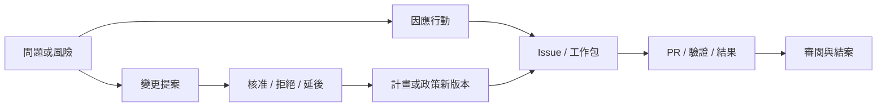

# 專案管理工作台：六個管理視圖與執行工作空間

日期：2026-10-12。來源：產品負責人提供的 Charter、資源登錄表、RTM、矩陣及甘特圖參考，
並明確否定只調配色、表單和截圖的前一輪方向。

**這是新的產品介面與資料合約；六個視圖尚未完成。** 規格制定時主線為 `3bb4fff`（PR #119）；
#121／#122 已合併的增量與剩餘範圍見第 13、14 節。
既有 [PM v1.2 計畫](../product/pm-v1.2-plan.md) 的工作編號、中央權威、版本、來源與執行
邊界保留。本合約更新其視圖組織與驗收要求，不能把過去五視圖草稿直接當成此次需求的完成品。

## 1. 導覽與共同資料

進入專案預設顯示 **專案總覽 / Project Charter**。左側保留專案切換，專案內導覽為：

| 視圖 | 英文名稱 | 主要管理問題 |
| --- | --- | --- |
| 專案總覽 | Project Charter | 為何做、答應做什麼、目前如何、需要決定什麼？ |
| Agent 資源與效能 | Agent Resources & Performance | 哪些執行資源可用，消耗與交付表現如何？ |
| 需求與交付追溯 | Requirements & Delivery Traceability | 哪條需求由哪些工作、PR 和驗收結果交付？ |
| 技術相依與維護 | Technology & Dependency Matrix | 修改或維護這個專案，需要檢查哪些上游與下游？ |
| 時程 | Project Schedule | 原定何時完成，現在預估何時完成，什麼正在阻擋？ |
| 問題、行動與變更 | Issues, Actions & Changes | 發現了什麼、如何處理、由誰決定、結果是什麼？ |

**工作看板 / Work Board** 與 **工作空間 / Workspace** 繼續存在。前者檢視工作流；後者
閱讀對話、回覆、檔案、執行及結果。Sprint Goal、Planning、Review、Retro 放在對應的
Sprint／計畫脈絡內，不再把所有管理編輯表單由上到下堆在同一頁。

六頁使用同一組 Requirement、PlanRevision、Issue、WorkPackage、ExecutionAttempt、Session、
PR、Commit、Verification、Decision、Release 和來源關聯。不能以名稱或時間接近推定關聯。
同一需求有多次執行或多個 PR，仍只算一條需求；跨需求共用的 PR、CI run、usage event
也不能重複計量。未歸屬資料放在「待歸屬」，不能消失或猜進專案。

歷史報告固定 `snapshot_id`、計畫版本、來源、時間與可見範圍；即時畫面保留觀測時間。
已採用計畫、候選變更及實際結果在資料上分開，顯示在同一頁不代表可互相覆寫。

## 2. 專案總覽：Charter + executive status + 計畫入口

預設是一頁可閱讀、可列印的管理摘要。桌面使用對齊的兩欄；手機依相同閱讀順序堆疊。
首頁只呈現以下重點，完整文字和來源按需展開，長附件另列，不靠縮小字體塞進一張紙。

| 區塊 | 呈現內容 |
| --- | --- |
| 專案定義 | 名稱、目的、價值、目前階段、負責／核准者、成功條件 |
| 範圍與交付 | 本輪範圍、排除範圍、主要成果及對應需求 |
| 里程碑與進度 | 原定日期、目前預測、已接受成果、尚待驗收及偏差 |
| 資源與預算 | 允許的 Agent／模型政策、資源限制、已觀測消耗與有依據的預測 |
| 風險與依賴 | 影響目標的主要風險、觸發條件、處置及相依關係 |
| 待決事項 | 少量真正影響方向、預算、時程或品質的決定 |

頂部以左右箭頭瀏覽固定的總覽版本，顯示日期、草稿／採用／歷史狀態，並可比較變更。
總覽版本是報告快照；它引用的計畫版本另有身分。一個計畫可以有多次進度快照，不能把
重新整理進度當成重新核准計畫。歷史模式不套入今日的完成數、quota 或新計畫文字。

「完整計畫」打開同一份版本化計畫的詳細內容；「與 PM 討論」帶入當前總覽和選定問題；
「審閱更新」呈現 PM 的候選變更。總覽不設無脈絡的主要派工按鈕。

PM 應先使用已允許的討論、固定 repository 資料、Issues、PR、CI 與既有決策整理草稿，
把可確定資訊自動填好。有根據的推論標示為候選；缺資料只在該欄標「待確認」。
新專案可以有不完整的 Charter，不以填滿所有欄位阻擋 Idea 討論。
使用者審閱的是有意義的變更，不必逐格輸入同一份資訊。重大範圍、預算與承諾變更沿用
既有採用規則；觀測到 PR／CI 的事實可在既有政策內回填，不要求每次另批聊天確認。

## 3. Agent 資源與效能：以可交付成果評估資源

借用登錄表的清楚欄位，名稱不沿用 Stakeholder Register。人的需求與核准責任仍保留在
Charter、決策與計畫中；Agent 資源屬於另一個管理維度。

預設每列是一個可辨識的執行配置，可依主機、CLI、模型、專案、角色和時間窗分組。
CLI 可用能力、目前配置、實際呼叫模型分開顯示，模型切換保留歷史。

| 群組 | 欄位／互動 |
| --- | --- |
| 身分與能力 | 主機、CLI／版本、模型／effort、角色、可用／忙碌／離線、已驗證能力及限制 |
| 用量 | 呼叫次數、輸入／快取／輸出／推理用量、專案占比、觀測涵蓋期間 |
| 配額與容量 | 配額池、限制時間窗、來源回報餘額、重設時間、並行容量、保留量 |
| 交付表現 | 已驗收工作、首次驗證通過率、返工率、完成時間與 CI 等待時間 |
| 預測與風險 | 剩餘工作耗量區間、估計依據／樣本數、耗盡風險、阻擋工作、可用替代配置 |

同一帳號被多台主機使用時，配額依明確的 pool 身分去重，不能把共享餘額相加。
無法確認同池時標示未確認；憑證和私人帳號資訊不進圖表或公開報告。
「模型可用於某類工作」採具名能力與相同任務類型的驗證資料，不用模型名稱推定通用能力分數。
CI 成敗須區分程式、測試、基礎設施、取消及重試，不能把不同工作難度的原始通過率直接排名。

各支援 CLI 使用具名版本 adapter，在來源主機增量讀取紀錄、去重並彙總；不靠 LLM
閱讀原始 logs，也不把私人對話全文集中傳回。未支援 CLI 顯示能力缺口。
正規化須保留原欄位是否存在、計量單位和包含關係，避免把已包含在 input/output 的
cache/reasoning 再加一次。Token 流量、實際費用、牌價估算、訂閱配額是不同指標。

剩餘配額只有來源提供可靠訊號時才顯示數字；缺少訊號顯示「未提供」。預測以同類已驗收
工作及其返工分布估算範圍，註明版本、資料期間與可信程度；不足時顯示「資料不足」。
不以所有工作平均 token 數乘上 Issue 數得到假精確的完工成本。

預設圖表為用量趨勢、CLI／模型組成與合格交付的消耗比較。每個圖段可篩選到原始彙總列。
優化建議需要理由和可比較的前後結果，優先檢查重複派工、上下文大小、批次檢查、角色分工、
返工與模型／effort 配置。不使用固定「四分鐘喚醒」作為跨 CLI 通則。

## 4. 需求與交付追溯：RTM 是多對多關係

主要分組：**階段 → 里程碑 → Requirement → Issue／工作包 → PR／執行紀錄**。
一個 Issue 的多個 PR 可展開成多列；同一 PR 可支援多個需求，計數依原身分去重。
沒有 Issue 的已核准工作包仍可追溯；沒有需求對應的 Issue 顯示待歸屬，不自動刪掉。

預設列顯示需求／工作名稱、里程碑、Issue、PR、驗收、部署和下一個阻擋。
側邊詳情顯示需求／計畫版本、提案與核准日期及 actor、sessions／attempts、開始／結束時間、
commits、CI、品質評估、merge receipt、release／environment／實際部署 SHA。
結束 session 不等於工作完成；merged 不等於已上線；歷史部署成功不等於現在仍運行該版本。

點擊核准標記看到當次決策、理由和固定範圍；點擊成果看到其適用的需求與驗收條件。
Issue close 不直接變成 Requirement accepted。新版本的需求若改變驗收條件，舊品質結果
不能自動沿用為新版本已通過。

## 5. 技術相依與維護：使用相依詞彙，不套人的 RACI 字母

提供**矩陣**和**相依圖**兩種閱讀方式，選取同一資料列。列可為 repo、服務或元件；欄為
repo、語言／runtime、library、API／schema、build／test toolchain、外部服務。

矩陣關係使用：**執行依賴 / Runtime、建置依賴 / Build、測試依賴 / Test、介面契約 / Contract、
參考來源 / Reference**。邊保留方向與版本；上游更新影響哪些下游可反向查詢。
負責維護的 owner／agent 是獨立欄位，不假裝 repo 本身能核准決策。

側邊顯示目前固定版本、允許範圍、來源 manifest／lockfile／文件與 commit、維護政策、
需要重跑的測試及受影響的 release。明確區分已驗證相依、文件聲稱的相依與 PM 待確認推論。
不要僅從「同一語言」推論兩個 repo 有相依關係。

中央清冊、固定來源、操作及 read API 的後端候選契約見 [固定版本技術相依清冊](pm-dependencies.md)；前端矩陣／圖仍需另行整合。

此頁回答「改 A，要查誰、驗證什麼？」；「檢視影響」產出可審閱的維護／變更建議。
上游變更通知由既有觀察與政策提供，矩陣本身不自動寫入其他 repo。

## 6. 時程：計畫、預測、實際三條時間線

左側使用可展開的 Phase／Milestone／Issue／WorkPackage；右側甘特圖呈現時間。
**Session 是某項工作的執行列，不是專案排程的最上層。** 展開後可見 attempt、Agent、
實際起訖與已觀測用量；token 主要在選取或懸停後顯示，避免所有欄位塞進時間條。

原定 baseline、目前 forecast、實際起訖分開。里程碑用明確符號，未來計畫用虛線，
阻塞／驗證等待用文字與狀態。依賴箭頭來自明確關係；未排期工作留在待排清單，
缺結束證據的 session 不從最後一筆輸出自行推算結束。

目前可讀的投影是 [專案時程](pm-schedule.md)。它只回傳已記錄的 baseline、forecast
與明確執行證據，並把沒有日期的列留在未排期清單。這一版沒有階段列、推算預測、
critical path、token 歸因或拖曳改期。

支援日／週／月縮放、今日定位、關鍵依賴追蹤與同步工作詳情。日期拖動產生時程提案，
不能無聲覆寫已採用 baseline。資料足夠才算 critical path／預測；不以 token/s 推算完成日期。

## 7. 問題、行動與變更：保留處理鏈

預設為篩選表格＋選取列的處理時間線，保留各記錄身分及不可覆寫的決策：

不是每個 Issue 都需要變更計畫，也不是每個 Action 都要建立 GitHub Issue。
「轉為工作」建立來源關聯；「提出變更」保留原問題與影響；不以更改同一列的類型消除歷史。
產品問題紀錄與 GitHub Issue 有不同身分，必須明確連結。Release changelog 由實際已交付
變更整理，不能把所有已核准提案都列為已發布。

表格包含類型、來源、影響、優先級、owner、處理期限、狀態、下一步、相關需求與工作。
摘要圖只回答管理問題：新增／解決趨勢、未決事項年齡、阻塞原因、變更影響或處理流量。
圓餅／環形圖僅用於同一分母、互斥類別的組成；允許多標籤的記錄使用條形圖，不硬算比例。
圖表能點回對應列，篩選、計量期間與涵蓋範圍共用，不設一排沒有行動價值的裝飾 KPI。
登記的讀取投影與紀錄對照見 [pm-register.md](pm-register.md)。篩選表、時間線畫面與圖表仍待實作。

## 8. 派工與 PM 的責任

主路徑：**已採用方向 → Requirement／Issue／工程工作包 → readiness → PM 資源安排 →
Orchestrator 執行 → PR／CI → 驗收 → 發布／回填**。

- 總覽主要動作：與 PM 討論、審閱計畫更新、查看待決事項。
- RTM／工作詳情主要動作：查看安排／阻擋；必要時「安排執行」。
- 問題記錄主要動作：建立因應行動、轉工作或提出變更。
- 手動派工放在工作詳情的次要選單，預填固定需求、來源、工作包及目的地。

PM 在已採用的政策、scope、預算、允許 CLI／模型、WIP、時間與成功條件內選擇和安排資源；
Orchestrator 沿用既有註冊 action 與中央 admission/final-frame checks 執行。
有授權的日常工作不逐次要求使用者重按確認。超出政策、關鍵資料不足、來源失效或
改變重大承諾時，PM 帶回具體決策；不能只因更省 token 就降低驗收標準。

資源餘額檢查和並行 reservation 必須在中央送出前核對；未知 quota 依採用政策明確處理，
不當成無限量。授權只能控制自有資源；人工和外部 session 仍唯讀，切換模型只影響
獲授權的後續執行，不擅自改他人現有 session。變更資源策略不能重送未知結果的原操作。

## 9. 工作空間與動態行為

保留「專案／工作樹 → 對話與成果 → 按需展開詳情」的工作空間。
從任一管理視圖開工作時，保持同一個 Issue／需求／計畫／attempt 脈絡，並可回到原篩選位置。
PM 的討論和實作 Agent 的 session 有明確名稱與責任；不混成無來歷的訊息串。

已收到真實事件時才短暫標示更新、移動卡片或延伸進度；工作處於 idle、CI wait、offline、
unknown 時使用對應狀態，不用流動線條假裝正在產出。使用者正在讀取、輸入或選取時
保留位置，不自動重排眼前列。提供暫停即時更新和 reduced-motion；不能只用顏色或動畫傳達狀態。
高頻 token 事件在來源端聚合；事件更新不逐條喚醒 PM 模型，也不讓每頁各自全量掃描 logs。
歷史快照保持靜態，只能由使用者明確播放已記錄的事件。

## 10. 既有資料、缺口與施工順序

| 工序 | 既有基礎 | 仍需完成 | 對應工作 |
| --- | --- | --- | --- |
| 1. 總覽與專案內導覽 | PlanRevision、採用、DocumentSnapshot、Brief、自然對話提案 | 一頁 Charter、整合計畫、快照版本箭頭、PM 持續補齊、單頁列印 | W08、W10–12、W33、W39–40 |
| 2. RTM 與處理鏈 | Requirement、品質紀錄、Issue mapping、delivery lineage、治理、登記讀取 API | 明確多對多外部同步、跨版本完整追溯、可展開表格畫面（契約見 pm-register.md） | W05–06、W17–21 |
| 3. 資源與效能 | 前次人工本機診斷方法；中央 execution/verification 來源 | 多 CLI collector、增量 cursor、去重、配額 adapter、效能歸因、估計 | W09、W23–24、W28、W30 |
| 4. 技術相依與時程 | 固定 repo/spec 來源、Roadmap baseline/forecast、maintenance policy | 技術關係 inventory、影響矩陣、分層甘特圖與時程提案 | W13、W35–37、W42–49 |
| 5. 政策內自動安排 | 有界工作包／批次及維護派工 | 資源 reservation、PM 安排政策、exception 回討論及完整循環 | W19、W30、W44–46、W50–52 |

W30 的資源觀測不再只是最後才加的圖表；它是新資源頁與 PM 配置的必要依賴。
先取得可信觀測，再啟用比較、預測與策略，不能跳過資料實作直接打開自動降模型。
現有未合併 M4／M5 和 W39 草稿須保留來源隔離修正，但按本合約重新檢查呈現方式；
不整包合入舊長表單。原始範圍和未知項目在狀態表保留，不藉重新命名宣稱完成。

## 11. 一次完整的驗收情境

以會員登入與忘記密碼專案驗證以下行為：

1. 只從討論開始；PM 填出部分 Charter，留下真正缺少的資訊，後續以版本更新而非重填。
2. 採用 scope／條件後，同一資料出現在 Charter、RTM 和時程；切回舊快照仍見舊共識。
3. 同一 Issue 經兩個 PR、三次 attempts，RTM 完整呈現；需求完成數、CI 與 token 不重複。
4. PM 依政策安排自己的 Agent，另一個人的 BAT session／worktree 不受影響；超限成為
   一項可理解的決策。來源沒提供 quota 時所有視圖都保留未知，不能顯示 100% 可用。
5. A 上游更新，技術矩陣指出有證據的下游及驗證，生成有來源的變更／行動鏈。
6. 原定、預測、實際日期可以比較；session 結束、PR merge、需求驗收和環境上線有不同狀態。
7. 驗收、發布或修復結果更新同一份 PM 資料；重連或重啟不重派，不回寫舊歷史。
8. EN／zh-TW、390／768／1440、鍵盤、reduced-motion、空資料／過期／失權限皆可用；
   失去來源存取權後，不在圖表、計數、快取詳情或輸出中殘留該來源衍生資料。

## 12. PM 名詞與引用

此產品借用 PM 管理文件的目的和關聯，將資源與技術視圖調整為 coding-agent 專案的需求。
Charter 記錄成立與高層授權，plan 描述執行與控制；RTM 將需求連至交付物；RACI 記錄
人的活動責任。因此本產品不把 Agent 用量表稱為 stakeholder register，也不把技術依賴圖
宣稱為標準 RACI。這些區別見 [PMI Lexicon v5](https://www.pmi.org/-/media/pmi/documents/registered/pdf/pmbok-standards/pmi-lexicon-pm-terms.pdf)。
需求在不同階段持續整理與管理，參考 [PMI requirements management](https://www.pmi.org/learning/library/project-requirements-management-process-groups-6599)。
本頁是產品設計決策，並不宣稱取得 PMP／PMI 認證或已完成所有列出的實作。

## 13. Charter／RTM 第一段實作範圍

#121 已將 `feat/pm-v12-charter-rtm-20261012` 合併為 `8bc6cf3`；
沒有 owner 安裝或真人驗收宣稱。本段只新增共用前端投影，沒有新增中央
action、schema、外部同步、派工政策或 native 權限。

- **Charter：** 六區摘要讀取同一個 DocumentSnapshot，提供前後版本、差異比較、原計畫
  閱讀、列印與既有 Brief 匯出。比較重新核對兩份來源；歷史快照不混入目前計畫、用量
  或完成數。清單分頁明示，未載入的版本不假裝相鄰。來源缺少時各欄保留待確認。
- **RTM：** 使用已採用計畫、Kanban work binding、明確 Issue mapping、Roadmap milestone
  及固定品質紀錄。Requirement 依完整計畫身分及驗收條件對照品質；同一工作可連到多條
  需求，載入計數依 work ID 去重。其他計畫版本及未匹配 Issue 保留在待歸屬區。
- **工作詳情：** 按需重讀原工作，展開 session／attempts、採用 actor／日期／理由及交付。
  PR 依 provider origin、numeric repository ID、PR number 分組；merge、部署驗證與
  `is_current` 分開。交付分頁重讀已載入頁，避免保留已失權限的舊 receipt。
- **來源失效：** 串接、分頁或詳情讀取失敗時，相關列、計數及詳情一起撤回；遲到的回應
  不得復活已撤回資料。保持中央 scope、既有 operation key 和原請求恢復行為。

此段仍不是完整六視圖交付。Charter 尚未新增 PM 自動整理／持續補齊。中央已補即時 overview、
建立討論時的正式 context refs（含固定 snapshot）與 durable rename；API／來源可見性／涵蓋限制見
[即時總覽與討論來源](pm-overview-discussion-context.md)。前端入口尚未接上，也尚未安裝或實機驗收。
RTM 尚未新增階段關聯、任意外部 Issue／PR 的多對多同步或完整跨版本比較；里程碑僅使用既有明確關聯。
本機 Agent collector／quota 第一段見第 14 節；技術相依矩陣、分層甘特圖、問題處理時間線與政策內自動安排
仍依第 10 節接續。

## 14. Agent 資源第一段實作範圍

#122 已將 `feat/pm-v12-resource-observation-20261012` 合併為 `2bf152d`，從 #121 接續。新增中央定期收集
明確綁定的本機 Codex／Claude 用量檔、原 cursor／去重、有限來源配額窗與共用資源頁。
精確範圍、來源格式、權限及剩餘工作見 [Agent resource observations](agent-resource-observation.md)。
同一投影現在附帶每日本地用量桶，供之後的趨勢圖使用；這還不是圖表 UI。
這不是完整第 3 節：遠端主機、完整配額、合格交付／返工歸因、容量、區間預測和策略安排仍待做。
候選檢查、合併後主線 Windows 失敗及安裝／live 界線見
[資源交接](../handoff/2026-10-12-pm-v1.2-resources.md)。
