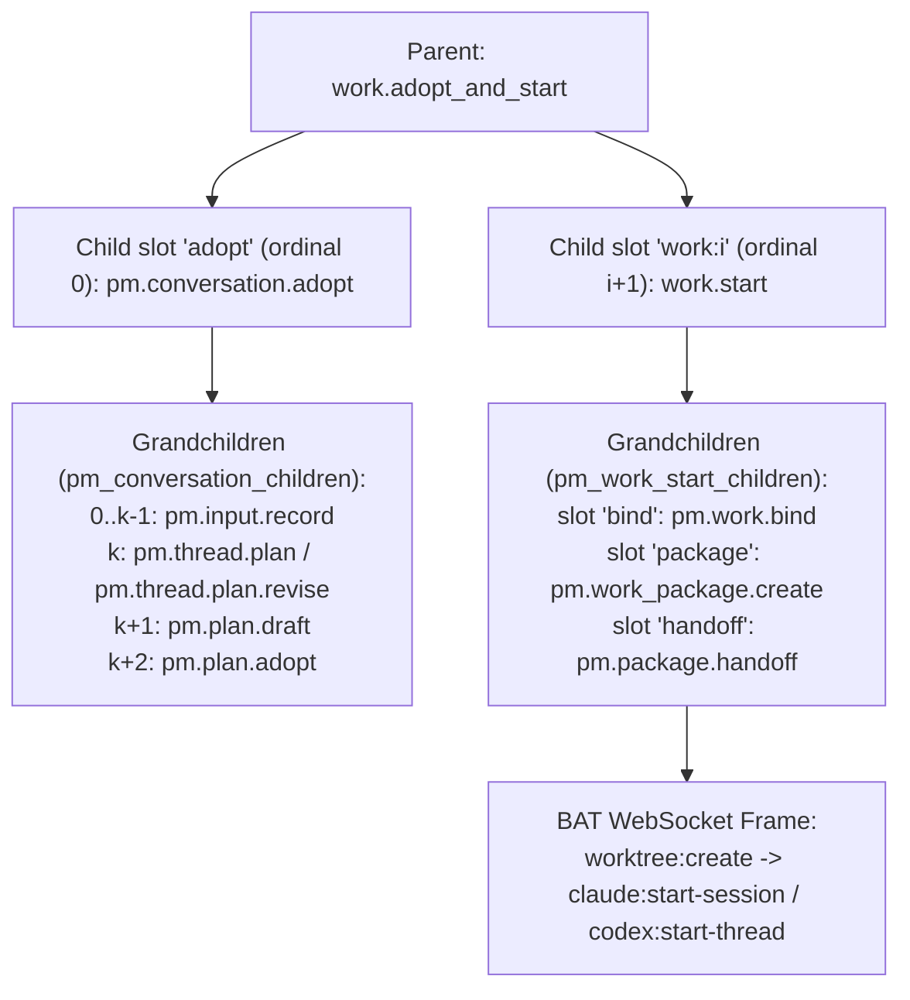

# v1.3 P6：`work.adopt_and_start` 採用提案並開始選定工作設計規格

## 1. 範圍與目標

本規格定義 v1.3 Phase 6（P6）的複合動作 `work.adopt_and_start`（對齊 `docs/product/v1.3-closed-loop-plan.md` F3、`§7.1`、R1 與 A06，以及 `docs/design/v1.3-e00-baseline.md` `§3.2`、`§3.3` 與 `docs/design/v1.3-e02-work-start.md`）。

當擁有決策權的使用者在 PM 對話中審閱完一份結構化提案（proposal）並勾選一或多個要立即執行的 Work 時，按下「採用並開始選定工作」只會送出**一次明確授權**（`work.adopt_and_start`），但後端必須將「採用計畫」與「逐一啟動所選 Work」紀錄為**分離且各自具備持久收據的階段**，絕不假裝 SQLite、托管 Git 與遠端 BAT 主機構成單一原子交易：

1. **一次授權、兩階段紀錄**：
   - 第一階段（`adopting` → `adopted`）建立並等待單一 `pm.conversation.adopt` 子操作（slot `"adopt"`，`ordinal = 0`），重用既有對話提案採用鏈路（`pm.input.record`、`pm.thread.plan` 或 `pm.thread.plan.revise`、`pm.plan.draft`、`pm.plan.adopt`）。
   - 第二階段（`starting`）在 `"adopt"` 子操作成功並寫入 `pm_plan_adoptions` 收據後，依使用者於父操作 admission 鎖定的 `works` 順序，逐一建立 `work.start` 子操作（slot `"work:0"`, `"work:1"`, ...，`ordinal = 1..N`），完整重用 E02（`src/bat_agent_connector/pm_work_start.py`）的綁定、工作包組合／重用與執行交接鏈路，絕不重新實作 `work.start`。
2. **誠實的階段失敗與局部成功語意**：
   - 若採用階段失敗或停止（`adoption_failed`），後端**不會**建立任何 `work.start` 子操作（0 個 Work 啟動）。
   - 若採用成功但後續任一或全部 Work 未能啟動，父操作狀態明確呈現「計畫已採用，工作尚未開始」（`adopted_not_started`）或「部分已開始」（`partially_started`）或「工作啟動結果未知」（`start_unknown`）。
3. **恢復與重試安全保證**：
   - Recovery（`resume` 或 daemon 重啟）絕不重新執行已完成的採用（不重送 `pm.conversation.adopt`），也絕不重啟已經啟動（`started`）或啟動結果未知（`start_unknown` / `uncertain`）的 Work。
   - 所有子操作與孫操作的 `idempotency_key` 皆由父操作 `operation_id` 與固定 slot 決定，確保跨重啟收據對帳（reconciliation）與最終 frame 檢查不被繞過。

本階段僅交付設計規格文件 `docs/design/v1.3-p6-adopt-and-start.md`，不修改任何程式碼。

---

## 2. 既有基底事實與程式碼錨點（Decision 1–8 基礎）

以下引用皆來自當前基底 commit `5840f41df5be1d481f0ed3cecf147a178715bd3c` 的實際程式碼。

### 2.1 對話提案採用（`src/bat_agent_connector/pm_conversation_adoption.py`）

`pm.conversation.adopt` 已註冊為複合操作，主要 scope 為 `"manage"`，其不可變子操作表為 `pm_conversation_children`，並以 SQLite trigger `pm_conversation_child_settled` 在子操作進入終態時喚醒處於 `waiting_external` 的父操作（見 `src/bat_agent_connector/pm_conversation_adoption.py:26-57`）：

```python
def install(ops):
    with ops.journal.tx():
        ops.db.execute("""CREATE TABLE IF NOT EXISTS pm_conversation_children (
            parent_id TEXT NOT NULL, ordinal INTEGER NOT NULL, operation_id TEXT NOT NULL UNIQUE,
            request TEXT NOT NULL, request_digest TEXT NOT NULL, created_at REAL NOT NULL,
            PRIMARY KEY(parent_id,ordinal))""")
        for verb in ("UPDATE", "DELETE"):
            ops.db.execute(f"CREATE TRIGGER IF NOT EXISTS pm_conversation_children_{verb.lower()}_immutable "
                f"BEFORE {verb} ON pm_conversation_children BEGIN SELECT RAISE(ABORT,'Proposal child is immutable'); END")
        # The immutable relation, not caller-supplied refs, identifies the parent.
        # Persist its wakeup with the child's outcome so restart cannot lose it.
        ops.db.execute("""CREATE TRIGGER IF NOT EXISTS pm_conversation_child_settled
            AFTER UPDATE OF status ON operations
            WHEN NEW.status != OLD.status AND NEW.status IN ('succeeded','failed','cancelled','needs_attention')
            BEGIN
                UPDATE operations SET next_run_at=0
                WHERE action='pm.conversation.adopt' AND status='waiting_external'
                    AND operation_id=(SELECT parent_id FROM pm_conversation_children
                        WHERE operation_id=NEW.operation_id);
            END""")
    if proposals.ADOPT not in ops.actions:
        ops.register(ActionDef(proposals.ADOPT, "manage", "Adopt one complete owner-reviewed conversation update",
            _run, _admit, ("workspace_id", "thread_id"), authorize_existing=_authorize_existing))


def _admit(ops, principal, target, params, pre):
    pm_native_operations._scopes(principal)
    pm_workspace.require_member(ops.db, principal, target.get("workspace_id"), decide=True)
    if (set(target) != {"workspace_id", "thread_id"} or set(params) != {"proposal_id", "review", "rationale"}
            or set(pre) != {"expected_version", "expected_plan_version", "expected_accepted_revision_id", "expected_proposal_digest"}):
        raise proposals.error("Supply one exact proposal, whole review, rationale and original versions")
    proposal = proposals.get_proposal(ops, principal, target["workspace_id"], params["proposal_id"])["proposal"]
```

在執行階段，`_current_principal` 已驗證呼叫者必須同時具備 `{"observe", "manage", "start"}` 三個 scopes（見 `src/bat_agent_connector/pm_conversation_adoption.py:114-120`）：

```python
def _current_principal(ops, parent):
    binding = parent["external_refs"]["admission_binding"]
    saved = binding["principal"]
    original = Principal(saved["actor"], frozenset(saved["scopes"]), admin=saved["admin"])
    pm_native_operations._scopes(original)
    required, now = {"observe", "manage", "start"}, time.time()
    rows = ops.db.execute("""SELECT token_hash,scopes FROM api_principals WHERE actor=? AND revoked_at IS NULL
```

`pm.conversation.adopt` 的 `_request`、`_create` 與 `_run` 會依序產生每個候選條目的 `pm.input.record`、接著 `pm.thread.plan.revise` 或 `pm.thread.plan`、`pm.plan.draft` 以及 `pm.plan.adopt`，並在成功時回傳包含 `pm_plan_adoptions.result`（含新採用的 `revision_id`、`scope_revision`、`plan_version` 等）的收據（見 `src/bat_agent_connector/pm_conversation_adoption.py:203-274`）：

```python
def _request(parent, proposal, children, *, base_version=None):
    reviewed = parent["params"]["review"]
    originals = proposal["document"]["candidates"]
    rows = {row["key"]: row for row in reviewed["rows"]}
    ordinal, count = len(children), len(originals)
    context = proposal["context"]
    version = context["thread_version"] if base_version is None else base_version
    common = {"target": parent["target"], "idempotency_key": "pm-conversation:" + parent["operation_id"] + ":" + str(ordinal)}
    if ordinal < count:
        original = originals[ordinal]
        row = rows[original["key"]]
        return {**common, "action": "pm.input.record", "params": {"slot": original["domain"] + "." + row["key"],
            "value": row["text"], "status": row["status"],
            "source_ref": {"kind": "statement", "ref": "Owner review " + parent["operation_id"] +
                "; original proposal " + proposal["proposal_id"] + "; candidate " + row["key"]}},
            "preconditions": {"expected_version": version + ordinal}}
    inputs = {item["key"]: children[index]["result"]["input_id"] for index, item in enumerate(originals)}
    selected = [inputs[item["key"]] for item in originals if rows[item["key"]]["include"]]
    if ordinal == count:
        previous = context["draft_id"]
        return {**common, "action": "pm.thread.plan.revise" if previous else "pm.thread.plan",
            "params": {"title": reviewed["title"], "rationale": parent["params"]["rationale"], "selected_input_ids": selected},
            "preconditions": {"expected_version": version + count, **({"expected_draft_id": previous} if previous else {})}}
    if ordinal == count + 1:
        return {**common, "action": "pm.plan.draft", "params": {"title": reviewed["title"],
            "previous_revision_id": context["plan_head"]["latest_revision_id"],
            "sections": {domain: [inputs[item["key"]] for item in originals
                if item["domain"] == domain and rows[item["key"]]["include"]] for domain in pm_profiles.DOMAINS},
            "requirements": [{"id": item["id"], "source_input_id": inputs[item["source_key"]],
                "acceptance_input_ids": [inputs[key] for key in item["acceptance_keys"]], "priority": item["priority"],
                "depends_on": item["depends_on"]} for item in reviewed["requirements"]]},
            "preconditions": {"expected_version": version + count + 1, "expected_plan_version": context["plan_head"]["version"]}}
    if ordinal == count + 2:
        return {**common, "action": "pm.plan.adopt",
            "target": {"workspace_id": parent["target"]["workspace_id"], "revision_id": children[-1]["result"]["revision_id"]},
            "params": {"rationale": parent["params"]["rationale"]},
            "preconditions": {"expected_accepted_revision_id": context["plan_head"]["accepted_revision_id"]}}
    return None


def _create(ctx):
    def create():
        parent = ctx.service._row(ctx.operation_id)
        principal, proposal, children = _guard(ctx.service, parent)
        thread = pm_discussions._thread(ctx.service.db, **parent['target'])
        applied = sum(ctx.service.db.execute('SELECT 1 FROM pm_discussion_applied WHERE operation_id=?',
            (child['operation_id'],)).fetchone() is not None for child in children)
        request = _request(parent, proposal, children, base_version=thread['version'] - applied)
        child, fresh = ctx.service.create(principal, **request, entry="pm-conversation")
        if not fresh:
            raise proposals.error("Child key exists without original relation", "PM_CONVERSATION_CHANGED", 409)
        ctx.service.db.execute("INSERT INTO pm_conversation_children VALUES(?,?,?,?,?,?)", (ctx.operation_id, len(children),
            child["operation_id"], pm_runs._json(request), pm_runs._digest(request), time.time()))
        ctx.service._merge_refs(child["operation_id"], {LINK: ctx.operation_id})
        ctx.service.db.execute("INSERT OR IGNORE INTO pm_source_lineage VALUES(?,?,?,?)",
            ("operation", child["operation_id"], proposal["operation_id"], ctx.operation_id))
        return {"operation_id": child["operation_id"]}
    ordinal = len(_children(ctx.service.db, ctx.op))
    return ctx.effect("pm.conversation.child." + str(ordinal), create)


async def _run(ctx):
    children = _children(ctx.service.db, ctx.op)
    if children:
        last = children[-1]
        # Original accepted receipt recovery precedes all new-effect gates.
        if last["action"] == "pm.plan.adopt":
            saved = ctx.service.db.execute("SELECT result FROM pm_plan_adoptions WHERE operation_id=?", (last["operation_id"],)).fetchone()
            if saved:
                return {**json.loads(saved[0]), "proposal_id": ctx.params["proposal_id"],
                    "review_digest": ctx.admission_binding["conversation_review"]["review_digest"],
                    "adoption_operation_id": last["operation_id"], "child_operation_ids": [child["operation_id"] for child in children]}
```

此外，`src/bat_agent_connector/pm_conversation_proposals.py` 以索引 `pm_conversation_adopted_proposal`（見 `src/bat_agent_connector/pm_conversation_proposals.py:45-47`）記錄成功採用的提案操作：

```python
        journal.db.execute("CREATE INDEX IF NOT EXISTS pm_conversation_adopted_proposal ON operations "
            "(json_extract(target,'$.workspace_id'), json_extract(params,'$.proposal_id')) "
            "WHERE action='pm.conversation.adopt' AND status='succeeded'")
```

並且 `_adoptions` 會查詢 `o.action='pm.conversation.adopt' AND o.status='succeeded'` 以判定提案是否已被採用（見 `src/bat_agent_connector/pm_conversation_proposals.py:258-275`）：

```python
def _adoptions(db, principal, workspace_id, proposal_ids):
    """One indexed page lookup; only visible, successful parents prove adoption.

    The final original child's receipt supports older/recovered parent results.
    Neither a current plan head nor an unfinished parent's child proves success.
    """
    from . import pm_access
    if not proposal_ids:
        return {}
    rows = db.execute("""SELECT o.*, COALESCE(json_extract(o.result,'$.revision_id'), a.revision_id) AS adopted_revision_id
        FROM operations o LEFT JOIN pm_plan_adoptions a ON a.operation_id=(
            SELECT c.operation_id FROM pm_conversation_children c
            WHERE c.parent_id=o.operation_id ORDER BY c.ordinal DESC LIMIT 1)
            AND a.workspace_id=json_extract(o.target,'$.workspace_id')
        WHERE o.action='pm.conversation.adopt' AND o.status='succeeded'
            AND json_extract(o.target,'$.workspace_id')=?
            AND json_extract(o.params,'$.proposal_id') IN (SELECT value FROM json_each(?))
        ORDER BY o.created_at, o.operation_id""", (workspace_id, json.dumps(proposal_ids))).fetchall()
```

### 2.2 單一工作啟動（`src/bat_agent_connector/pm_work_start.py`）

`work.start` 已實作為複合操作，主要 scope 為 `"start"`，具備 10 個必要 `PRECONDITIONS` 與固定參數集合（見 `src/bat_agent_connector/pm_work_start.py:39-59`）：

```python
SLOTS = ("bind", "package", "handoff")
SLOT_ORDINAL = {"bind": 0, "package": 1, "handoff": 2}
LINK = "work_start_parent"
CHILD_STOPPED = frozenset({"succeeded", "failed", "cancelled", "needs_attention"})
PRECONDITIONS = frozenset({
    "expected_work_item_fingerprint",
    "expected_work_version",
    "expected_binding_id",
    "expected_scope_revision",
    "expected_previous_package_id",
    "expected_project_version",
    "repository_id",
    "binding_digest",
    "expected_source_sha",
    "expected_latest_attempt_id",
})
PARAMS_REQUIRED = frozenset({"instruction", "agent", "delivery", "code_target"})
PARAMS_OPTIONAL = frozenset({"model", "requirement_ids"})
CODE_TARGET_KEYS = ("repository", "host", "workspace_id", "source_ref")
DELIVERY_GOALS = frozenset({"pull_request", "reviewable_changes"})
AGENTS = frozenset({"claude", "codex"})
```

同時，`pm_work_start.install` 建立了固定子操作表 `pm_work_start_children`（slots 為 `"bind"`、`"package"`、`"handoff"`）、不可變嘗試紀錄表 `work_attempts` 以及 `pm_work_start_child_settled` trigger（見 `src/bat_agent_connector/pm_work_start.py:89-133`）：

```python
            """CREATE TABLE IF NOT EXISTS pm_work_start_children (
                parent_id TEXT NOT NULL,
                slot TEXT NOT NULL,
                ordinal INTEGER NOT NULL,
                operation_id TEXT NOT NULL UNIQUE,
                request TEXT NOT NULL,
                request_digest TEXT NOT NULL,
                created_at REAL NOT NULL,
                PRIMARY KEY(parent_id, slot),
                UNIQUE(parent_id, ordinal))""",
            """CREATE TABLE IF NOT EXISTS work_attempts (
                sequence INTEGER PRIMARY KEY AUTOINCREMENT,
                attempt_id TEXT NOT NULL UNIQUE,
                workspace_id TEXT NOT NULL,
                work_item_id TEXT NOT NULL,
                origin_kind TEXT NOT NULL,
                origin_id TEXT NOT NULL,
                start_operation_id TEXT UNIQUE,
                predecessor_attempt_id TEXT,
                admission_digest TEXT NOT NULL,
                created_at REAL NOT NULL,
                UNIQUE(origin_kind, origin_id))""",
            """CREATE INDEX IF NOT EXISTS work_attempts_by_work
                ON work_attempts(workspace_id, work_item_id, sequence DESC)""",
        ):
            journal.db.execute(ddl)
        for table, label in (
            ("pm_work_start_children", "Work start child is immutable"),
            ("work_attempts", "Work attempt history is immutable"),
        ):
            for verb in ("UPDATE", "DELETE"):
                journal.db.execute(
                    f"CREATE TRIGGER IF NOT EXISTS {table}_{verb.lower()}_immutable "
                    f"BEFORE {verb} ON {table} BEGIN SELECT RAISE(ABORT, '{label}'); END"
                )
        journal.db.execute("DROP TRIGGER IF EXISTS pm_work_start_child_settled")
        journal.db.execute("""CREATE TRIGGER IF NOT EXISTS pm_work_start_child_settled
            AFTER UPDATE OF status ON operations
            WHEN NEW.status != OLD.status AND NEW.status IN ('succeeded','failed','cancelled','needs_attention','uncertain')
            BEGIN
                UPDATE operations SET next_run_at=0
                WHERE action='work.start' AND status='waiting_external'
                    AND operation_id=(SELECT parent_id FROM pm_work_start_children
                        WHERE operation_id=NEW.operation_id);
            END""")
```

當 `work.start` 需要自動合成工作包（`package_plan["mode"] == "compose"`）時，`_require_ready` 會拒絕含有 `depends_on` 前置條件的 requirement，並回傳 `PM_WORK_START_PREREQUISITES`（見 `src/bat_agent_connector/pm_work_start.py:607-617`）：

```python
def _require_ready(selected_requirements: list[dict], package_plan: dict, readiness: dict) -> None:
    if package_plan["mode"] == "compose":
        prereq_ids = [r["id"] for r in selected_requirements if r.get("depends_on")]
        if prereq_ids:
            raise _bad(
                "PM_WORK_START_PREREQUISITES",
                "Requirements declaring depends_on prerequisites ("
                + ", ".join("dependency:" + rid for rid in prereq_ids)
                + ") are not supported by the thin work.start path; use pm.work_package.create and pm.work_batch.start",
                409,
            )
```

---

## 3. 八項核心設計決策（Decisions 1–8）

### Decision 1：入口、Target 與採用子操作（Entry, Target and the Adoption Child）

1. **R1 封裝的採用動作**：
   - `work.adopt_and_start` 在 R1 封裝的是 **`pm.conversation.adopt`**（而非裸 `pm.plan.adopt`）。
   - **理由**：
     1. 產品規格 F3（`docs/product/v1.3-closed-loop-plan.md:132-139`）與 R1（`docs/product/v1.3-closed-loop-plan.md:542`）將「採用，稍後做」（`pm.conversation.adopt`）與「採用並開始選定工作」（`work.adopt_and_start`）並列為對話提案審閱面板上的兩個按鈕；在該時間點，審閱後的候選條目（candidates）與計畫修訂（plan draft）尚未寫入資料庫，必須透過 `pm.conversation.adopt` 依序執行 `pm.input.record`、`pm.thread.plan` / `pm.thread.plan.revise`、`pm.plan.draft` 與 `pm.plan.adopt`。
     2. `pm_conversation_proposals._adoptions` 與索引 `pm_conversation_adopted_proposal` 皆以 `o.action='pm.conversation.adopt' AND o.status='succeeded'` 判斷提案是否已採用；以真實的 `pm.conversation.adopt` 作為第 0 個子操作（slot `"adopt"`），能直接讓提案在採用完成當下被標記為已採用，若後續 Work 啟動失敗，使用者重試或恢復時也不會重複出現未採用狀態或允許二次採用同一提案。
2. **`work.adopt_and_start` 的 Target、Params 與 Preconditions**：
   - **`target`**（`target_keys = ("workspace_id", "thread_id")`）：
     - `workspace_id`: PM 工作區 ID（對應 Project 的 PM workspace）。
     - `thread_id`: 產生該提案的 PM 討論串 ID（符合 `pm_discussions.THREAD`）。
   - **`params`**：
     - `proposal_id`: 對話提案操作 ID（與 `pm.conversation.adopt` 相同）。
     - `review`: 擁有者審閱後的完整結構（含 `title`、`rows`、`requirements`，與 `pm.conversation.adopt` 相同，由 `pm_conversation_formats.review` 驗證）。
     - `rationale`: 採用理由字串（1..4000 字元，與 `pm.conversation.adopt` 相同）。
     - `works`: 非空陣列（長度 1 至 10 筆），列出選定要啟動的既有 Work 及其啟動參數（詳見 Decision 2）。
   - **`preconditions`**：
     - 對話與計畫基線前置條件（與 `pm.conversation.adopt` 完全一致）：
       - `expected_version`: `int`，討論串目前版本號。
       - `expected_plan_version`: `int`，目前 `pm_plan_heads.version`。
       - `expected_accepted_revision_id`: `str | None`，目前 `pm_plan_heads.accepted_revision_id`。
       - `expected_proposal_digest`: `str`，提案文件的 SHA-256 digest（`proposal["document_digest"]`）。
     - 所選 Work 的固定前置條件陣列 `works`（詳見 Decision 3）。
3. **Adoption 子操作請求結構**：
   - Slot `"adopt"`（`ordinal = 0`）提交給 `ctx.service.create(principal, **request, entry="work-adopt-and-start")` 的請求與獨立呼叫 `pm.conversation.adopt` 完全一致，不做任何欄位刪減或變造：
     - `action`: `"pm.conversation.adopt"`
     - `target`: `{"workspace_id": parent["target"]["workspace_id"], "thread_id": parent["target"]["thread_id"]}`
     - `params`: `{"proposal_id": parent["params"]["proposal_id"], "review": parent["params"]["review"], "rationale": parent["params"]["rationale"]}`
     - `preconditions`: `{"expected_version": pre["expected_version"], "expected_plan_version": pre["expected_plan_version"], "expected_accepted_revision_id": pre["expected_accepted_revision_id"], "expected_proposal_digest": pre["expected_proposal_digest"]}`
     - `idempotency_key`: `f"work-adopt-and-start:{parent_id}:adopt"`

---

### Decision 2：固定的選定工作清單（The Fixed Work Selection）

1. **僅選擇既有 Work（Existing Works Only）**：
   - 在 R1 中，`params.works` 的每一個項目都必須指向一個**已存在且處於 active 狀態的 Work**（`work_item_id` 符合 `WORK_ITEM_ID = re.compile(r"wi_[0-9a-f]{20}")`（`src/bat_agent_connector/work_items.py:36`）），且其所屬 Project 已綁定至 `target.workspace_id`（`pm_project_bindings`）且未封存（`archived_at IS NULL`）。
   - **為何不在 `work.adopt_and_start` 內動態建立新 Work**：`work_item.create` 在執行時以 `wid = "wi_" + secrets.token_hex(10)`（`src/bat_agent_connector/work_items.py:708`）產生 `work_item_id`，在父操作 admission 當下無法鎖定 `work_item_id`、`expected_work_version`、`expected_work_item_fingerprint`、`expected_binding_id`、`expected_previous_package_id` 與 `expected_latest_attempt_id`。因此使用者若需新增 Work，應先透過既有 `work_item.create` 建立，或於未來擴充版本才引入固定 `f"work-adopt-and-start:{parent_id}:work_create:{i}"` 子操作；R1 的 `work.adopt_and_start` 僅接受既有 `work_item_id`。
2. **`params.works[i]` 每項目的欄位規格**：
   - `work_item_id`（必填，`str`）：目標 Work ID（`wi_[0-9a-f]{20}`）。
   - `requirement_ids`（必填，`list[str]`，`1..50` 個不重複 ID）：此 Work 在本次採用計畫中負責的 requirement IDs。
     - 每個 `rid` 都必須存在於 `params.review["requirements"]` 中。
     - 因為採用剛剛建立全新的 plan revision，尚未存在指向該新 `revision_id` 的 `pm_work_bindings` 或 `pm_work_packages`（故每個 `work.start` 子操作必然走 `bind_needed = True` 與 `package_plan["mode"] == "compose"`）。為避免採用成功後 `work.start` 才因 `PM_WORK_START_PREREQUISITES` 失敗，父操作 `_admit` 會在 admission 當下檢查 `params.review["requirements"]` 中被選取的 `requirement_ids`：若任一被選取的 requirement 在 `review["requirements"]` 宣告了非空的 `depends_on`，父操作在 admission 直接以 `PM_WORK_START_PREREQUISITES`（HTTP 409）拒絕，不建立任何操作。
   - `instruction`（必填，`str`）：1..4000 字元（經 `strip()` 後非空），交由 `work.start` 傳遞給執行會話。
   - `agent`（必填，`"claude" | "codex"`）：與 `pm_work_start.AGENTS` 一致。
   - `model`（選填，`str | None`）：若提供，為 1..256 字元且不含控制字元（與 `pm_work_start._clean_model` 一致）。
   - `delivery`（必填，`"pull_request" | "reviewable_changes"`）：與 `pm_work_start.DELIVERY_GOALS` 一致。
   - `code_target`（必填，`dict`）：鍵集合固定為 `{"repository", "host", "workspace_id", "source_ref"}`（與 `pm_work_start.CODE_TARGET_KEYS` 一致）。
3. **數量上限、重複檢查與不可變封存**：
   - **數量上限**：提議定義常數 `MAX_SELECTED_WORKS = 10`（即 `1 <= len(params["works"]) <= 10`）。超出上限或為空陣列時，admission 回傳 `INVALID_PARAMS`（HTTP 422）。
   - **重複檢查**：`params["works"]` 中所有 `work_item_id` 必須互不相同；若同一個 `work_item_id` 出現超過一次，admission 回傳 `INVALID_PARAMS`（HTTP 422）。
   - **封存不變性**：父操作在 `_admit` 驗證通過後，將正規化後的 `works` 清單（含順序 `index = 0..N-1`、每個項目的參數與對應的固定 preconditions）寫入 `external_refs["admission_binding"]["work_adopt_and_start"]` 並計算 SHA-256 `work_adopt_and_start_digest`。Admission 之後，無論 resume 或重啟，皆不得新增、刪除、重排或修改任何選定 Work。

---

### Decision 3：採用後的 `work.start` 前置條件銜接（Preconditions After Adoption）

`work.start` 的 `def _validate_preconditions_shape(pre: dict) -> None:`（`src/bat_agent_connector/pm_work_start.py:668-709`）強制要求全部 10 個 `PRECONDITIONS`。在 `work.adopt_and_start` 中，這 10 個前置條件的來源嚴格區分為「父操作 admission 時固定鎖定的 9 個值」與「唯一取自 `"adopt"` 子操作成功收據的 1 個值」：

| `work.start` 前置條件欄位 | 來源階段 | 精確來源與驗證規則 |
| :--- | :--- | :--- |
| `expected_work_item_fingerprint` | 父操作 admission 固定（`preconditions.works[i]`） | 取自啟動前預覽的 Work 指紋（`pm_work_start._work_fingerprint(work)`）；父操作 `_admit` 先與當前 Work 比對，不一致回傳 `WORK_ITEM_CHANGED`（409）。 |
| `expected_work_version` | 父操作 admission 固定（`preconditions.works[i]`） | 取自啟動前預覽的 `work_items.version`；父操作 `_admit` 比對不一致回傳 `WORK_ITEM_CHANGED`（409）。 |
| `expected_project_version` | 父操作 admission 固定（`preconditions.works[i]`） | 取自啟動前預覽的 `projects.version`；父操作 `_admit` 比對不一致回傳 `PROJECT_CHANGED`（409）。 |
| `expected_binding_id` | 父操作 admission 固定（`preconditions.works[i]`） | 取自啟動前預覽時該 Work 既有的 `pm_work_bindings.binding_id`（若尚未綁定則為 `None`）；父操作 `_admit` 比對不一致回傳 `PM_WORK_BINDING_CHANGED`（409）。 |
| `expected_previous_package_id` | 父操作 admission 固定（`preconditions.works[i]`） | 取自啟動前預覽時該 Work 最新工作包 `pm_work_packages.package_id`（若無則為 `None`）；父操作 `_admit` 比對不一致回傳 `PM_PACKAGE_VERSION_CONFLICT`（409）。 |
| `expected_latest_attempt_id` | 父操作 admission 固定（`preconditions.works[i]`） | 取自啟動前預覽時該 Work 在 `work_attempts` 的最新 `attempt_id`（若無則為 `None`）；父操作 `_admit` 比對不一致回傳 `PM_WORK_ATTEMPT_CHANGED`（409）。 |
| `repository_id` | 父操作 admission 固定（`preconditions.works[i]`） | 取自啟動前預覽時 `code_target` 對應的 `project_repositories.id`；父操作 `_admit` 比對不一致回傳 `REPOSITORY_BINDING_CHANGED`（409）。 |
| `binding_digest` | 父操作 admission 固定（`preconditions.works[i]`） | 取自啟動前預覽時的 repo binding digest；父操作 `_admit` 比對不一致回傳 `REPOSITORY_BINDING_CHANGED`（409）。 |
| `expected_source_sha` | 父操作 admission 固定（`preconditions.works[i]`） | 取自啟動前預覽時解析出的 40-hex commit SHA；父操作 `_admit` 比對不一致回傳 `PM_WORK_START_SOURCE_MISMATCH`（409）。 |
| **`expected_scope_revision`** | **唯一取自 `"adopt"` 子操作收據** | **不接受**呼叫端於父操作 `preconditions.works[i]` 預填舊計畫的 `scope_revision`。當 `"adopt"` 子操作成功後，父操作從 `adopt_child["result"]["scope_revision"]`（與 `pm_plan_adoptions` 收據一致）讀取新採用計畫版本的 `scope_revision`，填入每個 `work:{i}` 子操作請求的 `preconditions["expected_scope_revision"]`。 |

#### 為何不會與新採用的計畫產生偽衝突，但能攔截並行變更

1. **新計畫採用本身只推進 `pm_plan_heads` 與 `pm_plan_revisions`**：
   - `"adopt"` 子操作執行 `pm.input.record`、`pm.thread.plan` / `pm.thread.plan.revise`、`pm.plan.draft` 與 `pm.plan.adopt`，它會更新 `pm_discussion_threads`、`pm_plan_revisions`、`pm_plan_heads` 與 `pm_plan_adoptions`，並產出新的 `revision_id` 與 `scope_revision`。
   - `"adopt"` 子操作**不會**修改 `work_items`、`projects`、`pm_work_bindings`、`pm_work_packages`、`work_attempts` 或 `project_repositories`。
   - 當 `"adopt"` 完成後，`pm_plans.current(db, workspace_id)` 回傳的正是剛剛採用的 `revision_id` 與 `scope_revision`。此時 `work.start` 子操作以 `expected_scope_revision = adopt_child["result"]["scope_revision"]` 搭配父操作鎖定的其餘 9 個前置條件進入 `pm_work_start._admit`：
     - `pm_work_start._resolve_requirement_ids` 看到傳入的 `requirement_ids` 存在於新採用的 `current_plan["document"]["requirements"]`，而既有 `binding["plan_revision_id"]`（若存在）不等於新的 `current_plan["revision_id"]`，因此判定 `bind_needed = True`。
     - `pm_work_start._select_or_compose_package` 合成指向新 `revision_id` 與 `expected_scope_revision` 的工作包描述，並在 `work.start` 內部依序執行 `pm.work.bind` → `pm.work_package.create` → `pm.package.handoff`。
2. **禁止在建立 `work:{i}` 時重新讀取資料庫以覆寫固定的 9 個值**：
   - 父操作在建立 `work:{i}` 子操作時，**絕不**重新查詢 `work_items`、`pm_work_bindings`、`pm_work_packages`、`work_attempts` 或 `project_repositories` 來替換 `preconditions`。
   - 若在 `"adopt"` 執行期間，有另一個並行請求修改了某個選定 Work（導致 `work_version` 或 `fingerprint` 改變）、改綁了 `pm_work_bindings`、建立了新 `pm_work_packages`、或已經對該 Work 發起了另一個 `work.start`（導致 `work_attempts` 的 `latest_attempt_id` 改變或出現未結案 attempt），則 `ctx.service.create(principal, **request, entry="work-adopt-and-start")` 會在子操作 admission 當下拋出對應的 `OperationError`（`WORK_ITEM_CHANGED`、`PROJECT_CHANGED`、`PM_WORK_BINDING_CHANGED`、`PM_PACKAGE_SCOPE_CHANGED`、`PM_PACKAGE_VERSION_CONFLICT`、`PM_WORK_ATTEMPT_CHANGED`、`PM_WORK_START_IN_PROGRESS`、`PM_WORK_START_OUTCOME_UNPROVEN`、`PM_WORK_CONTROLLER_CONFLICT`、`REPOSITORY_BINDING_CHANGED` 等，HTTP 409）。
   - 父操作捕獲該子操作 admission 的 `OperationError`，將該筆 Work 的拒絕原因持久化於 step receipt `work.adopt_and_start.refused.work:{i}`（標記該 Work 為 `stage = "not_started"`，附上 `error_code` 與 `error_message`），不會竄改前置條件強行啟動，並繼續處理下一個選定的 Work（詳見 Decision 5）。

---

### Decision 4：階段模型與子操作表（Stages and Children）

1. **對齊 `docs/design/v1.3-e00-baseline.md` `§3.3` 的階段詞彙**：
   - 父操作階段（`result.stage`）：
     - `accepted`：父操作已通過 admission，尚未建立 `"adopt"` 子操作。
     - `adopting`：`"adopt"` 子操作已建立並執行中（`queued` / `running` / `waiting_external`）。
     - `adopted`：`"adopt"` 子操作已成功（`pm_plan_adoptions` 收據已存在），尚未建立第一個 `work.start` 子操作。
     - `starting`：已進入 Work 啟動階段，至少一個 `work:{i}` 正在執行或待建立。
     - 終態階段：
       - `started`：`"adopt"` 成功，且所有選定的 Work 皆已 `started`（`succeeded`）。
       - `partially_started`：`"adopt"` 成功，至少一個選定 Work 為 `started`，但另有選定 Work 為 `not_started` 或 `start_unknown`。
       - `start_unknown`：`"adopt"` 成功，沒有任何 Work 為 `started`（或與 `not_started` 並存），且至少一個 Work 處於 `start_unknown`（`uncertain`）。
       - `adopted_not_started`：`"adopt"` 成功，但沒有任何選定 Work 啟動成功且無 `start_unknown`（所有 Work 皆為 `not_started`，對應 UI「計畫已採用，工作尚未開始」）。
       - `adoption_failed`：`"adopt"` 子操作以 `failed` 或 `needs_attention` 停止，没有任何 Work 啟動。
       - `cancelled`：使用者在完成前取消操作（若在採用後取消且無任何 Work 啟動，仍保留 `adopted = True` 與 `adoption` 收據，清楚區分「採用前取消」與「採用後取消」）。
   - 每個選定 Work 的階段（`result.works[i].stage`）：
     - `not_started`：尚未啟動，或在子操作 admission / `"bind"` / `"package"` / `"handoff"` 確定未送出啟動前失敗／取消。
     - `starting`：`work:{i}` 子操作正在執行中。
     - `started`：`work:{i}` 子操作 `succeeded`（已取得 `session_id` 與 `worktree_path`）。
     - `start_unknown`：`work:{i}` 子操作為 `uncertain`（或 `pm_work_start._uncertain(ops, child)` 為真，代表 `"handoff"` 已進入無確認結果的不確定狀態）。
2. **專用不可變子操作關聯表 `pm_work_adopt_and_start_children`**：
   - **為何不重用既有表**：
     - `pm_conversation_children` 的 trigger `pm_conversation_child_settled` 寫死 `WHERE action='pm.conversation.adopt'`，且 `pm_conversation_adoption._children` 驗證 `len(rows) <= 23` 與 `pm.conversation.adopt` 專屬的 `_request`。
     - `pm_work_start_children` 的 trigger `pm_work_start_child_settled` 寫死 `WHERE action='work.start'`，且 `pm_work_start._children` 寫死 `SLOTS = ("bind", "package", "handoff")`。
   - 因此在新模組中以冪等 DDL 建立 `pm_work_adopt_and_start_children` 表、不可變 triggers 與 `pm_work_adopt_and_start_child_settled` trigger（**不分配 `user_version`，不新增 data step**）。

提議（Proposed）新增之 schema DDL：
```sql
CREATE TABLE IF NOT EXISTS pm_work_adopt_and_start_children (
    parent_id TEXT NOT NULL,
    slot TEXT NOT NULL,
    ordinal INTEGER NOT NULL,
    operation_id TEXT NOT NULL UNIQUE,
    request TEXT NOT NULL,
    request_digest TEXT NOT NULL,
    created_at REAL NOT NULL,
    PRIMARY KEY(parent_id, slot),
    UNIQUE(parent_id, ordinal)
);

CREATE TRIGGER IF NOT EXISTS pm_work_adopt_and_start_children_update_immutable
BEFORE UPDATE ON pm_work_adopt_and_start_children
BEGIN SELECT RAISE(ABORT, 'Work adopt-and-start child is immutable'); END;

CREATE TRIGGER IF NOT EXISTS pm_work_adopt_and_start_children_delete_immutable
BEFORE DELETE ON pm_work_adopt_and_start_children
BEGIN SELECT RAISE(ABORT, 'Work adopt-and-start child is immutable'); END;

CREATE TRIGGER IF NOT EXISTS pm_work_adopt_and_start_child_settled
AFTER UPDATE OF status ON operations
WHEN NEW.status != OLD.status AND NEW.status IN ('succeeded','failed','cancelled','needs_attention','uncertain')
BEGIN
    UPDATE operations SET next_run_at=0
    WHERE action='work.adopt_and_start' AND status='waiting_external'
        AND operation_id=(SELECT parent_id FROM pm_work_adopt_and_start_children
            WHERE operation_id=NEW.operation_id);
END;
```

3. **子操作建立順序與固定 `idempotency_key`**：
   - 父操作 `_run(ctx)` 每次只建立並等待**一個**子操作（sequential execution），絕不平行爆量送出：
     1. **Slot `"adopt"`（`ordinal = 0`）**：
        - Step 名稱：`ctx.effect("work.adopt_and_start.child.adopt", ...)`
        - 子操作 `action`: `"pm.conversation.adopt"`
        - 子操作 `idempotency_key`: `f"work-adopt-and-start:{parent_id}:adopt"`
        - 建立後寫入 `pm_work_adopt_and_start_children`、設定 `external_refs["work_adopt_and_start_parent"] = {"operation_id": parent_id, "slot": "adopt"}`、寫入 `pm_source_lineage`（`("operation", child_id, proposal_operation_id, parent_id)`），然後父操作 `raise Wait("waiting_external", "Waiting for conversation adoption child", 1)`。
     2. **Slots `"work:0"` .. `"work:{N-1}"`（`ordinal = 1 .. N`）**：
        - 僅在 `"adopt"` 子操作 `status == "succeeded"` 且 `pm_plan_adoptions` 收據存在後才依 `i = 0 .. N-1` 順序進行。
        - 每個 `i` 先檢查是否已有 `slot = f"work:{i}"` 的子操作，或是否已有拒絕收據 step `f"work.adopt_and_start.refused.work:{i}"`。
        - 若尚未處理，於 `ctx.effect(f"work.adopt_and_start.child.work:{i}", ...)` 中呼叫 `ctx.service.create(principal, **request_i, entry="work-adopt-and-start")`（其中 `request_i["idempotency_key"] = f"work-adopt-and-start:{parent_id}:work:{i}"`）：
          - 若 `create` 成功：必須為 `fresh == True`（否則拋出 `PM_WORK_START_CHILD_CHANGED`），寫入 `pm_work_adopt_and_start_children(parent_id, f"work:{i}", i + 1, child_id, ...)`、設定 `external_refs["work_adopt_and_start_parent"] = {"operation_id": parent_id, "slot": f"work:{i}"}`、寫入 `pm_source_lineage`，並 `raise Wait("waiting_external", f"Waiting for work.start child work:{i}", 1)`。
          - 若 `create` 拋出 admission `OperationError`（例如 `WORK_ITEM_CHANGED`、`PM_WORK_START_IN_PROGRESS` 等確定拒絕，此時子操作尚未寫入 `operations` 表，無任何外部副作用）：將拒絕結果 `{"slot": f"work:{i}", "work_item_id": item["work_item_id"], "stage": "not_started", "error_code": exc.code, "error_message": exc.message}` 紀錄於持久 step receipt `f"work.adopt_and_start.refused.work:{i}"`（`receipt_only=True`），然後直接進入 `i + 1`（不中斷其他選定 Work）。

---

### Decision 5：局部成功、錯誤映射與恢復語意（Partial Success and Recovery）

1. **當 `"adopt"` 子操作失敗或停止時**：
   - 若 `"adopt"` 子操作狀態為 `failed` 或 `needs_attention`（例如 `PM_CONVERSATION_CHILD_STOPPED`、`VERSION_CONFLICT`、Git worktree 錯誤等）：
     - 父操作**絕不**建立任何 `work:{i}` 子操作。
     - 父操作將 `result` 更新為 `stage = "adoption_failed"`、`adopted = False`、`adoption = {"operation_id": adopt_child["operation_id"], "status": adopt_child["status"], "error_code": adopt_child["error_code"], "error_message": adopt_child["error_message"]}`，且 `works` 陣列中所有項目皆為 `stage = "not_started"`、`start_operation_id = None`、`attempt_id = None`。
     - 接著父操作依 `"adopt"` 的狀態結束：若 `"adopt"` 為 `needs_attention`，父操作 `raise NeedsAttention(adopt_child["error_code"] or "PM_CONVERSATION_CHILD_STOPPED", adopt_child["status_reason"] or "Conversation adoption stopped")`；若為 `failed`，父操作同樣以 `NeedsAttention` 保存結構化 `result` 並停止。
2. **當 `"adopt"` 成功，但某個 Work 啟動確定失敗時**：
   - 確定失敗包含兩種情況：
     - （a）建立 `work:{i}` 時在 `work.start` admission 被拒絕（已紀錄於 `work.adopt_and_start.refused.work:{i}`，無子操作或無外部效果）；
     - （b）`work:{i}` 子操作已建立，但最終停在 `failed`（或停在 `"bind"` / `"package"` 階段的 `needs_attention`，且 `pm_work_start._uncertain(ops, child)` 為 `False`，代表 `"handoff"` 尚未送出任何不確定 frame）。
   - **對其他選定 Work 的影響**：不阻擋後續 `work:{j}`（`j > i`）的建立與啟動。因為每一個選定的 `work_item_id` 彼此獨立（Decision 2 已強制 `work_item_id` 不重複且每個 requirement 無 `depends_on`），讓其餘已授權的 Work 繼續啟動可避免使用者被迫逐一手工補點。
   - **該失敗 Work 的呈現與後續處置**：
     - 在父操作的 `result.works[i]` 中紀錄 `stage = "not_started"`、`status = "failed"`（或 `"refused"`）、`start_operation_id`（若有）、`attempt_id`（若有）、`error_code` 與 `error_message`。
     - 若該 `work:{i}` 子操作是停在可恢復的 `needs_attention`（例如 `"bind"` 或 `"package"` 或 `"handoff"` 內部等待條件，且非 `uncertain`），對父操作呼叫 `resume` 會轉發 `ops.resume(principal, child["operation_id"])` 讓**原 `work:{i}` 子操作以原 key** 繼續。
     - 若該 Work 是 admission 拒絕或 `work:{i}` 已終止於 `failed`（不可 resume），則 `work.adopt_and_start` 的 `resume` **不會**為同一個 `work:{i}` 製造第二個 `work.start` 子操作（因為 `pm_work_adopt_and_start_children` 對 `(parent_id, slot)` 唯一且不可變，且 `work_attempts` 亦禁止同一 `origin_id` 重送）。使用者在 UI 看到該 Work 為「尚未開始」後，可透過 P3 的單一 `work.start` 動作重新預覽並啟動該 Work。
3. **當某個 Work 的啟動結果為 `start_unknown`（`uncertain`）時**：
   - 若 `work:{i}` 子操作的 `status == "uncertain"`，或 `pm_work_start._uncertain(ops, child)` 為真（代表其 `"handoff"` 孫操作 `pm.package.handoff` 處於 `uncertain` 或已進入外部寫入但結果未明）：
     - 在父操作 `result.works[i]` 中紀錄 `stage = "start_unknown"`、`status = "uncertain"`、`start_operation_id = child["operation_id"]`、`attempt_id = "att_" + child["operation_id"][3:]`、`error_code = child["error_code"] or "PM_WORK_START_OUTCOME_UNPROVEN"`。
     - **絕不以新 key 重試**：父操作不會建立新的 `work.start`，且因為 `work_attempts` 中該 Work 的最新 attempt 所對應的 `work.start` 處於未結案狀態，函式 `def require_latest_attempt_settled(db, workspace_id: str, work_item_id: str) -> None:`（`src/bat_agent_connector/pm_work_start.py:215-266`）也會自動以 `PM_WORK_START_OUTCOME_UNPROVEN` 攔截任何針對該 Work 的新 `work.start`，直到原 `work:{i}` 子操作透過 `resume` 對帳結案。
     - 後續尚未建立的 `work:{j}`（目標是其他 `work_item_id`）仍可依序完成，待全部 `works[0..N-1]` 處理完畢後，父操作透過 `_save_progress` 保存完整 `result` 並以 `raise NeedsAttention("PM_WORK_START_OUTCOME_UNPROVEN", ...)` 停止（其 `result.stage` 若有其他已啟動 Work 則為 `"partially_started"`，否則為 `"start_unknown"`）。
4. **父操作終態判定表**：
   當 `"adopt"` 已成功，且所有 `i = 0 .. N-1` 的選定 Work 都已處理完畢（無任何子操作處於 `queued` / `running` / `waiting_external`）時：

| 選定 Work 的結果分佈（共 $N \ge 1$ 個） | 父操作 `operations.status` | 父操作 `result.stage` | 父操作 `error_code` | UI 橫幅與語意 |
| :--- | :--- | :--- | :--- | :--- |
| $N$ 個皆為 `started` | `succeeded` | `"started"` | `None` | 計畫已採用，選定工作皆已開始 |
| 至少 1 個 `start_unknown`（無論其餘為 `started` 或 `not_started`） | `needs_attention` | 若有 `started` 則為 `"partially_started"`，否則 `"start_unknown"` | `"PM_WORK_START_OUTCOME_UNPROVEN"` | 計畫已採用；部分工作啟動結果未知（指向原 `start_operation_id` / `attempt_id`） |
| 無 `start_unknown`，但至少 1 個子操作為 `needs_attention` | `needs_attention` | 若有 `started` 則為 `"partially_started"`，否則 `"adopted_not_started"` | 第一個 `needs_attention` 子操作的 `error_code` | 計畫已採用，工作尚未開始（或部分已開始），需處理或恢復 |
| 無 `start_unknown` 與 `needs_attention`，至少 1 個 `started` 且至少 1 個 `not_started` | `needs_attention` | `"partially_started"` | 第一個失敗 Work 的 `error_code` | 計畫已採用，部分工作已開始，其餘工作尚未開始 |
| 全部 $N$ 個皆為 `not_started`（皆在 admission 被拒或子操作 `failed`） | `needs_attention` | `"adopted_not_started"` | 第一個失敗 Work 的 `error_code` | **「計畫已採用，工作尚未開始」**（保留完整 `adoption` 收據與逐筆 Work 原因） |

   - **為何採用成功但部分／全部 Work 未開始時，父操作透過 `_save_progress` + `NeedsAttention` 結束**：
     1. 採用階段已經不可逆地提交至 SQLite 與托管 Git（`pm_plan_adoptions` 收據已生效）；若父操作標記為單純 `failed`，客戶端可能誤以為整個請求毫無副作用而重送採用。
     2. 在 `OperationService` 的 `async def _execute(self, operation_id: str) -> None:`（`src/bat_agent_connector/operations.py:818-868`）中，未捕獲的 `OperationError` 會將 `operations` 標為 `failed` 且不寫入 `result`，而遵循 `def _save_progress(ctx, state: dict) -> dict:`（`src/bat_agent_connector/pm_work_start.py:1445-1465`）與 `_raise_child_stopped`（`src/bat_agent_connector/pm_work_start.py:1489-1519`）的既有模式，先將結構化進度寫入 `operations.result` 與 `external_refs`，再 `raise NeedsAttention(code, reason)`，API 與 UI 讀取該操作時就能同時拿到 `status = "needs_attention"`、`error_code` 以及完整的 `result`（內含 `adopted: True`、`stage: "adopted_not_started"`、`adoption` 收據與每個 Work 的 `works[i]` 狀態）。
5. **取消（`cancel`）與恢復（`resume`）行為**：
   - **`cancel`**：
     - 呼叫 `ops.cancel(principal, parent_id)` 時，透過 `pm_work_adopt_and_start.cancel_children(ops, principal, op)` 對目前尚未終止的子操作（`"adopt"` 或正在執行的 `"work:{i}"`）轉發 `ops.cancel`，並將父操作標記 `cancel_requested = 1`。
     - 若 `"adopt"` 已經完成，已採用的計畫**不會**回滾；若某個 `"work:{i}"` 的遠端會話已經啟動（`started`），該會話依 `continue_under_original_authority` 規則在原控制者權限下繼續存在，但尚未建立的後續 `"work:{j}"` 不再建立。
   - **`resume`**：
     - 呼叫 `ops.resume(principal, parent_id)` 時，透過 `pm_work_adopt_and_start.resume_children(ops, principal, op)` 對處於 `needs_attention` 且非 `_uncertain` 的子操作（`"adopt"` 或 `"work:{i}"`）轉發 `ops.resume`。
     - 當父操作再度被 worker 執行時：
       - 若 `"adopt"` 已在 `pm_plan_adoptions` 擁有成功收據，直接讀取該收據，**絕不**重新執行採用。
       - 對於 `i = 0 .. N-1`：
         - 已 `succeeded`（`started`）的 `work:{i}` 直接讀取其結果，**絕不**重啟。
         - 處於 `uncertain`（`start_unknown`）的 `work:{i}` 僅等待原 `work:{i}` 子操作對帳，**絕不**以新 key 重建。
         - 已有 `work.adopt_and_start.refused.work:{i}` 收據或子操作已 `failed` 的 `work:{i}` 保持 `not_started`，不自動重試。
         - 尚未建立過的 `work:{i}`（例如先前在 `"adopt"` 或更早的 `work:{k}` 暫停，現已恢復成功）則依原定固定順序與固定 key 建立。

---

### Decision 6：權限 Scope 與控制者授權（Scopes and Authority）

1. **主要 Scope 與必要 Scopes**：
   - `work.adopt_and_start` 在 `ops.register(ActionDef(...))` 註冊的主要 `scope` 為 **`"start"`**（對齊 `docs/product/v1.3-closed-loop-plan.md` `§7.1` 與 `docs/design/v1.3-e00-baseline.md` `§3.2`）。
   - 在 `_admit`、`_authorize_existing` 以及每次背景執行與恢復的 `_current_principal` 中，強制檢查呼叫者與原始 actor 的存活憑證必須同時具備 `REQUIRED_SCOPES = frozenset({"observe", "manage", "start"})`（`src/bat_agent_connector/pm_work_start.py:38`），這也與 `required, now = {"observe", "manage", "start"}, time.time()`（`src/bat_agent_connector/pm_conversation_adoption.py:119`）完全一致。不新增任何 admin 專屬 scope。
2. **PM Workspace 角色與控制者錨點（Controller Authority）**：
   - 呼叫者在 `target["workspace_id"]` 必須同時具備 `write=True` 與 `decide=True`（在 `src/bat_agent_connector/pm_workspace.py:100-108` 中即 `member["role"] == "owner"`），因為採用計畫與綁定 Work 至新計畫修訂皆屬決策權（`decide`）。
   - 控制者（controller）即為發起 `work.adopt_and_start` 的 `principal.actor`，於 `_admit` 時透過 `controller_authority.binding(ops.db, principal, pm_workspace_id=wid)` 擷取並封存於 `admission_binding["controller_authority"]` 與 `admission_binding["work_adopt_and_start"]["controller"]`。
   - 對每個選定的 `work_item_id`，父操作在 `_admit` 與每次建立 `work:{i}` 子操作前，皆呼叫 `pm_work_start.require_work_controller(ops.db, wid, work_item_id, controller)`，確認該 Work 未被其他控制者鎖定（否則回傳 `PM_WORK_CONTROLLER_CONFLICT`，409）。
   - 在背景執行每個 step、建立子操作或重啟恢復時，`_current_principal(ops, parent)` 會重新查詢 `api_principals` 中屬於原 `actor` 且未撤銷、未過期、同時具備 `{"observe", "manage", "start"}` 的單一憑證，並重新驗證 `_member(ops, principal, wid, write=True, decide=True)` 與 `controller_authority.same_controller(current, saved_controller)`；若憑證已被撤銷或角色被降級，立即以 `PM_WORK_START_AUTHORITY_UNAVAILABLE`（403）或 `PM_WORK_START_CONTROLLER_CHANGED`（403）中止新副作用。

---

### Decision 7：巢狀子操作、來源血統與最終 Frame 閘門（Nested Children & Gate Extensions）

在 `work.adopt_and_start` 下，操作樹為**三層結構**（父操作 → 子操作 → 孫操作）：



#### 7.1 基底程式碼現況與必須擴充的精確位置

經檢視基底 commit `5840f41df5be1d481f0ed3cecf147a178715bd3c`，既有閘門只認識兩層關係（`pm.conversation.adopt` → 其子，以及 `work.start` → 其子），且多處將非 `pm.` 開頭的動作白名單硬編碼為 `"work.start"`。要讓 `work.adopt_and_start` 及其子操作、孫操作完整通過來源血統、生命週期、存取控制、托管 Git 與最終 frame 檢查，實作階段必須擴充以下 6 處：

1. **來源血統衍生動作白名單與可見性（`src/bat_agent_connector/pm_source_lineage.py`）**：
   - `DERIVED_ACTIONS` 現況（見 `src/bat_agent_connector/pm_source_lineage.py:21-24`）：

```python
DERIVED_ACTIONS = frozenset({"artifact.capture.managed", "artifact.accept", "github.pr.publish", "pm.execution.verify",
    "session.send", "session.answer", "session.interrupt", "session.read", "session.position",
    "session.labels.set", "session.record_verification", "work.start", "work_item.update", "work_item.pin",
    "work_item.order", "work_item.approve", "work_item.continue"})
```

   - `_visible_roots` 現況（見 `src/bat_agent_connector/pm_source_lineage.py:260-265`）：

```python
        elif operation["action"] == "work.start":
            from .pm_work_start import source_visible as work_start_visible
            if not work_start_visible(db, principal, operation):
                return False
        elif not source_visible(db, principal, operation):
            return False
```

   - `inherit` 現況（見 `src/bat_agent_connector/pm_source_lineage.py:306-309`）：

```python
    if not visible_roots(ops.db, principal, original_ids):
        raise OperationError("NOT_FOUND", "Original resource sources are unavailable", 404)
    if action not in DERIVED_ACTIONS | pm_delivery_lineage.ACTIONS and not action.startswith("pm.") and not (action == "repository.continue" and (binding or {}).get("pm_handoff")):
        raise OperationError("PM_DERIVED_ACTION_UNAVAILABLE", "This action has no fixed PM source handoff contract yet", 409)
```

   - **問題與擴充**：
     - `"work.adopt_and_start"` 不以 `"pm."` 開頭，若未加入 `DERIVED_ACTIONS`，當父操作（其 `pm_source_roots` 為 `[proposal["operation_id"]]`）呼叫 `pm_source_lineage.inherit` 時會拋出 `PM_DERIVED_ACTION_UNAVAILABLE`。
     - 在 `_visible_roots` 中，若 root 或中間節點為 `"work.adopt_and_start"`，預設的 `pm_package_handoff.source_visible` 會預期 `target` 內有 `"package_id"` 而失敗；必須加入 `elif operation["action"] == "work.adopt_and_start":` 分支，委派給 `pm_work_adopt_and_start.source_visible(db, principal, operation)`（驗證工作區成員資格、提案可見性與所有選定 `work_item_id` 的專案可見性）。

2. **三層子／孫操作的父鏈驗證（`require_child` 與 `admit_restart`）**：
   - `require_new_effect` 現況（見 `src/bat_agent_connector/pm_source_lineage.py:371-380`）：

```python
def require_new_effect(ops, operation_id):
    from .pm_conversation_adoption import require_child as require_conversation_child
    require_conversation_child(ops.db, operation_id)
    from .pm_delivery_lineage import require_admitted_sources
    op = ops._row(operation_id)
    from .pm_work_batches import require_child
    require_child(ops, op)
    from .pm_work_start import require_child as require_work_start_child
    require_work_start_child(ops, op)
    from .pm_maintenance_repairs import require_new_effect as require_repair_effect
```

   - `_require_frame` 現況（見 `src/bat_agent_connector/pm_source_lineage.py:413-420`）：

```python
def _require_frame(ops, operation_id):
    from .pm_conversation_adoption import require_child as require_conversation_child
    require_conversation_child(ops.db, operation_id)
    from .pm_work_batches import require_child
    require_child(ops, ops._row(operation_id))
    from .pm_work_start import require_child as require_work_start_child
    require_work_start_child(ops, ops._row(operation_id))
    from .pm_maintenance_repairs import require_child as require_repair_child
```

   - `require_local` 現況（見 `src/bat_agent_connector/pm_lifecycle_gates.py:115-122`）：

```python
def require_local(db, operation_id, *, bookkeeping=False):
    """Invoke after receipt lookup, INSIDE the local mutation transaction."""
    if not bookkeeping:
        from .pm_conversation_adoption import require_child
        require_child(db, operation_id)
        from .pm_work_start import require_child as require_work_start_child
        require_work_start_child(db, operation_id)
    binding = operation_binding(db, operation_id)
```

   - `_step_restart` 現況（見 `src/bat_agent_connector/operations.py:476-481`）：

```python
                from .pm_work_start import admit_restart as admit_work_start_restart
                admit_work_start_restart(self, operation_id, name)
                from .pm_maintenance_repairs import admit_restart as admit_repair_restart
                admit_repair_restart(self, operation_id, name, request)
            from .pm_lifecycle_gates import admit_step
            admit_step(self.db, operation_id, name, bookkeeping=bookkeeping, restart=True)
```

   - **問題與擴充**：
     - 當孫操作（例如 `pm.input.record`、`pm.plan.adopt`、`pm.work.bind`、`pm.work_package.create`、`pm.package.handoff`）執行時，`pm_conversation_adoption.require_child` 只檢查其直接父操作 `pm.conversation.adopt`，`pm_work_start.require_child` 只檢查其直接父操作 `work.start`，但兩者都不知道該 `pm.conversation.adopt` 或 `work.start` 本身是否為 `pm_work_adopt_and_start_children` 的子操作（或帶有 `external_refs["work_adopt_and_start_parent"]`）。
     - 因此，在 `pm_source_lineage.require_new_effect`、`pm_source_lineage._require_frame`、`pm_lifecycle_gates.require_local` 中加入 `pm_work_adopt_and_start.require_child(ops_or_db, operation_id)`，並在 `operations._step_restart` 中加入 `pm_work_adopt_and_start.admit_restart(self, operation_id, name)`。
     - `pm_work_adopt_and_start.require_child` 會同時解析：
       1. **直接子操作**：`operation_id` 存在於 `pm_work_adopt_and_start_children.operation_id`，或 `op["external_refs"].get("work_adopt_and_start_parent")` 非空；
       2. **孫操作（Grandchild）**：`operation_id` 在 `pm_conversation_children` 或 `pm_work_start_children` 中的 `parent_id`（設為 `mid_id`）存在於 `pm_work_adopt_and_start_children.operation_id`（或 `mid_op["external_refs"].get("work_adopt_and_start_parent")` 非空）。
     - 一旦命中上述任一層級，`pm_work_adopt_and_start.require_child` 立即驗證：
       - 根父操作 `work.adopt_and_start` 的 `admission_binding` digest 完好、状态未處於非法篡改；
       - 根父操作的 `_current_principal` 憑證仍有效（具備 `{"observe", "manage", "start"}` 與 workspace `write=True, decide=True`）且控制者未變更；
       - 中間子操作（`"adopt"` 或 `"work:{i}"`）在 `pm_work_adopt_and_start_children` 中的 `slot`、`ordinal`、`request_digest` 與實際 `operations` 欄位完全相符；
       - 若為 `"work:{i}"` 分支，已採用的 `pm_plan_adoptions` 收據仍然存在，且 `pm_work_start.require_work_controller` 對該 `work_item_id` 依然通過。

3. **PM 操作可見性過濾器（`src/bat_agent_connector/pm_workspace.py` 與 `src/bat_agent_connector/pm_access.py`）**：
   - `pm_workspace.operation_visible` 現況（見 `src/bat_agent_connector/pm_workspace.py:114-119`）：

```python
    """Read filter for all PM actions; callers retain their ordinary scope checks."""
    if op.get("action") == "work.start":
        from .pm_work_start import operation_visible as work_start_visible
        return work_start_visible(db, principal, op)
    if not op.get("action", "").startswith("pm."):
        return True
```

   - `pm_access.visible` 現況（見 `src/bat_agent_connector/pm_access.py:109-118`）：

```python
    if operation.get('action') == 'github.pr.publish':
        from .pr_publication import operation_visible
        return operation_visible(db, principal, operation)
    if operation.get("action") == "work.start":
        from .pm_work_start import operation_visible
        return operation_visible(db, principal, operation)
    if not operation.get("action", "").startswith("pm."):
        return True
    from .pm_workspace import operation_visible
    return operation_visible(db, principal, operation)
```

   - `pm_access.event_visible` 現況（見 `src/bat_agent_connector/pm_access.py:134-137`）：

```python
            action = event.get("body", {}).get("action", "")
            return not action.startswith("pm.") and action != "work.start"
        return visible(db, principal, {**dict(row), "target": json.loads(row["target"]),
                                      "result": json.loads(row["result"]) if row["result"] else None})
```

   - **問題與擴充**：因為 `"work.adopt_and_start"` 不以 `"pm."` 開頭，若未在 `pm_workspace.operation_visible`、`pm_access.visible` 與 `pm_access.event_visible` 加入 `"work.adopt_and_start"` 分支，`not action.startswith("pm.")` 會直接回傳 `True`，導致非該 workspace 成員也能透過 `/api/v1/operations` 或 SSE 看見 `work.adopt_and_start` 操作與事件。擴充後，`pm_work_adopt_and_start.operation_visible(db, principal, op)` 會同時要求 caller 為 `target["workspace_id"]` 的成員，且對 `params["works"]` 中所有 `work_item_id` 皆具備 `pm_work_start.operation_visible` 可見性。

4. **`OperationService` 的 Workspace Key、Controller 授權與 Cancel/Resume 串聯（`src/bat_agent_connector/operations.py`）**：
   - `_workspace_key` 現況（見 `src/bat_agent_connector/operations.py:126-127`）：

```python
def _workspace_key(action: str) -> bool:
    return action.startswith("pm.") or action == "work.start"
```

   - `_authorize_controller` 現況（見 `src/bat_agent_connector/operations.py:669-672`）：

```python
        if not (action.startswith(("session.", "worktree.", "fanout.", "cleanup."))
                or action in {"checkpoint.continue", "checkpoint.continue.revalidate",
                              "repository.continue", "integration.handoff", "work.start"}):
            return
```

   - `cancel` 現況（見 `src/bat_agent_connector/operations.py:708-710`）：

```python
        if op["action"] == "work.start":
            from .pm_work_start import cancel_children as cancel_work_start_children
            cancel_work_start_children(self, principal, op)
```

   - `resume` 現況（見 `src/bat_agent_connector/operations.py:757-759`）：

```python
        if op["action"] == "work.start":
            from .pm_work_start import resume_children as resume_work_start_children
            resume_work_start_children(self, principal, op)
```

   - **擴充**：將 `"work.adopt_and_start"` 加入 `_workspace_key`（使 `idempotency_key` 以 `workspace_id` 隔離）、加入 `_authorize_controller`（使 `get` / `cancel` / `resume` 驗證 controller authority），並在 `cancel` 與 `resume` 中呼叫 `pm_work_adopt_and_start.cancel_children` 與 `pm_work_adopt_and_start.resume_children`。

5. **Host Git 閘門豁免父容器本身（`src/bat_agent_connector/host_git.py`）**：
   - 在 `src/bat_agent_connector/host_git.py:307-314` 中，`action_class` 要求所有動作都歸類於 `SETUP_ACTIONS`、`HOST_EFFECT_ACTIONS` 或 `JOURNAL_ONLY_ACTIONS`（目前 `JOURNAL_ONLY_ACTIONS` 已包含 `"work.start"` 與 `"pm.conversation.adopt"`）：

```python
def action_class(action):
    if action in SETUP_ACTIONS:
        return "setup"
    if action in HOST_EFFECT_ACTIONS:
        return "host_effect"
    if action in JOURNAL_ONLY_ACTIONS:
        return "journal_only"
    raise ValueError(f"unclassified action {action!r}")
```

   - 將 `"work.adopt_and_start"` 加入 `JOURNAL_ONLY_ACTIONS`，使父操作本身的 local step 不觸發 `unclassified action` 或受 host git lock 誤攔，而實際執行 Git 操作的孫操作 `pm.plan.adopt` 與 `pm.package.handoff` 仍照常接受完整的 `host_git` 檢查。

6. **從孫操作 `pm.package.handoff` 到 BAT WebSocket Frame 的真實呼叫路徑（`src/bat_agent_connector/client.py`）**：
   - 當 `work:{i}` 的 `"handoff"` 孫操作（`pm.package.handoff`）向遠端 BAT 主機建立托管 worktree（`worktree:create`）並啟動會話（`claude:start-session` 或 `codex:start-thread`）時，每一道寫入都經過 `BatClient.invoke` → `final_gate` → `_invoke_checked`（見 `src/bat_agent_connector/client.py:394-433`）：

```python
    async def invoke(self, channel: str, params: dict | None = None, *, timeout: float | None = None,
                     retry_on_disconnect: bool = False,
                     before_send: Callable[[], None] | None = None,
                     before_frame: Callable[[], Awaitable[None]] | None = None,
                     frame_guard: Callable[[dict], None] | None = None,
                     on_transport: Callable[[], None] | None = None,
                     grant: WriteGrant | None = None) -> Any:
        """Invoke an allow-listed channel. Raises ChannelNotAllowed before sending anything otherwise.

        Write channels also need a resource policy grant for this host, channel and session."""
        canonical = check_allowed(
            channel, allow_writes=self.allow_writes, allow_orchestrate=self.allow_orchestrate
        )
        if is_write(canonical):
            check_grant(grant, self.host.name, canonical, params)
        def final_gate():
            if before_send:
                before_send()
            if is_write(canonical):
                # A shared-carrier failover may reserve its writer fence while
                # this frame waits for connect, a permit or async identity reads.
                check_grant(grant, self.host.name, canonical, params)
                from .pm_source_lineage import require_frame
                require_frame()
                from .host_git import require_execution
                require_execution(self.host.name)
        return await self._invoke_checked(canonical, params, timeout,
                                          retry_on_disconnect=retry_on_disconnect,
                                          before_send=final_gate, before_frame=before_frame,
                                          frame_guard=frame_guard, on_transport=on_transport)

    async def _invoke_checked(self, canonical: str, params: dict | None, timeout: float | None,
                              *, retry_on_disconnect: bool = False,
                              before_send: Callable[[], None] | None = None,
                              before_frame: Callable[[], Awaitable[None]] | None = None,
                              frame_guard: Callable[[dict], None] | None = None,
                              on_transport: Callable[[], None] | None = None) -> Any:
        write = is_write(canonical)
        timeout = timeout or timeout_for(canonical)
        attempts = 1 if write and (canonical != "claude:send-message" or not retry_on_disconnect) else 3
```

   - 隨後 `_invoke_checked` 呼叫 `_roundtrip` 將 frame 送上 WebSocket（見 `src/bat_agent_connector/client.py:346-367`）：

```python
    async def _roundtrip(self, frame: dict, timeout: float,
                         on_transport: Callable[[], None] | None = None) -> dict:
        if not self.connected:
            raise ConnectionLost(f"{self.host.name}: not connected")
        mid = frame["id"]
        fut = asyncio.get_running_loop().create_future()
        self._pending[mid] = fut
        try:
            assert self._ws is not None
            encoded = json.dumps(frame)
            if on_transport:
                on_transport()  # No await between this durable fence and handing the frame to websocket send.
            await self._ws.send(encoded)
            return await _wait_with_timeout(fut, timeout)
        except asyncio.TimeoutError:
            raise InvokeTimeout(
                f"{self.host.name}: {frame.get('channel', frame['type'])} timed out after {timeout:.0f}s"
            ) from None
        except ConnectionClosed:
            raise ConnectionLost(f"{self.host.name}: connection closed") from None
        finally:
            self._pending.pop(mid, None)
```

   - **關鍵保證**：
     - 對於 `worktree:create`、`claude:start-session` 與 `codex:start-thread`，`write` 為 `True` 且 `canonical != "claude:send-message"`，因此 `_invoke_checked` 的 `attempts = 1`（絕不在斷線時自動重送啟動或建立 worktree frame）。
     - 在真正將 JSON frame 交給 `await self._ws.send(encoded)` 前，`final_gate()` 會同步呼叫 `check_grant`、`pm_source_lineage.require_frame()`（其內部呼叫 `_require_frame`，進而執行 `pm_work_start.require_child` 與我們新增的 `pm_work_adopt_and_start.require_child`）與 `host_git.require_execution(self.host.name)`，隨後在 `_roundtrip` 內緊貼 `self._ws.send(encoded)` 之前執行 `on_transport()` 持久化 `sent` 柵欄（無任何中間 `await`）。
     - 若在 `final_gate()` 的最後一刻發現根父操作 `work.adopt_and_start` 的控制者憑證失效、父鏈不一致或 PM 生命週期已停止（`paused` / `closed`），frame 會在送出前被立即攔截，不會產生孤兒遠端會話。

---

### Decision 8：專案與工作區生命週期（Lifecycle）

`src/bat_agent_connector/pm_lifecycle_gates.py` 在操作 admission 與每個 local / external step 強制檢查 PM 工作區的生命週期狀態（見 `src/bat_agent_connector/pm_lifecycle_gates.py:78-97`）：

```python
    return 'record' if action in RECORD_ACTIONS else 'investment'


def _require(current, epoch):
    if current['stage'] in STOPPED:
        raise OperationError('PM_LIFECYCLE_STOPPED', 'This workspace has stopped new investment; original effects may still be reconciled', 409)
    if epoch != current['execution_epoch']:
        raise OperationError('PM_LIFECYCLE_EPOCH_CHANGED', 'This intent belongs to an earlier execution epoch; explicitly submit new work after reopening', 409)


def admit_operation(db, operation_id, action, target, binding):
    """Called inside the same INSERT transaction as the operation's original intent."""
    wid = lineage(action, target, binding)
    if not wid or not installed(db):
        return
    current, mode = head(db, wid), kind(action, binding)
    if mode == 'investment':
        _require(current, current['execution_epoch'])
    db.execute('INSERT INTO pm_lifecycle_operations VALUES(?,?,?,?,?)',
               (operation_id, wid, current['execution_epoch'], mode, time.time()))
```

1. **處於 `idea` 階段的 Project / Workspace**：
   - 在 `src/bat_agent_connector/pm_lifecycle.py:85` 中，新建工作區的 `pm_lifecycle_heads.stage` 預設為 `'idea'`，而 `STOPPED = frozenset({'paused', 'closed'})`（`src/bat_agent_connector/pm_lifecycle_gates.py:32`）。因此 `'idea'` 屬於允許 `'investment'` 的活躍階段。
   - 對齊產品規格 F4（`docs/product/v1.3-closed-loop-plan.md:144`）：在 `idea` 階段不會自動派工，直到使用者明確按下「開始工作」或「採用並開始選定工作」（`work.adopt_and_start`）。
   - 當使用者對 `idea` 階段的討論串提案執行 `work.adopt_and_start` 時：
     - 父操作 `work.adopt_and_start` 在 `pm_lifecycle_gates.kind` 被歸類為 `'investment'`，並記錄當前的 `execution_epoch`。
     - 其 `"adopt"` 子操作（`pm.conversation.adopt`）內部的孫操作 `pm.thread.plan` 會將該討論串的 `mode` 由 `'idea'` 推進至 `'planning'`，並由 `pm.plan.draft` 與 `pm.plan.adopt` 正式建立第一個採用計畫版本（`accepted_revision_id`），使該專案具備可綁定與可啟動 Work 的正式範疇基準。
     - 緊接著 `"work:{i}"` 子操作（`work.start`）在同一 `execution_epoch` 下綁定新採用的 `revision_id` 並啟動執行會話。
2. **處於 `paused` 或 `closed` 的 Project / Workspace**：
   - 若工作區生命週期處於 `'paused'` 或 `'closed'`（在 `STOPPED` 集合內），當呼叫端提交 `work.adopt_and_start` 時，`OperationService.create` 內的 `pm_lifecycle_gates.admit_operation` 會在 INSERT 交易中呼叫 `_require(current, current['execution_epoch'])`，直接拋出 `PM_LIFECYCLE_STOPPED`（HTTP 409）。
   - 此拒絕發生在父操作 admission 當下，**不會**建立父操作列，更不會建立 `"adopt"` 或任何 `"work:{i}"` 子操作。
   - 若工作區是在 `work.adopt_and_start` 已經 admission 並開始執行後，才被擁有者變更為 `paused` 或 `closed`（或重開導致 `execution_epoch` 遞增）：
     - 任何尚未送出的新副作用會在 `pm_lifecycle_gates.admit_step`、`require_local` 與 `require_frame` 被 `PM_LIFECYCLE_STOPPED` 或 `PM_LIFECYCLE_EPOCH_CHANGED`（409）攔截。
     - 已經寫入的 `pm_plan_adoptions` 收據與已經送出（`sent`）的 BAT frame 仍允許透過 `reconciling=True` 完成結果對帳，符合不捏造、不重送的恢復原則。

---

## 4. 請求／回應 Schema 與錯誤碼契約

### 4.1 動作註冊與請求格式

- **Action 名稱**：`work.adopt_and_start`
- **Primary scope**：`"start"`（實際執行與 admission 同時驗證 `{"observe", "manage", "start"}`）
- **Target keys**：`("workspace_id", "thread_id")`

```json
{
  "action": "work.adopt_and_start",
  "target": {
    "workspace_id": "pmws_0123456789abcdef01234567",
    "thread_id": "pmth_0123456789abcdef01234567"
  },
  "params": {
    "proposal_id": "op_0123456789abcdef01234567",
    "rationale": "採用錯誤處理與測試需求，並立即開始兩項實作工作。",
    "review": {
      "title": "v1.3 採用並開始計畫修訂",
      "rows": [
        {
          "key": "cand_1",
          "text": "實作採用並開始複合操作",
          "status": "accepted",
          "include": true
        }
      ],
      "requirements": [
        {
          "id": "REQ-1",
          "source_key": "cand_1",
          "acceptance_keys": ["cand_1"],
          "priority": "must",
          "depends_on": []
        }
      ]
    },
    "works": [
      {
        "work_item_id": "wi_0123456789abcdef0123",
        "requirement_ids": ["REQ-1"],
        "instruction": "請依照 REQ-1 完成後端實作並通過測試。",
        "agent": "claude",
        "model": "claude-sonnet-4-20250514",
        "delivery": "pull_request",
        "code_target": {
          "repository": "TED-H-com/bat-agent-connector",
          "host": "host-a",
          "workspace_id": "ws-main",
          "source_ref": "main"
        }
      }
    ]
  },
  "preconditions": {
    "expected_version": 3,
    "expected_plan_version": 1,
    "expected_accepted_revision_id": "pmrev_0123456789abcdef01234567",
    "expected_proposal_digest": "a1b2c3d4e5f60123456789abcdef0123456789abcdef0123456789abcdef0123",
    "works": [
      {
        "work_item_id": "wi_0123456789abcdef0123",
        "expected_work_item_fingerprint": "f0e1d2c3b4a50123456789abcdef0123456789abcdef0123456789abcdef0123",
        "expected_work_version": 2,
        "expected_binding_id": null,
        "expected_previous_package_id": null,
        "expected_project_version": 1,
        "repository_id": 1,
        "binding_digest": "11223344556677889900aabbccddeeff00112233445566778899aabbccddeeff",
        "expected_source_sha": "0123456789abcdef0123456789abcdef01234567",
        "expected_latest_attempt_id": null
      }
    ]
  },
  "idempotency_key": "client-supplied-key-001"
}
```

### 4.2 父操作 `result` 結構（含「計畫已採用，工作尚未開始」範例）

無論父操作處於執行中、`succeeded`、`needs_attention` 或 `uncertain`，`operations.result` 皆保存最新結構化進度，使前端與 CLI/MCP 可直接渲染兩階段狀態：

```json
{
  "stage": "adopted_not_started",
  "adopted": true,
  "workspace_id": "pmws_0123456789abcdef01234567",
  "thread_id": "pmth_0123456789abcdef01234567",
  "proposal_id": "op_0123456789abcdef01234567",
  "adoption": {
    "operation_id": "op_adoptchild0123456789abcd",
    "status": "succeeded",
    "revision_id": "pmrev_new0123456789abcdef0123",
    "scope_revision": "pmscope_0123456789abcdef0123456789abcdef",
    "plan_version": 2,
    "adoption_operation_id": "op_planadopt0123456789abc",
    "error_code": null,
    "error_message": null
  },
  "summary": {
    "selected_count": 1,
    "started_count": 0,
    "not_started_count": 1,
    "unknown_count": 0
  },
  "works": [
    {
      "index": 0,
      "slot": "work:0",
      "work_item_id": "wi_0123456789abcdef0123",
      "requirement_ids": ["REQ-1"],
      "stage": "not_started",
      "status": "failed",
      "start_operation_id": "op_workstart0123456789abcd",
      "attempt_id": "att_workstart0123456789abcd",
      "binding_id": "pmwb_0123456789abcdef01234567",
      "package_id": "pmpkg_0123456789abcdef01234567",
      "handoff_operation_id": "op_handoff0123456789abcdef",
      "session_id": null,
      "worktree_path": null,
      "branch": null,
      "error_code": "HOST_DISCONNECTED",
      "error_message": "host-a: not connected"
    }
  ]
}
```

### 4.3 既有錯誤碼映射（只使用基底已存在的錯誤碼）

本設計只使用基底程式碼已定義之錯誤碼（參見 `def _error_code(exc: BaseException) -> str:`（`src/bat_agent_connector/operations.py:137-149`）、`src/bat_agent_connector/pm_conversation_adoption.py` 與 `src/bat_agent_connector/pm_work_start.py`）：

| 階段 / 檢查點 | 錯誤碼（皆已存在於基底） | HTTP 狀態 | 觸發條件 |
| :--- | :--- | :---: | :--- |
| 權限與憑證 | `INSUFFICIENT_SCOPE` / `PM_WORK_START_AUTHORITY_UNAVAILABLE` / `PM_WORK_START_CONTROLLER_CHANGED` | 403 | 缺少 `observe`/`manage`/`start` scope、workspace 非 `owner`（`write`+`decide`），或背景執行時原 actor 憑證失效／控制者變更。 |
| 生命週期閘門 | `PM_LIFECYCLE_STOPPED` / `PM_LIFECYCLE_EPOCH_CHANGED` | 409 | 專案工作區處於 `paused` 或 `closed`，或執行期間 epoch 改變。 |
| 參數與前置條件格式 | `INVALID_PARAMS` / `PRECONDITION_REQUIRED` | 422 | `target`、`params`（如 `works` 為空、超過 10 筆、`work_item_id` 重複）或 `preconditions` 欄位缺失／格式不符。 |
| 提案與討論基線 | `PM_CONVERSATION_CHANGED` / `VERSION_CONFLICT` | 409 | `proposal_id` 非該討論串有效可採用提案、`expected_proposal_digest` 不符，或 `expected_version` / `expected_plan_version` / `expected_accepted_revision_id` 已變動。 |
| 選定需求含前置依賴 | `PM_WORK_START_PREREQUISITES` | 409 | `params.works[i].requirement_ids` 在 `review["requirements"]` 中宣告了非空 `depends_on`。 |
| Work / Project / Repo 預覽基線變動 | `WORK_ITEM_CHANGED` / `PROJECT_CHANGED` / `PM_WORK_BINDING_CHANGED` / `PM_PACKAGE_VERSION_CONFLICT` / `PM_WORK_ATTEMPT_CHANGED` / `REPOSITORY_BINDING_CHANGED` / `PM_WORK_START_SOURCE_MISMATCH` | 409 | 父操作 admission 或 `work:{i}` 子操作 admission 時，Work、Project、Binding、Package、Attempt、Repository binding 或 `source_ref` SHA 與固定前置條件不符。 |
| Work 並行啟動與控制權衝突 | `PM_WORK_START_IN_PROGRESS` / `PM_WORK_START_OUTCOME_UNPROVEN` / `PM_WORK_CONTROLLER_CONFLICT` / `PM_WORK_START_NOT_READY` | 409 | 該 Work 已有進行中 attempt、前次 attempt 結果 `uncertain`、控制者不同，或 readiness 檢查未通過。 |
| 採用子操作停止 | `PM_CONVERSATION_CHILD_STOPPED` | 409 | `"adopt"` 子操作停止於 `failed` 或 `needs_attention`（此時無任何 Work 啟動）。 |
| Work 子操作不確定結果 | `PM_WORK_START_OUTCOME_UNPROVEN` | 409 | 任一 `work:{i}` 子操作進入 `uncertain`（`start_unknown`）。 |
| 遠端 BAT 連線或逾時 | `HOST_DISCONNECTED` / `GATEWAY_TIMEOUT` / `HOST_NOT_FOUND` | 502 / 504 / 404 | `operations._error_code` 對 `ConnectionLost`、`InvokeTimeout`、`KeyError` 的標準映射。 |

---

## 5. 介面曝光與實作階段變更清單（Phase 2 預覽）

本階段（Phase 1）僅交付本設計規格。待審閱通過進入實作階段時，預計變更之檔案如下：

1. **`src/bat_agent_connector/pm_work_adopt_and_start.py`（提議新增）**：
   - 定義 `ACTION = "work.adopt_and_start"`、`MAX_SELECTED_WORKS = 10`、DDL `pm_work_adopt_and_start_children` 與 triggers。
   - 實作 `install`、`_admit`、`_run`、`_authorize_existing`、`require_child`、`admit_restart`、`cancel_children`、`resume_children`、`operation_visible`、`source_visible`。
2. **`src/bat_agent_connector/operations.py`**：
   - 在 `OperationService.__init__` 呼叫 `pm_work_adopt_and_start.install(self)`；
   - 在 `_workspace_key`、`_authorize_controller`、`cancel`、`resume`、`_step_restart` 加入 `work.adopt_and_start`。
3. **`src/bat_agent_connector/pm_source_lineage.py`、`src/bat_agent_connector/pm_lifecycle_gates.py`、`src/bat_agent_connector/pm_workspace.py`、`src/bat_agent_connector/pm_access.py`、`src/bat_agent_connector/host_git.py`**：
   - 依 Decision 7 所列之 6 個精確擴充點加入 `"work.adopt_and_start"` 與 `pm_work_adopt_and_start.require_child` / `operation_visible` / `source_visible`。
4. **API / MCP / CLI / Agent Skills（同一控制平面路徑）**：
   - `src/bat_agent_connector/api_v1.py`：`/api/v1/operations` 透過已註冊的 `"work.adopt_and_start"` 直接支援提交、查詢、`cancel` 與 `resume`；於 `pm_reads.py` / `api_v1.py` 的對話提案預覽回應中，提供所選 Work 啟動所需的固定預覽前置條件（或組合現有 `preview_work_start` 的 9 個固定前置條件）。
   - `src/bat_agent_connector/mcp_server.py` 與 `scripts/generate_agent_skills.py`（及重新產生的 `skills/bat-agent-connector/SKILL.md`）：將 `work.adopt_and_start` 列入公開操作說明。
   - `desktop/src`（及重新建置的 `src/bat_agent_connector/dashboard/`）：於對話提案審閱面板接線「採用並開始選定工作」按鈕與「計畫已採用，工作尚未開始」階段狀態呈現（含繁體中文與英文雙語字串）。
