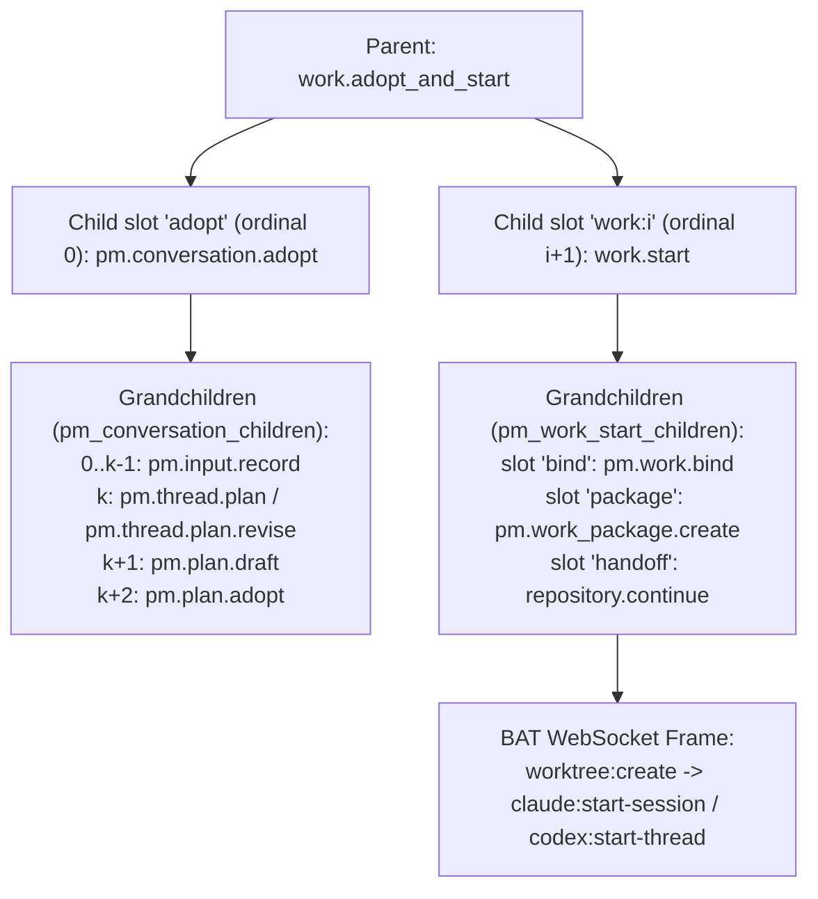

# v1.3 P6：`work.adopt_and_start` 採用提案並開始選定工作設計規格

> 2026-10-23 landing 導航補充：本人在所選 Work 的 landing 明確按下「恢復」，
> 會重新建立該分頁對原操作、第一個 Work 的導向意圖。重新載入後即使父、子收據
> 已完成，也依目前已核對的成功狀態開啟原 Attempt 的 live Work，一次即止；
> 不要求觀察到狀態轉換。離開該 landing 會撤回意圖，背景完成及被動重訪不會
> 搶回導航。原操作、Work／Attempt ID、key、授權與未知結果對帳規則不變。
>
> Landing navigation: explicitly resuming the selected Work renews this tab's
> intent to follow that original operation's first Work. Checked successful
> parent and child receipts open its exact live Attempt once, including after
> reload without observing a status transition. Leaving withdraws that intent;
> background completion and passive revisits cannot take navigation back.

> 2026-10-17 實作補充：`operation_steps.status = started` 同時涵蓋仍在執行中的
> 外部呼叫。父操作的進度判斷必須先核對該子操作是否仍有活躍 worker，不能僅因
> 看到未完成步驟就停成 `needs_attention`。仍有 worker 時繼續等待原操作；worker
> 已離開而結果未確認，或 operation 已是 `uncertain` 時，仍按本規格處理未知結果。
> 這項區分只用於進度與等待；取消、恢復及重複開工防護繼續把未完成外部步驟視為
> 未決效果，不清除送出記錄、不重建子操作。實作回歸刻意停住工作包讀取及 BAT
> 啟動，核對解除卡點後自動完成且只啟動一次。

## 1. 範圍與目標

本規格定義 v1.3 Phase 6（P6）的複合動作 `work.adopt_and_start`（對齊 `docs/product/v1.3-closed-loop-plan.md` F3、`§7.1`、R1 與 A06，以及 `docs/design/v1.3-e00-baseline.md` `§3.2`、`§3.3` 與 `docs/design/v1.3-e02-work-start.md`）。

當擁有決策權的使用者在 PM 對話中審閱完一份結構化提案（proposal）並勾選一或多個要立即執行的 Work 時，按下「採用並開始選定工作」只會送出**一次明確授權**（`work.adopt_and_start`），但後端必須將「採用計畫」與「逐一啟動所選 Work」紀錄為**分離且各自具備持久收據的階段**，絕不假裝 SQLite、托管 Git 與遠端 BAT 主機構成單一原子交易：

1. **一次授權、兩階段紀錄**：
   - 第一階段（`adopting` → `adopted`）建立並等待單一 `pm.conversation.adopt` 子操作（slot `"adopt"`，`ordinal = 0`），重用既有對話提案採用鏈路（`pm.input.record`、`pm.thread.plan` 或 `pm.thread.plan.revise`、`pm.plan.draft`、`pm.plan.adopt`）。
   - 第二階段（`starting`）在 `"adopt"` 子操作成功並寫入 `pm_plan_adoptions` 收據後，依使用者於父操作 admission 鎖定的 `works` 順序，逐一建立 `work.start` 子操作（slot `"work:0"`, `"work:1"`, ...，`ordinal = 1..N`），完整重用 E02（`src/bat_agent_connector/pm_work_start.py`）的綁定、工作包組合／重用與執行交接鏈路，絕不重新實作 `work.start`。
2. **誠實的階段失敗與局部成功語意**：
   - 若採用階段失敗（`adoption_failed`）或暫停（`adoption_paused`），後端**不會**建立任何 `work.start` 子操作（0 個 Work 啟動）。
   - 若採用成功但後續任一或全部 Work 未能啟動，父操作狀態明確呈現「計畫已採用，工作尚未開始」（`adopted_not_started`）或「部分已開始」（`partially_started`）或「工作啟動結果未知」（`start_unknown`）。
3. **恢復與重試安全保證**：
   - Recovery（`resume` 或 daemon 重啟）絕不重新執行已完成的採用（不重送 `pm.conversation.adopt`），也絕不重啟已經啟動（`started`）或啟動結果未知（`start_unknown` / `uncertain`）的 Work。
   - 所有子操作與孫操作的 `idempotency_key` 皆由父操作 `operation_id` 與固定 slot 決定，確保跨重啟收據對帳（reconciliation）與最終 frame 檢查不被繞過。

本階段僅交付設計規格文件 `docs/design/v1.3-p6-adopt-and-start.md`，不修改任何程式碼。

---

## 2. 既有基底事實與程式碼錨點（Decision 1–13 基礎）

以下引用皆來自當前基底 commit `5840f41df5be1d481f0ed3cecf147a178715bd3c` 的實際程式碼。

### 2.1 對話提案採用（`src/bat_agent_connector/pm_conversation_adoption.py`）

`pm.conversation.adopt` 已註冊為複合操作，主要 scope 為 `"manage"`，其不可變子操作表為 `pm_conversation_children`，並以 SQLite trigger `pm_conversation_child_settled` 在子操作進入終態時喚醒處於 `waiting_external` 的父操作（見 `src/bat_agent_connector/pm_conversation_adoption.py:26-57`）：

```python
def install(ops):
    with ops.journal.tx():
        ops.db.execute("""CREATE TABLE IF NOT EXISTS pm_conversation_children (
            parent_id TEXT NOT NULL, ordinal INTEGER NOT NULL, operation_id TEXT NOT NULL UNIQUE,
            request TEXT NOT NULL, request_digest TEXT NOT NULL, created_at REAL NOT NULL,
            PRIMARY KEY(parent_id,ordinal))""")
        for verb in ("UPDATE", "DELETE"):
            ops.db.execute(f"CREATE TRIGGER IF NOT EXISTS pm_conversation_children_{verb.lower()}_immutable "
                f"BEFORE {verb} ON pm_conversation_children BEGIN SELECT RAISE(ABORT,'Proposal child is immutable'); END")
        # The immutable relation, not caller-supplied refs, identifies the parent.
        # Persist its wakeup with the child's outcome so restart cannot lose it.
        ops.db.execute("""CREATE TRIGGER IF NOT EXISTS pm_conversation_child_settled
            AFTER UPDATE OF status ON operations
            WHEN NEW.status != OLD.status AND NEW.status IN ('succeeded','failed','cancelled','needs_attention')
            BEGIN
                UPDATE operations SET next_run_at=0
                WHERE action='pm.conversation.adopt' AND status='waiting_external'
                    AND operation_id=(SELECT parent_id FROM pm_conversation_children
                        WHERE operation_id=NEW.operation_id);
            END""")
    if proposals.ADOPT not in ops.actions:
        ops.register(ActionDef(proposals.ADOPT, "manage", "Adopt one complete owner-reviewed conversation update",
            _run, _admit, ("workspace_id", "thread_id"), authorize_existing=_authorize_existing))


def _admit(ops, principal, target, params, pre):
    pm_native_operations._scopes(principal)
    pm_workspace.require_member(ops.db, principal, target.get("workspace_id"), decide=True)
    if (set(target) != {"workspace_id", "thread_id"} or set(params) != {"proposal_id", "review", "rationale"}
            or set(pre) != {"expected_version", "expected_plan_version", "expected_accepted_revision_id", "expected_proposal_digest"}):
        raise proposals.error("Supply one exact proposal, whole review, rationale and original versions")
    proposal = proposals.get_proposal(ops, principal, target["workspace_id"], params["proposal_id"])["proposal"]
```

在執行階段，`_current_principal` 已驗證呼叫者必須同時具備 `{"observe", "manage", "start"}` 三個 scopes（見 `src/bat_agent_connector/pm_conversation_adoption.py:114-120`）：

```python
def _current_principal(ops, parent):
    binding = parent["external_refs"]["admission_binding"]
    saved = binding["principal"]
    original = Principal(saved["actor"], frozenset(saved["scopes"]), admin=saved["admin"])
    pm_native_operations._scopes(original)
    required, now = {"observe", "manage", "start"}, time.time()
    rows = ops.db.execute("""SELECT token_hash,scopes FROM api_principals WHERE actor=? AND revoked_at IS NULL
```

`pm.conversation.adopt` 的 `_request`、`_create` 與 `_run` 會依序產生每個候選條目的 `pm.input.record`、接著 `pm.thread.plan.revise` 或 `pm.thread.plan`、`pm.plan.draft` 以及 `pm.plan.adopt`，並在成功時回傳包含 `pm_plan_adoptions.result`（含新採用的 `revision_id`、`scope_revision`、`plan_version` 等）的收據（見 `src/bat_agent_connector/pm_conversation_adoption.py:203-274`）：

```python
def _request(parent, proposal, children, *, base_version=None):
    reviewed = parent["params"]["review"]
    originals = proposal["document"]["candidates"]
    rows = {row["key"]: row for row in reviewed["rows"]}
    ordinal, count = len(children), len(originals)
    context = proposal["context"]
    version = context["thread_version"] if base_version is None else base_version
    common = {"target": parent["target"], "idempotency_key": "pm-conversation:" + parent["operation_id"] + ":" + str(ordinal)}
    if ordinal < count:
        original = originals[ordinal]
        row = rows[original["key"]]
        return {**common, "action": "pm.input.record", "params": {"slot": original["domain"] + "." + row["key"],
            "value": row["text"], "status": row["status"],
            "source_ref": {"kind": "statement", "ref": "Owner review " + parent["operation_id"] +
                "; original proposal " + proposal["proposal_id"] + "; candidate " + row["key"]}},
            "preconditions": {"expected_version": version + ordinal}}
    inputs = {item["key"]: children[index]["result"]["input_id"] for index, item in enumerate(originals)}
    selected = [inputs[item["key"]] for item in originals if rows[item["key"]]["include"]]
    if ordinal == count:
        previous = context["draft_id"]
        return {**common, "action": "pm.thread.plan.revise" if previous else "pm.thread.plan",
            "params": {"title": reviewed["title"], "rationale": parent["params"]["rationale"], "selected_input_ids": selected},
            "preconditions": {"expected_version": version + count, **({"expected_draft_id": previous} if previous else {})}}
    if ordinal == count + 1:
        return {**common, "action": "pm.plan.draft", "params": {"title": reviewed["title"],
            "previous_revision_id": context["plan_head"]["latest_revision_id"],
            "sections": {domain: [inputs[item["key"]] for item in originals
                if item["domain"] == domain and rows[item["key"]]["include"]] for domain in pm_profiles.DOMAINS},
            "requirements": [{"id": item["id"], "source_input_id": inputs[item["source_key"]],
                "acceptance_input_ids": [inputs[key] for key in item["acceptance_keys"]], "priority": item["priority"],
                "depends_on": item["depends_on"]} for item in reviewed["requirements"]]},
            "preconditions": {"expected_version": version + count + 1, "expected_plan_version": context["plan_head"]["version"]}}
    if ordinal == count + 2:
        return {**common, "action": "pm.plan.adopt",
            "target": {"workspace_id": parent["target"]["workspace_id"], "revision_id": children[-1]["result"]["revision_id"]},
            "params": {"rationale": parent["params"]["rationale"]},
            "preconditions": {"expected_accepted_revision_id": context["plan_head"]["accepted_revision_id"]}}
    return None


def _create(ctx):
    def create():
        parent = ctx.service._row(ctx.operation_id)
        principal, proposal, children = _guard(ctx.service, parent)
        thread = pm_discussions._thread(ctx.service.db, **parent['target'])
        applied = sum(ctx.service.db.execute('SELECT 1 FROM pm_discussion_applied WHERE operation_id=?',
            (child['operation_id'],)).fetchone() is not None for child in children)
        request = _request(parent, proposal, children, base_version=thread['version'] - applied)
        child, fresh = ctx.service.create(principal, **request, entry="pm-conversation")
        if not fresh:
            raise proposals.error("Child key exists without original relation", "PM_CONVERSATION_CHANGED", 409)
        ctx.service.db.execute("INSERT INTO pm_conversation_children VALUES(?,?,?,?,?,?)", (ctx.operation_id, len(children),
            child["operation_id"], pm_runs._json(request), pm_runs._digest(request), time.time()))
        ctx.service._merge_refs(child["operation_id"], {LINK: ctx.operation_id})
        ctx.service.db.execute("INSERT OR IGNORE INTO pm_source_lineage VALUES(?,?,?,?)",
            ("operation", child["operation_id"], proposal["operation_id"], ctx.operation_id))
        return {"operation_id": child["operation_id"]}
    ordinal = len(_children(ctx.service.db, ctx.op))
    return ctx.effect("pm.conversation.child." + str(ordinal), create)


async def _run(ctx):
    children = _children(ctx.service.db, ctx.op)
    if children:
        last = children[-1]
        # Original accepted receipt recovery precedes all new-effect gates.
        if last["action"] == "pm.plan.adopt":
            saved = ctx.service.db.execute("SELECT result FROM pm_plan_adoptions WHERE operation_id=?", (last["operation_id"],)).fetchone()
            if saved:
                return {**json.loads(saved[0]), "proposal_id": ctx.params["proposal_id"],
                    "review_digest": ctx.admission_binding["conversation_review"]["review_digest"],
                    "adoption_operation_id": last["operation_id"], "child_operation_ids": [child["operation_id"] for child in children]}
```

此外，`src/bat_agent_connector/pm_conversation_proposals.py` 以索引 `pm_conversation_adopted_proposal`（見 `src/bat_agent_connector/pm_conversation_proposals.py:45-47`）記錄成功採用的提案操作：

```python
        journal.db.execute("CREATE INDEX IF NOT EXISTS pm_conversation_adopted_proposal ON operations "
            "(json_extract(target,'$.workspace_id'), json_extract(params,'$.proposal_id')) "
            "WHERE action='pm.conversation.adopt' AND status='succeeded'")
```

並且 `_adoptions` 會查詢 `o.action='pm.conversation.adopt' AND o.status='succeeded'` 以判定提案是否已被採用（見 `src/bat_agent_connector/pm_conversation_proposals.py:258-275`）：

```python
def _adoptions(db, principal, workspace_id, proposal_ids):
    """One indexed page lookup; only visible, successful parents prove adoption.

    The final original child's receipt supports older/recovered parent results.
    Neither a current plan head nor an unfinished parent's child proves success.
    """
    from . import pm_access
    if not proposal_ids:
        return {}
    rows = db.execute("""SELECT o.*, COALESCE(json_extract(o.result,'$.revision_id'), a.revision_id) AS adopted_revision_id
        FROM operations o LEFT JOIN pm_plan_adoptions a ON a.operation_id=(
            SELECT c.operation_id FROM pm_conversation_children c
            WHERE c.parent_id=o.operation_id ORDER BY c.ordinal DESC LIMIT 1)
            AND a.workspace_id=json_extract(o.target,'$.workspace_id')
        WHERE o.action='pm.conversation.adopt' AND o.status='succeeded'
            AND json_extract(o.target,'$.workspace_id')=?
            AND json_extract(o.params,'$.proposal_id') IN (SELECT value FROM json_each(?))
        ORDER BY o.created_at, o.operation_id""", (workspace_id, json.dumps(proposal_ids))).fetchall()
```

### 2.2 單一工作啟動（`src/bat_agent_connector/pm_work_start.py`）

`work.start` 已實作為複合操作，主要 scope 為 `"start"`，具備 10 個必要 `PRECONDITIONS` 與固定參數集合（見 `src/bat_agent_connector/pm_work_start.py:39-59`）：

```python
SLOTS = ("bind", "package", "handoff")
SLOT_ORDINAL = {"bind": 0, "package": 1, "handoff": 2}
LINK = "work_start_parent"
CHILD_STOPPED = frozenset({"succeeded", "failed", "cancelled", "needs_attention"})
PRECONDITIONS = frozenset({
    "expected_work_item_fingerprint",
    "expected_work_version",
    "expected_binding_id",
    "expected_scope_revision",
    "expected_previous_package_id",
    "expected_project_version",
    "repository_id",
    "binding_digest",
    "expected_source_sha",
    "expected_latest_attempt_id",
})
PARAMS_REQUIRED = frozenset({"instruction", "agent", "delivery", "code_target"})
PARAMS_OPTIONAL = frozenset({"model", "requirement_ids"})
CODE_TARGET_KEYS = ("repository", "host", "workspace_id", "source_ref")
DELIVERY_GOALS = frozenset({"pull_request", "reviewable_changes"})
AGENTS = frozenset({"claude", "codex"})
```

同時，`pm_work_start.install` 建立了固定子操作表 `pm_work_start_children`（slots 為 `"bind"`、`"package"`、`"handoff"`）、不可變嘗試紀錄表 `work_attempts` 以及 `pm_work_start_child_settled` trigger（見 `src/bat_agent_connector/pm_work_start.py:89-133`）：

```python
            """CREATE TABLE IF NOT EXISTS pm_work_start_children (
                parent_id TEXT NOT NULL,
                slot TEXT NOT NULL,
                ordinal INTEGER NOT NULL,
                operation_id TEXT NOT NULL UNIQUE,
                request TEXT NOT NULL,
                request_digest TEXT NOT NULL,
                created_at REAL NOT NULL,
                PRIMARY KEY(parent_id, slot),
                UNIQUE(parent_id, ordinal))""",
            """CREATE TABLE IF NOT EXISTS work_attempts (
                sequence INTEGER PRIMARY KEY AUTOINCREMENT,
                attempt_id TEXT NOT NULL UNIQUE,
                workspace_id TEXT NOT NULL,
                work_item_id TEXT NOT NULL,
                origin_kind TEXT NOT NULL,
                origin_id TEXT NOT NULL,
                start_operation_id TEXT UNIQUE,
                predecessor_attempt_id TEXT,
                admission_digest TEXT NOT NULL,
                created_at REAL NOT NULL,
                UNIQUE(origin_kind, origin_id))""",
            """CREATE INDEX IF NOT EXISTS work_attempts_by_work
                ON work_attempts(workspace_id, work_item_id, sequence DESC)""",
        ):
            journal.db.execute(ddl)
        for table, label in (
            ("pm_work_start_children", "Work start child is immutable"),
            ("work_attempts", "Work attempt history is immutable"),
        ):
            for verb in ("UPDATE", "DELETE"):
                journal.db.execute(
                    f"CREATE TRIGGER IF NOT EXISTS {table}_{verb.lower()}_immutable "
                    f"BEFORE {verb} ON {table} BEGIN SELECT RAISE(ABORT, '{label}'); END"
                )
        journal.db.execute("DROP TRIGGER IF EXISTS pm_work_start_child_settled")
        journal.db.execute("""CREATE TRIGGER IF NOT EXISTS pm_work_start_child_settled
            AFTER UPDATE OF status ON operations
            WHEN NEW.status != OLD.status AND NEW.status IN ('succeeded','failed','cancelled','needs_attention','uncertain')
            BEGIN
                UPDATE operations SET next_run_at=0
                WHERE action='work.start' AND status='waiting_external'
                    AND operation_id=(SELECT parent_id FROM pm_work_start_children
                        WHERE operation_id=NEW.operation_id);
            END""")
```

當 `work.start` 需要自動合成工作包（`package_plan["mode"] == "compose"`）時，`_require_ready` 會拒絕含有 `depends_on` 前置條件的 requirement，並回傳 `PM_WORK_START_PREREQUISITES`（見 `src/bat_agent_connector/pm_work_start.py:607-617`）：

```python
def _require_ready(selected_requirements: list[dict], package_plan: dict, readiness: dict) -> None:
    if package_plan["mode"] == "compose":
        prereq_ids = [r["id"] for r in selected_requirements if r.get("depends_on")]
        if prereq_ids:
            raise _bad(
                "PM_WORK_START_PREREQUISITES",
                "Requirements declaring depends_on prerequisites ("
                + ", ".join("dependency:" + rid for rid in prereq_ids)
                + ") are not supported by the thin work.start path; use pm.work_package.create and pm.work_batch.start",
                409,
            )
```

---

## 3. 十三項核心設計決策（Decisions 1–13）

### Decision 1：入口、Target 與採用子操作（Entry, Target and the Adoption Child）

1. **R1 封裝的採用動作**：
   - `work.adopt_and_start` 在 R1 封裝的是 **`pm.conversation.adopt`**（而非裸 `pm.plan.adopt`）。
   - **理由**：
     1. 產品規格 F3（`docs/product/v1.3-closed-loop-plan.md:132-139`）與 R1（`docs/product/v1.3-closed-loop-plan.md:542`）將「採用，稍後做」（`pm.conversation.adopt`）與「採用並開始選定工作」（`work.adopt_and_start`）並列為對話提案審閱面板上的兩個按鈕；在該時間點，審閱後的候選條目（candidates）與計畫修訂（plan draft）尚未寫入資料庫，必須透過 `pm.conversation.adopt` 依序執行 `pm.input.record`、`pm.thread.plan` / `pm.thread.plan.revise`、`pm.plan.draft` 與 `pm.plan.adopt`。
     2. `pm_conversation_proposals._adoptions` 與索引 `pm_conversation_adopted_proposal` 皆以 `o.action='pm.conversation.adopt' AND o.status='succeeded'` 判斷提案是否已採用；以真實的 `pm.conversation.adopt` 作為第 0 個子操作（slot `"adopt"`），能直接讓提案在採用完成當下被標記為已採用，若後續 Work 啟動失敗，使用者重試或恢復時也不會重複出現未採用狀態或允許二次採用同一提案。
2. **`work.adopt_and_start` 的 Target、Params 與 Preconditions**：
   - **`target`**（`target_keys = ("workspace_id", "thread_id")`）：
     - `workspace_id`: PM 工作區 ID（對應 Project 的 PM workspace）。
     - `thread_id`: 產生該提案的 PM 討論串 ID（符合 `pm_discussions.THREAD`）。
   - **`params`**：
     - `proposal_id`: 對話提案操作 ID（與 `pm.conversation.adopt` 相同）。
     - `review`: 擁有者審閱後的完整結構（含 `title`、`rows`、`requirements`、`removed_requirement_ids`，與 `pm.conversation.adopt` 相同，由 `def review(value, document, baseline_ids=()):`（`src/bat_agent_connector/pm_conversation_format.py:115`）驗證）。
     - `rationale`: 採用理由字串（1..4000 字元，與 `pm.conversation.adopt` 相同）。
     - `works`: 非空陣列（長度 1 至 10 筆），列出選定要啟動的既有 Work 及其啟動參數（詳見 Decision 2）。
   - **`preconditions`**：
     - 對話與計畫基線前置條件（與 `pm.conversation.adopt` 完全一致）：
       - `expected_version`: `int`，討論串目前版本號。
       - `expected_plan_version`: `int`，目前 `pm_plan_heads.version`。
       - `expected_accepted_revision_id`: `str | None`，目前 `pm_plan_heads.accepted_revision_id`。
       - `expected_proposal_digest`: `str`，提案文件的 SHA-256 digest（`proposal["document_digest"]`）。
     - 所選 Work 的固定前置條件陣列 `works`（詳見 Decision 3）。
3. **Adoption 子操作請求結構**：
   - Slot `"adopt"`（`ordinal = 0`）提交給 `ctx.service.create(principal, **request, entry="work-adopt-and-start")` 的請求與獨立呼叫 `pm.conversation.adopt` 完全一致，不做任何欄位刪減或變造：
     - `action`: `"pm.conversation.adopt"`
     - `target`: `{"workspace_id": parent["target"]["workspace_id"], "thread_id": parent["target"]["thread_id"]}`
     - `params`: `{"proposal_id": parent["params"]["proposal_id"], "review": parent["params"]["review"], "rationale": parent["params"]["rationale"]}`
     - `preconditions`: `{"expected_version": pre["expected_version"], "expected_plan_version": pre["expected_plan_version"], "expected_accepted_revision_id": pre["expected_accepted_revision_id"], "expected_proposal_digest": pre["expected_proposal_digest"]}`
     - `idempotency_key`: `f"work-adopt-and-start:{parent_id}:adopt"`

---

### Decision 2：固定的選定工作清單（The Fixed Work Selection）

1. **僅選擇既有 Work（Existing Works Only）**：
   - 在 R1 中，`params.works` 的每一個項目都必須指向一個**已存在且處於 active 狀態的 Work**（`work_item_id` 符合 `WORK_ITEM_ID = re.compile(r"wi_[0-9a-f]{20}")`（`src/bat_agent_connector/work_items.py:36`）），且其所屬 Project 已綁定至 `target.workspace_id`（`pm_project_bindings`）且未封存（`archived_at IS NULL`）。
   - **為何不在 `work.adopt_and_start` 內動態建立新 Work**：`work_item.create` 在執行時以 `wid = "wi_" + secrets.token_hex(10)`（`src/bat_agent_connector/work_items.py:708`）產生 `work_item_id`，在父操作 admission 當下無法鎖定 `work_item_id`、`expected_work_version`、`expected_work_item_fingerprint`、`expected_binding_id`、`expected_previous_package_id` 與 `expected_latest_attempt_id`。因此使用者若需新增 Work，應先透過既有 `work_item.create` 建立，或於未來擴充版本才引入固定 `f"work-adopt-and-start:{parent_id}:work_create:{i}"` 子操作；R1 的 `work.adopt_and_start` 僅接受既有 `work_item_id`。
2. **`params.works[i]` 每項目的欄位規格**：
   - `work_item_id`（必填，`str`）：目標 Work ID（`wi_[0-9a-f]{20}`）。
   - `requirement_ids`（必填，`list[str]`，`1..50` 個不重複 ID）：此 Work 在本次採用計畫中負責的 requirement IDs。
     - 每個 `rid` 都必須存在於 `params.review["requirements"]` 中。
     - 因為採用剛剛建立全新的 plan revision，尚未存在指向該新 `revision_id` 的 `pm_work_bindings` 或 `pm_work_packages`（故每個 `work.start` 子操作必然走 `bind_needed = True` 與 `package_plan["mode"] == "compose"`）。為避免採用成功後 `work.start` 才因 `PM_WORK_START_PREREQUISITES` 失敗，父操作 `_admit` 會在 admission 當下檢查 `params.review["requirements"]` 中被選取的 `requirement_ids`：若任一被選取的 requirement 在 `review["requirements"]` 宣告了非空的 `depends_on`，父操作在 admission 直接以 `PM_WORK_START_PREREQUISITES`（HTTP 409）拒絕，不建立任何操作。
   - `instruction`（必填，`str`）：1..4000 字元（經 `strip()` 後非空），交由 `work.start` 傳遞給執行會話。
   - `agent`（必填，`"claude" | "codex"`）：與 `pm_work_start.AGENTS` 一致。
   - `model`（選填，`str | None`）：若提供，為 1..256 字元且不含控制字元（與 `pm_work_start._clean_model` 一致）。
   - `delivery`（必填，`"pull_request" | "reviewable_changes"`）：與 `pm_work_start.DELIVERY_GOALS` 一致。
   - `code_target`（必填，`dict`）：鍵集合固定為 `{"repository", "host", "workspace_id", "source_ref"}`（與 `pm_work_start.CODE_TARGET_KEYS` 一致）。
3. **數量上限、重複檢查與不可變封存**：
   - **數量上限**：提議定義常數 `MAX_SELECTED_WORKS = 10`（即 `1 <= len(params["works"]) <= 10`）。超出上限或為空陣列時，admission 回傳 `INVALID_PARAMS`（HTTP 422）。
   - **重複檢查**：`params["works"]` 中所有 `work_item_id` 必須互不相同；若同一個 `work_item_id` 出現超過一次，admission 回傳 `INVALID_PARAMS`（HTTP 422）。
   - **封存不變性**：父操作在 `_admit` 驗證通過後，將正規化後的 `works` 清單（含順序 `index = 0..N-1`、每個項目的參數與對應的固定 preconditions）寫入 `external_refs["admission_binding"]["work_adopt_and_start"]` 並計算 SHA-256 `work_adopt_and_start_digest`。Admission 之後，無論 resume 或重啟，皆不得新增、刪除、重排或修改任何選定 Work。

---

### Decision 3：採用後的 `work.start` 前置條件銜接與 Admission 職責分工（Preconditions After Adoption & Shared Admission Helpers）

#### 3.1 10 個 `work.start` 前置條件的來源與精確錯誤碼（修正 B1）

`work.start` 的 `def _validate_preconditions_shape(pre: dict) -> None:`（`src/bat_agent_connector/pm_work_start.py:668-709`）強制要求全部 10 個 `PRECONDITIONS`（格式不符或缺少鍵時於 `src/bat_agent_connector/pm_work_start.py:670, 708` 拋出 `PRECONDITION_REQUIRED`，HTTP 422）。在 `work.adopt_and_start` 中，這 10 個前置條件嚴格區分為「父操作 admission 時固定鎖定的 9 個值」與「唯一取自 `"adopt"` 子操作成功收據的 1 個值」：

| `work.start` 前置條件欄位 | 來源階段 | 精確來源、`work.start` 驗證點（`path:line`）與錯誤碼（HTTP 狀態） |
| :--- | :--- | :--- |
| `expected_work_item_fingerprint` | 父操作 admission 固定（`preconditions.works[i]`） | 取自預覽時的 `work_items.fingerprint(work)`；在 `src/bat_agent_connector/pm_work_start.py:756-757`（及 `_guard` `:1228-1230`）比對，不符拋出 `WORK_ITEM_CHANGED`（HTTP 409）。 |
| `expected_work_version` | 父操作 admission 固定（`preconditions.works[i]`） | 取自預覽時的 `work["version"]`；在 `src/bat_agent_connector/pm_work_start.py:756-757`（及 `_guard` `:1227-1230`）比對，不符拋出 `WORK_ITEM_CHANGED`（HTTP 409）。 |
| `expected_project_version` | 父操作 admission 固定（`preconditions.works[i]`） | 取自預覽時的 `project["version"]`；在 `src/bat_agent_connector/pm_work_start.py:758-759`（及 `_guard` `:1231-1232`）比對，不符拋出 `PROJECT_CHANGED`（HTTP 409）。 |
| `expected_binding_id` | 父操作 admission 固定（`preconditions.works[i]`） | 取自預覽時該 Work 既有的 `pm_work_bindings.binding_id`（未綁定則為 `None`）；在 `src/bat_agent_connector/pm_work_start.py:761-765`（及 `_guard` `:1251-1267`）比對，不符拋出 `PM_WORK_BINDING_CHANGED`（HTTP 409）。 |
| `expected_previous_package_id` | 父操作 admission 固定（`preconditions.works[i]`） | 取自預覽時該 Work 最新 `pm_work_packages.package_id`（無則為 `None`）；在 `src/bat_agent_connector/pm_work_start.py:774-776`（及 `_guard` `:1269-1280`）比對，不符拋出 `PM_PACKAGE_VERSION_CONFLICT`（HTTP 409）。 |
| `expected_latest_attempt_id` | 父操作 admission 固定（`preconditions.works[i]`） | 取自預覽時該 Work 在 `work_attempts` 的最新 `attempt_id`（無則為 `None`）；由 `require_expected_latest_attempt`（`src/bat_agent_connector/pm_work_start.py:276, 291, 297`，於 `_check_admission` `:777` 與 `admit_operation` `:334` 呼叫）驗證，不符拋出 `PM_WORK_ATTEMPT_CHANGED`（HTTP 409）。 |
| `repository_id` | 父操作 admission 固定（`preconditions.works[i]`） | 取自預覽時 `repository_sync.config_snapshot` 的 `config["repository_id"]`；在 `src/bat_agent_connector/pm_work_start.py:791-795` 比對，不符拋出 `REPOSITORY_BINDING_CHANGED`（HTTP 409）。 |
| `binding_digest` | 父操作 admission 固定（`preconditions.works[i]`） | 取自預覽時 `repository_sync.digest(config)`；在 `src/bat_agent_connector/pm_work_start.py:790-795`（及 `_guard` `:1243-1244`）比對，不符拋出 `REPOSITORY_BINDING_CHANGED`（HTTP 409）。 |
| `expected_source_sha` | 父操作 admission 固定（`preconditions.works[i]`） | 取自預覽時 `repository_sync.source_preview` 解析出的 40-hex commit SHA。**注意（修正 B1）**：同步執行的 `_check_admission` 僅在 `_validate_preconditions_shape`（`src/bat_agent_connector/pm_work_start.py:706-708`）以 `SHA_RE` 驗證 40-hex 格式（不符拋出 `PRECONDITION_REQUIRED`，HTTP 422）。若遠端分支 head 在預覽後、啟動前發生變動，則會在非同步執行階段被攔截：（1）於 `"package"` 子操作（`pm.work_package.create`）的 `_read_sources`（`src/bat_agent_connector/pm_work_packages.py:326-329`）比對 `observed != code` 時拋出 `PM_PACKAGE_CODE_SOURCE_CHANGED`（HTTP 409）；（2）於 `"handoff"` 子操作（`repository.continue`）的 `"source.resolve"` step（`src/bat_agent_connector/repository_sync.py:211-213`）比對 `selected["source_sha"] != ctx.params["source_sha"]` 時拋出 `REPOSITORY_REF_CHANGED`（HTTP 409；若在 `"repository.fetch"` 階段分支移動，亦於 `src/bat_agent_connector/repository_sync.py:159-160, 270-271` 拋出 `REPOSITORY_REF_CHANGED`，HTTP 409）。 |
| **`expected_scope_revision`** | **唯一取自 `"adopt"` 子操作收據** | **不接受**呼叫端於父操作 `preconditions.works[i]` 預填舊計畫的 `scope_revision`。當 `"adopt"` 子操作成功後，父操作從 `adopt_child["result"]["scope_revision"]`（與 `pm_plan_adoptions` 收據一致）讀取新採用計畫版本的 `scope_revision`，填入每個 `work:{i}` 子操作請求的 `preconditions["expected_scope_revision"]`，由 `work:{i}` 的 `_check_admission`（`src/bat_agent_connector/pm_work_start.py:770-772`）與 `_guard`（`:1247-1248`）比對，不符拋出 `PM_PACKAGE_SCOPE_CHANGED`（HTTP 409）。 |

#### 3.2 為何不會與新採用的計畫產生偽衝突，但能攔截並行變更

1. **新計畫採用本身只推進 `pm_plan_heads` 與 `pm_plan_revisions`**：
   - `"adopt"` 子操作執行 `pm.input.record`、`pm.thread.plan` / `pm.thread.plan.revise`、`pm.plan.draft` 與 `pm.plan.adopt`，它會更新 `pm_threads`、`pm_plan_revisions`、`pm_plan_heads` 與 `pm_plan_adoptions`，並產出新的 `revision_id` 與 `scope_revision`。
   - `"adopt"` 子操作**不會**修改 `work_items`、`projects`、`pm_work_bindings`、`pm_work_packages`、`work_attempts` 或設定快照。
   - 當 `"adopt"` 完成後，`pm_plans.accepted_plan(ops, principal, wid)["plan"]` 回傳的正是剛剛採用的 `revision_id` 與 `scope_revision`。此時 `work.start` 子操作以 `expected_scope_revision = adopt_child["result"]["scope_revision"]` 搭配父操作鎖定的其餘 9 個前置條件進入 `pm_work_start._admit`：
     - `pm_work_start._resolve_requirement_ids`（`src/bat_agent_connector/pm_work_start.py:631-665`）看到傳入的 `requirement_ids` 存在於新採用的 `current_plan["document"]["requirements"]`，而既有 `binding["plan_revision_id"]`（若存在）不等於新的 `current_plan["revision_id"]`，因此判定 `bind_needed`（`src/bat_agent_connector/pm_work_start.py:488-493`）為 `True`。
     - `pm_work_start.evaluate_package_plan`（`src/bat_agent_connector/pm_work_start.py:479-604`）合成指向新 `revision_id` 與 `expected_scope_revision` 的工作包描述（`mode = "compose"`），並在 `work.start` 內部依序執行 `pm.work.bind` → `pm.work_package.create` → `repository.continue`。
2. **禁止在建立 `work:{i}` 時重新讀取資料庫以覆寫固定的 9 個值**：
   - 父操作在建立 `work:{i}` 子操作時，**絕不**重新查詢 `work_items`、`pm_work_bindings`、`pm_work_packages`、`work_attempts` 或 `repository_sync.config_snapshot` 來替換 `preconditions`。
   - 若在 `"adopt"` 執行期間，有另一個並行請求修改了某個選定 Work、Project、Binding、Package、Repo 設定，或對該 Work 發起了另一個 `work.start`，則 `ctx.service.create(principal, **request_i, entry="work-adopt-and-start")` 會在 `work:{i}` 子操作 admission 當下拋出對應的 `OperationError`（詳見 Decision 5.2 與 `§4.3`）。

#### 3.3 父操作 Admission 與 `work:{i}` 子操作 Admission 的職責分工與共用 Helper（Decision C5 & Round 3 B6）

為確保父操作 `work.adopt_and_start._admit` 不複製 `pm_conversation_adoption.py` 或 `pm_work_start.py` 的驗證邏輯，同時能在建立任何子操作前攔截無效請求：

1. **在父操作 `work.adopt_and_start._admit` 同步執行的檢查（重用既有與提取之共用 helpers）**：
   - **工作區權限與角色**：直接呼叫 `pm_work_start._member(ops, principal, wid, write=True, decide=True)`（`src/bat_agent_connector/pm_work_start.py:155-159`），驗證 `{"observe", "manage", "start"}` scopes 與 workspace `owner` 資格。
   - **提案與審閱內容驗證**：直接呼叫 `pm_conversation_adoption._admit(ops, principal, target, adopt_params, adopt_pre)`（`src/bat_agent_connector/pm_conversation_adoption.py:51-80`），不重複撰寫任何提案、討論串版本、計畫版本、`fmt.review` 或 `git_binding_id` 驗證。
   - **每筆選定 Work 的本地狀態與 9 個固定前置條件驗證**：將 `src/bat_agent_connector/pm_work_start.py:718-797` 中不依賴「已採用計畫（`accepted_plan`）」的檢查提取為 `pm_work_start.check_work_preconditions(ops, principal, wid, wi_id, params_i, pre_i, *, controller)`，由 `pm_work_start._check_admission` 與 `pm_work_adopt_and_start._admit` **共同呼叫**。該共用 helper 依序執行：
     1. `require_work_controller(ops.db, wid, wi_id, controller)`（`src/bat_agent_connector/pm_work_start.py:719`；注意 `require_work_controller` 於 `:192` 的簽名為 `def require_work_controller(db, workspace_id: str, work_item_id: str, candidate: dict) -> dict | None:`，接收完整的 `controller` binding dict）；
     2. `require_latest_attempt_settled(ops.db, wid, wi_id)`（`src/bat_agent_connector/pm_work_start.py:720`）；
     3. 參數欄位、`AGENTS`、`DELIVERY_GOALS`、`CODE_TARGET_KEYS`、`_clean_model`、`repository_sync.check_ref` 與 `_validate_preconditions_shape` 檢查（`src/bat_agent_connector/pm_work_start.py:721-747`；對父操作預檢時允許 `expected_scope_revision` 由後續採用填入）；
     4. `work = work_items._get_item(ops.db, wi_id, active=True)`（`src/bat_agent_connector/pm_work_start.py:749`）與 `project = work_items._get_project(ops.db, work["project_id"], active=True)`（`src/bat_agent_connector/pm_work_start.py:750`）；
     5. `pm_project_bindings` 存在性檢查（`src/bat_agent_connector/pm_work_start.py:751-755`，不符拋出 `PM_PROJECT_BINDING_REQUIRED` 409）；
     6. `expected_work_version` 與 `expected_work_item_fingerprint` 比對（`src/bat_agent_connector/pm_work_start.py:756-757`，不符拋出 `WORK_ITEM_CHANGED` 409）；
     7. `expected_project_version` 比對（`src/bat_agent_connector/pm_work_start.py:758-759`，不符拋出 `PROJECT_CHANGED` 409）；
     8. `expected_binding_id` 比對（`src/bat_agent_connector/pm_work_start.py:760-765`，不符拋出 `PM_WORK_BINDING_CHANGED` 409）；
     9. `expected_previous_package_id` 比對（`src/bat_agent_connector/pm_work_start.py:774-776`，不符拋出 `PM_PACKAGE_VERSION_CONFLICT` 409）與 `pm_work_packages._history` 數量上限預檢（若既有工作包已達 `MAX_PACKAGES_PER_WORK = 50`，於 `src/bat_agent_connector/pm_work_start.py:501-502` 拋出 `PM_PACKAGE_HISTORY_LIMIT` 409）；
     10. `require_expected_latest_attempt(ops.db, wid, wi_id, pre["expected_latest_attempt_id"])`（`src/bat_agent_connector/pm_work_start.py:777`，不符拋出 `PM_WORK_ATTEMPT_CHANGED` 409）；
     11. `code_target["repository"]` 所屬專案檢查（`src/bat_agent_connector/pm_work_start.py:783-784`，不符拋出 `PROJECT_REPOSITORY_CHANGED` 409）、`repository_sync.config_snapshot` 與 `repository_id` / `binding_digest` 比對（`src/bat_agent_connector/pm_work_start.py:786-795`，不符拋出 `REPOSITORY_NOT_BOUND` 403、`REPOSITORY_HOST_UNAVAILABLE` 403/409 或 `REPOSITORY_BINDING_CHANGED` 409），以及 `pm_worktree.validate_selection(ops, code_source)`（`src/bat_agent_connector/pm_work_start.py:796`）。
   - **針對審閱後提案需求（`review["requirements"]`）的預檢（Advisory Precheck）**：
     - 由 `params["review"]` 合成擬議計畫視圖 `preview_plan`（從 `review["rows"]` 解析每個 requirement 的 `statement` 與 `acceptance_criteria`），對每筆 `works[i]` 呼叫 `pm_work_start.compose_thin_package`（`src/bat_agent_connector/pm_work_start.py:392-476`）、`pm_work_packages.document_readiness_checks`、`pm_work_start._require_ready`（`src/bat_agent_connector/pm_work_start.py:607-628`，攔截 `PM_WORK_START_PREREQUISITES` 409 與 `PM_WORK_START_NOT_READY` 409）以及 `pm_package_handoff.prompt` 長度檢查（`src/bat_agent_connector/pm_work_start.py:817-838`，超過 `repository_sync.MAX_PROMPT_CHARS` 拋出 `PM_HANDOFF_TOO_LARGE` 413）。
     - **為何父操作的 `preview_plan` 預檢為 Advisory，而子操作 Admission 為 Authoritative（修正 Round 3 B6）**：在父操作 `_admit` 當下，`pm.input.record` 與 `pm.plan.draft` 尚未執行，真實的 `pm_inputs` ID、`revision_id` 與 `scope_revision` 尚未鑄造，因此 `preview_plan` 預檢的作用是在採用前儘早攔截明顯錯誤（如 `depends_on` 前置依賴 `PM_WORK_START_PREREQUISITES` 或明顯超長的 `instruction`）。待 `"adopt"` 子操作完成、真實計畫寫入 `pm_plan_revisions` 後，`work:{i}` 子操作 admission（`pm_work_start._check_admission`）針對真實 `accepted_plan` 的檢查才是**最終權威檢查（Authoritative Check）**。
2. **在 `work:{i}` 子操作 Admission（採用完成後）執行的最終權威檢查**：
   - 當 `"adopt"` 子操作完成後，`ctx.service.create(principal, **request_i, entry="work-adopt-and-start")` 呼叫完整的 `pm_work_start._check_admission` 與 `pm_work_start.admit_operation`：
     1. 除再次執行上述 `check_work_preconditions`（以攔截 `"adopt"` 執行期間發生的並行修改）外，還會針對**真實已採用**的 `pm_plans.accepted_plan(ops, principal, wid)["plan"]` 權威驗證 `PM_ADOPTED_PLAN_REQUIRED`（`src/bat_agent_connector/pm_work_start.py:768-769`）、`PM_PACKAGE_SCOPE_CHANGED`（`src/bat_agent_connector/pm_work_start.py:770-772`）、`_resolve_requirement_ids`（`src/bat_agent_connector/pm_work_start.py:779`）、`evaluate_package_plan`（`src/bat_agent_connector/pm_work_start.py:800-813`）、`_require_ready`（`src/bat_agent_connector/pm_work_start.py:814`）與真實 `pm_package_handoff.prompt` 長度（`src/bat_agent_connector/pm_work_start.py:817-838`）。若真實採用後合成的工作包或交接 prompt 因實際 `revision_id` / `input_id` 差異而跨越 readiness 或長度邊界（拋出 `PM_WORK_START_NOT_READY` 409 或 `PM_HANDOFF_TOO_LARGE` 413），由於這兩個錯誤碼皆屬於 `PER_WORK_REFUSAL_CODES`（見 `§5.2`），父操作會將其記錄為該筆 `work:{i}` 的拒絕收據（`work.adopt_and_start.refused.work:{i}`，`stage = "not_started"`、`status = "refused"`），並繼續處理其餘選定 Work；
     2. 在子操作的 INSERT 交易內執行 `pm_work_start.admit_operation`（`src/bat_agent_connector/pm_work_start.py:315-374`），寫入不可變的 `work_attempts` 列（`attempt_id = "att_" + child_op_id[3:]`）。父操作本身**不**在父 admission 寫入 `work_attempts`，因為唯有實際建立 `work:{i}` 子操作時才有對應的 `start_operation_id`。

---

### Decision 4：階段模型、執行狀態集與子操作表（Stages, Runnable States and Children）

1. **對齊 `docs/design/v1.3-e00-baseline.md` `§3.3` 的階段詞彙與 `operations.py` 狀態集（修正 C4 & Round 3 B4）**：
   - 在 `src/bat_agent_connector/operations.py:34-38` 與 `src/bat_agent_connector/pm_work_start.py:42` 中，操作的狀態集合定義如下（**注意：基底沒有 `"queued"` 狀態**，剛建立尚未執行完畢的操作狀態為 `"accepted"`）：

```python
STATES = ("accepted", "running", "waiting_checks", "waiting_external", "needs_attention", "uncertain",
          "succeeded", "failed", "cancelled")
TERMINAL = frozenset({"succeeded", "failed", "cancelled"})
# Rows the worker picks up again (``running`` after a restart replays its steps).
RUNNABLE = ("accepted", "running", "waiting_checks", "waiting_external", "uncertain")
```

   - 父操作階段（`result.stage`）：
     - `accepted`：父操作已通過 admission，尚未建立 `"adopt"` 子操作。
     - `adopting`：`"adopt"` 子操作已建立且尚未進入 `CHILD_STOPPED`（即 `status` 處於 `RUNNABLE`：`accepted`、`running`、`waiting_checks`、`waiting_external`、`uncertain`）。
     - `adopted`：`"adopt"` 子操作已成功（`pm_plan_adoptions` 收據已存在），尚未建立第一個 `work.start` 子操作。
     - `starting`：已進入 Work 啟動階段，至少一個 `work:{i}` 正在執行或待建立。
     - 終態／停止階段：
       - `started`：`"adopt"` 成功，且所有選定的 Work 皆已 `started`（`succeeded`）。
       - `partially_started`：`"adopt"` 成功，至少一個選定 Work 為 `started`，但另有選定 Work 為 `not_started` 或 `start_unknown`。
       - `start_unknown`：`"adopt"` 成功，沒有任何 Work 為 `started`（或與 `not_started` 並存），且至少一個 Work 處於 `start_unknown`。
       - `adopted_not_started`：`"adopt"` 成功，但沒有任何選定 Work 啟動成功且無 `start_unknown`（所有 Work 皆為 `not_started`，對應 UI「計畫已採用，工作尚未開始」）。
       - `adoption_paused`：`"adopt"` 子操作停在可恢復的 `needs_attention`（父操作 `operations.status = "needs_attention"`），尚未採用計畫，0 個 Work 啟動。
       - `adoption_failed`：`"adopt"` 子操作在 admission 被拒，或終止於 `failed` / `cancelled`（父操作 `operations.status = "failed"`），尚未採用計畫，0 個 Work 啟動。
       - `cancelled`：使用者在完成前取消操作（若在採用後取消且無任何 Work 啟動，仍保留 `adopted = True` 與 `adoption` 收據，清楚區分「採用前取消」與「採用後取消」）。
   - 每個選定 Work 的階段（`result.works[i].stage`）：
     - `not_started`：尚未啟動，或在子操作 admission / `"bind"` / `"package"` / `"handoff"` 確定未送出啟動前失敗／取消。
     - `starting`：`work:{i}` 子操作處於 `RUNNABLE` 且 `pm_work_start._uncertain(ops, child)` 為 `False`。
     - `started`：`work:{i}` 子操作 `succeeded`（已取得 `session_id` 與 `worktree_path`）。
     - `start_unknown`：`work:{i}` 子操作的 `status == "uncertain"`，或 `pm_work_start._uncertain(ops, child)` 為 `True`（代表 `"handoff"` 的外部步驟處於 `'started'` 或 `'uncertain'`，結果尚未證實）。
2. **專用不可變子操作關聯表 `pm_work_adopt_and_start_children`**：
   - **為何不重用既有表**：
     - `pm_conversation_children` 的 trigger `pm_conversation_child_settled` 寫死 `WHERE action='pm.conversation.adopt'`，且 `pm_conversation_adoption._children` 驗證 `len(rows) <= 23` 與 `pm.conversation.adopt` 專屬的 `_request`。
     - `pm_work_start_children` 的 trigger `pm_work_start_child_settled` 寫死 `WHERE action='work.start'`，且 `pm_work_start._children` 寫死 `SLOTS = ("bind", "package", "handoff")`。
   - 因此在新模組中以冪等 DDL 建立 `pm_work_adopt_and_start_children` 表、不可變 triggers 與 `pm_work_adopt_and_start_child_settled` trigger（**不分配 `user_version`，不新增 data step**）。

提議（Proposed）新增之 schema DDL：
```sql
CREATE TABLE IF NOT EXISTS pm_work_adopt_and_start_children (
    parent_id TEXT NOT NULL,
    slot TEXT NOT NULL,
    ordinal INTEGER NOT NULL,
    operation_id TEXT NOT NULL UNIQUE,
    request TEXT NOT NULL,
    request_digest TEXT NOT NULL,
    created_at REAL NOT NULL,
    PRIMARY KEY(parent_id, slot),
    UNIQUE(parent_id, ordinal)
);

CREATE TRIGGER IF NOT EXISTS pm_work_adopt_and_start_children_update_immutable
BEFORE UPDATE ON pm_work_adopt_and_start_children
BEGIN SELECT RAISE(ABORT, 'Work adopt-and-start child is immutable'); END;

CREATE TRIGGER IF NOT EXISTS pm_work_adopt_and_start_children_delete_immutable
BEFORE DELETE ON pm_work_adopt_and_start_children
BEGIN SELECT RAISE(ABORT, 'Work adopt-and-start child is immutable'); END;

CREATE TRIGGER IF NOT EXISTS pm_work_adopt_and_start_child_settled
AFTER UPDATE OF status ON operations
WHEN NEW.status != OLD.status AND NEW.status IN ('succeeded','failed','cancelled','needs_attention','uncertain')
BEGIN
    UPDATE operations SET next_run_at=0
    WHERE action='work.adopt_and_start' AND status='waiting_external'
        AND operation_id=(SELECT parent_id FROM pm_work_adopt_and_start_children
            WHERE operation_id=NEW.operation_id);
END;
```

3. **子操作建立順序、等待行為與延遲結案刷新（Decision C4 & Round 3 B2）**：
   - 父操作 `_run(ctx)` 每次只建立並等待**一個**子操作（sequential execution），絕不平行爆量送出：
     1. **Slot `"adopt"`（`ordinal = 0`）**：
        - Step 名稱：`ctx.effect("work.adopt_and_start.child.adopt", ...)`
        - 子操作 `action`: `"pm.conversation.adopt"`，`idempotency_key`: `f"work-adopt-and-start:{parent_id}:adopt"`
        - 建立後寫入 `pm_work_adopt_and_start_children`、設定 `external_refs["work_adopt_and_start_parent"] = {"operation_id": parent_id, "slot": "adopt"}`、寫入 `pm_source_lineage`（`("operation", child_id, proposal_operation_id, parent_id)`），然後儲存進度並 `raise Wait("waiting_external", "Waiting for conversation adoption child", 1)`。
     2. **Slots `"work:0"` .. `"work:{N-1}"`（`ordinal = 1 .. N`）**：
        - 僅在 `"adopt"` 子操作 `status == "succeeded"` 且 `pm_plan_adoptions` 收據存在後才依 `i = 0 .. N-1` 順序進行。
        - 每個 `i` 先檢查是否已有 `slot = f"work:{i}"` 的子操作，或是否已有拒絕收據 step `f"work.adopt_and_start.refused.work:{i}"`。
        - **當 `work:{i}` 子操作已存在且處於 `RUNNABLE` 時的等待規則（C4）**：
          - 若 `child["status"] not in CHILD_STOPPED` 且 `child["status"] != "uncertain"` 且 `not pm_work_start._uncertain(ctx.service, child)`（即 `work:{i}` 正在正常執行 `"bind"`、`"package"` 或 `"handoff"`，尚未進入不確定重試），父操作呼叫 `_save_progress`（標記 `works[i].stage = "starting"`）並 `raise Wait("waiting_external", f"Waiting for work.start child work:{i}", 1)`。
          - 若 `child["status"] == "uncertain"` 或 `pm_work_start._uncertain(ctx.service, child)` 為 `True`（即 `work:{i}` 的 `"handoff"` 孫操作進入 `uncertain` 並在背景依 `UNCERTAIN_RETRY_S = (30.0, 60.0, 120.0, 300.0, 600.0)` 執行自動對帳，或已停在 `needs_attention` 且結果未知），父操作在 `_save_progress` 中將 `works[i].stage` 記為 `"start_unknown"`，並**繼續推進至 `work:{i+1}`**，使單一主機或單一 Work 的讀回延遲不會阻塞其他獨立 Work 的啟動。
        - **當子操作在父操作停止後才結案（Late Child Settlement）時的狀態讀取與刷新機制（修正 Round 3 B2）**：
          - 不在 `OperationService.get` 加入讀取時投影 hook。`operations.result` 僅在父操作自身執行 `_run`（包含在 `waiting_external` 被 `pm_work_adopt_and_start_child_settled` 喚醒）或呼叫 `ops.resume` 時由 `_save_progress` 寫入。
          - 若父操作已停在 `needs_attention`（例如因 `work:0` 為 `start_unknown` 且全部 Work 已巡訪完畢），而 `work:0` 的 `"handoff"` 稍後在背景自動讀回（或使用者對 `work:0` 執行 `resume`）後結案為 `succeeded` 或 `failed`：
            1. **Per-Work 即時真相（Per-Work Live Truth）**：`result.works[i]` 已保存 `start_operation_id` 與 `attempt_id`，任何客戶端或 UI 皆可直接透過 `GET /api/v1/operations/{start_operation_id}` 或 E02 既有的 `pm_work_attempt_get` / `pm_work_attempts_list` 讀取該筆 `work:{i}` 子操作的最新即時狀態。
            2. **父操作 `resume` 持久化刷新（Resume Persistence）**：當使用者對處於 `needs_attention` 的父操作呼叫 `ops.resume(principal, parent_id)` 時，父操作轉回 `running` 並執行 `_run`，讀取已結案的 `work:{i}` 子操作並透過 `_save_progress` 將最新 `result` 與終態（例如若所有 Work 現皆已 `started`，父操作直接轉為 `succeeded`）持久化寫回 `operations` 表。

---

### Decision 5：局部成功、錯誤分類、交易邊界與終態映射（Partial Success, Transaction Boundaries & Terminal Mapping）

#### 5.1 當 `"adopt"` 子操作在 Admission 被拒或執行中停止時（Decision C2 & Round 3 B4）

1. **情況 A：建立 `"adopt"` 子操作時在 `pm.conversation.adopt._admit` 被拒絕（無子操作列）**：
   - 在父操作通過 `_admit` 後、worker 實際執行 `_run` 建立 `"adopt"` 子操作前，討論串或計畫基線可能被其他並行操作修改，導致 `ctx.service.create(principal, **adopt_request, entry="work-adopt-and-start")` 在 `pm.conversation.adopt._admit` 拋出 `OperationError`（例如 `VERSION_CONFLICT` 409 或 `PM_CONVERSATION_CHANGED` 409）。
   - 此時 `operations` 表中**不存在** `"adopt"` 子操作列（`adoption.operation_id = None`）。
   - 父操作在 `ctx.effect("work.adopt_and_start.child.adopt", ...)` **外部**捕獲該 `OperationError`，呼叫 `_save_progress` 將 `result` 寫為：
     - `stage = "adoption_failed"`、`adopted = False`；
     - `adoption = {"operation_id": None, "status": "refused", "revision_id": None, "scope_revision": None, "plan_version": None, "adoption_operation_id": None, "error_code": exc.code, "error_message": exc.message}`；
     - `works` 陣列中全部 $N$ 個項目皆為 `stage = "not_started"`、`status = "not_started"`、`start_operation_id = None`、`attempt_id = None`。
   - 接著父操作紀錄持久收據 `ctx.effect("work.adopt_and_start.refused.adopt", ..., receipt_only=True)`（在該收據交易內一併呼叫 `ctx.service._step_status(ctx.operation_id, "work.adopt_and_start.child.adopt", "failed", error={"code": exc.code, "message": exc.message})`）並重新拋出 `raise _bad(exc.code, exc.message, exc.status)`，使父操作進入終態 `failed`（保留已寫入的 `result`，詳見 `§5.4`），且 **0 個 `work.start` 子操作被建立**。
2. **情況 B：`"adopt"` 子操作已建立，但最終停在 `failed`、`cancelled` 或 `needs_attention`（修正 Round 3 B4）**：
   - 父操作**絕不**建立任何 `work:{i}` 子操作。
   - **若 `"adopt"` 子操作停在可恢復的 `needs_attention`**（例如原 actor 憑證暫時過期或目標 Git 主機設定漂移 triggering `GIT_EXECUTION_LOCATION_CHANGED`）：
     - 父操作透過 `_save_progress` 將 `result` 更新為 **`stage = "adoption_paused"`**、`adopted = False`、`adoption = {"operation_id": adopt_child["operation_id"], "status": "needs_attention", "revision_id": None, "scope_revision": None, "plan_version": None, "adoption_operation_id": None, "error_code": adopt_child["error_code"], "error_message": adopt_child["status_reason"]}`，且所有 `works[i]` 為 `stage = "not_started"`。
     - 父操作 `raise NeedsAttention(code, reason)` 進入 `needs_attention`（可透過 `ops.resume` 轉發恢復 `"adopt"` 子操作）。
   - **若 `"adopt"` 子操作已終止於 `failed` 或 `cancelled`**：
     - 父操作透過 `_save_progress` 將 `result` 更新為 **`stage = "adoption_failed"`**、`adopted = False`、`adoption = {"operation_id": adopt_child["operation_id"], "status": adopt_child["status"], "revision_id": None, "scope_revision": None, "plan_version": None, "adoption_operation_id": None, "error_code": adopt_child["error_code"], "error_message": adopt_child["status_reason"]}`，且所有 `works[i]` 為 `stage = "not_started"`。
     - 父操作 `raise _bad(code, reason, 409)` 進入終態 `failed`（透過 `COALESCE(?, result)` 保留 `result`）。

#### 5.2 建立 `work:{i}` 時的交易邊界、Per-Work 拒絕碼白名單、父層級錯誤可恢復性與崩潰視窗（Decision C1 & Round 3 B1, B3）

在 `src/bat_agent_connector/operations.py:223-239` 中，`OpContext.effect` 的實作如下：

```python
        if not receipt_only:
            self.check_cancel()
        if row is None:
            self.service._step_start(self.operation_id, name, request or {}, local=True,
                                     bookkeeping=receipt_only or lifecycle_bookkeeping)
        with self.service.journal.tx():
            if not receipt_only:
                from .host_git import require_execution
                require_execution()
                from .pm_source_lineage import require_new_effect
                require_new_effect(self.service, self.operation_id)
            from .pm_lifecycle_gates import require_local
            require_local(self.service.db, self.operation_id, bookkeeping=receipt_only or lifecycle_bookkeeping)
            result = fn()
            self.service._step_done(self.operation_id, name, result or {})
            self._effect_refs(result or {}, refs)
        return result or {}
```

同時，`OperationService._step_status`（`src/bat_agent_connector/operations.py:497-503`）的實作如下：

```python
    def _step_status(self, operation_id: str, name: str, status: str, *, error: dict | None = None) -> None:
        with self.journal.tx():
            self.db.execute("""UPDATE operation_steps SET status=?,error=COALESCE(?,error),
                finished_at=CASE WHEN ?='failed' THEN ? ELSE finished_at END WHERE operation_id=? AND name=?""",
                            (status, _canonical(error) if error else None, status, time.time(), operation_id,
                             name))
            self._observation_event(operation_id, "operation.step." + status, {"step": name, "status": status, "error_code": (error or {}).get("code")})
```

而 `TaskJournal.tx`（`src/bat_agent_connector/task_journal.py:451-461`）支援嵌套 `SAVEPOINT`：

```python
    def tx(self):
        nested = self.db.in_transaction
        self.db.execute("SAVEPOINT task_effect" if nested else "BEGIN IMMEDIATE")
        try:
            yield
            self.db.execute("RELEASE task_effect" if nested else "COMMIT")
        except BaseException:
            self.db.execute("ROLLBACK TO task_effect" if nested else "ROLLBACK")
            if nested:
                self.db.execute("RELEASE task_effect")
            raise
```

這帶來三項關鍵設計約束：
1. **絕不可在 `ctx.effect` 的 `fn()` 內部 `try ... except OperationError`**：
   - `ctx.service.create` 的子操作 INSERT 與 `admit_operation` 共享 `ctx.effect` 的 `with self.service.journal.tx():` 交易（`src/bat_agent_connector/operations.py:228, 619-632`）。若在 `fn()` 內部吞掉 `OperationError`，外層 `with self.service.journal.tx():` 會正常退場並 commit 半途失敗的子操作狀態與 `_step_done`！
   - 因此，`admit_work_child()` 內部不捕獲 `OperationError`；任何 `OperationError` 都必須拋出 `with self.service.journal.tx():` 之外，讓 SQLite 交易完整回滾（不留下半成品子操作列或 `work_attempts` 列），並由 `ctx.effect` **外部**的 `try ... except OperationError as exc:` 處理。
2. **嚴格區分「單一 Work 拒絕碼（`PER_WORK_REFUSAL_CODES`）」與「父操作層級閘門錯誤」**：
   - `ctx.effect` 在呼叫 `fn()` 前會執行父操作自身的閘門（`check_cancel`、`host_git.require_execution`、`pm_source_lineage.require_new_effect`、`pm_lifecycle_gates.require_local`），且子操作的 `create` 也會執行工作區生命週期閘門 `pm_lifecycle_gates.admit_operation`。若發生的是工作區已 `paused`/`closed`、控制者憑證失效、Adopted Plan 被撤換等影響整個父操作的錯誤，絕不可將其當成單一 Work 拒絕而繼續迴圈。
   - 因此，我們在建立每個 `work:{i}` 前先呼叫父操作的 `_guard(ctx.service, parent)`，並定義明確的單一 Work 拒絕碼白名單 `PER_WORK_REFUSAL_CODES`：

| 單一 Work 拒絕碼（`PER_WORK_REFUSAL_CODES`） | HTTP 狀態 | 拋出位置（`path:line`） | 為何僅影響該筆 `work:{i}` |
| :--- | :---: | :--- | :--- |
| `WORK_ITEM_NOT_FOUND` | 404 | `src/bat_agent_connector/work_items.py:230`（由 `pm_work_start.py:749` 呼叫） | 僅該 `work_item_id` 被移除。 |
| `WORK_ITEM_ARCHIVED` | 409 | `src/bat_agent_connector/work_items.py:232`（由 `pm_work_start.py:749` 呼叫） | 僅該 `work_item_id` 在採用期間被封存。 |
| `WORK_ITEM_CHANGED` | 409 | `src/bat_agent_connector/pm_work_start.py:757` | 僅該 `work_item_id` 的 `version` 或 `fingerprint` 在採用期間被修改。 |
| `PROJECT_NOT_FOUND` | 404 | `src/bat_agent_connector/work_items.py:221`（由 `pm_work_start.py:750` 呼叫） | 僅該 Work 所屬 Project 不存在。 |
| `PROJECT_ARCHIVED` | 409 | `src/bat_agent_connector/work_items.py:223`（由 `pm_work_start.py:750` 呼叫） | 僅該 Work 所屬 Project 被封存。 |
| `PROJECT_CHANGED` | 409 | `src/bat_agent_connector/pm_work_start.py:759` | 僅該 Work 所屬 Project 的 `version` 在採用期間變動。 |
| `PM_PROJECT_BINDING_REQUIRED` | 409 | `src/bat_agent_connector/pm_work_start.py:755` | 僅該 Work 所屬 Project 與 workspace 的綁定被移除。 |
| `PM_WORK_BINDING_CHANGED` | 409 | `src/bat_agent_connector/pm_work_start.py:763, 765` | 僅該 Work 的 `pm_work_bindings` 在採用期間被其他操作改綁。 |
| `PM_PACKAGE_VERSION_CONFLICT` | 409 | `src/bat_agent_connector/pm_work_start.py:776` | 僅該 Work 的最新 `pm_work_packages` 在採用期間變動。 |
| `PM_PACKAGE_HISTORY_LIMIT` | 409 | `src/bat_agent_connector/pm_work_start.py:502`（由 `:800` 呼叫） | 僅該 Work 的歷史工作包數量達到 50 筆上限。 |
| `PM_WORK_ATTEMPT_CHANGED` | 409 | `src/bat_agent_connector/pm_work_start.py:276, 291, 297`（由 `:777, 334` 呼叫） | 僅該 Work 的 `work_attempts` 最新 attempt 在採用期間變動。 |
| `PM_WORK_START_IN_PROGRESS` | 409 | `src/bat_agent_connector/pm_work_start.py:245, 252`（由 `:720` 呼叫） | 僅該 Work 另有進行中的 `work.start` attempt。 |
| `PM_WORK_START_OUTCOME_UNPROVEN` | 409 | `src/bat_agent_connector/pm_work_start.py:238, 259`（由 `:720` 呼叫） | 僅該 Work 前次 attempt 處於結果未知的 `uncertain` 狀態。 |
| `PM_WORK_CONTROLLER_CONFLICT` | 409 | `src/bat_agent_connector/pm_work_start.py:188, 196`（由 `:719` 呼叫） | 僅該 Work 被另一名 controller 鎖定。 |
| `PROJECT_REPOSITORY_CHANGED` | 409 | `src/bat_agent_connector/pm_work_start.py:784` | 僅該 Work 選定的 repository 從其 Project 移除。 |
| `REPOSITORY_NOT_BOUND` | 403 | `src/bat_agent_connector/repository_sync.py:81`（由 `pm_work_start.py:786, 796` 呼叫） | 僅該 Work 選定的 `(repository, host, workspace_id)` 綁定被移除。 |
| `REPOSITORY_HOST_UNAVAILABLE` | 403 / 409 | `src/bat_agent_connector/repository_sync.py:85, 87`（由 `pm_work_start.py:786, 796` 呼叫） | 僅該 Work 選定的目標主機未設定或停用寫入。 |
| `REPOSITORY_BINDING_CHANGED` | 409 | `src/bat_agent_connector/pm_work_start.py:792` | 僅該 Work 選定的 repository 設定快照 digest 變動。 |
| `PM_WORK_START_PREREQUISITES` | 409 | `src/bat_agent_connector/pm_work_start.py:611`（由 `:814` 呼叫） | 僅該 Work 選定的 requirements 含 `depends_on`。 |
| `PM_WORK_START_NOT_READY` | 409 | `src/bat_agent_connector/pm_work_start.py:624`（由 `:814` 呼叫） | 僅該 Work 合成的工作包未通過 readiness 檢查。 |
| `PM_HANDOFF_TOO_LARGE` | 413 | `src/bat_agent_connector/pm_work_start.py:834` | 僅該 Work 合成的交接 prompt 超過字元上限。 |

   - **當 `exc.code in PER_WORK_REFUSAL_CODES` 時（修正 Round 3 B3：以 `_step_status` 與嵌套 `SAVEPOINT` 標記步驟失敗）**：
     - 父操作在 `ctx.effect` 外部捕獲 `exc`，並呼叫 `ctx.effect(f"work.adopt_and_start.refused.work:{i}", record_refusal, receipt_only=True)`。
     - 在 `record_refusal()` 內部，直接呼叫 `ctx.service._step_status(ctx.operation_id, f"work.adopt_and_start.child.work:{i}", "failed", error={"code": exc.code, "message": exc.message})`（`src/bat_agent_connector/operations.py:497-503`），並回傳拒絕收據 `{"slot": f"work:{i}", "work_item_id": item["work_item_id"], "stage": "not_started", "status": "refused", "error_code": exc.code, "error_message": exc.message}`。
     - 由於外層 `ctx.effect` 已開啟 `with self.service.journal.tx():`（`src/bat_agent_connector/operations.py:228`），而 `_step_status` 內部的 `with self.journal.tx():`（`src/bat_agent_connector/operations.py:498`）在 `TaskJournal.tx`（`src/bat_agent_connector/task_journal.py:451-461`）看到 `nested = self.db.in_transaction` 為 `True`，因此使用 `SAVEPOINT task_effect` 與 `RELEASE task_effect`，將「`work.adopt_and_start.child.work:{i}` 標記為 `'failed'`」與「寫入 `work.adopt_and_start.refused.work:{i}` 收據步驟」在**同一個外層 SQLite 交易**內原子提交，隨後更新 `_save_progress` 並繼續處理 `work:{i+1}`。
3. **當 `exc.code not in PER_WORK_REFUSAL_CODES`（父操作層級閘門錯誤）時的嚴格分流：不可恢復者進入 `failed`，唯有具備真實恢復路徑者才進入 `needs_attention`（修正 Round 3 B1）**：
   - 父操作**立即停止迴圈**，不嘗試建立 `work:{i+1}`，也不寫入 `refused.work:{i}` 收據，並先呼叫 `_save_progress`（`adopted = True`，已完成的前序 Work 保留其實際狀態，而當前的 `work:{i}` 與後續尚未建立的 `work:{j}` 皆記為 `stage = "not_started"`、`status = "not_started"`、`error_code = exc.code`、`error_message = exc.message`）。
   - 接著，為確保**每一個進入 `needs_attention` 的狀態在基底程式碼上都有真正可通過的 `ops.resume` 路徑**，我們將父操作層級錯誤嚴格分為「永久不可恢復（轉入 `failed`）」與「可修復後恢復（轉入 `needs_attention`）」兩類：

| 父操作層級錯誤碼 | HTTP 狀態 | 基底拋出位置（`path:line`） | 父操作停止狀態 | 原因與基底程式碼上的具體恢復路徑（或為何不可恢復） |
| :--- | :---: | :--- | :---: | :--- |
| `PM_LIFECYCLE_STOPPED` | 409 | `src/bat_agent_connector/pm_lifecycle_gates.py:81` | **`failed`** | **不可原單恢復**：在 `src/bat_agent_connector/pm_lifecycle.py:449` 中，`epoch = current['execution_epoch'] + int(action in ('pm.lifecycle.pause', 'pm.lifecycle.close', 'pm.lifecycle.reopen'))`；工作區 `pause`、`close` 與 `reopen` 皆會遞增 `execution_epoch`。即使管理員事後對工作區執行 `pm.lifecycle.reopen`，`current['execution_epoch']` 已大於父操作在 `_admit` 鎖定的 `intent['execution_epoch']`，`pm_lifecycle_gates._require`（`src/bat_agent_connector/pm_lifecycle_gates.py:83-84`）仍會永久以 `PM_LIFECYCLE_EPOCH_CHANGED`（`"This intent belongs to an earlier execution epoch; explicitly submit new work after reopening"`）拒絕。此外，`OpContext.step`（`src/bat_agent_connector/operations.py:291-294`）對 `PM_LIFECYCLE_STOPPED` / `PM_LIFECYCLE_EPOCH_CHANGED` 亦直接將步驟標為 `'failed'`。因此父操作儲存進度後拋出 `OperationError` 進入終態 **`failed`**（保留 `result`），引導使用者於工作區重開後以 P3 獨立 `work.start` 啟動剩餘 Work。 |
| `PM_LIFECYCLE_EPOCH_CHANGED` | 409 | `src/bat_agent_connector/pm_lifecycle_gates.py:83` | **`failed`** | **不可原單恢復**：同上，`execution_epoch` 單調遞增永不倒退，`ops.resume` 永遠無法通過 `_require`。父操作儲存進度後進入終態 **`failed`**。 |
| `PM_PACKAGE_SCOPE_CHANGED` | 409 | `src/bat_agent_connector/pm_work_start.py:772, 1248` | **`failed`** | **不可原單恢復**：父操作鎖定的是本次 `"adopt"` 子操作收據的 `expected_scope_revision`。若在 `"adopt"` 完成後另有其他計畫採用推進了工作區的 `scope_revision`，由於 `pm_plan_revisions` 與 `pm_plan_adoptions` 為 append-only（`src/bat_agent_connector/pm_plans.py:466` 每次變更範疇皆鑄造新的 `"pmscope_" + ctx.operation_id[3:]`），工作區永遠不會退回舊的 `scope_revision`。父操作儲存進度後進入終態 **`failed`**。 |
| `PM_ADOPTED_PLAN_REQUIRED` | 409 | `src/bat_agent_connector/pm_work_start.py:769` | **`failed`** | **不可原單恢復**：`"adopt"` 完成後若無已採用計畫屬不可逆異常，父操作儲存進度後進入終態 **`failed`**。 |
| `PM_WORK_START_CONTROLLER_CHANGED` | 403 | `src/bat_agent_connector/pm_work_start.py:994, 1132, 1301` | **`failed`** | **不可原單恢復**：`controller_for` 由 `return "ctr_" + uuid.uuid5(uuid.UUID(server_id(db)), principal.actor).hex`（`src/bat_agent_connector/pm_workspace.py:53-55`）決定，並由 `controller_authority.binding`（`src/bat_agent_connector/controller_authority.py:68`）封存，而 `same_controller`（`src/bat_agent_connector/controller_authority.py:108-113`）比對 `(server_id, controller_id)`。對固定 `actor` 而言，此錯誤僅在伺服器 `server_id` 或封存綁定遭破壞時發生，無法透過 `resume` 修復，故進入終態 **`failed`**。 |
| `PM_WORK_START_AUTHORITY_UNAVAILABLE` / `AUTHORITY_UNAVAILABLE` | 403 | `src/bat_agent_connector/pm_work_start.py:976, 987, 991`、`src/bat_agent_connector/pm_conversation_adoption.py:124`、`src/bat_agent_connector/pm_workspace.py:69` | **`needs_attention`** | **可修復並 `resume` 成功**：當原 `actor` 的 API token 過期（`expires_at <= now`）或被撤銷（`revoked_at IS NOT NULL`）時觸發。**具體恢復步驟**：管理員為同一個 `actor` 在 `api_principals` 核發一組新的單一有效 token（`revoked_at IS NULL`、`expires_at IS NULL OR expires_at > now`，且 `scopes` 包含 `{"observe", "manage", "start"}`）。由於 `controller_id` 由 `(server_id, actor)` 決定（「Stable across clients, credentials and roles」，`src/bat_agent_connector/pm_workspace.py:53-55`），新憑證擁有完全相同的 `controller_id`。隨後呼叫 `ops.resume(principal, parent_id)`，`_current_principal`（`src/bat_agent_connector/pm_work_start.py:970-981`）查詢 `WHERE actor=? AND revoked_at IS NULL` 即找到新憑證並通過驗證，繼續建立剩餘 `work:{i}`！ |
| `FORBIDDEN`（執行期角色降級） | 403 | `src/bat_agent_connector/pm_work_start.py:158`、`src/bat_agent_connector/pm_workspace.py:90` | **`needs_attention`** | **可修復並 `resume` 成功**：當原 `actor` 在 `pm_workspace_members` 的角色於執行期間被暫時改為 `'contributor'` 或 `'reader'` 時觸發。**具體恢復步驟**：工作區擁有者執行 `pm.workspace.member.set` 將該 `actor` 在該工作區的角色恢復為 `'owner'`（具備 `write=True, decide=True`）。由於 `pm_workspace_members.controller_id` 保持不變（`src/bat_agent_connector/pm_workspace.py:55`），隨後呼叫 `ops.resume(principal, parent_id)` 即可通過 `_member` 與 `same_controller`，繼續建立剩餘 `work:{i}`！ |
| 子／孫操作 `GIT_EXECUTION_LOCATION_CHANGED` | 409 (`NeedsAttention`) | `src/bat_agent_connector/host_git.py:91, 382, 426` | **`needs_attention`** | **可修復並 `resume` 成功**：注意 `"work.adopt_and_start"` 與 `"work.start"` 屬於 `JOURNAL_ONLY_ACTIONS`（`src/bat_agent_connector/host_git.py:211, 295, 417`），故 `host_git` 僅在 `HOST_EFFECT_ACTIONS`（`"pm.conversation.adopt"`、`"pm.plan.adopt"`、`"repository.continue"`，見 `src/bat_agent_connector/host_git.py:180, 186, 191`）檢查目標主機 Git 執行位置。若目標主機設定（`url`、`fingerprint`、`profile_id`、`git`、`managed_roots`、SSH `alias`）漂移導致子／孫操作拋出 `NeedsAttention("GIT_EXECUTION_LOCATION_CHANGED", ...)`，管理員將主機設定恢復至與封存之 `execution_binding` 一致後，對父操作呼叫 `ops.resume(principal, parent_id)` 即可通過 `host_git._require_current`（`src/bat_agent_connector/host_git.py:85-92`）並繼續完成操作！ |

   - **既有 E02 程式碼的不可恢復 `needs_attention` 死胡同、分類優先順序與 `status = "stopped"` 處置（修正 Round 4 Item 1 & Item 3，不於本任務修改 E02）**：
     - 在基底 `src/bat_agent_connector/pm_work_start.py:1546-1548`（`"bind"`）、`src/bat_agent_connector/pm_work_start.py:1594-1599`（`"package"`）與 `src/bat_agent_connector/pm_work_start.py:1653-1665`（`"handoff"`）三個 `except OperationError as exc:` 區塊中，E02 的 `_run` 將 `_guard` 與 `_admit_child` 拋出的**所有** `OperationError`（包含上述永久不可恢復的 `PM_LIFECYCLE_STOPPED`、`PM_LIFECYCLE_EPOCH_CHANGED`、`PM_PACKAGE_SCOPE_CHANGED`、`PM_ADOPTED_PLAN_REQUIRED` 與 `PM_WORK_START_CONTROLLER_CHANGED`）無差別捕獲並轉拋為 `raise NeedsAttention(exc.code, _failure_message(exc.code, exc.message)) from exc`，導致該筆已建立的 `work:{i}` 子操作進入永遠無法 `resume` 成功的 `needs_attention` 狀態。
     - **嚴格分類優先順序（Classification Order）**：父操作在評估已建立的 `work:{i}` 子操作時，**永遠先檢查 `child["status"] == "uncertain" or pm_work_start._uncertain(ctx.service, child)`**。只要該子操作的 `"handoff"` 孫操作存在未證實的外部步驟（`_uncertain` 為 `True`），無論其 `error_code` 為何，一律歸類為 `stage = "start_unknown"`。
     - 唯有在 **`not is_uncertain`** 且 `child["status"] == "needs_attention"` 且 `child["error_code"] in UNRESUMABLE_PARENT_CODES`（`frozenset({"PM_LIFECYCLE_STOPPED", "PM_LIFECYCLE_EPOCH_CHANGED", "PM_PACKAGE_SCOPE_CHANGED", "PM_ADOPTED_PLAN_REQUIRED", "PM_WORK_START_CONTROLLER_CHANGED"})`）時：
       - 由於該 `work:{i}` 子操作與其 `work_attempts` 列已經建立，而 `require_latest_attempt_settled`（`src/bat_agent_connector/pm_work_start.py:215-264`）在 `:244-249` 檢查 `if parent_row is None or parent_row["status"] not in OP_TERMINAL:`，只要該 `work:{i}` 子操作仍停在非終態的 `"needs_attention"`，使用者若直接對該 Work 發起 P3 獨立 `work.start`，必定會被 `require_latest_attempt_settled` 以 `PM_WORK_START_IN_PROGRESS`（HTTP 409）拒絕！
       - 同時，在基底 `src/bat_agent_connector/operations.py:686-737` 中，`ops.cancel` 對 `"work.start"` 會先呼叫 `cancel_work_start_children(self, principal, op)`（`:708-710`），並在 `:717-732` 將處於 `"needs_attention"` 的操作轉為終態 `"cancelled"`；且本規格的 `authorize_child` 規則 2（見 `§7.2` 第 7 項）僅在根父操作 `root_parent["status"] in RUNNABLE` 時拒絕直接取消子操作。一旦根父操作結束於終態 `"failed"`，原始 `actor` 即可合法對該筆卡住的 `work:{i}` 子操作直接呼叫 `ops.cancel(principal, start_operation_id)`（`POST /api/v1/operations/{start_operation_id}/cancel`）將其結案為 `"cancelled"`。
       - 因此，P6 父操作將此類 `work:{i}` 記錄於 `result.works[i]` 時，**完整保留 `start_operation_id = child["operation_id"]` 與 `attempt_id = "att_" + child["operation_id"][3:]`**，並設定 `stage = "not_started"`、專屬 **`status = "stopped"`**（明確區別於無子操作列的 `"refused"` / `"not_started"` 以及已終止的 `"failed"`），隨後停止迴圈、儲存進度並拋出 `_bad(code, reason, 409)` 使父操作進入終態 `failed`。UI 與呼叫端對 `status == "stopped"` 的下一步動作為：**「先取消已停止的啟動操作 `{start_operation_id}`，再以 P3 `work.start` 單獨啟動此工作」**（詳見 `§5.4` 與 `§11.2`）。
   - **崩潰視窗（Crash Window）分析與 `OpContext.effect` 真實重播路徑（修正 Round 4 Item 2）**：
     - 如同 `OpContext.effect` 的 docstring 與實作（`src/bat_agent_connector/operations.py:203-239`）所示：`self.service._step_start`（`:226`）先在獨立交易將本地步驟標為 `'started'`（`:463`），隨後進入 `with self.service.journal.tx():`（`:228`）。注意 `OpContext.effect` **從不呼叫** `_step_restart`（`_step_restart` 位於 `src/bat_agent_connector/operations.py:467-481`，僅由外部步驟 `OpContext.step` 在 `:290` 證明 `recovered is RERUN` 時呼叫；我們在 `_step_restart` 註冊的擴充點 3 `pm_work_adopt_and_start.admit_restart` 係供孫操作的外部步驟重啟驗證使用，與 `§7.1` 第 2 項一致）。
     - 若 `ctx.service.create` 拋出 `PER_WORK_REFUSAL_CODES` 中的 `OperationError`，內層 `tx()` 已完整回滾（資料庫中**沒有** `work:{i}` 子操作列，也**沒有** `work_attempts` 列）。若程序在 `tx()` 回滾後、`work.adopt_and_start.refused.work:{i}` 收據提交前崩潰（crash），重啟時 `operation_steps` 中的 `work.adopt_and_start.child.work:{i}` 仍為 `status = 'started'` 且無 `result`。
     - 父操作重啟重跑 `_run` 時，先執行迴圈檢查（見 `§4.2` 第 3 項）：確認 `pm_work_adopt_and_start_children` 尚無 `slot = f"work:{i}"` 的子操作列，且 `operation_steps` 亦尚無已完成的 `work.adopt_and_start.refused.work:{i}` 收據步驟，因此再次進入 `ctx.effect(f"work.adopt_and_start.child.work:{i}", admit_work_child)`。此時 `OpContext.effect`（`src/bat_agent_connector/operations.py:216-239`）查得既有步驟列 `row["status"] == "started"`（非 `"succeeded"`），證實前次交易已回滾（`:208`），遂跳過 `if row is None:` 的 `_step_start`（`:225-227`），直接在新的 `with self.service.journal.tx():`（`:228`）內重跑 `fn()`，以**完全相同的固定 `idempotency_key` 與固定 10 個 `preconditions`** 再次呼叫 `ctx.service.create`：
       - 若該 Work 的衝突仍然存在（例如 `work_version` 已變動），`create` 會再次以相同錯誤碼拒絕並寫入 `refused.work:{i}` 收據；
       - 若先前的拒絕原因屬於暫時性狀態（例如另一個並行 attempt 剛好結案但並未推進預期外狀態，或目標主機設定恢復），且全部 10 個固定前置條件依然完全吻合，則以原固定 key 與原授權前置條件成功建立 `work:{i}` 完全符合使用者原始授權意圖，且不會產生重複子操作或重複啟動。

#### 5.3 當某個 Work 的啟動結果為 `start_unknown`（`uncertain`）時

- 若 `work:{i}` 子操作的 `status == "uncertain"`，或 `pm_work_start._uncertain(ops, child)` 為真（代表其 `"handoff"` 孫操作 `repository.continue` 有外部步驟處於 `'started'` 或 `'uncertain'`，結果未明）：
  - 在父操作 `result.works[i]` 中紀錄 `stage = "start_unknown"`、`status = "uncertain"`、`start_operation_id = child["operation_id"]`、`attempt_id = "att_" + child["operation_id"][3:]`、`error_code = child["error_code"] or "PM_WORK_START_OUTCOME_UNPROVEN"`。
  - **絕不以新 key 重試**：父操作不會建立新的 `work.start`，且因為 `work_attempts` 中該 Work 的最新 attempt 所對應的 `work.start` 處於未結案狀態，函式 `def require_latest_attempt_settled(db, workspace_id: str, work_item_id: str) -> None:`（`src/bat_agent_connector/pm_work_start.py:215-266`）也會自動以 `PM_WORK_START_OUTCOME_UNPROVEN` 攔截任何針對該 Work 的新 `work.start`，直到原 `work:{i}` 子操作透過讀回對帳結案。

#### 5.4 父操作終態判定表與 `COALESCE(?, result)` 機制（修正 B2、Decision C3 & Round 3 B1, B4）

在 `src/bat_agent_connector/operations.py:413-418` 中，`OperationService._transition` 使用 `result=COALESCE(?,result)` 更新操作列：

```python
            self.db.execute("""UPDATE operations SET status=?,status_reason=?,error_code=?,
                result=COALESCE(?,result),next_run_at=?,attempts=COALESCE(?,attempts),
                uncertain_tries=COALESCE(?,uncertain_tries),version=version+1,updated_at=? WHERE operation_id=?""",
                            (status, (reason or "")[:500] or None, error_code,
                             _canonical(result) if result is not None else None, next_run_at, attempts,
                             uncertain_tries, now, operation_id))
```

並且 `src/bat_agent_connector/pm_work_start.py:1491-1530` 的 `_raise_child_stopped` 正是先呼叫 `_save_progress` 將結構化 `result` 寫入 `operations.result`，再依子操作是否為確定失敗（`is_failed`）決定拋出 `raise _bad(code, reason, 409)`（使父操作進入終態 `failed` 且透過 `COALESCE(?, result)` 完整保留 `result`）或 `raise NeedsAttention(code, reason)`（使父操作進入可恢復的 `needs_attention`）：

```python
def _raise_child_stopped(
    ctx,
    parent: dict,
    intent: dict,
    children: dict[str, dict],
    child: dict,
    *,
    in_progress_stage: str,
    default_code: str,
    fallback: str,
    binding_id: str | None = None,
    package_id: str | None = None,
    session: dict | None = None,
) -> None:
    # A parent with its own pending cancel must end cancelled rather than failing on a cancelled child.
    ctx.check_cancel()
    is_uncertain = child["status"] == "uncertain" or _uncertain(ctx.service, child)
    is_failed = not is_uncertain and child["status"] in {"failed", "cancelled"}
    stage = "start_unknown" if is_uncertain else ("start_failed" if is_failed else in_progress_stage)
    _save_progress(
        ctx,
        _build_state(
            parent,
            intent,
            children,
            stage=stage,
            binding_id=binding_id,
            package_id=package_id,
            session=session,
        ),
    )
    reason = _failure_reason(child, fallback)
    if is_uncertain:
        code = child["error_code"] or "UNCERTAIN_UNRESOLVED"
        raise NeedsAttention(code, reason)
    if is_failed:
        code = child["error_code"] or ("CANCELLED" if child["status"] == "cancelled" else default_code)
        raise _bad(code, reason, 409)
    code = child["error_code"] or default_code
    raise NeedsAttention(code, reason)
```

依此機制，`work.adopt_and_start` 的單別子操作分類**永遠先檢查 `child["status"] == "uncertain" or pm_work_start._uncertain(ctx.service, child)`**（任何帶有未決外部步驟的子操作不論其 `error_code` 為何，一律歸為 `start_unknown`），而父操作終態判定規則（修正 B2、Decision C3、Round 3 B1/B4 & Round 4 Item 1）嚴格以**「對父操作呼叫 `ops.resume` 在基底程式碼上是否真能推進任何子操作」**區分 `failed` 與 `needs_attention`：

| 採用與選定 Work 的結果分佈（共 $N \ge 1$ 個） | 父操作 `operations.status` | 父操作 `result.stage` | 父操作 `error_code` | 對父操作呼叫 `resume` 的行為 | 只讀 `operations.status` 的通用客戶端所見語意 |
| :--- | :--- | :--- | :--- | :--- | :--- |
| `"adopt"` 成功，且 $N$ 個 Work 皆為 `started` | `succeeded` | `"started"` | `None` | 不適用（已 `succeeded`） | 操作完全成功（採用與全部選定工作皆完成）。 |
| `"adopt"` 在 admission 被拒或終止於 `failed` / `cancelled`（0 個 Work 啟動） | `failed` | `"adoption_failed"` | `"adopt"` 的 `error_code` 或 `"PM_CONVERSATION_CHILD_STOPPED"` | 拒絕（`failed` 為終態，無可恢復子操作） | 操作失敗（未採用計畫、0 個工作啟動，`result.stage = "adoption_failed"`）。 |
| `"adopt"` 停在可恢復的 `needs_attention`（0 個 Work 啟動） | `needs_attention` | `"adoption_paused"` | `"adopt"` 的 `error_code` 或 `"PM_CONVERSATION_CHILD_STOPPED"` | 轉發 `ops.resume` 給 `"adopt"` 子操作，成功後繼續啟動 $N$ 個 Work | 需處理／可恢復（採用階段暫停，`result.stage = "adoption_paused"`，修復後可恢復完成採用與啟動）。 |
| `"adopt"` 成功，至少 1 個 Work 為 `start_unknown`，或至少 1 個 `work:{i}` 停在可恢復的 `needs_attention`（`_uncertain == False` 且非 `UNRESUMABLE_PARENT_CODES`），或因可修復的權限／角色暫停（`PM_WORK_START_AUTHORITY_UNAVAILABLE`、`AUTHORITY_UNAVAILABLE`、`FORBIDDEN`）而尚有未建立的 `work:{i}` | `needs_attention` | 若有 `started` 則為 `"partially_started"`；否則若有 `start_unknown` 則為 `"start_unknown"`；否則 `"adopted_not_started"` | 若有 `start_unknown` 則為 `"PM_WORK_START_OUTCOME_UNPROVEN"`，否則為第一個暫停項目的 `error_code` | 轉發 `ops.resume` 給可恢復的 `work:{i}` 子操作、刷新已結案的 `start_unknown` 子操作，或在修復憑證／角色後繼續建立剩餘未建立的 `work:{i}` | 需處理／可恢復（仍有子操作待對帳或可透過 `resume` 繼續推進）。 |
| `"adopt"` 成功，無 `start_unknown`、無可恢復 `needs_attention` 子操作，至少 1 個 Work `started` 且其餘 Work 因 `PER_WORK_REFUSAL_CODES`（`status = "refused"`）、子操作 `failed`（`status = "failed"`）、子操作因 `UNRESUMABLE_PARENT_CODES` 卡在 `needs_attention`（`status = "stopped"`，保留 `start_operation_id` 與 `attempt_id`）或不可恢復之父層級錯誤（`status = "not_started"`）停止 | `failed` | `"partially_started"` | 第一個失敗／停止 Work 或父層級錯誤的 `error_code` | 拒絕（父操作已終止；對 `status == "stopped"` 的 Work 先由原 actor 取消其 `start_operation_id` 使其終止為 `cancelled`，再與其餘未啟動 Work 一併由 P3 獨立 `work.start` 重新預覽啟動） | 操作未完全成功（不會誤判為全部啟動成功），而 `result.stage = "partially_started"`、`result.adopted = true` 與 `result.works` 完整保存採用收據與各 Work 結果。 |
| `"adopt"` 成功，無 `start_unknown`、無可恢復 `needs_attention` 子操作，全部 $N$ 個 Work 皆因 `PER_WORK_REFUSAL_CODES`（`status = "refused"`）、子操作 `failed`（`status = "failed"`）、子操作因 `UNRESUMABLE_PARENT_CODES` 卡在 `needs_attention`（`status = "stopped"`，保留 `start_operation_id` 與 `attempt_id`）或不可恢復之父層級錯誤（`status = "not_started"`）而未啟動 | `failed` | `"adopted_not_started"` | 第一個失敗／停止 Work 或父層級錯誤的 `error_code` | 拒絕（原父操作不可重跑；若 Work 為 `status == "stopped"`，先取消 `start_operation_id` 結案該 attempt，再於排除阻礙或重開工作區後透過 P3 獨立 `work.start` 啟動） | 操作失敗（通用客戶端立即得知工作未能啟動），同時 `result.stage = "adopted_not_started"` 與 `result.adopted = true` 明確呈現**「計畫已採用，工作尚未開始」**。 |
| 使用者對父操作請求 `cancel` 且所有無未決外部步驟的子操作皆已停止 | `cancelled` | `"cancelled"` | `"CANCELLED"` | 拒絕（`cancelled` 為終態） | 操作已取消（`result.adopted` 忠實反映取消發生在採用前或採用後）。 |

#### 5.5 取消（`cancel`）與恢復（`resume`）行為

- **`cancel`**：
  - 呼叫 `ops.cancel(principal, parent_id)` 時，透過 `pm_work_adopt_and_start.cancel_children(ops, principal, op)` 對目前尚未終止的子操作（`"adopt"` 或正在執行的 `"work:{i}"`）轉發 `ops.cancel`，並將父操作標記 `cancel_requested = 1`。
  - 若 `"adopt"` 已經完成，已採用的計畫**不會**回滾；若某個 `"work:{i}"` 的遠端會話已經啟動（`started`），該會話依 `continue_under_original_authority` 規則在原控制者權限下繼續存在，但尚未建立的後續 `"work:{j}"` 不再建立。
- **`resume`**：
  - 呼叫 `ops.resume(principal, parent_id)` 時，透過 `pm_work_adopt_and_start.resume_children(ops, principal, op)` 對處於 `needs_attention` 且非 `_uncertain` 的子操作（`"adopt"` 或 `"work:{i}"`）轉發 `ops.resume`。
  - 當父操作再度被 worker 執行時：
    - 若 `"adopt"` 已在 `pm_plan_adoptions` 擁有成功收據，直接讀取該收據，**絕不**重新執行採用。
    - 對於 `i = 0 .. N-1`：
      - 已 `succeeded`（`started`）的 `work:{i}` 直接讀取其結果，**絕不**重啟。
      - 處於 `uncertain`（`start_unknown`）的 `work:{i}` 僅等待原 `work:{i}` 子操作對帳（若其已在背景對帳結案則直接讀取結案結果），**絕不**以新 key 重建。
      - 已有 `work.adopt_and_start.refused.work:{i}` 收據或子操作已 `failed` 的 `work:{i}` 保持 `not_started`，不自動重試。
      - 尚未建立過的 `work:{i}`（例如先前在 `"adopt"`、更早的 `work:{k}` 或父層級閘門暫停，現已恢復）則依原定固定順序與固定 key 建立。


---

### Decision 6：權限 Scope 與控制者授權（Scopes and Authority）

1. **主要 Scope 與必要 Scopes**：
   - `work.adopt_and_start` 在 `ops.register(ActionDef(...))` 註冊的主要 `scope` 為 **`"start"`**（對齊 `docs/product/v1.3-closed-loop-plan.md` `§7.1` 與 `docs/design/v1.3-e00-baseline.md` `§3.2`）。
   - 在 `_admit`、`_authorize_existing` 以及每次背景執行與恢復的 `_current_principal` 中，強制檢查呼叫者與原始 actor 的存活憑證必須同時具備 `REQUIRED_SCOPES = frozenset({"observe", "manage", "start"})`（`src/bat_agent_connector/pm_work_start.py:38`），這也與 `required, now = {"observe", "manage", "start"}, time.time()`（`src/bat_agent_connector/pm_conversation_adoption.py:119`）完全一致。不新增任何 admin 專屬 scope。
2. **PM Workspace 角色與控制者錨點（Controller Authority）**：
   - 呼叫者在 `target["workspace_id"]` 必須同時具備 `write=True` 與 `decide=True`（在 `src/bat_agent_connector/pm_workspace.py:100-108` 中即 `member["role"] == "owner"`），因為採用計畫與綁定 Work 至新計畫修訂皆屬決策權（`decide`）。
   - 控制者（controller）即為發起 `work.adopt_and_start` 的 `principal.actor`，於 `_admit` 時透過 `controller_authority.binding(ops.db, principal, pm_workspace_id=wid)` 擷取並封存於 `admission_binding["controller_authority"]` 與 `admission_binding["work_adopt_and_start"]["controller"]`。
   - 對每個選定的 `work_item_id`，父操作在 `_admit` 與每次建立 `work:{i}` 子操作前，皆呼叫 `pm_work_start.require_work_controller(ops.db, wid, work_item_id, controller)`，確認該 Work 未被其他控制者鎖定（否則回傳 `PM_WORK_CONTROLLER_CONFLICT`，409）。
   - 在背景執行每個 step、建立子操作或重啟恢復時，`_current_principal(ops, parent)` 會重新查詢 `api_principals` 中屬於原 `actor` 且未撤銷、未過期、同時具備 `{"observe", "manage", "start"}` 的單一憑證，並重新驗證 `_member(ops, principal, wid, write=True, decide=True)` 與 `controller_authority.same_controller(current, saved_controller)`；若憑證已被撤銷或角色被降級，立即以 `PM_WORK_START_AUTHORITY_UNAVAILABLE`（403）或 `PM_WORK_START_CONTROLLER_CHANGED`（403）中止新副作用。

---

### Decision 7：巢狀子操作、來源血統與最終 Frame 閘門（Nested Children & Gate Extensions）

在 `work.adopt_and_start` 下，操作樹為**三層結構**（父操作 → 子操作 → 孫操作）：



#### 7.1 基底程式碼現況與必須擴充的精確位置

經檢視基底 commit `5840f41df5be1d481f0ed3cecf147a178715bd3c`，既有閘門只認識兩層關係（`pm.conversation.adopt` → 其子，以及 `work.start` → 其子），且多處將非 `pm.` 開頭的動作白名單硬編碼為 `"work.start"`。要讓 `work.adopt_and_start` 及其子操作、孫操作完整通過來源血統、生命週期、存取控制、托管 Git 與最終 frame 檢查，實作階段必須擴充以下 6 處：

1. **來源血統衍生動作白名單與可見性（`src/bat_agent_connector/pm_source_lineage.py`）**：
   - `DERIVED_ACTIONS` 現況（見 `src/bat_agent_connector/pm_source_lineage.py:21-24`）：

```python
DERIVED_ACTIONS = frozenset({"artifact.capture.managed", "artifact.accept", "github.pr.publish", "pm.execution.verify",
    "session.send", "session.answer", "session.interrupt", "session.read", "session.position",
    "session.labels.set", "session.record_verification", "work.start", "work_item.update", "work_item.pin",
    "work_item.order", "work_item.approve", "work_item.continue"})
```

   - `_visible_roots` 現況（見 `src/bat_agent_connector/pm_source_lineage.py:260-265`）：

```python
        elif operation["action"] == "work.start":
            from .pm_work_start import source_visible as work_start_visible
            if not work_start_visible(db, principal, operation):
                return False
        elif not source_visible(db, principal, operation):
            return False
```

   - `inherit` 現況（見 `src/bat_agent_connector/pm_source_lineage.py:306-309`）：

```python
    if not visible_roots(ops.db, principal, original_ids):
        raise OperationError("NOT_FOUND", "Original resource sources are unavailable", 404)
    if action not in DERIVED_ACTIONS | pm_delivery_lineage.ACTIONS and not action.startswith("pm.") and not (action == "repository.continue" and (binding or {}).get("pm_handoff")):
        raise OperationError("PM_DERIVED_ACTION_UNAVAILABLE", "This action has no fixed PM source handoff contract yet", 409)
```

   - **問題與擴充**：
     - `"work.adopt_and_start"` 不以 `"pm."` 開頭，若未加入 `DERIVED_ACTIONS`，當父操作（其 `pm_source_roots` 為 `[proposal["operation_id"]]`）呼叫 `pm_source_lineage.inherit` 時會拋出 `PM_DERIVED_ACTION_UNAVAILABLE`。
     - 在 `_visible_roots` 中，若 root 或中間節點為 `"work.adopt_and_start"`，預設的 `pm_package_handoff.source_visible` 會預期 `target` 內有 `"package_id"` 而失敗；必須加入 `elif operation["action"] == "work.adopt_and_start":` 分支，委派給 `pm_work_adopt_and_start.source_visible(db, principal, operation)`（驗證工作區成員資格、提案可見性與所有選定 `work_item_id` 的專案可見性）。

2. **三層子／孫操作的父鏈驗證（`require_child` 與 `admit_restart`）**：
   - `require_new_effect` 現況（見 `src/bat_agent_connector/pm_source_lineage.py:371-380`）：

```python
def require_new_effect(ops, operation_id):
    from .pm_conversation_adoption import require_child as require_conversation_child
    require_conversation_child(ops.db, operation_id)
    from .pm_delivery_lineage import require_admitted_sources
    op = ops._row(operation_id)
    from .pm_work_batches import require_child
    require_child(ops, op)
    from .pm_work_start import require_child as require_work_start_child
    require_work_start_child(ops, op)
    from .pm_maintenance_repairs import require_new_effect as require_repair_effect
```

   - `_require_frame` 現況（見 `src/bat_agent_connector/pm_source_lineage.py:413-420`）：

```python
def _require_frame(ops, operation_id):
    from .pm_conversation_adoption import require_child as require_conversation_child
    require_conversation_child(ops.db, operation_id)
    from .pm_work_batches import require_child
    require_child(ops, ops._row(operation_id))
    from .pm_work_start import require_child as require_work_start_child
    require_work_start_child(ops, ops._row(operation_id))
    from .pm_maintenance_repairs import require_child as require_repair_child
```

   - `require_local` 現況（見 `src/bat_agent_connector/pm_lifecycle_gates.py:115-122`）：

```python
def require_local(db, operation_id, *, bookkeeping=False):
    """Invoke after receipt lookup, INSIDE the local mutation transaction."""
    if not bookkeeping:
        from .pm_conversation_adoption import require_child
        require_child(db, operation_id)
        from .pm_work_start import require_child as require_work_start_child
        require_work_start_child(db, operation_id)
    binding = operation_binding(db, operation_id)
```

   - `_step_restart` 現況（見 `src/bat_agent_connector/operations.py:476-481`）：

```python
                from .pm_work_start import admit_restart as admit_work_start_restart
                admit_work_start_restart(self, operation_id, name)
                from .pm_maintenance_repairs import admit_restart as admit_repair_restart
                admit_repair_restart(self, operation_id, name, request)
            from .pm_lifecycle_gates import admit_step
            admit_step(self.db, operation_id, name, bookkeeping=bookkeeping, restart=True)
```

   - **問題與擴充**：
     - 當孫操作（例如 `pm.input.record`、`pm.plan.adopt`、`pm.work.bind`、`pm.work_package.create`，以及由 `pm_package_handoff` 模組 admit 的 `"handoff"` 孫操作 `repository.continue`，見 `src/bat_agent_connector/pm_work_start.py:1060`）執行時，`pm_conversation_adoption.require_child` 只檢查其直接父操作 `pm.conversation.adopt`，`pm_work_start.require_child` 只檢查其直接父操作 `work.start`，但兩者都不知道該 `pm.conversation.adopt` 或 `work.start` 本身是否為 `pm_work_adopt_and_start_children` 的子操作（或帶有 `external_refs["work_adopt_and_start_parent"]`）。
     - 因此，在 `pm_source_lineage.require_new_effect`、`pm_source_lineage._require_frame`、`pm_lifecycle_gates.require_local` 中加入 `pm_work_adopt_and_start.require_child(ops_or_db, operation_id)`，並在 `operations._step_restart` 中加入 `pm_work_adopt_and_start.admit_restart(self, operation_id, name)`。
     - `pm_work_adopt_and_start.require_child` 會同時解析：
       1. **直接子操作**：`operation_id` 存在於 `pm_work_adopt_and_start_children.operation_id`，或 `op["external_refs"].get("work_adopt_and_start_parent")` 非空；
       2. **孫操作（Grandchild）**：`operation_id` 在 `pm_conversation_children` 或 `pm_work_start_children` 中的 `parent_id`（設為 `mid_id`）存在於 `pm_work_adopt_and_start_children.operation_id`（或 `mid_op["external_refs"].get("work_adopt_and_start_parent")` 非空）。
     - 一旦命中上述任一層級，`pm_work_adopt_and_start.require_child` 立即驗證：
       - 根父操作 `work.adopt_and_start` 的 `admission_binding` digest 完好、狀態未處於非法篡改；
       - 根父操作的 `_current_principal` 憑證仍有效（具備 `{"observe", "manage", "start"}` 與 workspace `write=True, decide=True`）且控制者未變更；
       - 中間子操作（`"adopt"` 或 `"work:{i}"`）在 `pm_work_adopt_and_start_children` 中的 `slot`、`ordinal`、`request_digest` 與實際 `operations` 欄位完全相符；
       - 若為 `"work:{i}"` 分支，已採用的 `pm_plan_adoptions` 收據仍然存在，且 `pm_work_start.require_work_controller` 對該 `work_item_id` 依然通過。

3. **PM 操作可見性過濾器（`src/bat_agent_connector/pm_workspace.py` 與 `src/bat_agent_connector/pm_access.py`）**：
   - `pm_workspace.operation_visible` 現況（見 `src/bat_agent_connector/pm_workspace.py:114-119`）：

```python
    """Read filter for all PM actions; callers retain their ordinary scope checks."""
    if op.get("action") == "work.start":
        from .pm_work_start import operation_visible as work_start_visible
        return work_start_visible(db, principal, op)
    if not op.get("action", "").startswith("pm."):
        return True
```

   - `pm_access.visible` 現況（見 `src/bat_agent_connector/pm_access.py:109-118`）：

```python
    if operation.get('action') == 'github.pr.publish':
        from .pr_publication import operation_visible
        return operation_visible(db, principal, operation)
    if operation.get("action") == "work.start":
        from .pm_work_start import operation_visible
        return operation_visible(db, principal, operation)
    if not operation.get("action", "").startswith("pm."):
        return True
    from .pm_workspace import operation_visible
    return operation_visible(db, principal, operation)
```

   - `pm_access.event_visible` 現況（見 `src/bat_agent_connector/pm_access.py:134-137`）：

```python
            action = event.get("body", {}).get("action", "")
            return not action.startswith("pm.") and action != "work.start"
        return visible(db, principal, {**dict(row), "target": json.loads(row["target"]),
                                      "result": json.loads(row["result"]) if row["result"] else None})
```

   - **問題與擴充**：因為 `"work.adopt_and_start"` 不以 `"pm."` 開頭，若未在 `pm_workspace.operation_visible`、`pm_access.visible` 與 `pm_access.event_visible` 加入 `"work.adopt_and_start"` 分支，`not action.startswith("pm.")` 會直接回傳 `True`，導致非該 workspace 成員也能透過 `/api/v1/operations` 或 SSE 看見 `work.adopt_and_start` 操作與事件。擴充後，`pm_work_adopt_and_start.operation_visible(db, principal, op)` 會同時要求 caller 為 `target["workspace_id"]` 的成員，且對 `params["works"]` 中所有 `work_item_id` 皆具備 `pm_work_start.operation_visible` 可見性。

4. **`OperationService` 的 7 個擴充點（`src/bat_agent_connector/operations.py`，修正 Round 3 B2）**：
   - `_workspace_key` 現況（見 `src/bat_agent_connector/operations.py:126-127`）：

```python
def _workspace_key(action: str) -> bool:
    return action.startswith("pm.") or action == "work.start"
```

   - `_may_steer` 現況（見 `src/bat_agent_connector/operations.py:636-649`）：

```python
    def _may_steer(self, principal: Principal, op: dict, verb: str) -> None:
        from .pm_access import require_visible
        require_visible(self.db, principal, op)
        self._authorize_controller(principal, op, verb)
        from .bulk_approval import authorize_child
        authorize_child(self, principal, op, verb)
        from .orchestration_operations import authorize_child as authorize_orchestration_child
        authorize_orchestration_child(self, principal, op, verb)
        adef = self.actions.get(op["action"])
        if adef and adef.authorize_existing:
            adef.authorize_existing(self, principal, op, verb)
        if not (op["actor"] == principal.actor or principal.admin or (adef and principal.allows(adef.scope))):
            raise OperationError("FORBIDDEN", f"{verb} needs the operation's own actor or its {op['action']} scope",
                                 403)
```

   - `_authorize_controller` 現況（見 `src/bat_agent_connector/operations.py:669-672`）：

```python
        if not (action.startswith(("session.", "worktree.", "fanout.", "cleanup."))
                or action in {"checkpoint.continue", "checkpoint.continue.revalidate",
                              "repository.continue", "integration.handoff", "work.start"}):
            return
```

   - `cancel` 現況（見 `src/bat_agent_connector/operations.py:708-710`）：

```python
        if op["action"] == "work.start":
            from .pm_work_start import cancel_children as cancel_work_start_children
            cancel_work_start_children(self, principal, op)
```

   - `resume` 現況（見 `src/bat_agent_connector/operations.py:757-759`）：

```python
        if op["action"] == "work.start":
            from .pm_work_start import resume_children as resume_work_start_children
            resume_work_start_children(self, principal, op)
```

   - **`operations.py` 的 7 個擴充點（與 `§5` 第 3 項完全一對一對齊，不修改 `OperationService.get`）**：
     1. `OperationService.__init__`：呼叫 `pm_work_adopt_and_start.install(self)` 安裝表、triggers 與 `work.adopt_and_start` ActionDef；
     2. `_workspace_key`（`src/bat_agent_connector/operations.py:126-127`）：加入 `or action == "work.adopt_and_start"`（使 `idempotency_key` 以 `workspace_id` 隔離）；
     3. `_step_restart`（`src/bat_agent_connector/operations.py:476-481`）：呼叫 `pm_work_adopt_and_start.admit_restart(self, operation_id, name)`（供孫操作的外部步驟 `OpContext.step` 重啟時驗證三層父鏈，見 `§7.1` 第 2 項）；
     4. `_may_steer`（`src/bat_agent_connector/operations.py:636-649`）：比照既有的 `bulk_approval.authorize_child`（`src/bat_agent_connector/bulk_approval.py:261-270`）與 `orchestration_operations.authorize_child`（`src/bat_agent_connector/orchestration_operations.py:346-360`），在 `:643` 之後呼叫 `pm_work_adopt_and_start.authorize_child(self, principal, op, verb)`；
     5. `_authorize_controller`（`src/bat_agent_connector/operations.py:669-672`）：將 `"work.adopt_and_start"` 加入控制器授權動作集合；
     6. `cancel`（`src/bat_agent_connector/operations.py:708-710`）：當 `op["action"] == "work.adopt_and_start"` 時呼叫 `pm_work_adopt_and_start.cancel_children(self, principal, op)`；
     7. `resume`（`src/bat_agent_connector/operations.py:757-759`）：當 `op["action"] == "work.adopt_and_start"` 時呼叫 `pm_work_adopt_and_start.resume_children(self, principal, op)`。

5. **Host Git 閘門分類（`src/bat_agent_connector/host_git.py`，修正 Round 3 A4）**：
   - 在 `src/bat_agent_connector/host_git.py:166-314` 中，`action_class` 要求所有動作都歸類於 `SETUP_ACTIONS`、`HOST_EFFECT_ACTIONS`（`:166-209`）或 `JOURNAL_ONLY_ACTIONS`（`:211-304`）：
     - `HOST_EFFECT_ACTIONS`（`src/bat_agent_connector/host_git.py:166-209`）包含 `"pm.conversation.adopt"`（`:180`）、`"pm.plan.adopt"`（`:186`）與 `"repository.continue"`（`:191`，即 E02 在 `src/bat_agent_connector/pm_work_start.py:1060` 建立並由 `pm_package_handoff` 模組 admit 的 `"handoff"` 孫操作）；
     - `JOURNAL_ONLY_ACTIONS`（`src/bat_agent_connector/host_git.py:211-304`）包含 `"pm.input.record"`（`:231`）、`"pm.plan.draft"`（`:256`）、`"pm.thread.plan"`（`:275`）、`"pm.thread.plan.revise"`（`:276`）、`"pm.work.bind"`（`:278`）、`"pm.work_package.create"`（`:281`）與 `"work.start"`（`:295`）。

```python
def action_class(action):
    if action in SETUP_ACTIONS:
        return "setup"
    if action in HOST_EFFECT_ACTIONS:
        return "host_effect"
    if action in JOURNAL_ONLY_ACTIONS:
        return "journal_only"
    raise ValueError(f"unclassified action {action!r}")
```

   - 將 `"work.adopt_and_start"` 加入 `JOURNAL_ONLY_ACTIONS`（`src/bat_agent_connector/host_git.py:211-304`），使父操作本身的 local step 不觸發 `unclassified action` 或受 host git lock 誤攔，而實際屬於 `HOST_EFFECT_ACTIONS` 的子／孫操作 `"pm.conversation.adopt"`、`"pm.plan.adopt"` 與 `"repository.continue"`（由 `pm_package_handoff` admit）仍照常接受完整的 `host_git` 檢查。

6. **從孫操作 `repository.continue`（由 `pm_package_handoff` admit）到 BAT WebSocket Frame 的真實呼叫路徑（`src/bat_agent_connector/client.py`，修正 Round 3 A4）**：
   - 當 `work:{i}` 的 `"handoff"` 孫操作（`action = "repository.continue"`，`src/bat_agent_connector/pm_work_start.py:1060`，由 `src/bat_agent_connector/pm_package_handoff.py` admit）向遠端 BAT 主機建立托管 worktree（`worktree:create`）並啟動會話（`claude:start-session` 或 `codex:start-thread`）時，每一道寫入都經過 `BatClient.invoke` → `final_gate` → `_invoke_checked`（見 `src/bat_agent_connector/client.py:394-433`）：

```python
    async def invoke(self, channel: str, params: dict | None = None, *, timeout: float | None = None,
                     retry_on_disconnect: bool = False,
                     before_send: Callable[[], None] | None = None,
                     before_frame: Callable[[], Awaitable[None]] | None = None,
                     frame_guard: Callable[[dict], None] | None = None,
                     on_transport: Callable[[], None] | None = None,
                     grant: WriteGrant | None = None) -> Any:
        """Invoke an allow-listed channel. Raises ChannelNotAllowed before sending anything otherwise.

        Write channels also need a resource policy grant for this host, channel and session."""
        canonical = check_allowed(
            channel, allow_writes=self.allow_writes, allow_orchestrate=self.allow_orchestrate
        )
        if is_write(canonical):
            check_grant(grant, self.host.name, canonical, params)
        def final_gate():
            if before_send:
                before_send()
            if is_write(canonical):
                # A shared-carrier failover may reserve its writer fence while
                # this frame waits for connect, a permit or async identity reads.
                check_grant(grant, self.host.name, canonical, params)
                from .pm_source_lineage import require_frame
                require_frame()
                from .host_git import require_execution
                require_execution(self.host.name)
        return await self._invoke_checked(canonical, params, timeout,
                                          retry_on_disconnect=retry_on_disconnect,
                                          before_send=final_gate, before_frame=before_frame,
                                          frame_guard=frame_guard, on_transport=on_transport)

    async def _invoke_checked(self, canonical: str, params: dict | None, timeout: float | None,
                              *, retry_on_disconnect: bool = False,
                              before_send: Callable[[], None] | None = None,
                              before_frame: Callable[[], Awaitable[None]] | None = None,
                              frame_guard: Callable[[dict], None] | None = None,
                              on_transport: Callable[[], None] | None = None) -> Any:
        write = is_write(canonical)
        timeout = timeout or timeout_for(canonical)
        attempts = 1 if write and (canonical != "claude:send-message" or not retry_on_disconnect) else 3
```

   - 隨後 `_invoke_checked` 呼叫 `_roundtrip` 將 frame 送上 WebSocket（見 `src/bat_agent_connector/client.py:346-367`）：

```python
    async def _roundtrip(self, frame: dict, timeout: float,
                         on_transport: Callable[[], None] | None = None) -> dict:
        if not self.connected:
            raise ConnectionLost(f"{self.host.name}: not connected")
        mid = frame["id"]
        fut = asyncio.get_running_loop().create_future()
        self._pending[mid] = fut
        try:
            assert self._ws is not None
            encoded = json.dumps(frame)
            if on_transport:
                on_transport()  # No await between this durable fence and handing the frame to websocket send.
            await self._ws.send(encoded)
            return await _wait_with_timeout(fut, timeout)
        except asyncio.TimeoutError:
            raise InvokeTimeout(
                f"{self.host.name}: {frame.get('channel', frame['type'])} timed out after {timeout:.0f}s"
            ) from None
        except ConnectionClosed:
            raise ConnectionLost(f"{self.host.name}: connection closed") from None
        finally:
            self._pending.pop(mid, None)
```

   - **關鍵保證**：
     - 對於 `worktree:create`、`claude:start-session` 與 `codex:start-thread`，`write` 為 `True` 且 `canonical != "claude:send-message"`，因此 `_invoke_checked` 的 `attempts = 1`（絕不在斷線時自動重送啟動或建立 worktree frame）。
     - 在真正將 JSON frame 交給 `await self._ws.send(encoded)` 前，`final_gate()` 會同步呼叫 `check_grant`、`pm_source_lineage.require_frame()`（其內部呼叫 `_require_frame`，進而執行 `pm_work_start.require_child` 與我們新增的 `pm_work_adopt_and_start.require_child`）與 `host_git.require_execution(self.host.name)`，隨後在 `_roundtrip` 內緊貼 `self._ws.send(encoded)` 之前執行 `on_transport()` 持久化 `sent` 柵欄（無任何中間 `await`）。
     - 若在 `final_gate()` 的最後一刻發現根父操作 `work.adopt_and_start` 的控制者憑證失效、父鏈不一致或 PM 生命週期已停止（`paused` / `closed`），frame 會在送出前被立即攔截，不會產生孤兒遠端會話。

#### 7.2 中層子操作（`"adopt"` 與 `"work:{i}"`）自身閘門相容性逐項檢驗（Decision C6 & Round 3 A9, B2）

因為 `"adopt"`（`pm.conversation.adopt`）與 `"work:{i}"`（`work.start`）在 `work.adopt_and_start` 下由「頂層操作」變為「中層子操作（mid-level operations）」，我們逐一檢驗 `src/bat_agent_connector/pm_conversation_adoption.py`、`src/bat_agent_connector/pm_conversation_proposals.py` 與 `src/bat_agent_connector/pm_work_start.py` 中的每一道內部檢查，確認無任何中層衝突：

1. **`entry[:20]` 儲存與長度檢查（`src/bat_agent_connector/operations.py:622`）**：
   - `OperationService.create` 在 `src/bat_agent_connector/operations.py:622` 寫入 `entry[:20]`。
   - 父操作建立 `"adopt"` 與 `"work:{i}"` 時傳入 `entry="work-adopt-and-start"`，其長度恰好為 `len("work-adopt-and-start") == 20`，不發生截斷。
   - `pm_conversation_adoption`（建立孫操作時傳入 `entry="pm-conversation"`，`:129`）與 `pm_work_start`（建立孫操作時傳入 `entry="work-start"`，`:1371`）皆**不**檢查自身 `op["entry"]` 是否為特定字串，因此 `entry="work-adopt-and-start"` 完全相容。
2. **中層與底層 `idempotency_key` 前綴（`src/bat_agent_connector/operations.py:553-554`）**：
   - `OperationService._prepare_create` 對 `_workspace_key(action)` 為真的動作（含 `"pm.conversation.adopt"`、`"work.start"` 與 `"work.adopt_and_start"`）自動加上 `_pm_key_prefix(target)`（即 `f"pmws:{workspace_id}:"`）。
   - `pm_conversation_adoption`（`:88, 210`）只檢查其**孫操作**的 `idempotency_key` 是否為 `"pm-conversation:" + adopt_op["operation_id"] + ":" + str(ordinal)`；`pm_work_start`（`:1019, 1037, 1073, 1110`）只檢查其**孫操作**的 `idempotency_key` 是否為 `f"work-start:{work_start_op_id}:{slot}"`。兩者皆**不**限制中層操作自身的 `idempotency_key` 格式，因此中層使用 `f"work-adopt-and-start:{parent_id}:adopt"` 與 `f"work-adopt-and-start:{parent_id}:work:{i}"` 不會觸發任何 key mismatch。
3. **`actor` 與 `controller_authority` 一致性**：
   - `pm_conversation_adoption._children`（`:108`）要求孫操作的 `op["actor"] == adopt_parent["actor"]`。
   - `pm_work_start._child`（`:1129-1132`）要求孫操作的 `child["actor"] == work_start_parent["actor"]` 且 `controller_authority.same_controller` 為真。
   - 父操作 `work.adopt_and_start` 使用 `_current_principal(ctx.service, root_parent)` 建立中層 `"adopt"` 與 `"work:{i}"`，故根父操作、中層子操作與底層孫操作三層的 `actor` 與 `controller_authority` 完全一致。
4. **`external_refs` 命名空間無碰撞**：
   - 根父操作在中層子操作上透過 `ctx.service._merge_refs(child["operation_id"], {"work_adopt_and_start_parent": {"operation_id": ctx.operation_id, "slot": slot}})` 寫入 `"work_adopt_and_start_parent"`。
   - `pm_conversation_adoption` 在其孫操作寫入 `LINK = "pm_conversation_parent"`（`src/bat_agent_connector/pm_conversation_adoption.py:22, 134`），在中層自身只讀寫 `admission_binding`；`pm_work_start` 在其孫操作寫入 `LINK = "work_start_parent"`（`src/bat_agent_connector/pm_work_start.py:41, 1380`），在中層自身讀寫 `admission_binding` 與 `work_start_state`（`src/bat_agent_connector/pm_work_start.py:1454`）。`_merge_refs`（`src/bat_agent_connector/operations.py:429-435`）為字典淺層合併，鍵名完全正交，互不覆蓋。
5. **來源血統根節點（`pm_source_roots`）與 `class _Reader`（`src/bat_agent_connector/pm_work_start.py:906-918`）**：
   - 在 `src/bat_agent_connector/pm_work_start.py:914-917` 中，`class _Reader` 的 `get` 讀取原始來源操作時寫有：
     `if row is None or row["action"].startswith("pm.") or row["action"] == ACTION: raise _bad("NOT_FOUND", "Original source operation not found", 404)`。
   - 注意：`pm.conversation.propose` 雖以 `"pm."` 開頭，但 `_visible_roots`（`src/bat_agent_connector/pm_source_lineage.py:235-250`）對 `operation["action"] == "pm.conversation.propose"` 走專屬分支 `from .pm_conversation_proposals import operation_visible as proposal_visible`，**不會**進入 `class _Reader`（`src/bat_agent_connector/pm_work_start.py:906-918`）。
   - 為了確保新採用計畫修訂（`pm_plan_revision`）與工作包（`pm_work_package`）在 `pm_source_lineage` 中的 `root_operation_id` 保持為最初的 `proposal["operation_id"]`（或既有討論串來源），`work.adopt_and_start._admit` 與 `pm_conversation_adoption._admit`（`src/bat_agent_connector/pm_conversation_adoption.py:79`）一致，將 `"pm_source_roots": [proposal["operation_id"]]` 放入 `admission_binding`，且在建立 `"adopt"` 與 `"work:{i}"` 子操作時，將 `("operation", child["operation_id"], proposal["operation_id"], ctx.operation_id)` 寫入 `pm_source_lineage`（與 `src/bat_agent_connector/pm_conversation_adoption.py:135-136` 相同）。同時，為防止未來任何衍生資源將 `"work.adopt_and_start"` 視為 root，`row["action"] == ACTION`（`src/bat_agent_connector/pm_work_start.py:915`）亦同步排除 `"work.adopt_and_start"`，而 `_visible_roots`（`src/bat_agent_connector/pm_source_lineage.py:260`）則加入 `elif operation["action"] == "work.adopt_and_start":` 委派給 `pm_work_adopt_and_start.source_visible`。
6. **`proposal["adoptable"]` 在父操作 Admission 與建立 `"adopt"` 子操作之間的行為（`src/bat_agent_connector/pm_conversation_proposals.py:319-338`，修正 Round 3 A9）**：
   - `_adoptions`（`src/bat_agent_connector/pm_conversation_proposals.py:258-283`）僅查詢 `WHERE o.action='pm.conversation.adopt' AND o.status='succeeded'`，因此父操作 `work.adopt_and_start` 本身寫入 `operations` 表並不會讓 `proposal["adoptable"]` 變為 `False`（不會與自己的 `"adopt"` 子操作產生自我衝突）。
   - 然而，在父操作通過 `work.adopt_and_start._admit` 後、worker 執行 `work.adopt_and_start.child.adopt` 呼叫 `ctx.service.create` 之間的非同步視窗內，**有可能**另有並行的 `pm.conversation.adopt`（或另一個 `work.adopt_and_start`、新討論串訊息、或計畫修訂）搶先完成或修改了討論串／計畫基線，使 `proposal["adoptable"]` 變為 `False` 或版本號推進。此時 `pm.conversation.adopt._admit`（`src/bat_agent_connector/pm_conversation_adoption.py:64-69`）會觀察到 `if not proposal["adoptable"]:`（或版本不符）並拋出 `VERSION_CONFLICT`（HTTP 409），由 `§5.1` 情況 A 捕獲並將父操作階段設為 `"adoption_failed"`、終態設為 `"failed"`（0 個 Work 啟動）。
7. **對中層與底層子操作直接呼叫 `cancel` / `resume` 的防護（`authorize_child`，修正 Round 3 B2）**：
   - 比照 `bulk_approval.authorize_child(ops, principal, op, verb)`（`src/bat_agent_connector/bulk_approval.py:261-270`）與 `orchestration_operations.authorize_child(ops, caller, op, verb)`（`src/bat_agent_connector/orchestration_operations.py:346-360`），在 `OperationService._may_steer`（`src/bat_agent_connector/operations.py:636-649`）呼叫 `pm_work_adopt_and_start.authorize_child(self, principal, op, verb)`：
     - 若 `op` 為 `pm_work_adopt_and_start_children` 的中層子操作（或帶有 `external_refs.get("work_adopt_and_start_parent")`）或其底層孫操作：
       1. 驗證 `principal.actor == root_parent["actor"]`、具備 `REQUIRED_SCOPES = frozenset({"observe", "manage", "start"})` 且通過 `controller_authority` 檢查（否則拋出 `FORBIDDEN` 403 或 `CONTROLLER_MISMATCH` 403）；
       2. 若 `verb == "cancel"` 且根父操作 `root_parent["status"] in RUNNABLE` 且非由根父操作 `cancel_children` 發起，拒絕繞過根父操作的單獨子操作取消（拋出 `FORBIDDEN` 403，要求對根父操作 `work.adopt_and_start` 呼叫 `cancel`）。反之，一旦根父操作已進入終態（例如 `root_parent["status"] == "failed"`，不在 `RUNNABLE` 內），原始 `actor` 即可直接對停在 `needs_attention`（`works[i].status == "stopped"`）的 `work:{i}` 子操作呼叫 `ops.cancel(principal, start_operation_id)`（`src/bat_agent_connector/operations.py:686-737`），將該子操作與其孫操作轉為 `"cancelled"` 以通過 `require_latest_attempt_settled`（`src/bat_agent_connector/pm_work_start.py:215-264`）；
       3. 若 `verb == "resume"` 且 `root_parent["cancel_requested"]` 為真且該子操作無未決外部步驟（`not _uncertain`），拒絕在已取消的根父操作下恢復未送出之子操作（拋出 `FORBIDDEN` 403）。

---

### Decision 8：專案與工作區生命週期（Lifecycle，修正 B3 與 B4）

#### 8.1 生命週期閘門與 `lineage()` 的綁定機制（修正 B3）

在 `src/bat_agent_connector/pm_lifecycle_gates.py:47-57` 中，`lineage(action, target, binding)` 決定該操作屬於哪一個 PM 工作區：

```python
def lineage(action, target, binding):
    """Only the service's registered admit function can provide extra lineage."""
    fixed = (binding or {}).get('pm_lineage')
    wid = target.get('workspace_id') if action.startswith('pm.') else None
    if fixed is not None:
        if not isinstance(fixed, dict) or set(fixed) != {'workspace_id'} or not isinstance(fixed['workspace_id'], str):
            raise OperationError('PM_LIFECYCLE_BINDING_INVALID', 'Invalid server-bound PM lineage', 409)
        if wid is not None and wid != fixed['workspace_id']:
            raise OperationError('PM_LIFECYCLE_BINDING_INVALID', 'Conflicting PM workspace lineage', 409)
        wid = fixed['workspace_id']
    return wid
```

接著在 `src/bat_agent_connector/pm_lifecycle_gates.py:78-97` 中，`admit_operation` 在操作 INSERT 交易內強制檢查生命週期狀態：

```python
    return 'record' if action in RECORD_ACTIONS else 'investment'


def _require(current, epoch):
    if current['stage'] in STOPPED:
        raise OperationError('PM_LIFECYCLE_STOPPED', 'This workspace has stopped new investment; original effects may still be reconciled', 409)
    if epoch != current['execution_epoch']:
        raise OperationError('PM_LIFECYCLE_EPOCH_CHANGED', 'This intent belongs to an earlier execution epoch; explicitly submit new work after reopening', 409)


def admit_operation(db, operation_id, action, target, binding):
    """Called inside the same INSERT transaction as the operation's original intent."""
    wid = lineage(action, target, binding)
    if not wid or not installed(db):
        return
    current, mode = head(db, wid), kind(action, binding)
    if mode == 'investment':
        _require(current, current['execution_epoch'])
    db.execute('INSERT INTO pm_lifecycle_operations VALUES(?,?,?,?,?)',
               (operation_id, wid, current['execution_epoch'], mode, time.time()))
```

- **為何 `_admit` 必須明確綁定 `pm_lineage`（修正 B3）**：
  - `lineage(action, target, binding)`（`src/bat_agent_connector/pm_lifecycle_gates.py:47-57`）僅在 `action.startswith('pm.')`（`src/bat_agent_connector/pm_lifecycle_gates.py:50`）時才會從 `target.get('workspace_id')` 取得 `wid`；對於不以 `'pm.'` 開頭的 `"work.adopt_and_start"`，若 `_admit` 回傳的 `binding` 未包含 `"pm_lineage"`，`lineage` 會回傳 `None`，導致 `admit_operation`（`src/bat_agent_connector/pm_lifecycle_gates.py:89-90`）提前 `return`，使處於 `paused` 或 `closed` 的工作區無法攔截 `work.adopt_and_start`！
  - 因此，比照 `pm_work_start._admit`（`src/bat_agent_connector/pm_work_start.py:880-888`）與 `pm_conversation_adoption._admit`（`src/bat_agent_connector/pm_conversation_adoption.py:78`）：
    1. `pm_work_adopt_and_start._admit` 在 `intent` 中記錄 `"execution_epoch": pm_lifecycle_gates.head(ops.db, wid)["execution_epoch"]`，並在回傳的 `admission_binding` 中明確綁定 `"pm_lineage": {"workspace_id": target["workspace_id"]}`；
    2. 在父操作的 `_guard(ops, parent)` 與 `require_child` 中，每次執行前都會比照 `src/bat_agent_connector/pm_work_start.py:1218-1219` 重新檢查：
       `current_lc = pm_lifecycle_gates.head(ops.db, wid)`
       `pm_lifecycle_gates._require(current_lc, intent["execution_epoch"])`
       確保工作區在 admission 後若被 `pause` / `close` 或跨 `reopen` 改變了 `execution_epoch`，父操作與所有子／孫操作都會立即以 `PM_LIFECYCLE_STOPPED` 或 `PM_LIFECYCLE_EPOCH_CHANGED`（HTTP 409）中止新副作用。

#### 8.2 討論串 `pm_threads.mode` 與工作區生命週期 `pm_lifecycle_heads.stage` 的嚴格區分（修正 B4）

1. **討論串 `mode` vs. 工作區生命週期 `stage`**：
   - 在 `src/bat_agent_connector/pm_discussions.py:357` 中，`pm.thread.plan` / `pm.thread.plan.revise` 執行的是：
     `db.execute("UPDATE pm_threads SET mode='planning',draft_id=? WHERE thread_id=?", (result["draft_id"], thread_id))`
     這更新的是**單一討論串（`pm_threads.mode`）**的模式，**並非**工作區的生命週期階段（`pm_lifecycle_heads.stage`）。
   - 工作區的生命週期階段定義於 `src/bat_agent_connector/pm_lifecycle.py:16-17`：

```python
STAGES = ('idea', 'planning', 'development')
ACTIONS = tuple('pm.lifecycle.' + name for name in ('set_stage', 'pause', 'close', 'reopen', 'retain_inflight'))
```

   - **明確結論（修正 B4）**：**無論是 `pm.conversation.adopt`、`work.start` 或 `work.adopt_and_start`，皆不會修改 `pm_lifecycle_heads.stage`**（只有 `pm.lifecycle.set_stage`、`pm.lifecycle.pause`、`pm.lifecycle.close`、`pm.lifecycle.reopen` 會修改 `pm_lifecycle_heads`）。
   - 因為新建工作區在 `src/bat_agent_connector/pm_lifecycle.py:85` 預設 `pm_lifecycle_heads.stage = 'idea'`，而 `STOPPED = frozenset({'paused', 'closed'})`（`src/bat_agent_connector/pm_lifecycle_gates.py:32`），所以當工作區處於 `'idea'`、`'planning'` 或 `'development'` 任一活躍階段時，`pm_lifecycle_gates._require` 都允許執行 `'investment'` 操作；而在 `'paused'` 或 `'closed'` 時則會在父操作 INSERT 交易內的 `admit_operation` 直接以 `PM_LIFECYCLE_STOPPED`（409）拒絕，不建立任何操作列。
2. **三層操作樹中每個動作的 `pm_lifecycle_gates.kind()` 分類（修正 B4）**：
   - `RECORD_ACTIONS` 定義於 `src/bat_agent_connector/pm_lifecycle_gates.py:20-31`：

```python
RECORD_ACTIONS = frozenset({
    'pm.work_batch.evidence.record',
    'pm.maintenance.repair.evidence.record',
    'pm.quality.review.create', 'pm.quality.review.record', 'pm.quality.review.revoke',
    'pm.maintenance.repair.runtime.observe', 'pm.execution.runtime.observe', 'pm.session.quiescence.observe',
    'pm.workspace.member.set', 'pm.message.append', 'pm.thread.rename', 'pm.input.record',
    'pm.ahp.observe', 'pm.evidence.capture', 'pm.snapshot.create', 'pm.roadmap.observe', 'pm.workload.capture', 'pm.github.observe',
    'pm.meeting.note', 'pm.meeting.complete', 'pm.meeting.follow_up.record',
    'pm.governance.adoption.link', 'pm.sprint.close', 'pm.sprint.cancel',
    'pm.maintenance_review.prepare', 'pm.maintenance_review.note', 'pm.maintenance_review.candidate.record',
    'pm.maintenance_review.complete', 'pm.maintenance_review.follow_up.record',
})
```

   - 因此，`work.adopt_and_start` 三層操作樹中每個節點的 `kind()`（`src/bat_agent_connector/pm_lifecycle_gates.py:60-79`）如下表所示：

| 層級 | Slot / 關係 | `action` | 是否在 `RECORD_ACTIONS` | `pm_lifecycle_gates.kind()` | 生命週期閘門行為 |
| :--- | :--- | :--- | :---: | :---: | :--- |
| 根父操作（Parent） | — | `"work.adopt_and_start"` | 否 | `'investment'` | 由 `_admit` 綁定 `pm_lineage`，在 `admit_operation`、`admit_step`、`require_local` 與 `_guard` 強制執行 `_require(current, epoch)`。 |
| 子操作（Child 0） | `"adopt"` | `"pm.conversation.adopt"` | 否 | `'investment'` | 在 `admit_operation`、`admit_step`、`require_local` 強制執行 `_require(current, epoch)`。 |
| `"adopt"` 的孫操作 | `ordinal 0..k-1` | `"pm.input.record"` | **是**（`src/bat_agent_connector/pm_lifecycle_gates.py:25`） | `'record'` | 雖然 `pm.input.record` 本身在 `RECORD_ACTIONS` 中歸類為 `'record'`，但它在建立與執行時仍會在 `pm_lifecycle_gates.require_local`（`src/bat_agent_connector/pm_lifecycle_gates.py:118-121`）觸發 `pm_conversation_adoption.require_child`（其內部在 `src/bat_agent_connector/pm_conversation_adoption.py:155` 對 `'investment'` 父操作呼叫 `require_local(db, parent["operation_id"])`）與 `pm_work_adopt_and_start.require_child`，因此當工作區 `paused`/`closed` 時一樣會被攔截！ |
| `"adopt"` 的孫操作 | `ordinal k` | `"pm.thread.plan"` 或 `"pm.thread.plan.revise"` | 否 | `'investment'` | 強制執行 `_require(current, epoch)`。 |
| `"adopt"` 的孫操作 | `ordinal k+1` | `"pm.plan.draft"` | 否 | `'investment'` | 強制執行 `_require(current, epoch)`。 |
| `"adopt"` 的孫操作 | `ordinal k+2` | `"pm.plan.adopt"` | 否 | `'investment'` | 強制執行 `_require(current, epoch)`。 |
| 子操作（Child $i+1$） | `"work:{i}"` | `"work.start"` | 否 | `'investment'` | 由 `pm_work_start._admit` 綁定 `pm_lineage`，強制執行 `_require(current, epoch)`。 |
| `"work:{i}"` 的孫操作 | `"bind"` | `"pm.work.bind"` | 否 | `'investment'` | 強制執行 `_require(current, epoch)`。 |
| `"work:{i}"` 的孫操作 | `"package"` | `"pm.work_package.create"` | 否 | `'investment'` | 強制執行 `_require(current, epoch)`。 |
| `"work:{i}"` 的孫操作 | `"handoff"` | `"repository.continue"` | 否 | `'investment'` | 由 `pm_package_handoff._admit` 繼承 `pm_lineage`，在 `admit_operation`、`admit_step`、`require_frame` 強制執行 `_require(current, epoch)`（已送出之 `sent` frame 則允許 `reconciling=True` 對帳）。 |

---

### Decision 9：預覽與讀取契約（Preview and Reads，`pm_work_adopt_and_start_preview`，Section A9 & D）

#### 9.1 為何不能在採用前直接呼叫現有 `pm_work_start.preview`

現有單一工作啟動預覽 `pm_work_start.preview`（`src/bat_agent_connector/pm_work_start.py:1746-1927`）在 `_load_preview_local`（`src/bat_agent_connector/pm_work_start.py:1737-1742`）讀取的是**當前已採用**的計畫版本：
1. 若該工作區處於 `idea` 階段、尚無任何已採用計畫（`current_plan is None`），`_load_preview_local` 會在 `src/bat_agent_connector/pm_work_start.py:1738-1739` 直接拋出 `PM_ADOPTED_PLAN_REQUIRED`（HTTP 409）。
2. 即使工作區已有舊版已採用計畫，`_resolve_requirement_ids(current_plan, binding, body.get("requirement_ids"))`（`src/bat_agent_connector/pm_work_start.py:1742` → `src/bat_agent_connector/pm_work_start.py:648-657`）也會檢查每個 `requirement_id` 是否存在於**舊版** `current_plan["document"]["requirements"]`；對於本次對話提案審閱（`review["requirements"]`）才新增或修改的 requirement IDs，舊版計畫中並不存在，會直接拋出 `INVALID_PARAMS`（HTTP 422）。
3. 同時，現有 `pm_work_start.preview` 針對單一已採用計畫下的 Work 預覽行為必須保持 **byte-for-byte 不變**。

因此，P6 新增專用的唯讀預覽方法與路由 `pm_work_adopt_and_start_preview`，根據使用者在對話提案審閱面板中**擬議採用**的 `proposal_id` 與 `review`，一次為選定的 $1..10$ 個 Work 計算預覽結果與全部固定 `preconditions`。

#### 9.2 路由、方法名稱與權限

- **公開讀方法／MCP 工具名稱**：`pm_work_adopt_and_start_preview`（常數 `PREVIEW = "pm_work_adopt_and_start_preview"`）
- **HTTP 路由**：`POST /api/v1/pm/workspaces/{workspace_id}/threads/{thread_id}/adopt-and-start-preview`
- **為什麼使用 `POST`**：請求本體包含使用者在審閱面板中編輯後的完整 `review` 結構（含候選條目文字與選定的 `works` 清單），不適合放入 URL query string，且與 POST `"/api/v1/pm/workspaces/{workspace_id}/work/{work_item_id}/start-preview"`（`src/bat_agent_connector/pm_work_start.py:1941`）完全一致。
- **必要權限與無副作用保證**：
  - 呼叫 `pm_work_start._member(ops, principal, workspace_id, write=False, decide=False)`（即要求 `"observe"` scope 與工作區成員資格；同時在回傳的 `adoptable` / `can_submit` 欄位標示呼叫者是否具備提交所需的 `{"observe", "manage", "start"}` scopes 與 `owner` 角色）。
  - **純唯讀（Read-only）**：不寫入任何 SQLite 資料表、不建立 `operations` 或 `work_attempts`、不修改托管 Git、不向遠端 BAT 送出任何寫入 frame。

#### 9.3 預覽請求、單筆 Work 阻礙隔離與回應結構（修正 Round 3 A2, A8, B5）

- **請求本體（Request Body）**：
  - `proposal_id`（必填，`str`）：目標對話提案操作 ID（`op_` + 32 hex，`src/bat_agent_connector/operations.py:611`）。
  - `review`（必填，`dict`）：擁有者審閱後的結構（包含 `title`、`rows`、`requirements`、`removed_requirement_ids` 四個鍵），由 `def review(value, document, baseline_ids=()):`（`src/bat_agent_connector/pm_conversation_format.py:115`）驗證。
  - `rationale`（選填，`str | None`）：採用理由（若提供則以 `pm_discussions._text(rationale, "rationale", 4000)` 驗證）。
  - `works`（必填，`list[dict]`，`1..10` 筆，且 `work_item_id` 不可重複）：每筆包含：
    - `work_item_id`（必填，`str`）：既有 active Work ID（`wi_` + 20 hex，`src/bat_agent_connector/work_items.py:36`）。
    - `requirement_ids`（必填，`list[str]`，`1..50` 個 ID）：必須皆存在於 `review["requirements"]` 中（符合 `pm_plans.ITEM_ID = re.compile(r"[a-z][a-z0-9_.-]{0,79}")`，`src/bat_agent_connector/pm_plans.py:16`）。
    - `code_target`（選填，`dict | None`）：同 `pm_work_start.preview`（`src/bat_agent_connector/pm_work_start.py:1760-1767`），可提供部分過濾條件 `{repository?, host?, workspace_id?, source_ref?}` 或完整目標。
    - `delivery`（選填，預設 `"pull_request"`）：`"pull_request" | "reviewable_changes"`。
    - `agent`（選填，預設 `"claude"`）：`"claude" | "codex"`。
    - `model`（選填，`str | None`）：預設 `None`；若呼叫端明確指定模型則為 1..256 字元之模型名稱字串（經 `pm_work_start._clean_model` 驗證）。
    - `instruction`（選填，`str | None`）：若未提供或為空白，比照 `src/bat_agent_connector/pm_work_start.py:1876-1880` 預設回傳 `(work.get("request") or work.get("goal") or work["title"] or "Start work").strip()[:4000]`。

- **預覽內部重用的 `pm_work_start` 與提案 helpers**：
  1. **提案與討論串基線檢查（若失敗則整筆預覽回傳對應 HTTP 錯誤）**：呼叫 `pm_conversation_proposals.get_proposal(ops, principal, workspace_id, proposal_id)["proposal"]`、`pm_discussions._thread(ops.db, workspace_id=workspace_id, thread_id=thread_id)`、`pm_plans.head(ops.db, workspace_id)`、`pm_conversation_format.review(review, proposal["document"], proposals.baseline_ids(proposal["context"]))`（`src/bat_agent_connector/pm_conversation_format.py:115`），並檢查 `pm_plan_operations._binding` 與 `pm_revision_git.binding_id`。
  2. **合成擬議計畫視圖（Synthetic Preview Plan）**：在不寫入資料庫的情況下，用 `review["rows"]` 的文字與狀態以及 `review["requirements"]` 組出擬議採用後的 `preview_plan`（含每個 requirement 的 `id`、`statement`、`acceptance_criteria`、`priority`、`depends_on`）。
  3. **每筆 Work 的本地狀態、候選儲存庫解析與單筆阻礙隔離（Per-Work Blocking Isolation，修正 Round 3 B5）**：
     - 對於每筆 `works[i]`，先以 `work_items._get_item(ops.db, wi_id, active=True)` 與 `work_items._get_project(ops.db, work["project_id"], active=True)` 讀取目標 Work 與 Project（若 `work_item_id` 不存在或格式錯誤，整筆預覽拋出 `WORK_ITEM_NOT_FOUND` 404 或 `INVALID_TARGET` 422）。
     - **單筆 Work 執行狀態阻礙不中斷其他 Work 的預覽（回傳 HTTP 200）**：接著對每筆 `works[i]` 執行 `pm_work_start.require_work_controller(ops.db, workspace_id, wi_id, controller)`、`pm_work_start.require_latest_attempt_settled(ops.db, workspace_id, wi_id)`、`pm_work_packages._history` 上限檢查、`pm_work_start.compose_thin_package`、`pm_work_packages.document_readiness_checks`、`pm_work_start._require_ready` 與 `pm_package_handoff.prompt` 長度檢查。若某筆 `works[i]` 拋出單筆阻礙錯誤（例如 `PM_WORK_START_IN_PROGRESS`、`PM_WORK_START_OUTCOME_UNPROVEN`、`PM_WORK_CONTROLLER_CONFLICT`、`PM_PACKAGE_HISTORY_LIMIT`、`PM_WORK_START_PREREQUISITES`、`PM_WORK_START_NOT_READY` 或 `PM_HANDOFF_TOO_LARGE`），預覽會在該筆 `works[i]` 內部捕獲該 `OperationError`，將 `works[i]["readiness"]` 記為 `{"ready": False, "blocking_code": exc.code, "blocking_message": exc.message, "checks": checks}`，並將頂層 `ready` 設為 `False`，但**整筆預覽請求仍回傳 HTTP 200**，使單一忙碌或受阻的 Work 不會遮蔽其他已勾選 Work 的預覽與 `preconditions`（使用者可直接取消勾選受阻的 Work 後提交其餘就緒的 Work）。
  4. **外部 GitHub 與遠端 BAT 唯讀查詢（含去重與明確上限）**：
     - 若多筆選定的 Work 指向相同的 `(repository, host, workspace_id, source_ref)`，預覽會**先以鍵值去重（deduplicate）**，對每個不重複的目標僅呼叫一次 `repository_sync.gh_read`（當 `source_ref` 省略時查詢預設分支，見 `src/bat_agent_connector/pm_work_start.py:1838-1843`）與一次 `await repository_sync.source_preview(ops, ...)`（`:1845`）。
     - 單次 `source_preview`（`src/bat_agent_connector/repository_sync.py:177-204`）最多執行 **1 次 BAT 唯讀呼叫**（`workspace:load`，見 `repository_sync.py:164-174`）與 **2 次 GitHub REST GET**（`repository` 與 `branch_ref`，見 `repository_sync.py:147-161`）。
     - 因此，在 `MAX_SELECTED_WORKS = 10` 的上限下，一次 `pm_work_adopt_and_start_preview` 最多執行 **$N_{\text{distinct}} \le 10$ 次 BAT `workspace:load` 唯讀呼叫**與 **$\le 30$ 次 GitHub GET**（常見情況下同專案多筆 Work 共用同一 `(repository, host, workspace_id, source_ref)`，實際僅執行 **1 次 BAT `workspace:load`** 與 **2–3 次 GitHub GET**），且 **0 次 BAT 寫入、0 次 SQLite 寫入**。

- **回應結構（Response Shape，修正 Round 3 A8）**：
  - 回應頂層同時包含個別 Work 的預覽明細 `works[i]` 以及可直接原封不動傳給 `work.adopt_and_start` 的頂層 `preconditions`（含討論串／計畫 4 個基線前置條件與每筆 Work 的 9 個固定前置條件，**不含** `expected_scope_revision`）：

```json
{
  "workspace_id": "ws_0123456789abcdef0123456789abcdef",
  "thread_id": "pmt_0123456789abcdef0123456789abcdef",
  "proposal_id": "op_0123456789abcdef0123456789abcdef",
  "adoptable": true,
  "adoptable_reason": null,
  "ready": true,
  "preconditions": {
    "expected_version": 3,
    "expected_plan_version": 1,
    "expected_accepted_revision_id": "pmrev_0123456789abcdef0123456789abcdef",
    "expected_proposal_digest": "a1b2c3d4e5f60123456789abcdef0123456789abcdef0123456789abcdef0123",
    "works": [
      {
        "work_item_id": "wi_0123456789abcdef0123",
        "expected_work_item_fingerprint": "f0e1d2c3b4a50123456789abcdef0123456789abcdef0123456789abcdef0123",
        "expected_work_version": 2,
        "expected_binding_id": null,
        "expected_previous_package_id": null,
        "expected_project_version": 1,
        "repository_id": 1,
        "binding_digest": "11223344556677889900aabbccddeeff00112233445566778899aabbccddeeff",
        "expected_source_sha": "0123456789abcdef0123456789abcdef01234567",
        "expected_latest_attempt_id": null
      }
    ]
  },
  "works": [
    {
      "work_item_id": "wi_0123456789abcdef0123",
      "requirement_ids": ["req_1"],
      "agent": "claude",
      "model": null,
      "delivery": "pull_request",
      "instruction": "請依照 req_1 完成後端實作並通過測試。",
      "code_target": {
        "repository": "TED-H-com/bat-agent-connector",
        "host": "host-a",
        "workspace_id": "ws-main",
        "source_ref": "main"
      },
      "source": {
        "repository": "TED-H-com/bat-agent-connector",
        "host": "host-a",
        "workspace_id": "ws-main",
        "source_ref": "main",
        "source_sha": "0123456789abcdef0123456789abcdef01234567"
      },
      "package_plan": {
        "mode": "compose",
        "bind_needed": true,
        "package_needed": true,
        "previous_package_id": null
      },
      "readiness": {
        "ready": true,
        "blocking_code": null,
        "blocking_message": null,
        "checks": []
      },
      "preconditions": {
        "work_item_id": "wi_0123456789abcdef0123",
        "expected_work_item_fingerprint": "f0e1d2c3b4a50123456789abcdef0123456789abcdef0123456789abcdef0123",
        "expected_work_version": 2,
        "expected_binding_id": null,
        "expected_previous_package_id": null,
        "expected_project_version": 1,
        "repository_id": 1,
        "binding_digest": "11223344556677889900aabbccddeeff00112233445566778899aabbccddeeff",
        "expected_source_sha": "0123456789abcdef0123456789abcdef01234567",
        "expected_latest_attempt_id": null
      }
    }
  ],
  "observed_at": 1760620000.0
}
```

---

### Decision 10：Capability 宣告與跨介面一致性（Capability and Parity，Section A10 & Round 3 A5）

#### 10.1 `features.pm_workspaces.work_adopt_and_start` Capability 結構

比照 `src/bat_agent_connector/pm_work_start.py:1929-1951` 的 `pm_work_start.capabilities`：

```python
def capabilities(ops=None) -> dict:
    avail = True if ops is None else ACTION in ops.actions
    return {
        "version": 1,
        "supported": avail,
        "available": avail,
        "action": ACTION,
        "preview_read": PREVIEW,
        "attempts_reads": [ATTEMPTS_LIST, ATTEMPT_GET],
        "reads": [PREVIEW, ATTEMPTS_LIST, ATTEMPT_GET],
        "mcp_tools": [PREVIEW, ATTEMPTS_LIST, ATTEMPT_GET],
        "routes": {
            "preview": "/api/v1/pm/workspaces/{workspace_id}/work/{work_item_id}/start-preview",
            "attempts_list": "/api/v1/pm/workspaces/{workspace_id}/work/{work_item_id}/attempts",
            "attempt_get": "/api/v1/pm/workspaces/{workspace_id}/work-attempts/{attempt_id}",
        },
        "composition_profile": COMPOSITION_PROFILE,
        "required_scopes": sorted(REQUIRED_SCOPES),
        "child_actions": ["pm.work.bind", "pm.work_package.create", "repository.continue"],
        "delivery_goals": sorted(DELIVERY_GOALS),
        "agents": sorted(AGENTS),
        "existing_sessions": "continue_under_original_authority",
    }
```

在 `pm_work_adopt_and_start.capabilities(ops=None)` 中定義並掛載於 `/api/v1/capabilities` 的 `features["pm_workspaces"]["work_adopt_and_start"]`（同時將 `"work.adopt_and_start"` 加入 `features["pm_workspaces"]["actions"]`，將 `"pm_work_adopt_and_start_preview"` 加入 `features["pm_workspaces"]["reads"]` 與 `mcp_tools`）：

- `version`: `1`
- `supported`: `avail`（`bool`，當 `ops is None` 或 `"work.adopt_and_start" in ops.actions` 時為 `True`）
- `available`: `avail`
- `action`: `"work.adopt_and_start"`
- `preview_read`: `"pm_work_adopt_and_start_preview"`
- `reads`: `["pm_work_adopt_and_start_preview"]`
- `mcp_tools`: `["pm_work_adopt_and_start_preview"]`
- `routes`:
  - `"preview"`: `"/api/v1/pm/workspaces/{workspace_id}/threads/{thread_id}/adopt-and-start-preview"`
  - `"operations"`: `"/api/v1/operations"`
- `required_scopes`: `["manage", "observe", "start"]`（即 `sorted(REQUIRED_SCOPES)`）
- `preview_required_scopes`: `["observe"]`
- `max_selected_works`: `10`（`MAX_SELECTED_WORKS`）
- `child_actions`: `["pm.conversation.adopt", "work.start"]`
- `delivery_goals`: `["pull_request", "reviewable_changes"]`
- `agents`: `["claude", "codex"]`
- `existing_sessions`: `"continue_under_original_authority"`

#### 10.2 REST API、MCP 與 Agent Skill Parity（修正 Round 3 A5）

1. **REST API**：
   - 預覽：`POST /api/v1/pm/workspaces/{workspace_id}/threads/{thread_id}/adopt-and-start-preview`（scope: `"observe"`）。
   - 執行：`POST /api/v1/operations`，`action = "work.adopt_and_start"`（scopes: `{"observe", "manage", "start"}`）。
   - 查詢、取消與恢復：`GET /api/v1/operations/{operation_id}`、`POST /api/v1/operations/{operation_id}/cancel`、`POST /api/v1/operations/{operation_id}/resume`。
2. **MCP Server（`src/bat_agent_connector/mcp_server.py`，修正 Round 3 A5）**：
   - **唯讀預覽工具 `pm_work_adopt_and_start_preview`**：比照 `pm_work_start_preview`（定義於 `src/bat_agent_connector/mcp_server.py:891-900`），定義 `async def pm_work_adopt_and_start_preview` 並將 `pm_work_adopt_and_start_preview` 加入唯讀工具註冊元組（`src/bat_agent_connector/mcp_server.py:1148-1190`），由迴圈內的 `mcp.add_tool(_wrap(fn), name=fn.__name__, annotations=ro)`（`:1190`）完成註冊。
   - **操作提交、查詢、取消與恢復工具**：基底 MCP Server 的通用操作工具名稱與註冊方式如下：
     - `operation_get`（定義於 `src/bat_agent_connector/mcp_server.py:459`，於唯讀迴圈 `:1148-1190` 以 `mcp.add_tool(_wrap(fn), name=fn.__name__, annotations=ro)` 註冊）；
     - `operation_submit`（定義於 `src/bat_agent_connector/mcp_server.py:1297-1323`，於寫入迴圈 `for fn in (operation_submit, operation_cancel, operation_resume, ...): mcp.add_tool(_wrap(fn), name=fn.__name__, annotations=op_write)` `:1488-1491` 註冊）；
     - `operation_cancel`（定義於 `src/bat_agent_connector/mcp_server.py:1478-1481`，於寫入迴圈 `:1488-1491` 註冊）；
     - `operation_resume`（定義於 `src/bat_agent_connector/mcp_server.py:1483-1486`，於寫入迴圈 `:1488-1491` 註冊）。
   - `operation_submit` 的 docstring（`src/bat_agent_connector/mcp_server.py:1301-1321`）僅列舉代表性操作範例（如 `action="session.send"`、`action="integration.preview"`、`action="integration.apply"`、`action="integration.handoff"`、`action="work_item.create"`、`action="work_item.update"`、`action="work_item.link"`），並未窮舉所有 `pm.*` 或 `work.start` 動作，而是直接透過 `principal_daemon("op_submit", confirm, action=action, ...)` 委派給共用的 `OperationService.create`，因此一旦 `work.adopt_and_start` 註冊於 `OperationService`，`operation_submit`、`operation_get`、`operation_cancel` 與 `operation_resume` 即原生支援 `work.adopt_and_start`。
3. **Agent Skill（`scripts/generate_agent_skills.py` 與 `skills/bat-agent-connector/SKILL.md`）**：
   - 在生成的 Skill 文件中記錄 `pm_work_adopt_and_start_preview`（預覽對話提案採用並啟動選定工作的前置條件）與透過 `operation_submit` 提交 `action="work.adopt_and_start"`（一次授權採用提案並依序啟動選定工作，強調 `expected_scope_revision` 由採用子操作收據提供，呼叫端僅需傳入預覽回傳的 `preconditions`）。

---

### Decision 11：前端狀態詞彙與下一步動作映射（State Words & Next Actions，Section A11、Round 3 B4 & Round 4 Items 1, 4）

以下定義供後續 E03 前端使用的每一個父操作階段（`result.stage`）與每一個單別 Work 階段（`result.works[i].stage`）之英文（English）與繁體中文（臺灣用語，zh-TW）標準狀態詞彙、原因呈現規則，以及對應提供的下一步動作（Next Action）：

#### 11.1 父操作階段（Parent Stage：`result.stage`）

| 父操作 `result.stage` | 父操作 `operations.status` | English 狀態標題與原因格式 | zh-TW 狀態標題與原因格式 | 提供的下一步動作（Next Action） |
| :--- | :--- | :--- | :--- | :--- |
| `accepted` | `accepted` / `running` | **Queued to adopt and start**<br/>Reason: Waiting for worker to start adoption. | **已排入採用並開始工作**<br/>原因：等待背景執行器開始採用計畫。 | **Cancel**（取消操作：`POST /api/v1/operations/{parent_id}/cancel`） |
| `adopting` | `running` / `waiting_external` | **Adopting plan…**<br/>Reason: Recording reviewed inputs and adopting plan revision (`{adoption.operation_id}`). | **正在採用計畫…**<br/>原因：正在寫入審閱條目並採用計畫修訂（`{adoption.operation_id}`）。 | **Cancel**（取消操作：`POST /api/v1/operations/{parent_id}/cancel`） |
| `adopted` | `running` | **Plan adopted; preparing selected work…**<br/>Reason: Adopted revision `{adoption.revision_id}`; starting selected work items next. | **計畫已採用，正在準備啟動選定工作…**<br/>原因：已採用修訂版本 `{adoption.revision_id}`，即將依序啟動選定工作。 | **Cancel**（取消尚未啟動的後續工作：`POST /api/v1/operations/{parent_id}/cancel`） |
| `starting` | `running` / `waiting_external` | **Plan adopted; starting selected work ({started_count}/{selected_count})…**<br/>Reason: Starting `{current_work_item_id}`. | **計畫已採用，正在開始選定工作（{started_count}/{selected_count}）…**<br/>原因：正在啟動 `{current_work_item_id}`。 | **Cancel**（取消尚未啟動的後續工作：`POST /api/v1/operations/{parent_id}/cancel`） |
| `started` | `succeeded` | **Plan adopted and selected work started**<br/>Reason: Adopted revision `{adoption.revision_id}` and started all {selected_count} selected work items. | **計畫已採用，選定工作皆已開始**<br/>原因：已採用修訂版本 `{adoption.revision_id}`，並已啟動全部 {selected_count} 項選定工作。 | **None on parent operation**（無需恢復；各筆 Work 顯示 **Open Session** 前往已啟動的會話 `{session_id}`） |
| `adoption_paused` | `needs_attention` | **Plan adoption paused — no work started**<br/>Reason: `{error_code}`: `{error_message}` | **計畫採用已暫停 — 工作尚未開始**<br/>原因：`{error_code}`：`{error_message}` | **Resume this operation**（恢復此操作：`POST /api/v1/operations/{parent_id}/resume`，以原 key 恢復 `"adopt"` 子操作並繼續啟動工作）或 **Cancel**（取消此操作：`POST /api/v1/operations/{parent_id}/cancel`） |
| `adoption_failed` | `failed` | **Plan adoption failed — no work started**<br/>Reason: `{error_code}`: `{error_message}` | **計畫採用失敗 — 工作尚未開始**<br/>原因：`{error_code}`：`{error_message}` | **None on this operation**（此操作已終止且無任何副作用；使用者於對話面板重新檢視最新討論／計畫基線後重新預覽提交） |
| `adopted_not_started` | `needs_attention` | **Plan adopted, work not started (action needed)**<br/>Reason: Adopted revision `{adoption.revision_id}`, but starting paused (`{error_code}`: `{error_message}`). | **計畫已採用，工作尚未開始（需處理）**<br/>原因：已採用修訂版本 `{adoption.revision_id}`，但啟動階段暫停（`{error_code}`：`{error_message}`）。 | **Resume this operation**（恢復此操作：`POST /api/v1/operations/{parent_id}/resume`，不重跑採用，直接恢復暫停的 `work:{i}` 或於修復憑證／角色後繼續建立剩餘 `work:{i}`）或 **Cancel**（**Cancel remaining work** / **取消剩餘工作啟動**：`POST /api/v1/operations/{parent_id}/cancel`，經由 `cancel_children` 取消暫停中的子操作並將父操作轉為 `cancelled`，已採用的計畫修訂保持有效） |
| `adopted_not_started` | `failed` | **Plan adopted, work not started**<br/>Reason: Adopted revision `{adoption.revision_id}`; selected work could not start (`{error_code}`: `{error_message}`). | **計畫已採用，工作尚未開始**<br/>原因：已採用修訂版本 `{adoption.revision_id}`；選定工作未能啟動（`{error_code}`：`{error_message}`）。 | 對 `works[i].status == "stopped"` 的項目提供 **Cancel the stopped start `{start_operation_id}`, then start this Work on its own (P3)**（先取消已停止的啟動操作 `{start_operation_id}`，再以 P3 單獨啟動此工作）；對其餘未開始的項目直接提供 **Start individual work with `work.start` (P3)**（獨立開啟 P3 `work.start` 預覽） |
| `partially_started` | `needs_attention` | **Plan adopted, work partially started ({started_count}/{selected_count}) — action needed**<br/>Reason: {started_count} started; remaining work is paused or has unknown outcome (`{error_code}`: `{error_message}`). | **計畫已採用，部分工作已開始（{started_count}/{selected_count}，需處理）**<br/>原因：已啟動 {started_count} 項；其餘工作暫停或啟動結果未知（`{error_code}`：`{error_message}`）。 | **Resume this operation**（恢復此操作：`POST /api/v1/operations/{parent_id}/resume`）或 **Cancel**（**Cancel remaining work (does not settle any unknown start)** / **取消剩餘工作（不會結案結果未知的啟動嘗試）**：`POST /api/v1/operations/{parent_id}/cancel`，經由 `cancel_children` 停止後續未開始工作；已啟動會話在原權限下繼續存在，而處於 `uncertain` 的子操作僅排程讀回對帳 `operations.py:733-734`） |
| `partially_started` | `failed` | **Plan adopted, work partially started ({started_count}/{selected_count})**<br/>Reason: {started_count} started, {not_started_count} did not start (`{error_code}`: `{error_message}`). | **計畫已採用，部分工作已開始（{started_count}/{selected_count}）**<br/>原因：已啟動 {started_count} 項，{not_started_count} 項尚未開始（`{error_code}`：`{error_message}`）。 | 對已啟動的 Work 提供 **Open Session**；對 `works[i].status == "stopped"` 的項目提供 **Cancel the stopped start `{start_operation_id}`, then start this Work on its own (P3)**（先取消 `{start_operation_id}` 再以 P3 單獨啟動）；對其餘確定未開始的 Work 提供 **Start this Work with `work.start` (P3)** |
| `start_unknown` | `needs_attention` | **Plan adopted, work start outcome unknown**<br/>Reason: Adopted revision `{adoption.revision_id}`; `{error_code}`: `{error_message}`. Verify original start attempt before retrying. | **計畫已採用，工作啟動結果未知**<br/>原因：已採用修訂版本 `{adoption.revision_id}`；`{error_code}`：`{error_message}`。請先對帳原啟動嘗試，勿重送新啟動。 | **Open the unknown Work's own operation / Resume reconciliation**（開啟原啟動操作 `{start_operation_id}` 檢視或呼叫 `POST /api/v1/operations/{parent_id}/resume` 讀回對帳，禁止建立新 `work.start`）或 **Cancel**（**Cancel remaining work — stops remaining works but does not settle the unknown start** / **取消剩餘工作 — 停止後續未開始工作，但不會結案結果未知的啟動嘗試**：`POST /api/v1/operations/{parent_id}/cancel` 對 `uncertain` 子操作僅排程立即讀回 `operations.py:733-734`，絕不發送新請求或抹除未知狀態） |
| `cancelled` | `cancelled` | 若 `adopted == true`：**Plan adopted; remaining work start cancelled**<br/>若 `adopted == false`：**Adopt and start cancelled**<br/>Reason: Cancelled by user. | 若 `adopted == true`：**計畫已採用，其餘工作啟動已取消**<br/>若 `adopted == false`：**採用並開始工作已取消**<br/>原因：已由使用者取消。 | 若 `adopted == true`：對尚未開始的 Work 可由 P3 **Start this Work with `work.start`** 單獨啟動；若 `adopted == false`：**None** |

#### 11.2 單別選定工作階段（Per-Work Stage：`result.works[i].stage`）

| 單別 Work `works[i].stage` | 細部條件（`works[i].status`） | English 狀態詞與原因 | zh-TW 狀態詞與原因 | 該筆 Work 提供的下一步動作（Next Action） |
| :--- | :--- | :--- | :--- | :--- |
| `not_started` | `"not_started"`（尚未輪到，或採用失敗／取消／父層級錯誤前尚未建立） | **Not started**<br/>Reason: Waiting for prior step, or stopped before this work item was reached (`{error_code}`: `{error_message}` if parent stopped). | **尚未開始**<br/>原因：等待前序步驟，或於輪到此工作前已停止（若父操作停止則顯示 `{error_code}`：`{error_message}`）。 | 若父操作為 `needs_attention`：**Resume parent operation**（恢復父操作以繼續建立此 Work）或 **Cancel**；若父操作已終止且 `adopted == true`：**Start this Work on its own with `work.start` (P3)**；若 `adopted == false`：**None** |
| `not_started` | `"refused"`（於 `work:{i}` 子操作 admission 被 `PER_WORK_REFUSAL_CODES` 拒絕） | **Not started (refused at start check)**<br/>Reason: `{error_code}`: `{error_message}` | **尚未開始（啟動前檢查未通過）**<br/>原因：`{error_code}`：`{error_message}` | **Start this Work on its own with `work.start` (P3)**（以 P3 單獨重新預覽並啟動此 Work） |
| `not_started` | `"needs_attention"`（`work:{i}` 停在 `"bind"` / `"package"` / `"handoff"` 等可恢復步驟，`_uncertain == False` 且非 `UNRESUMABLE_PARENT_CODES`） | **Not started (paused)**<br/>Reason: `{error_code}`: `{error_message}` | **尚未開始（已暫停）**<br/>原因：`{error_code}`：`{error_message}` | **Resume this operation**（對父操作或原 `start_operation_id` 呼叫 `resume`，以原 key 繼續）或由父操作 **Cancel** |
| `not_started` | `"stopped"`（`work:{i}` 子操作已建立並寫入 `work_attempts`，但在執行期間因 `UNRESUMABLE_PARENT_CODES` 卡在 `needs_attention` 且 `_uncertain == False`；保留 `start_operation_id` 與 `attempt_id`） | **Not started (stopped after creation)**<br/>Reason: `{error_code}`: `{error_message}` (Attempt `{attempt_id}`, operation `{start_operation_id}`). | **尚未開始（建立後因環境變更停止）**<br/>原因：`{error_code}`：`{error_message}`（嘗試 `{attempt_id}`，操作 `{start_operation_id}`）。 | **Cancel the stopped start `{start_operation_id}`, then start this Work on its own (P3)**（**先取消已停止的啟動操作 `{start_operation_id}`，再以 P3 `work.start` 單獨啟動此工作**：呼叫 `POST /api/v1/operations/{start_operation_id}/cancel` 將該未結案子操作轉為 `cancelled` 以解除 `PM_WORK_START_IN_PROGRESS` 鎖定，再開啟 P3 預覽啟動） |
| `not_started` | `"failed"` / `"cancelled"`（`work:{i}` 確定未送出會話即失敗或取消，`_uncertain == False`） | **Not started (failed)**<br/>Reason: `{error_code}`: `{error_message}` | **尚未開始（啟動失敗）**<br/>原因：`{error_code}`：`{error_message}` | **Start this Work on its own with `work.start` (P3)**（開啟 P3 單一 `work.start` 重新預覽並建立新 attempt） |
| `starting` | `"accepted"` / `"running"` / `"waiting_checks"` / `"waiting_external"` | **Starting…**<br/>Reason: Binding scope, creating work package, or preparing worktree (`{start_operation_id}`). | **正在開始…**<br/>原因：正在綁定需求範疇、建立工作包或準備工作樹（`{start_operation_id}`）。 | **Open start operation**（檢視 `{start_operation_id}` 進度；可由父操作 **Cancel**） |
| `started` | `"succeeded"` | **Started**<br/>Reason: Session `{session_id}` running in `{worktree_path}` on `{host}`. | **已開始**<br/>原因：已在主機 `{host}` 的工作樹 `{worktree_path}` 啟動會話 `{session_id}`。 | **Open Session**（開啟會話 `{session_id}` / 檢視 Attempt `{attempt_id}`） |
| `start_unknown` | `"uncertain"` / `"needs_attention"`（`_uncertain == True`） | **Start outcome unknown**<br/>Reason: `{error_code}`: `{error_message}` (Attempt `{attempt_id}`, operation `{start_operation_id}`). Do not start a duplicate session before reconciliation. | **啟動結果未知**<br/>原因：`{error_code}`：`{error_message}`（嘗試 `{attempt_id}`，操作 `{start_operation_id}`）。對帳完成前請勿重複啟動。 | **Open the unknown Work's own operation**（開啟 `{start_operation_id}` 並對原操作或父操作執行 `resume` 讀回對帳；後端 `require_latest_attempt_settled` 在此操作結案前禁止對此 Work 發起新 `work.start`） |

---

### Decision 12：測試計畫（Tests，Section A12、Round 3 A6/A7/B1–B6 & Round 4 Item 1）

實作階段將於 `tests/test_pm_work_adopt_and_start.py` 新增完整後端整合測試。所有測試遵守硬性規範：**只透過公開 API / `OperationService` 路徑呼叫、使用 mock BAT 與臨時 Git/SQLite 儲存庫、全程使用 `settle_operations` 驅動背景執行、零 `asyncio.sleep` / `time.sleep`、透過 `pytest-disktmp eatmydata uv run pytest -q tests/test_pm_work_adopt_and_start.py` 執行**：

| # | 測試函式名稱 | 驗證目標與斷言（What it proves） |
| :---: | :--- | :--- |
| 1 | `test_adopt_and_start_single_work_happy_path` | **（r1 #1）採用提案並啟動 1 個選定 Work**：驗證先呼叫 `POST .../adopt-and-start-preview` 取得 `preconditions`，再提交 `work.adopt_and_start` 後，依序完成 `"adopt"` 子操作（寫入 `pm_plan_adoptions` 收據）與 `"work:0"` 子操作（依序完成 `pm.work.bind` → `pm.work_package.create` → `repository.continue`，透過 mock BAT 建立 worktree 並啟動會話）。斷言父操作 `status == "succeeded"`、`result["stage"] == "started"`、`result["adopted"] is True`、`result["works"][0]["stage"] == "started"` 且帶回真實 `session_id`、`worktree_path`、`attempt_id`。 |
| 2 | `test_adopt_and_start_multiple_works_sequential_order` | **（r1 #2）採用提案並依固定順序啟動多個選定 Work**：提交 2 個選定 Work（`wi_1`, `wi_2`），斷言 `pm_work_adopt_and_start_children` 中 `ordinal = 0` 為 `"adopt"`、`ordinal = 1` 為 `"work:0"`、`ordinal = 2` 為 `"work:1"`；驗證 `"work:1"` 在 `"work:0"` 完成後才建立，兩者各自擁有獨立的 `work_attempts` 列、worktree 與 session，且父操作 `result["summary"] == {"selected_count": 2, "started_count": 2, "not_started_count": 0, "unknown_count": 0}`。 |
| 3 | `test_adopt_and_start_adoption_failure_starts_zero_works` | **（r1 #3 + Round 3 B4）採用階段失敗或暫停時啟動 0 個 Work，且區分 `adoption_failed` 與 `adoption_paused`**：（a）當 `"adopt"` 子操作在執行期間確定失敗時，斷言父操作 `status == "failed"`、`result["stage"] == "adoption_failed"`、`result["adopted"] is False`；（b）當 `"adopt"` 子操作停在可恢復的 `needs_attention`（例如 `GIT_EXECUTION_LOCATION_CHANGED`）時，斷言父操作 `status == "needs_attention"`、`result["stage"] == "adoption_paused"`，修復後呼叫 `POST /api/v1/operations/{parent_id}/resume` 可繼續完成採用與啟動；在（a）與（b）暫停期間，`action = 'work.start'` 的操作數、`work_attempts` 新增列數與 BAT 寫入次數皆嚴格為 `0`。 |
| 4 | `test_adopt_and_start_adopt_child_admission_refused` | **（新增 C2 + Round 3 A9）`"adopt"` 子操作在自身 admission 被拒（無 `"adopt"` 子操作列）**：在父操作 `_admit` 通過後、worker 執行 `_run` 前推進討論串版本號（或完成另一筆採用使 `proposal["adoptable"]` 變為 `False`），使 `ctx.service.create` 建立 `"adopt"` 時拋出 `VERSION_CONFLICT`（409）。斷言 `pm_work_adopt_and_start_children` 為空、父操作 `status == "failed"`（且 `COALESCE(?, result)` 保留 `result`）、`result["stage"] == "adoption_failed"`、`result["adoption"]["operation_id"] is None`、`result["adoption"]["status"] == "refused"`、`result["adoption"]["error_code"] == "VERSION_CONFLICT"`，且 0 個 `work.start` 被建立。 |
| 5 | `test_adopt_and_start_adopted_not_started_when_start_fails` | **（r1 #4 + B2/C3）採用成功但所有選定 Work 啟動確定失敗（`adopted_not_started`）**：讓 `"adopt"` 成功，但使唯一選定 Work 的 `"handoff"` 在 `"source.resolve"` 因遠端分支 SHA 移動而以 `REPOSITORY_REF_CHANGED`（409）確定失敗（`_uncertain_db` 為 `False`）。斷言計畫已正式採用（`pm_plans.accepted_plan` 為新修訂）、父操作 `status == "failed"` 且 `result` 完整保留：`result["stage"] == "adopted_not_started"`、`result["adopted"] is True`、`result["works"][0]["stage"] == "not_started"`、`result["works"][0]["error_code"] == "REPOSITORY_REF_CHANGED"`，且對已 `failed` 的父操作呼叫 `resume` 會被拒絕，但使用者可接著以 P3 單獨提交 `work.start` 成功啟動該 Work。 |
| 6 | `test_adopt_and_start_partial_success_across_multiple_works` | **（r1 #5 + C1/C3 + Round 3 B3）多筆 Work 部分啟動成功（`partially_started`）**：選定 2 個 Work，`work:0` 在子操作 admission 因並行修改 `work_items` 而觸發 `PER_WORK_REFUSAL_CODES` 中的 `WORK_ITEM_CHANGED`（409），驗證外層 catch 透過 `ctx.effect("work.adopt_and_start.refused.work:0", ..., receipt_only=True)` 與嵌套 `SAVEPOINT` 的 `OperationService._step_status` 將 `work.adopt_and_start.child.work:0` 標為 `'failed'` 並寫入拒絕收據（回滾內層交易，無半成品 `work:0` 子操作列），並繼續成功建立且完成 `work:1`。斷言父操作 `status == "failed"`、`result["stage"] == "partially_started"`、`result["works"][0]["stage"] == "not_started"`（`status == "refused"`）、`result["works"][1]["stage"] == "started"`。 |
| 7 | `test_adopt_and_start_parent_level_error_classification_and_resume_path` | **（新增 C1 + Round 3 B1）建立 `work:{i}` 時父層級錯誤的分流（不可恢復轉 `failed` vs. 可修復轉 `needs_attention` 並成功 `resume`）**：（a）選定 2 個 Work，在 `"adopt"` 完成後、`work:0` 建立前將工作區設為 `paused`（觸發 `PM_LIFECYCLE_STOPPED` 409），斷言不寫入 `refused.work:0`、不建立 `work:1`，且因為 `pause`/`reopen` 會遞增 `execution_epoch`，父操作直接進入終態 `status == "failed"`、`result["stage"] == "adopted_not_started"`、`result["adopted"] is True`；（b）在 `"adopt"` 與 `"work:0"` 完成後、`"work:1"` 建立前，撤銷原 `actor` 的憑證（觸發 `PM_WORK_START_AUTHORITY_UNAVAILABLE` 403）或將其工作區角色降為 `"contributor"`（觸發 `FORBIDDEN` 403），斷言父操作停在 `status == "needs_attention"`、`result["stage"] == "partially_started"`；接著為同一 `actor` 核發新有效憑證（或以 `pm.workspace.member.set` 恢復 `"owner"` 角色）並呼叫 `POST /api/v1/operations/{parent_id}/resume`，斷言 `resume` 通過驗證並成功建立且完成 `"work:1"`，父操作轉為 `succeeded`。 |
| 8 | `test_adopt_and_start_refusal_crash_window_replay_safety` | **（新增 C1）`work:{i}` 拒絕後、`refused.work:{i}` 收據提交前的崩潰視窗重播**：模擬 `work.adopt_and_start.child.work:0` 處於 `operation_steps.status == 'started'` 但內層 `create` 交易已回滾後重啟 worker；斷言重播時以相同固定 key `f"work-adopt-and-start:{parent_id}:work:0"` 與原固定前置條件執行，不會產生重複子操作或越權覆寫前置條件。 |
| 9 | `test_adopt_and_start_start_unknown_blocks_duplicate_start_and_refreshes_on_resume` | **（r1 #6 + C4 + Round 3 B2）`start_unknown`（`uncertain`）防護與延遲結案後的 `resume` 持久化刷新**：模擬 `work:0` 的 `"handoff"` 在送出 `claude:start-session` frame 後斷線（`ConnectionLost`），使步驟進入 `uncertain`（`error_code == "UNCERTAIN"`）。斷言父操作紀錄 `result["works"][0]["stage"] == "start_unknown"`、父操作停在 `status == "needs_attention"` 且 `error_code == "PM_WORK_START_OUTCOME_UNPROVEN"`；斷言此時對同一 Work 呼叫新 `work.start` 會被 `require_latest_attempt_settled` 以 `PM_WORK_START_OUTCOME_UNPROVEN`（409）拒絕；接著讓 `work:0` 完成讀回對帳結案為 `succeeded`（此時可由 `GET /api/v1/operations/{start_operation_id}` 讀取單筆最新狀態），再對父操作呼叫 `POST /api/v1/operations/{parent_id}/resume`，斷言父操作 `result["works"][0]["stage"]` 持久化更新為 `"started"` 且父操作轉為 `succeeded`，全程 BAT `claude:start-session` 寫入次數嚴格為 `1`。 |
| 10 | `test_adopt_and_start_resume_does_not_readopt_or_restart_started_work` | **（r1 #7）Recovery / `resume` 不重複採用、不重啟已啟動 Work**：選定 2 個 Work，在 `"adopt"` 與 `"work:0"` 成功後、`"work:1"` 暫停於 `needs_attention` 時，對父操作呼叫 `POST /api/v1/operations/{parent_id}/resume`。斷言 `"adopt"` 不會重跑（`pm_plan_adoptions` 列數仍為 1）、`"work:0"` 不會重送 BAT 啟動 frame（`work:0` 的 BAT 啟動次數仍為 1），僅 `"work:1"` 以原固定 key 繼續完成，最終父操作 `succeeded`。 |
| 11 | `test_adopt_and_start_duplicate_submission_idempotency` | **（r1 #8）相同 `idempotency_key` 重複提交的冪等性**：以相同 `(workspace_id, idempotency_key)` 與相同 payload 呼叫兩次 `POST /api/v1/operations`，斷言第二次回傳同一個 `operation_id`（`fresh == False`），不會建立第二套子操作；若以相同 `idempotency_key` 但不同 payload 提交，回傳 `IDEMPOTENCY_CONFLICT`（409）。 |
| 12 | `test_adopt_and_start_concurrent_work_change_during_adoption_caught_at_child_admission` | **（r1 #9）採用期間並行修改 Work 被固定前置條件攔截**：在父操作 admission 通過後、`"adopt"` 執行期間，修改選定 Work 的標題使 `work_version` 與 `fingerprint` 改變。斷言當 `"adopt"` 完成、父操作以原鎖定的 9 個前置條件建立 `"work:0"` 時，被 `pm_work_start._check_admission` 以 `WORK_ITEM_CHANGED`（409）拒絕，父操作絕不偷讀新 `work_version` 覆寫前置條件。 |
| 13 | `test_adopt_and_start_scope_and_role_enforcement` | **（r1 #10 + Round 3 A6, A7）權限 Scopes 與 Workspace Owner 角色強制檢查**：驗證缺少 `"manage"` 或 `"start"` scope 的 token 提交 `work.adopt_and_start` 回傳 `FORBIDDEN`（403）；具備 `{"observe", "manage", "start"}` scopes 但工作區角色為 `"contributor"` 或 `"reader"`（非 `"owner"`，見 `ROLES = ("owner", "contributor", "reader")` 於 `src/bat_agent_connector/pm_workspace.py:19`）的呼叫者回傳 `FORBIDDEN`（403）；非工作區成員讀取或預覽回傳 `NOT_FOUND`（404）。 |
| 14 | `test_adopt_and_start_lifecycle_idea_succeeds_and_paused_or_closed_refuses` | **（r1 #11 + B3/B4）生命週期 `idea` 階段成功且不改動 `pm_lifecycle_heads.stage`，`paused` / `closed` 在父 admission 直接拒絕**：（a）在 `pm_lifecycle_heads.stage == 'idea'` 的工作區執行 `work.adopt_and_start`，斷言操作成功完成，`pm_threads.mode` 變為 `'planning'`，而 `pm_lifecycle_heads.stage` 保持 `'idea'`；（b）在 `paused` 與 `closed` 的工作區提交 `work.adopt_and_start`，斷言因 `_admit` 綁定了 `pm_lineage`，在父操作 INSERT 交易內即被 `pm_lifecycle_gates.admit_operation` 以 `PM_LIFECYCLE_STOPPED`（409）拒絕，資料庫無任何父／子操作列。 |
| 15 | `test_adopt_and_start_preview_unadopted_requirements_and_depends_on_blocking` | **（新增 D）P6 專用預覽 `pm_work_adopt_and_start_preview` 支援未採用需求並標記 `depends_on`**：在尚無已採用計畫（或提案含全新 requirement ID）的工作區呼叫 `POST .../adopt-and-start-preview`，斷言：（a）對無 `depends_on` 的新 requirement 回傳 `ready == True` 與完整 `preconditions`（且對共用同一 repo target 的多筆 Work 去重 `source_preview` 唯讀呼叫，0 次 DB/BAT 寫入）；（b）對宣告了非空 `depends_on` 的新 requirement，預覽在該 Work 的 `readiness` 標記 `ready == False` 與 `blocking_code == "PM_WORK_START_PREREQUISITES"`，且若仍強行提交 `work.adopt_and_start`，父操作在 admission 直接以 `PM_WORK_START_PREREQUISITES`（409）拒絕；（c）既有 `pm_work_start.preview` 的行為保持不變。 |
| 16 | `test_adopt_and_start_preview_per_work_blocking_preserves_other_works_http_200` | **（新增 Round 3 B5）預覽時單筆 Work 忙碌或控制器衝突不遮蔽其他選定 Work（回傳 HTTP 200）**：選定 2 個 Work（`wi_0`, `wi_1`），其中 `wi_0` 已有進行中的 attempt（`PM_WORK_START_IN_PROGRESS`）或被另一名 controller 鎖定（`PM_WORK_CONTROLLER_CONFLICT`），而 `wi_1` 完全就緒。呼叫 `POST .../adopt-and-start-preview`，斷言回傳 **HTTP 200**、頂層 `ready is False`、`works[0]["readiness"]["ready"] is False` 且 `works[0]["readiness"]["blocking_code"]` 為對應錯誤碼，同時 `works[1]["readiness"]["ready"] is True` 且完整回傳 `works[1]` 的預覽明細與 `preconditions`。 |
| 17 | `test_adopt_and_start_advisory_precheck_passes_but_child_admission_refuses_on_drift` | **（新增 Round 3 B6）父操作 `preview_plan` 預檢通過但真實採用後 `work:{i}` 權威檢查拒絕時記為單筆拒絕**：選定 2 個 Work，讓父操作 `_admit` 的 `preview_plan` 預檢通過，但在 `"adopt"` 完成後建立 `work:0` 時，因真實採用計畫合成之工作包／交接 prompt 跨越邊界而由 `pm_work_start._check_admission` 拋出 `PM_HANDOFF_TOO_LARGE`（413）或 `PM_WORK_START_NOT_READY`（409）。斷言父操作將 `work:0` 寫入 `work.adopt_and_start.refused.work:0`（`stage == "not_started"`, `status == "refused"`），並繼續成功啟動 `work:1`（父操作 `result["stage"] == "partially_started"`）。 |
| 18 | `test_adopt_and_start_child_stopped_unresumable_requires_child_cancel_before_p3_start` | **（新增 Round 4 Item 1）已建立的 `work:{i}` 子操作因 `PM_LIFECYCLE_STOPPED` 停在 `needs_attention` 時記為 `status == "stopped"`，且取消子操作後可由 P3 啟動**：比照 E02 測試 `test_restart_mid_chain_and_parent_cancellation_preserve_child_authority`（`tests/test_pm_work_start.py:1675-1684`）的分步執行點（hold points），在 `"adopt"` 完成、`work:0` 建立並完成其 `"bind"` 孫操作（`pm.work.bind`）後、建立 `"package"` 孫操作（`pm.work_package.create`）前，對工作區執行 `pm.lifecycle.pause`，使 `work:0` 在 `src/bat_agent_connector/pm_work_start.py:1594-1599` 捕獲 `PM_LIFECYCLE_STOPPED` 並停在 `status == "needs_attention"`。斷言：（a）父操作進入終態 `status == "failed"`（`result["stage"] == "adopted_not_started"`），且 `result["works"][0]` 為 `stage == "not_started"`、`status == "stopped"`，並完整保留 `start_operation_id == work_0_id` 與 `attempt_id`；（b）此時（即使重開工作區）直接對該 Work 提交 P3 `work.start` 會被 `require_latest_attempt_settled`（`src/bat_agent_connector/pm_work_start.py:244-249`）以 `PM_WORK_START_IN_PROGRESS`（409）拒絕；（c）原 `actor` 直接對 `work_0_id` 呼叫 `ops.cancel(STARTER_OWNER, work_0_id)`（由 `authorize_child` 放行，因根父操作已非 `RUNNABLE`）成功將 `work_0_id` 轉為 `cancelled`；（d）執行 `pm.lifecycle.reopen` 重開工作區後，對該 Work 提交 P3 `work.start` 成功通過 admission 並完成啟動。 |

---

### Decision 13：不在本階段範圍（Out of Scope，Section A13）

對齊 P6 任務簡報第 13 項，以下項目明確不在 P6 範圍內，不在本設計或 P6 實作中混入：

1. **前端按鈕與 Work 卡片 UI（屬於 E03）**：對話提案審閱面板上的「採用並開始選定工作」按鈕、多選 Work 勾選互動與結果橫幅／Work 卡片 DOM 渲染由 **E03** 負責（P6 提供後端動作、預覽、capabilities 與 Decision 11 的雙語狀態詞規範）。
2. **含有 `depends_on` 前置依賴的 Work 自動排程**：若選定的 `requirement_ids` 在 `review["requirements"]` 中宣告了非空的 `depends_on`，P6 預覽將其標記為不可啟動，且 `work.adopt_and_start` 在 admission 直接以 `PM_WORK_START_PREREQUISITES`（HTTP 409）拒絕（引導使用 `pm.work_package.create` 與 `pm.work_batch.start`）。
3. **對進行中會話送出第二道指令（屬於 P5）**：已啟動會話的後續追問或第二道指令屬於 **P5**（`session.send` / 會話互動），不在 `work.adopt_and_start` 內處理。
4. **原生 CLI Adapter 擴充（屬於 E06）**：跨 CLI 原生配接器與額外執行器擴充屬於 **E06**；P6 直接重用 E02 `pm_work_start` 既有的 `AGENTS = frozenset({"claude", "codex"})` 與 `repository.continue` 交接鏈路。

---

## 4. 請求／回應 Schema 與錯誤碼契約

### 4.1 動作註冊與請求格式（修正 Round 3 A8）

- **Action 名稱**：`work.adopt_and_start`
- **Primary scope**：`"start"`（實際執行與 admission 同時驗證 `{"observe", "manage", "start"}`）
- **Target keys**：`("workspace_id", "thread_id")`

```json
{
  "action": "work.adopt_and_start",
  "target": {
    "workspace_id": "ws_0123456789abcdef0123456789abcdef",
    "thread_id": "pmt_0123456789abcdef0123456789abcdef"
  },
  "params": {
    "proposal_id": "op_0123456789abcdef0123456789abcdef",
    "rationale": "採用錯誤處理與測試需求，並立即開始兩項實作工作。",
    "review": {
      "title": "v1.3 採用並開始計畫修訂",
      "rows": [
        {
          "key": "cand_1",
          "text": "實作採用並開始複合操作",
          "status": "user_confirmed",
          "include": true
        }
      ],
      "requirements": [
        {
          "id": "req_1",
          "source_key": "cand_1",
          "acceptance_keys": ["cand_1"],
          "priority": "must",
          "depends_on": []
        }
      ],
      "removed_requirement_ids": []
    },
    "works": [
      {
        "work_item_id": "wi_0123456789abcdef0123",
        "requirement_ids": ["req_1"],
        "instruction": "請依照 req_1 完成後端實作並通過測試。",
        "agent": "claude",
        "model": null,
        "delivery": "pull_request",
        "code_target": {
          "repository": "TED-H-com/bat-agent-connector",
          "host": "host-a",
          "workspace_id": "ws-main",
          "source_ref": "main"
        }
      }
    ]
  },
  "preconditions": {
    "expected_version": 3,
    "expected_plan_version": 1,
    "expected_accepted_revision_id": "pmrev_0123456789abcdef0123456789abcdef",
    "expected_proposal_digest": "a1b2c3d4e5f60123456789abcdef0123456789abcdef0123456789abcdef0123",
    "works": [
      {
        "work_item_id": "wi_0123456789abcdef0123",
        "expected_work_item_fingerprint": "f0e1d2c3b4a50123456789abcdef0123456789abcdef0123456789abcdef0123",
        "expected_work_version": 2,
        "expected_binding_id": null,
        "expected_previous_package_id": null,
        "expected_project_version": 1,
        "repository_id": 1,
        "binding_digest": "11223344556677889900aabbccddeeff00112233445566778899aabbccddeeff",
        "expected_source_sha": "0123456789abcdef0123456789abcdef01234567",
        "expected_latest_attempt_id": null
      }
    ]
  },
  "idempotency_key": "client-supplied-key-001"
}
```

### 4.2 父操作 `result` 結構與 `_uncertain_db` 判定（修正 Section E & Round 3 A6, A8）

在 `src/bat_agent_connector/pm_work_start.py:203-212` 與 `:1151-1152` 中，`_uncertain` 透過查詢 `operation_steps` 判斷子操作是否具有處於 `'started'` 或 `'uncertain'` 的外部步驟：

```python
def _uncertain_db(db, operation_id: str) -> bool:
    return (
        db.execute(
            "SELECT 1 FROM operation_steps s LEFT JOIN pm_lifecycle_steps l "
            "ON l.operation_id=s.operation_id AND l.name=s.name WHERE s.operation_id=? "
            "AND s.status IN ('started','uncertain') AND (l.kind IS NULL OR l.kind='external') LIMIT 1",
            (operation_id,),
        ).fetchone()
        is not None
    )
```

- **為何 `ConnectionLost` / `InvokeTimeout`（`UNCERTAIN`）屬於 `start_unknown`，而非確定未開始的 `not_started`（修正 Section E & Round 3 A6）**：
  - 在 `src/bat_agent_connector/operations.py:28` 中，`AMBIGUOUS = (InvokeTimeout, ConnectionLost)`；當 `repository.continue` 的外部步驟拋出 `ConnectionLost` 或 `InvokeTimeout` 時，`OpContext.step`（`src/bat_agent_connector/operations.py:305-308`）會將該步驟狀態設為 `'uncertain'`（並記錄 `error={"code": "UNCERTAIN", ...}`，在 `OperationService._execute` `src/bat_agent_connector/operations.py:863-873` 中使操作進入 `status = "uncertain"`, `error_code = "UNCERTAIN"`，或於重試預算用盡後進入 `status = "needs_attention"`, `error_code = "UNCERTAIN_UNRESOLVED"`），因此 `_uncertain_db` 回傳 `True`，該筆 Work 的階段會是 `"start_unknown"`！
  - 相對地，當 `"handoff"`（`repository.continue`）在 `"source.resolve"` 步驟（尚未建立 worktree、尚未送出任何會話啟動 frame）發現遠端分支 SHA 已變動並拋出 `StepFailed("REPOSITORY_REF_CHANGED", "selected published head changed")`（`src/bat_agent_connector/repository_sync.py:213`）時，因為 `StepFailed` 不屬於 `AMBIGUOUS`，`OpContext.step`（`src/bat_agent_connector/operations.py:309-313`）會將 `"source.resolve"` 步驟標記為 `status = 'failed'`，使 `repository.continue` 與 `work.start` 皆進入終態 `failed`。此時 `_uncertain_db` 回傳 `False`，百分之百證明沒有任何遠端會話被啟動，該筆 Work 的 `stage` 才會是確定未開始的 `"not_started"`（父操作 `status = "failed"`，並透過 `COALESCE(?, result)` 保存 `result.stage = "adopted_not_started"`）。

以下為此「計畫已採用，工作尚未開始」（`adopted_not_started`）情境的精確 `operations.result` 範例（所有 ID 前綴與 hex 長度皆嚴格對齊基底產生器格式）：

```json
{
  "stage": "adopted_not_started",
  "adopted": true,
  "workspace_id": "ws_0123456789abcdef0123456789abcdef",
  "thread_id": "pmt_0123456789abcdef0123456789abcdef",
  "proposal_id": "op_0123456789abcdef0123456789abcdef",
  "adoption": {
    "operation_id": "op_11111111111111111111111111111111",
    "status": "succeeded",
    "revision_id": "pmrev_22222222222222222222222222222222",
    "scope_revision": "pmscope_22222222222222222222222222222222",
    "plan_version": 2,
    "adoption_operation_id": "op_22222222222222222222222222222222",
    "error_code": null,
    "error_message": null
  },
  "summary": {
    "selected_count": 1,
    "started_count": 0,
    "not_started_count": 1,
    "unknown_count": 0
  },
  "works": [
    {
      "index": 0,
      "slot": "work:0",
      "work_item_id": "wi_0123456789abcdef0123",
      "requirement_ids": ["req_1"],
      "stage": "not_started",
      "status": "failed",
      "start_operation_id": "op_33333333333333333333333333333333",
      "attempt_id": "att_33333333333333333333333333333333",
      "binding_id": "pmwb_55555555555555555555555555555555",
      "package_id": "pmwp_66666666666666666666666666666666",
      "handoff_operation_id": "op_44444444444444444444444444444444",
      "session_id": null,
      "worktree_path": null,
      "branch": null,
      "error_code": "REPOSITORY_REF_CHANGED",
      "error_message": "selected published head changed"
    }
  ]
}
```

### 4.3 完整錯誤碼契約與基底拋出位置（修正 B1 & Round 3 A6）

本規格**不新增任何新錯誤碼**（New Codes = 0）；所有錯誤碼皆以字串字面量存在於基底 `5840f41df5be1d481f0ed3cecf147a178715bd3c` 的 `src/` 中。下表列出本規格使用的每一個錯誤碼、其精確拋出位置（`path:line`）、HTTP 狀態碼與是否為新錯誤碼：

| 錯誤碼 | 是否新增 | HTTP 狀態 | 基底拋出位置（`path:line`） | 觸發條件與層級 |
| :--- | :---: | :---: | :--- | :--- |
| `FORBIDDEN` | 既有 | 403 | `src/bat_agent_connector/pm_native_operations.py:23`、`src/bat_agent_connector/pm_plan_operations.py:29`、`src/bat_agent_connector/pm_work_start.py:158`、`src/bat_agent_connector/pm_workspace.py:90`、`src/bat_agent_connector/pm_conversation_adoption.py:86`、`src/bat_agent_connector/operations.py:648` | 呼叫者缺少必要 scope（預覽需 `observe`；執行需 `observe`、`manage`、`start`）、非該 PM workspace 的 `owner`（缺少 `write` 或 `decide` 權限），或非原操作 `actor`。 |
| `NOT_FOUND` | 既有 | 404 | `src/bat_agent_connector/pm_workspace.py:75, 78, 87`、`src/bat_agent_connector/pm_source_lineage.py:276, 281, 307`、`src/bat_agent_connector/pm_work_start.py:894, 916` | 工作區不存在、呼叫者非工作區成員，或原始來源不可見。 |
| `AUTHORITY_UNAVAILABLE` | 既有 | 403 | `src/bat_agent_connector/pm_workspace.py:69`、`src/bat_agent_connector/pm_conversation_adoption.py:124` | `api_principals` 表不存在，或原 actor 的存活憑證已撤銷／過期（採用子操作檢查）。 |
| `PM_WORK_START_AUTHORITY_UNAVAILABLE` | 既有 | 403 | `src/bat_agent_connector/pm_work_start.py:976, 987, 991` | 背景執行或恢復時，原 actor 的有效憑證已撤銷、過期或無唯一有效憑證。 |
| `PM_WORK_START_CONTROLLER_CHANGED` | 既有 | 403 | `src/bat_agent_connector/pm_work_start.py:994, 1132, 1301` | 操作的控制者綁定（`controller_authority`）與初始 admission 不一致。 |
| `CONTROLLER_MISMATCH` | 既有 | 403 | `src/bat_agent_connector/operations.py:677` | `OperationService._authorize_controller` 比對呼叫者與原操作 `controller_authority` 不一致。 |
| `PM_LIFECYCLE_BINDING_INVALID` | 既有 | 409 | `src/bat_agent_connector/pm_lifecycle_gates.py:53, 55` | `admission_binding["pm_lineage"]` 格式無效或與 `target["workspace_id"]` 衝突。 |
| `PM_LIFECYCLE_STOPPED` | 既有 | 409 | `src/bat_agent_connector/pm_lifecycle_gates.py:81` | 工作區處於 `paused` 或 `closed`（`STOPPED`），禁止新 `'investment'` 操作或步驟。 |
| `PM_LIFECYCLE_EPOCH_CHANGED` | 既有 | 409 | `src/bat_agent_connector/pm_lifecycle_gates.py:83` | 工作區經重開後 `execution_epoch` 已遞增，舊 epoch 操作不得送出新副作用。 |
| `INVALID_TARGET` | 既有 | 422 | `src/bat_agent_connector/pm_work_start.py:713, 716`、`src/bat_agent_connector/repository_sync.py:76`、`src/bat_agent_connector/work_items.py:239` | `target` 鍵集合或 `workspace_id` / `work_item_id` 格式無效。 |
| `INVALID_PARAMS` | 既有 | 422 | `src/bat_agent_connector/pm_conversation_proposals.py:55`、`src/bat_agent_connector/pm_work_start.py:641, 654, 726, 730, 733, 736, 739, 746`、`src/bat_agent_connector/pm_worktree.py:44, 52` | `params` 欄位缺失、`works` 筆數不在 `1..10`、`work_item_id` 重複、`requirement_ids` 不在 `review["requirements"]` 或 `code_target` 無效。 |
| `PRECONDITION_REQUIRED` | 既有 | 422 | `src/bat_agent_connector/pm_work_start.py:670, 708` | `preconditions` 欄位缺失或型別／SHA-256／40-hex 格式不符。 |
| `INVALID_REF` | 既有 | 422 | `src/bat_agent_connector/repository_sync.py:103`（由 `pm_work_start.py:747`、`pm_worktree.py:47` 呼叫） | `code_target["source_ref"]` 分支名稱不合法。 |
| `IDEMPOTENCY_CONFLICT` | 既有 | 409 | `src/bat_agent_connector/operations.py:591, 608` | 相同 `idempotency_key` 被用於不同 `action`、`target`、`params` 或 `preconditions`。 |
| `PM_CONVERSATION_CHANGED` | 既有 | 409 | `src/bat_agent_connector/pm_conversation_adoption.py:60, 65, 96, 108, 131, 160`、`src/bat_agent_connector/pm_conversation_proposals.py:345, 356` | 提案不屬於該討論串、`expected_proposal_digest` 不符，或對話採用子操作鏈被竄改。 |
| `VERSION_CONFLICT` | 既有 | 409 | `src/bat_agent_connector/pm_conversation_adoption.py:69, 166` | 討論串 `expected_version`、計畫 `expected_plan_version`、`expected_accepted_revision_id` 或 `proposal["adoptable"]` 已變動。 |
| `PM_CONVERSATION_CHILD_STOPPED` | 既有 | 409 | `src/bat_agent_connector/pm_conversation_adoption.py:265, 267` | `"adopt"` 子操作內部的孫操作停止於 `failed`、`cancelled` 或 `needs_attention`。 |
| `WORK_ITEM_NOT_FOUND` | 既有 | 404 | `src/bat_agent_connector/work_items.py:230`（由 `pm_work_start.py:749` 呼叫） | 選定的 `work_item_id` 不存在。 |
| `WORK_ITEM_ARCHIVED` | 既有 | 409 | `src/bat_agent_connector/work_items.py:232`（由 `pm_work_start.py:749` 呼叫） | 選定的 `work_item_id` 已封存。 |
| `WORK_ITEM_CHANGED` | 既有 | 409 | `src/bat_agent_connector/pm_work_start.py:757, 1230` | Work 的 `version` 或 `fingerprint` 與 `expected_work_version` / `expected_work_item_fingerprint` 不符。 |
| `PROJECT_NOT_FOUND` | 既有 | 404 | `src/bat_agent_connector/work_items.py:221`（由 `pm_work_start.py:750` 呼叫） | Work 所屬 Project 不存在。 |
| `PROJECT_ARCHIVED` | 既有 | 409 | `src/bat_agent_connector/work_items.py:223`（由 `pm_work_start.py:750` 呼叫） | Work 所屬 Project 已封存。 |
| `PROJECT_CHANGED` | 既有 | 409 | `src/bat_agent_connector/pm_work_start.py:759, 1232` | Project 的 `version` 與 `expected_project_version` 不符。 |
| `PM_PROJECT_BINDING_REQUIRED` | 既有 | 409 | `src/bat_agent_connector/pm_work_start.py:755, 1237, 1733` | Work 所屬 Project 未綁定至該 PM workspace（`pm_project_bindings`）。 |
| `PM_WORK_BINDING_CHANGED` | 既有 | 409 | `src/bat_agent_connector/pm_work_start.py:763, 765, 1264, 1267, 1736` | Work 的 `pm_work_bindings.binding_id` 與 `expected_binding_id` 不符，或綁定至其他專案。 |
| `PM_ADOPTED_PLAN_REQUIRED` | 既有 | 409 | `src/bat_agent_connector/pm_work_start.py:769, 1739` | 建立 `work:{i}` 子操作（或呼叫單一 `pm_work_start.preview`）時工作區無已採用計畫。 |
| `PM_PACKAGE_SCOPE_CHANGED` | 既有 | 409 | `src/bat_agent_connector/pm_work_start.py:772, 1248` | 建立或執行 `work:{i}` 時，工作區當前採用計畫的 `scope_revision` 與 `"adopt"` 收據的 `expected_scope_revision` 不符。 |
| `PM_PACKAGE_VERSION_CONFLICT` | 既有 | 409 | `src/bat_agent_connector/pm_work_start.py:776, 1277, 1280` | Work 的最新 `pm_work_packages.package_id` 與 `expected_previous_package_id` 不符。 |
| `PM_PACKAGE_HISTORY_LIMIT` | 既有 | 409 | `src/bat_agent_connector/pm_work_start.py:502`（由 `:800` 呼叫） | 該 Work 的工作包歷史紀錄已達 `MAX_PACKAGES_PER_WORK = 50` 上限。 |
| `PM_WORK_ATTEMPT_CHANGED` | 既有 | 409 | `src/bat_agent_connector/pm_work_start.py:276, 291, 297`（由 `:334, 777` 呼叫） | Work 的最新 `work_attempts.attempt_id` 與 `expected_latest_attempt_id` 不符。 |
| `PM_WORK_START_IN_PROGRESS` | 既有 | 409 | `src/bat_agent_connector/pm_work_start.py:245, 252`（由 `:720` 呼叫） | 該 Work 已有進行中的 `work.start` 操作。 |
| `PM_WORK_START_OUTCOME_UNPROVEN` | 既有 | 409 | `src/bat_agent_connector/pm_work_start.py:238, 259`（由 `:720` 呼叫） | 該 Work 的前次或本次啟動操作處於結果未明的 `uncertain`（`start_unknown`）狀態。 |
| `PM_WORK_CONTROLLER_CONFLICT` | 既有 | 409 | `src/bat_agent_connector/pm_work_start.py:188, 196`（由 `:719, 1296` 呼叫） | 該 Work 已被另一名 controller 鎖定。 |
| `PROJECT_REPOSITORY_CHANGED` | 既有 | 409 | `src/bat_agent_connector/pm_work_start.py:784, 1239` | `code_target["repository"]` 不屬於該 Work 所屬 Project 的 `repositories`。 |
| `REPOSITORY_NOT_BOUND` | 既有 | 403 | `src/bat_agent_connector/repository_sync.py:81`（由 `pm_work_start.py:786, 796` 呼叫） | 選定的 `(repository, host, workspace_id)` 不在允許的儲存庫綁定清單中。 |
| `REPOSITORY_HOST_UNAVAILABLE` | 既有 | 403 / 409 | `src/bat_agent_connector/repository_sync.py:85, 87`（由 `pm_work_start.py:786, 796` 呼叫） | 目標主機不存在（409）或未開啟 `allow_writes`（403）。 |
| `REPOSITORY_BINDING_CHANGED` | 既有 | 409 | `src/bat_agent_connector/pm_work_start.py:792, 1244` | 儲存庫設定快照的 `repository_id` 或 `binding_digest` 與預覽時不符。 |
| `PM_WORK_START_PREREQUISITES` | 既有 | 409 | `src/bat_agent_connector/pm_work_start.py:611`（由 `:814` 呼叫） | 選定的 requirement 宣告了非空的 `depends_on` 前置依賴。 |
| `PM_WORK_START_NOT_READY` | 既有 | 409 | `src/bat_agent_connector/pm_work_start.py:624`（由 `:814` 呼叫） | 合成的工作包未通過 readiness 檢查。 |
| `PM_HANDOFF_TOO_LARGE` | 既有 | 413 | `src/bat_agent_connector/pm_work_start.py:834`、`src/bat_agent_connector/pm_package_handoff.py:97`、`src/bat_agent_connector/repository_sync.py:136` | 交接 prompt 超過 `service.MAX_PROMPT_CHARS - 100`（`src/bat_agent_connector/repository_sync.py:129, 135`）字元上限。 |
| `PM_PACKAGE_CODE_SOURCE_CHANGED` | 既有 | 409 | `src/bat_agent_connector/pm_work_packages.py:329` | 在 `"package"`（`pm.work_package.create`）階段發現遠端分支 SHA 或工作區狀態與預覽的 `expected_source_sha` 不符。 |
| `REPOSITORY_REF_CHANGED` | 既有 | 409 | `src/bat_agent_connector/repository_sync.py:160, 213` | 在 `"handoff"`（`repository.continue`）的 `"source.resolve"` 或 `"repository.fetch"` 步驟發現遠端分支 head SHA 已變動（不符 `expected_source_sha`）。 |
| `PM_WORK_START_UNINITIALIZED` | 既有 | 409 | `src/bat_agent_connector/pm_work_start.py:320` | `work_attempts` 表尚未安裝。 |
| `PM_WORK_START_CONTEXT_INVALID` | 既有 | 409 | `src/bat_agent_connector/pm_work_start.py:325, 330, 899, 902, 1345` | `admission_binding` 缺失或 digest 驗證失敗。 |
| `PM_WORK_START_CHILD_CHANGED` | 既有 | 409 | `src/bat_agent_connector/pm_work_start.py:1110, 1126, 1138, 1349, 1373` | 子操作關聯列、slot、`idempotency_key` 或 `request_digest` 不一致。 |
| `GIT_EXECUTION_LOCATION_CHANGED` | 既有 | 409 | `src/bat_agent_connector/host_git.py:91, 382, 426` | 目標主機 Git 執行設定與操作封存的 `execution_binding` 不一致（拋出 `NeedsAttention`）。 |
| `UNCERTAIN` | 既有 | 409 | `src/bat_agent_connector/operations.py:307, 867, 872` | 外部步驟拋出 `InvokeTimeout`、`ConnectionLost`（`AMBIGUOUS`）或 `OSError`，進入 `uncertain` 自動讀回對帳。 |
| `UNCERTAIN_UNRESOLVED` | 既有 | 409 | `src/bat_agent_connector/operations.py:869`、`src/bat_agent_connector/pm_work_start.py:1524` | 外部步驟在重試讀回預算（`UNCERTAIN_RETRY_S`）用盡後仍未結案，轉入 `needs_attention` 等待人工對帳。 |
| `REFUSED` / `BAT_ERROR` / `INTERNAL` | 既有 | 403 / 502 / 500 | `src/bat_agent_connector/operations.py:146, 148, 149, 880` | `operations._error_code`（`src/bat_agent_connector/operations.py:137-149`）對 `WriteRefused`、`BatError` 與未預期例外之錯誤碼映射。 |

---

## 5. 介面曝光與實作階段變更清單（Phase 2 預覽）

本階段（Phase 1）僅交付本設計規格。待審閱通過進入實作階段時，預計變更之檔案如下：

1. **`src/bat_agent_connector/pm_work_adopt_and_start.py`（提議新增）**：
   - 定義 `ACTION = "work.adopt_and_start"`、`PREVIEW = "pm_work_adopt_and_start_preview"`、`MAX_SELECTED_WORKS = 10`、`PER_WORK_REFUSAL_CODES`、`UNRESUMABLE_PARENT_CODES`、DDL `pm_work_adopt_and_start_children` 與 triggers。
   - 實作 `install`、`capabilities`、`preview`、`_admit`、`_run`、`_authorize_existing`、`authorize_child`、`require_child`、`admit_restart`、`cancel_children`、`resume_children`、`operation_visible`、`source_visible`。
2. **`src/bat_agent_connector/pm_work_start.py`**：
   - 提取共用前置條件檢查 helper `check_work_preconditions` 供 `pm_work_start._check_admission` 與 `pm_work_adopt_and_start._admit` 共用；於 `class _Reader`（`src/bat_agent_connector/pm_work_start.py:906-918`）加入 `"work.adopt_and_start"` 排除。
3. **`src/bat_agent_connector/operations.py`（與 Decision 7 第 4 項之 7 個擴充點一對一對齊，不修改 `OperationService.get`）**：
   - `OperationService.__init__`：呼叫 `pm_work_adopt_and_start.install(self)`；
   - `_workspace_key`（`:126-127`）：加入 `or action == "work.adopt_and_start"`；
   - `_step_restart`（`:476-481`）：呼叫 `pm_work_adopt_and_start.admit_restart(self, operation_id, name)`（供孫操作的外部步驟 `OpContext.step` 重啟時驗證三層父鏈，見 `§7.1` 第 2 項）；
   - `_may_steer`（`:636-649`）：呼叫 `pm_work_adopt_and_start.authorize_child(self, principal, op, verb)`；
   - `_authorize_controller`（`:669-672`）：加入 `"work.adopt_and_start"`；
   - `cancel`（`:708-710`）：呼叫 `pm_work_adopt_and_start.cancel_children(self, principal, op)`；
   - `resume`（`:757-759`）：呼叫 `pm_work_adopt_and_start.resume_children(self, principal, op)`。
4. **`src/bat_agent_connector/pm_source_lineage.py`、`src/bat_agent_connector/pm_lifecycle_gates.py`、`src/bat_agent_connector/pm_workspace.py`、`src/bat_agent_connector/pm_access.py`、`src/bat_agent_connector/host_git.py`**：
   - 依 Decision 7 所列之擴充點加入 `"work.adopt_and_start"` 與 `pm_work_adopt_and_start.require_child` / `operation_visible` / `source_visible`。
5. **API / MCP / Agent Skills（同一控制平面路徑，Decision 9 & 10）**：
   - `src/bat_agent_connector/api_v1.py` 與 `src/bat_agent_connector/pm_reads.py`：掛載 `POST /api/v1/pm/workspaces/{workspace_id}/threads/{thread_id}/adopt-and-start-preview` 與 `features.pm_workspaces.work_adopt_and_start` capability。
   - `src/bat_agent_connector/mcp_server.py` 與 `scripts/generate_agent_skills.py`（及重新產生的 `skills/bat-agent-connector/SKILL.md`）：於唯讀工具迴圈註冊 `pm_work_adopt_and_start_preview` MCP 工具，並於 Skill 文件記錄 `pm_work_adopt_and_start_preview` 與 `operation_submit(action="work.adopt_and_start", ...)`。
6. **測試（Decision 12）**：
   - 新增 `tests/test_pm_work_adopt_and_start.py`，實作 Decision 12 所列之 18 項測試案例。


## 6. 後端實作分支核對（2026-10-17，尚未合併）

`ux/p6-impl` 將這份已採納規格接到既有操作服務。安裝沿用目前
`api_v1.API` 組裝 `work.start` 的位置，而不是讓每個只用 Journal 的
`OperationService` 都自動啟用完整 PM 動作。HTTP、RPC、MCP 共用相同
preview 與 operation；新的 capability 只在 action 已註冊時可用。

- `check_work_preconditions`、`check_handoff_size` 與原採用流程的
  `check_review`／`check_frozen_review` 共用驗證。E01 的十二項 profile
  條件和一般 `work.start` 的十項條件保留；P6 只保存採用前九項，
  新 scope 只取自原採用收據。PM Git 綁定亦不得在父操作受理後替換。
- 不可變子操作關係延伸到工作階段最後送出前的檢查；已有採用、
  已開始、拒絕和未知結果分別記錄。子操作建立失敗先回滾 operation
  與 Attempt，再寫單筆拒絕收據，不會把部分成功假裝成全部成功。
- 本規格描述的舊 E02 永久 `needs_attention` 行為，以 #216 已修正的
  不可恢復條件分類為準。原採用子流程若已有確定失敗的葉操作，P6
  也以失敗結束；不提供永遠無法成功的整體 resume。
- 預覽不寫 SQLite 或 BAT；共用相同執行位置時去重外部來源讀取。
  審閱後的需求、條件與模型參數由正式的 `work.start` 再做最終檢查。

目前測試使用暫存磁碟 Git、模擬 provider 與 BAT。全部二十三項 P6
流程在 Python 3.13 通過；Python 3.10 的前三十二項流程／文件檢查
及最後兩項收據與未知結果回歸均通過。另有十九項既有啟動、profile、
綁定與文件回歸通過。若內層採用收據已提交而外層確定失敗，仍保留
已採用計畫並回報尚未開始，不會無限等待或重採用。完整後端檢查待跑。
前端採用選取入口與原生 preview route 已由 `ux/e03-adopt-start-ui` 接續，
見 [E03 實作核對](v1.3-e03-loop-ui.md)。兩者仍是未合併分支；完整後端
檢查與實機閉環驗收未完成，並非已安裝或已實機驗證的功能。
