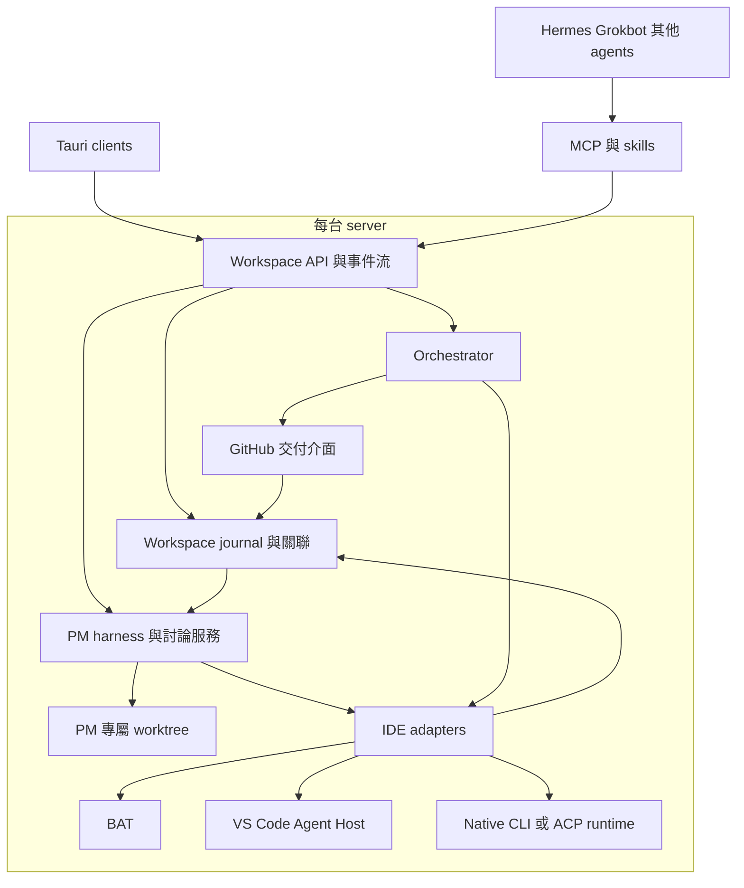
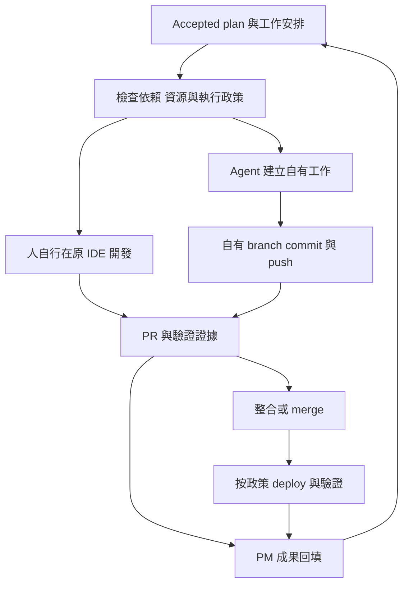

# Better Agent Dashboard 詳細開發計畫

版本 1.2\
更新日期 2026 年 10 月 11 日\
適用專案 TED-H-com/bat-agent-connector\
用途 供 使用者 與開發 agents 校正範圍 拆分工作與驗收

本計畫將現有 Better Agent Connector 擴充為以 workspace 為單位的專案管理與交付服務。Tauri client 提供 Fleet、Dashboard、五種 PM 視圖與 agent 討論；workspace 所在 server 保存計畫、工作關聯與操作紀錄。人與 coding agents 保留各自的 BAT、VS Code 或 CLI 使用方式，彼此不接管現有 session。

第一版的交付目標，是讓一個真實 workspace 從可長期停留的 Idea 討論開始，在使用者要求後形成 Planning 草稿，經採用與近期工程細化，再完成 Sprint 內的開發、驗證、GitHub 交付與 PM 回填。發布指定 package／版本後，可繼續開發，或依已設定政策轉入維護，直到使用者暫存或關閉專案。五種視圖、專案文件、簡報與 SVG 使用同一份可追溯資料。外部 PM 工具雙向同步與 Project Hub 專案匯入器不在本次範圍。

本版補入完整的 release 後生命週期：Maintainer 沿用 PM 的專屬 worktree、記憶與 phase harness，透過既有 Orchestrator 執行有界維護工作，提供依賴／Issue／PR 追蹤、改進研究、每週 Maintenance Review，以及可核對的暫停、重啟與關閉。既有 Tauri、Connector、BAT、journal、SDD、文件輸出與不接管他人 session 的原則保持有效。

> 開發基準：這是已採用的 v1.2 產品計畫，不是目前實作完成聲明。公開版本僅將個人稱呼改為使用者，並省略個人時區；需求、工作與驗收編號保留。逐批完成狀態見 [PM v1.2 開發狀態](pm-v1.2-status.md)。

**2026-10-12 介面方向修訂：**產品負責人要求以 Charter／專案總覽、Agent 資源與效能、
需求與交付追溯、技術相依與維護、時程、問題／行動／變更六個管理視圖組織工作，保留
工作看板及對話工作空間。最新版[專案管理工作台合約](../design/pm-project-control-center.md)
補充下文 §10 的視圖與 §13 的執行安排；舊「五視圖」名稱保留為原計畫追蹤，不限制新介面。
這是需求修訂，六頁與多 CLI 定期用量／配額讀取尚未完成；W01–W52、A01–A64 與既有
來源、採用及執行規則保留。PM 自動安排僅在已採用政策內，手動派工進入工作脈絡。

## 1 已確定的產品決策

| 主題 | 本計畫採用的決策 |
| --- | --- |
| 協作邊界 | 一台 server 上的一個 workspace 是獨立管理單位；同 repo 不自動合併不同 workspace |
| 多人協作 | 多個 client 連同一個 workspace，分享計畫、討論與工作狀態；各自保留 worktree 與 session |
| 主要 coding 體驗 | 在 BAT、VS Code 與原生 CLI；Dashboard 不建完整程式編輯器 |
| PM 工作環境 | 每個 workspace 有專屬 PM worktree，統一採用 docs/pm 目錄 |
| PM agent | 可選已具備必要能力的 BAT、VS Code Agent Host、ACP 或 native CLI adapter |
| Idea | 每條討論可長期探索，只有使用者明確要求才轉 Planning；與現有 Sprint 並行 |
| PM harness | 依模式準備上下文、補資訊、確認重要決策、驗證輸出；規則由服務與 skills 共同執行 |
| 工程規格 | 按 repo 的架構與變更大小裁適；OpenSpec 作規格產物 adapter |
| 文件輸出 | 同一 snapshot 產生專案文件、簡報與五視圖 SVG／列印版 |
| 討論方式 | 預設 使用者 與一個 PM agent；額外 reviewer 可選，不固定模型數與辯論輪數 |
| Adapter 範圍 | BAT、VS Code AHP、常用 CLI；依能力與工具版本明確登錄支持程度 |
| 觀察與控制 | 可以觀察可合法取得的其他工作；只控制本 controller 建立的 session |
| GitHub 操作 | Dashboard、Hermes、Grokbot 與其他 agents 使用同一服務執行 push、PR、merge、deploy |
| Client 技術 | 沿用現有 Tauri 與共用 Web UI |
| Server 技術 | 沿用現有 Python Connector 與 journal，擴充 workspace、PM 與 adapter 契約 |
| Fleet | 沿用現有 supervisor，管理已選 server、連線與服務就緒狀態 |
| 不納入第一版 | Jira／Linear 等雙向同步、Hub importer、跨 server 自動合併、session 接手、完整 IDE、任意 workflow graph editor |
| Release 與維護 | 指定發布成果是檢視點；已設定 maintain_when_idle 且工作狀態已核對時，自動轉 Maintain |
| Maintainer | 同一 PM 的維護角色與持久工作設定；沿用 Orchestrator 執行，不新增常駐無限思考 agent 或第二套 engine |
| 維護期間的發想 | 依來源提出改進與競品觀察，保留為 Idea／proposal；未採用不自動擴張 scope |
| 專案暫停與關閉 | 由有權使用者指定，停止新的自動活動並保存歷史；不隱含刪檔、停止他人 session 或 archive GitHub repo |

上述是開發範圍。它不代表目前所有能力已完成，也不要求重新建立一套平行產品。既有使用者資料、operation identity、BAT integration 與 GitHub 交付原語應保留並遷移。

## 2 專業管理與協定基線

### 2.1 PMI 與 Scrum

PM 層以 PMBOK 第 8 版的原則與管理領域作為裁適基線，Sprint 行為依正式 Scrum Guide 設計。PMBOK 第 8 版出版於 2025 年 11 月，官方頁面列出六個原則、七個績效領域；目前 Scrum Guide 官方版本仍為 2020 年 11 月。[PMI 官方概述](https://www.pmi.org/standards/pmbok)、[Scrum 現行版本](https://scrumguides.org/download.html)

PMP 是認證名稱。本產品的承諾是「將相關管理概念落成可驗收的產品行為」，不宣稱五頁 UI 等於完整 PMP，不重製付費教材，也不宣稱已完成 PMBOK 全文逐條認證。標準版本與後續修改需列在產品文件中；採用新版標準時，以差異檢查更新功能映射。

五個首頁重點固定為：目標、交付、阻塞、偏差、決策。五種完整視圖則是：

1. 專案總覽。

2. 範圍與里程碑。

3. 工作流看板。

4. Sprint 與討論。

5. 風險變更與決策。

### 2.2 AHP ACP MCP 與 skills

| 名稱 | 在本產品中的責任 |
| --- | --- |
| Microsoft Agent Host Protocol AHP | 連接 VS Code Agent Host，取得其提供的 session、事件與 changeset；建立本系統自己的工作 |
| Agent Client Protocol ACP | 驅動支持 ACP 的單一 agent runtime，接收更新與處理工具互動 |
| Model Context Protocol MCP | 對 Hermes、Grokbot、PM 與其他 agent 提供 workspace、計畫、工作與交付工具 |
| Agent skills | 教 agent 如何理解工作範圍、取得證據、提案與使用工具；權限仍由服務執行 |

Microsoft 的協定正名為 AHP。AHP 與 ACP 是可組合的不同層，不能把兩者當同一介面；MCP 也不替本產品定義 PM 與交付流程。[AHP 與 ACP 官方比較](https://microsoft.github.io/agent-host-protocol/guide/ahp-and-acp)、[ACP 概述](https://agentclientprotocol.com/protocol/v1/overview)、[MCP 架構](https://modelcontextprotocol.io/docs/2026-07-28/learn/architecture)

第一版實作 AHP client adapter，不要求把 Connector 改寫為完整 AHP server。保持現有可用 MCP 版本，協定升級另作相容性工作，避免成為 PM 交付的無關前置條件。

## 3 現有基礎與需要補上的差額

查核基線為 main@05396b1a5b778de64bbf6df4325daf7462d2dd53，提交時間 2026 年 10 月 10 日 20:50:31 UTC。以下是程式與文件基礎，實機通過條件列於後面的里程碑與驗收章節。

| 模組 | 沿用資產 | 本次工作 |
| --- | --- | --- |
| Tauri 與共用前端 | desktop/src-tauri 與 desktop/src | 增加五種 PM 視圖、meeting、PM adapter 選擇 |
| Headless 服務 | TaskDaemon 與現有 service lifecycle | 在 workspace 所在 server 部署，client 連回既有 endpoint |
| Journal | tasks、operations、events、projects、work_items、links 等 | 加入 workspace scope、plan、Sprint、meeting 與 evidence 關聯 |
| BAT integration | BatTaskAdapter、inventory、session observation | 抽出共用 capability 契約並保留 BAT 原有能力 |
| Resource policy | manual／unknown session 與人類 checkout 保護 | 將 controller 身分一致帶到每一個 session mutation 入口 |
| API MCP skills | 共用 OperationService 與 canonical skill | 新增 PM、meeting、Sprint、adapter 操作；沒有 UI 特有旁路 |
| 工作管理 | work_items 的目標、接受條件、步驟與版本 | 增加 evidence-based 完成判斷，減少逐項人工 completion approve |
| GitHub 整合 | integration、PR delivery、deployment | 接上 accepted spec、issue 關聯、交付政策與 PM 回填 |
| Fleet | Rust supervisor、Tailscale、tunnel、BAT launch | 增加 server service 與 adapter readiness |
| 新 PM 核心 | 尚無完整的新領域鏈 | 新增 Idea、phase harness、PM worktree、meeting、Sprint、SDD 關聯、五視圖與文件輸出 |
| VS Code 與 native CLI | 尚無完整共用 IDE adapter 層 | 按工具版本與實際能力逐一接入 |

現有 pm_providers.py 主要是 experimental Goose PM 的 provider 與 pre-dispatch fallback 設定，不能視為本計畫的 workspace PM 已完成。現有 resource_policy.py 已保護 manual／unknown，但 authorize_session 介面沒有 caller/controller 參數；需要補齊「不同 connector controller 也不能互相控制」的產品契約。現有 work_items 的 completion 還有 awaiting_approval 語意，需有意識改造為證據與政策驅動的進度呈現。

程式依據：[共用前端](https://github.com/TED-H-com/bat-agent-connector/blob/05396b1a5b778de64bbf6df4325daf7462d2dd53/docs/design/shared-frontend.md)、[TaskDaemon](https://github.com/TED-H-com/bat-agent-connector/blob/05396b1a5b778de64bbf6df4325daf7462d2dd53/src/bat_agent_connector/task_daemon.py)、[Journal](https://github.com/TED-H-com/bat-agent-connector/blob/05396b1a5b778de64bbf6df4325daf7462d2dd53/src/bat_agent_connector/task_journal.py)、[Resource policy](https://github.com/TED-H-com/bat-agent-connector/blob/05396b1a5b778de64bbf6df4325daf7462d2dd53/src/bat_agent_connector/resource_policy.py)、[現有 PM provider](https://github.com/TED-H-com/bat-agent-connector/blob/05396b1a5b778de64bbf6df4325daf7462d2dd53/src/bat_agent_connector/pm_providers.py)、[Work items](https://github.com/TED-H-com/bat-agent-connector/blob/05396b1a5b778de64bbf6df4325daf7462d2dd53/src/bat_agent_connector/work_items.py)

## 4 系統架構與資料責任



### 4.1 Server 與 workspace

一個 server 可承載多個 workspace。每個 workspace 有自己的 repo binding、計畫、工作、PM worktree 與設定。Client 保存 Fleet 入口、偏好與唯讀快取；離線時不能把快取變成另一個可寫 journal。

相同 repo 的兩個 workspace 是兩個管理範圍。各自明確保存納入的 issue／PR，不能因 repo URL 相同就自動合併。未關聯的 GitHub 活動可顯示為候選或背景資訊，不自動由本 workspace orchestrator 處理。

各 workspace 可處理自己的 PR；共享 main、GitHub environment 或同一正式文件的部分，遵守原有 GitHub 規則。若兩個獨立 workspace 都發布同 repo 的 PM 文件，可配置 docs/pm/<scope>，不因此新增全域 PM 同步系統。

### 4.2 資料的權威來源

| 資料 | 權威來源 | 本產品保存什麼 |
| --- | --- | --- |
| Native session 執行狀態 | BAT、AHP host 或實際 CLI runtime | 觀察結果、來源版本、時間、缺口與工作關聯 |
| 工作 討論 操作與採用紀錄 | Workspace journal | 穩定 ID、事件、意圖、回覆、重試與目前關聯 |
| 人可讀 plan spec review decision | PM worktree 的 Git 版本 | 文件與草稿；journal 指向已採用的 commit 與檔案 |
| PR CI merge deploy | GitHub 與指定部署工作流程 | 對應 revision、狀態與可查回的 receipt |
| 五種 PM 視圖 | 以上資料的同一組 projection | 可重建的查詢索引；不另存互相獨立的進度 |
| 發布基準與維護政策 | 指定 registry／GitHub／部署來源的 receipt，加 workspace 已採用政策 | Release/channel/commit、維護範圍、觀察涵蓋度、檢查紀錄與下次執行 |

採用 plan 的 journal 記錄必須綁定已存在的不可變 Git revision。文件內容不自填自己的 commit SHA，以免產生循環。PM 可繼續編輯下一版草稿，而目前採用版本仍指向上一次已保存內容。

### 4.3 模組配置

優先擴充既有模組；新增名稱為建議內部責任，不要求照名稱建立每一個檔案：

- workspace domain：範圍、repo、成員與設定。

- adapter registry：能力、版本、runtime discovery 與 lifecycle。

- evidence projection：正規化、去重、來源關聯與資料缺口。

- pm service：PM worktree、Idea／各階段 harness、分析工作、計畫變更、工程規格關聯、Maintainer／Maintenance Review 與文件輸出。

- meeting service：討論、證據快照、決策與採用。

- sprint service：Goal、Backlog、DoD、Review 與 Retro。

- orchestration policy：選工作、查條件、管理開發／維護派工與生命週期邊界，呼叫既有交付 primitives。

- view queries：五種 PM template 的查詢模型。

只有在 AHP SDK 相容性需要時才增加小型 Rust 或 TypeScript helper。Helper 只承擔 adapter 通訊，不新增第二套 PM database 或派工引擎。

## 5 不接管 session 的固定契約

### 5.1 人 工作與 controller

principal 是登入或呼叫工具的身分；controller 是持續存在的執行責任，例如 workspace_pm、hermes_dispatcher。Controller 不是短暫的 WebSocket client ID，也不能靠請求參數自行冒認。

資源至少保留 workspace_id、adapter_id、native_session_ref、worktree_ref、origin、controller_id、created_by、work_item_id 與最後觀察時間。Controller 由已驗證 principal 的服務設定與建立紀錄決定。

| Session 或工作樹來源 | 本產品允許的預設行為 |
| --- | --- |
| 人在 BAT GUI 或 CLI 自己開啟 | 唯讀觀察與關聯，不 send、resume、interrupt、stop 或 close |
| 其他 controller 建立 | 本 caller 唯讀；同屬 connector_managed 不代表共用控制 |
| 目前 controller 建立且位置已確認 | 依 adapter capability 操作自己的工作 |
| 建立結果不明或來源不明 | 先核對，未確認前唯讀 |
| 已結束但仍屬他人的 session | 仍維持唯讀；結束不代表可接手 |

計畫變更、Sprint 取消、issue 延後或 Dashboard 卡片開啟，都不能改變上述規則。人類本人要控制原生 session，繼續使用自己的 BAT／IDE；Dashboard 可以開啟相關工具位置，但 MCP/API 不藉此取得控制權。

### 5.2 Worktree 與 Git 分支

人、各 coding worker、PM 各自使用獨立工作樹。Connector 新工作優先使用自己管理的 clone／worktree 根目錄，避免共享人類 checkout 的 index、未提交修改與 ref 操作。

每個工作預設使用獨立 worktree 與開發 branch；不同成果可以依指定整合政策交付到同一個 PR。整合在自己的工作區進行，不操作原 session／checkout，不強推或重寫他人的開發 branch。若共同 PR 的 head 也是某人的開發 branch，須明確將它指定為共同整合目標，不能從可讀取 PR 推定；更新時沿用來源 SHA、PR head 與結果讀回檢查。這是 Git 成果整合，不需要 session 控制權移轉。

PM 自己的 worktree 一次只由一個 PM writer 工作。額外 reviewers 讀取相同證據快照並回傳意見，不共同寫同一 checkout。這是本系統自有工作的排程，並不要求對人類 GUI 建立接手鎖。

### 5.3 服務端執行

UI、API、MCP、內部 background job 與 adapter helper 都經過同一操作 admission。UI 隱藏按鈕或 skill 文字提醒，不能取代實際檢查。

MCP 不提供「任意 session ID 加任意 raw command」的通用旁路。若 adapter 原生有 load／resume／cancel 能力，必須先通過同一個 caller、controller、session 與 worktree 判定。

本契約管的是本產品發出的操作。Cwd 不是 OS sandbox；若要限制任意 shell 接觸同機其他目錄或原始控制端點，需要另外設定 OS／runtime 權限。產品不得把自己的 ownership 規則宣稱為整台主機的完整隔離。

## 6 IDE adapter 與 PM 執行選擇

### 6.1 共用能力契約

| 能力 | 說明 |
| --- | --- |
| discover_runtime | 安裝位置、工具版本、登入與就緒狀態分開回報 |
| list_observable_sessions | 僅列真正可由此介面取得的 sessions |
| read_session | 取得狀態或歷史；不得暗中 resume 或啟動新 turn |
| subscribe_events | 即時事件及可用的 cursor／snapshot 機制 |
| read_changes | Worktree、diff、commit、changeset 或 PR 關聯 |
| create_owned_session | 在指定的自有 worktree 建立新工作 |
| send_owned_turn | 向本 controller 已建立的 session 發工作 |
| cancel_owned_turn | 只取消本 controller 的工作，若原生工具支持 |
| close_owned_session | 只關閉本 controller 的 session，若原生工具支持 |
| bind_working_directory | 確認真正使用的 cwd 與 worktree |
| run_headless | Client 離線後工作能在 server 持續 |
| read_workspace_context | 讀取 PM 文件、工作與必要證據 |
| write_pm_artifacts | 在 PM 自有工作樹更新標準文件 |

每項能力回報 supported、unsupported 或 degraded，並包含測過的版本與原因。安裝成功、登入成功與能完成一次工作是三個不同狀態。能力宣告須有測試或實機證據，不依產品名稱猜測。

### 6.2 首輪 adapter 支援清單

| 工具 | 接入路線 | 首輪要求 |
| --- | --- | --- |
| BAT | 沿用現有原生 integration | 觀察可取得 session；完整 create-own、stream、PM 與交付關聯 |
| VS Code | AHP client 連 Agent Host | Observe 與 create-own；驗證重連、changeset、headless 與版本能力 |
| Claude Code | 正式 SDK 或 documented headless CLI | 自有工作、stream、cwd 與結果；外部歷史另驗證 |
| Codex | 既有可用 app-server 或 documented CLI | 自有工作與讀取分開；不為觀察呼叫 resume |
| Grok CLI | 選定實際發行版的 native adapter | 自有執行與 stdout／structured events；能力逐項驗證 |
| Agy | 選定實際 runtime 的 native adapter | 自有執行、PM 檔案工作與串流；保留原工具用法 |
| OMP | 依選定工具與版本的官方介面 | 先確認正式入口，再給可驗證的能力標記 |
| 其他 ACP CLI | 共用 ACP adapter 加工具設定 | 逐 provider 測試，不承諾所有 ACP 實作完全等價 |

支援清單代表要納入的開發範圍，不代表第一個增量必須同時完成所有工具。第一個可用增量先跑通 BAT 與 PM 完整循環；跨工具 V1 至少跑通 BAT、VS Code AHP 與一個 native CLI，其餘列為具名後續項目。正式宣稱某工具「支援 PM writer」之前，必須通過該角色的實測。只讀工具仍可作為 evidence source，不列在 PM writer 選單。

VS Code 的既有 extension-host sessions 不必然由 Agent Host 暴露。看不到即時事件時，僅顯示取得到的 Git／PR 資料與能力限制，不顯示成沒有活動。[VS Code Agent Host](https://code.visualstudio.com/docs/agents/concepts/agent-host)

### 6.3 PM working adapter 設定

每個 workspace 保存：

- PM adapter 與 runtime。

- 動態查得或經驗證的 model／effort 選項。

- PM worktree 與標準 folder。

- Headless 要求、預算與同時執行限制。

- 額外 reviewer 設定。

- 工具失效時的行為。

不在新核心 hard code 固定模型名稱，也不強迫 PM 一律經 Goose。舊 provider 設定可遷移為選項，不當成不可變架構。

切換 adapter 的意思是：保存目前 meeting 與文件，在新工具建立 PM 自己的新 session，讀取同一批 PM 資料接續。沒有跨 provider 的 session 接手。

若上一個 PM writer 尚在工作，切換先排隊；若狀態不明，保存 pending 與已知 revision，先核對，不在同一路徑啟第二個 writer。必要時使用獨立 recovery worktree 產生可比較的修訂。

### 6.4 斷線與事件回復

觀察事件保留 provider 原 ID、cursor、schema version 與接收時間；重播不重複計入工作或成本。Host 斷線、runtime 失敗與工作完成要分開。

建立或送出工作後若回覆遺失，先查既有 operation 和 native session，再決定如何恢復。不能直接重送 prompt，不能以切換模型掩蓋不明的派工結果。AHP 如需 fresh snapshot，先重建 projection 並標記缺口；session catalog 也要重新核對。

AHP 本身支持多 client 共享與控制；本產品必須額外守住上述 ownership 契約。[AHP 與 ACP](https://microsoft.github.io/agent-host-protocol/guide/ahp-and-acp)、[AHP client libraries](https://microsoft.github.io/agent-host-protocol/guide/clients.html)

### 6.5 執行 adapter 與規格 adapter 分工

IDE adapter 負責 runtime、PM 自有 session、cwd、事件與工具能力；SpecArtifactAdapter 負責讀取與產生可版本化的 proposal、requirements、design、tasks。OpenSpec 首先落在後者，利用既有檔案／Git／command service；不另建派工 queue 或 PM database。

PM 階段規則由 Workspace Service 維持，不隨 BAT、AHP 或 CLI 的 prompt 語法改變。Slash commands 是個別工具的使用入口，不能當成所有 IDE 共通的 RPC。切換 adapter 時，仍由新自有 PM session 讀取持久上下文。

## 7 共用資料模型與狀態

資料模型由既有 journal 擴充；下表是領域責任，不要求每項都建立獨立 service 或獨立 database。

| 記錄 | 必要內容與用途 |
| --- | --- |
| Workspace | server_id、workspace_id、repo binding、管理路徑、PM 設定、納入的 GitHub 工作範圍 |
| Goal 與 Requirement | 穩定 ID、價值、範圍、接受條件、來源、優先次序與相依關係 |
| PlanRevision | 內容 revision、前版、草稿或採用狀態、採用者、決策與影響清單 |
| Milestone 與 Sprint | Milestone 保存交付檢視點與基準／預測；Sprint 另保存固定期間、Goal、Backlog 與 DoD reference |
| WorkItem 與 Attempt | 工作依據的 spec、負責 controller、各次嘗試、session／worktree／issue／PR 關聯 |
| Evidence | 原來源、原 ID、時間、適用 commit／spec、類型、可見範圍與驗證結果 |
| Meeting 與 Decision | 議題、證據快照、參與角色、討論、候選方案、採用或未决結果 |
| Risk 與 Change | 風險或偏差、影響目標、owner、因應措施、觸發條件、接受或拒絕原因 |
| Operation | 提交者、目標、預期版本、request key、執行狀態、外部 receipt 與核對結果 |
| ResourceBudget | 人與工具可用性、並行數、配額、已知成本、預算與未知部分 |
| DiscussionThread | thread_id、Idea／Planning 等 mode、來源、候選方向、關聯工作與轉換意圖 |
| InputRecord | 內容、來源、已確認／假設／未決等狀態、適用版本、確認者與時間 |
| SoftwareChange | 穩定 change ID、spec artifact refs、採用 revision、需求與工程工作關聯 |
| DispatchBatch | 選定工作與 revisions、controller、執行範圍、資源與停止條件 |
| DocumentSnapshot | as_of、journal cursor、scope/document revision、可見範圍、template version 與來源 |
| Actor 與 FollowUp | 人類／agent／controller 身分、責任範圍、待辦原因、owner、觸發點與結案證據 |
| ProjectLifecycle | 工作區的 Idea／Planning／Development／Maintain／Paused／Closed、轉換原因與 lifecycle_revision；不取代 thread／Sprint／attempt 狀態 |
| ReleaseBaseline | 本 workspace 納入的發布對象、channel、version/tag、解析後 commit、artifact／registry receipt、驗證、支援分支與歷史 |
| MaintenancePolicy | 負責 controller、after_release_policy、允許工作類型／路徑／branch／交付層級、排程時區、預算、同時工作上限、停止條件與 policy_revision |
| MaintenanceRun 與 Finding | 觸發來源／時間窗、去重 key、snapshot、來源涵蓋度、執行與成本、發現 ID／處置／work refs、下次檢查 |
| LifecycleTransition | 暫停／關閉／恢復意圖、阻止新派工的生效點、仍在進行或未知的 operations、最終狀態與歷史 |

### 7.1 版本與關聯

WorkItem 保留開始時的 spec_revision，PR evidence 綁定實際 head SHA，部署 evidence 綁定實際 artifact 或 source revision。新方向採用後，計算受影響工作，但不重新標記舊工作彷彿一開始就按新版進行。

方向基準 scope_revision 與文件版本 document_revision 分開。回填進度、觀察時間或驗證連結可以產生新的文件 revision，但不改變原 Goal／scope／acceptance 的基準識別，也不觸發全部工作重新規劃。只有目標、範圍或接受條件的實質變更，才形成新的方向修訂與影響清單。

Issue／PR 可以是一對多或多對一的工作關聯，不假設一個 session 等於一個 requirement。外部工作沒有明確 work ID 時，先以未歸類活動呈現；PM 可提出關聯候選，不能憑猜測把它算成某目標的完成證據。

不同 workspace 的本地 ID 不要求全域協調。Client 的完整定位使用 server 與 workspace。備份還原保留原 ID；另建獨立副本必須有新的 server／workspace 身分，不同時啟動兩個持有相同工作帳本的 writer。

### 7.2 狀態分離

至少分開顯示：

- Session：running、idle、ended、unreachable、unknown。

- 工作執行：queued、running、blocked、finished、failed、cancelled。

- 驗證：not_run、passed、failed、incomplete、unknown。

- PR：open、draft、merged、closed。

- 可交付成果：是否符合指定的 DoD 與接受條件。

- 部署：not_requested、running、verified、failed、unknown。

- 計畫：draft、proposed、accepted、superseded；與 thread mode、Sprint 狀態及派工授權分開。

- 操作：pending、running、succeeded、failed、unknown。

這些狀態名稱是新產品的語意建議，實際 schema 可以沿用現有列舉作映射。不能用一個 done 同時代表 process 結束、測試通過、PR merged 與正式站可用。

### 7.3 指標口徑

完成比例若顯示為「符合接受條件數／目前採用的接受條件數」，必須一併顯示 plan 版本、分子分母與未驗證項目；不能宣稱這就是精確的剩餘工時。Scope 變更產生分母變更紀錄。

Kanban 的 WIP 以已開始、尚未結束的工作計算；一個工作同時有多個 session 不重複增加工作件數。Age 從工作實際進入開始狀態計算，blocked 時間保留，取消與重開分別記錄。Cycle time 與 throughput 使用清楚定義的完成邊界。

成本分成 actual、estimate、unknown，並顯示涵蓋來源。沒有 provider cost 的工具不補成零。Velocity 只有在使用者採用且持續維護估點時顯示；不自動用模型、token 或 commit 數換算 story points。

### 7.4 討論 計畫 Sprint 與執行是獨立狀態

| 物件 | 管理範圍 | 不能因其改變而自動發生的事 |
| --- | --- | --- |
| Discussion mode | 這條 thread 正在發想、規劃、細化、追蹤或檢討 | 不改其他 thread、當前 Sprint 或執行中的 session |
| Plan/spec revision | 草稿、採用基準與歷史 | 不因文件存在就執行或發布 |
| Software change | 一個功能或修訂的提案、產物與工作關聯 | 不等於整個 workspace 或 Sprint |
| Sprint | 固定期間、Goal、選入工作與成果 | 不把所有未來 Idea 都納入本輪 |
| Batch/attempt | 已授權範圍內的排程、執行與結果 | 不改採用規格，不把自報完成升級成驗收 |
| Project lifecycle | 整個 workspace 的管理階段與自動活動政策 | 不因某一 thread 進 Idea 就停止既有開發；不因 release 就自動結案 |
| Release／maintenance | 受維護的發布基準、監看範圍與有界工作 | 不把 webhook、main 最新 commit 或單純 idle 當作正式發布；不接管其他 runtime |

Idea 可與現有 Sprint 並存。使用者只要求把 A 方案寫成 plan 時，保留 B／C 為候選；不得將漫長討論中所有內容合併為需求。一個 change 可分成數個可驗證工作，跨 Sprint 時保留各輪選入與成果；重複選入不能重複計算完成。

### 7.5 人與 agents 的共同工作模型

WorkItem 對應成果，Attempt 對應一次執行，Actor 對應參與者；controller 是操作資源的身分，不能以模型名稱或 websocket 連線取代。Git author、PR author、session owner 可能不同，關聯不確定時保存候選與來源。

一個人開四個 sessions 不等於四位開發者；四位參與者完成一個需求也只計一份成果。單人、多人、多 agent 使用相同關聯，不另做三套 Dashboard。任務指派、共同 PR 或討論參與資格都不賦予接管其他 session 的權限。

### 7.6 專案生命週期與 release

| 管理階段 | 意義 | 開發與維護行為 |
| --- | --- | --- |
| Idea | 專案仍在探索，可能長期沒有正式計畫 | 可討論、研究、保存 PM 筆記；沒有開發派工，不因時間經過轉 Planning、Maintain 或 Closed |
| Planning | 已要求整理方案，正在形成或採用計畫 | 草稿不派工；就緒的工程工作仍需明確授權或已採用政策 |
| Development | 有明確安排或正在進行的開發 | 人與 agents 各自工作；可依設定持續監看已發布版本 |
| Maintain | 指定成果已發布，目前沒有已確認的活躍開發安排 | 按 MaintenancePolicy 監看、研究、回報，並在範圍內派送修復 |
| Paused | 使用者明確暫存，暫時停止自動投入 | 不新開監看分析、週報、開發或維護工作；保留可讀歷史與已在途結果核對 |
| Closed | 使用者關閉本產品中的管理專案 | 停止該 workspace 的自動活動，保留結案紀錄；明確 reopen 才可恢復 |

Release 是一筆獨立的發布事實與版本基準，不是整個專案必須離開 Development 的狀態。正在做下一版時可已有數個 release；維護版發布後可繼續 Maintain，不反覆建立新的 Maintainer。UI 呈現階段與當前工作，服務以 lifecycle、policy、revision 與實際工作條件判斷可執行操作，不能只看一個 badge。

尚在 Idea 的 workspace 可以只有 PM 討論、材料與筆記，不必建立任何 coding worktree 或啟動 coding runner。多個專案可各自長期停在 Idea；預設不自動追討計畫、不以沉默推論放棄。已有開發的 workspace 新增 Idea thread 時，只改該 thread，不將整個專案退回 Idea。

Idea 階段限制的是產品開發派工與無意圖的維護，不是關閉底層 TaskDaemon。使用者正在要求的資料研究、討論與 PM 筆記仍可在相應工具範圍內使用同一執行基礎。Pausing／closing 由 LifecycleTransition 表示轉換中與待核對事項；不將它們藏成已停止。

## 8 PM 專屬 worktree 與標準文件

### 8.1 建立方式

註冊 workspace 時，服務在管理根目錄建立 PM 專屬 worktree。PM branch 名稱包含 workspace 範圍，並避免與 coding branch 混用。統一預設 folder 為 docs/pm；多個獨立 workspace 發布到同 repo 時，可以設定明確的子 scope。

| 路徑 | 內容 |
| --- | --- |
| docs/pm/ideas | 各 thread 的可恢復摘要、選項、來源與未決事項；原始對話留 journal |
| docs/pm/architecture | 必要架構概覽與 ADR，既有設計文件保持原路徑並建立引用 |
| docs/pm/project.yaml | 目標、角色、管理方式、成功條件與必要資源假設 |
| docs/pm/plan.md | 目前規劃說明、執行回填、後續方向與關聯 |
| docs/pm/specs | 新 PM 規格，以及既有 repo 規格的版本引用與索引；不強制搬移或複製既有 spec |
| docs/pm/roadmap.yaml | Milestone、依賴、基準與目前預測 |
| docs/pm/sprints | 各 Sprint 的 Goal、選入工作、DoD reference 與結果 |
| docs/pm/decisions | 採用與拒絕的決策、原因、受影響範圍 |
| docs/pm/reviews | Sprint Review、Retro 與必要的階段檢討 |
| docs/pm/meetings | 精簡討論記錄、證據快照引用與未決事項 |
| docs/pm/README.md | 目錄用途、更新責任與閱讀入口 |
| docs/pm/releases | 發布基準、驗證／registry receipt 引用、支援版本與已知限制 |
| docs/pm/maintenance | 維護範圍與政策的人可讀說明、findings／work 關聯、改進候選與週報 snapshot 引用 |
| docs/pm/closure | 暫停／結案理由、交付摘要、接受保留的事項與重新開啟條件 |

原始 streaming logs、暫存檔、憑證、模型 token、工具輸出全文與高頻事件存於服務資料區，透過 evidence reference 連結，不逐 token 寫入 Git。

### 8.2 文件與 journal 的一致性

PM 草稿可以在專屬 worktree 更新。採用正式修訂時：

1. 驗證文件 schema、關聯與預期的原 plan 版本。

2. 在 PM 自己的 branch 保存一個可讀回的 Git commit。

3. 以同一 operation 將 accepted revision 與 decision 記入 journal。

4. 由該 revision 更新五種 view 與受影響 work mapping。

5. 如需發布 README 或 project page，另產生可追蹤的文件交付工作。

Git 與 SQLite 無法假設是單一原子交易。Operation 必須記錄階段：僅完成 Git commit、journal 尚未採用時，舊 accepted revision 仍有效。若 journal 操作回覆遺失，結果可能已成功寫入；operation 顯示 unknown，依原 request key 查回 durable accepted pointer 與操作記錄。在確認前不重複採用、不重複建立 issues，也不自行回退到舊版。Commit marker 用來核對同一操作，不用來猜測採用結果。

Repo 中的 plan 可以更新，不要求永久凍結。實際進度回填、預測與範圍變更的欄位與紀錄要清楚；移除原接受條件或降低 DoD 屬於變更，不能當成一般成果整理。

### 8.3 PM 的寫入範圍

PM agent 預設修改 PM folder；使用者登錄規格 adapter 後，也可在 PM 自有 worktree 的指定 OpenSpec 等目錄產生規劃產物。它可提出 README、docs 與 GitHub Pages 的更新，由文件工作按正常 Git 流程交付。它不能藉 PM 身分直接改 coding worktree、改 CI required checks，或清理他人的 session。

新的通用 schema 應支援 human-readable Markdown 加少量 structured metadata，不要求 coding agents 改回答格式。PM 文件損壞時顯示校驗問題，保留上一版已採用內容；不能靜默以部分解析結果替換全計畫。

### 8.4 原生規格與 PM 文件維持單一內容來源

若 repo 已使用 OpenSpec，需求與 change artifacts 保持在原 openspec 目錄，docs/pm/specs 僅保存引用／索引，不建立可獨立修改的第二份規格。未使用 OpenSpec 的 repo 沿用既有 Markdown 規格，也能使用相同 PM 功能；初始化 OpenSpec 是明確的 workspace 設定，不因讀 repo 或 Idea 聊天自動執行。

PM 在自有 worktree 保存規格 commit。Coding worktree 透過固定 Git revision／可追溯 artifact bundle 取得文件，不共用 PM 的 live working files。PM branch 包含下一輪草稿時，只交付所選工作需要的 artifacts，不把整個 PM branch 當成必合併來源。

Coding agents 在各自 worktree 回報 tasks 與建議；PM 透過 Git 和 evidence reconciliation 回填。需求語意或接受條件變更需新版本；checkbox、測試連結與實際結果回填不重寫原 scope。

## 9 PMI 管理概念如何落在產品中

以下是本產品的功能映射。PMBOK 第 8 版的官方骨架提供原則、領域與 focus areas；具體 UI 與自動化由本產品依 software workspace 情境裁適。[PMI 官方概述](https://www.pmi.org/standards/pmbok)、[第 8 版公開目錄](https://www.pmi.org/-/media/pmi/documents/public/pdf/publications/pmbok-guide-eighth-edition_table-of-contents.pdf)

### 9.1 六個原則

| 原則方向 | 本產品的落地方式 |
| --- | --- |
| 整體視野 | 串起目標、工作、依賴、驗證、交付與使用成果 |
| 注重價值 | 首頁呈現要解決的問題與成功條件，不把程式活動量當價值 |
| 品質內建 | Requirement 接受條件、DoD、驗證結果與品質改進 |
| 負責任的領導 | 方向、操作與決策有可追溯的責任人，Agent 分工可見 |
| 永續性 | 依情境檢視環境、社會與長期經濟影響；軟體可從資源使用、維護與供應商依賴切入，未量測不編造數值 |
| 有自主性的團隊 | Coding 留在原工具，工作由原負責人管理，PM 支持共同決策 |

### 9.2 七個績效領域

| 領域 | 共用模型與主要行為 | 完成的最低條件 |
| --- | --- | --- |
| 治理 | 角色、採用版本、決策、交付政策、結案 | 任何重要變更可追到原因與採用版本 |
| 範圍 | Goal、requirement、接受條件、in/out scope | 新舊範圍可比較，已做工作可對應 |
| 時程 | Milestone、依賴、Sprint、基準／預測／實際 | 延後有依據，不用重寫基準掩蓋偏差 |
| 財務 | 預算、已知支出、估算與缺資料部分 | 支出涵蓋範圍清楚，未知不是零 |
| 利害關係人 | 使用者、需求者、方向負責者與 feedback | 重要成果知道為誰提供、由誰討論取捨 |
| 資源 | 人與工具能力、並行限制、配額、可用性 | 派工前可辨識必要資源是否可用 |
| 風險 | Risk、assumption、issue、dependency 與回應 | 關鍵風險有 owner、影響與下一步 |

財務、採購、供應商與較完整的效益追蹤採漸進揭露；小型 workspace 可只保留必要欄位。裁適不等於刪掉概念，而是清楚記錄哪些資訊適用、由哪裡取得。

### 9.3 五個 focus areas

啟動、規劃、執行、監控、結案，映射為：

- 建立 workspace 的目標、責任與管理範圍。

- 討論並採用 plan、spec、milestone 與工作安排。

- 人與 agents 在各自工具完成工作。

- PM 整理成果、阻塞、偏差與調整選項。

- 記錄交付、驗證、未完成事項、經驗與後續效益觀察。

這些不是五個必須依序按完的 UI 關卡。產品中的 Idea 是探索入口，不要求每個想法都成為正式專案。一次交付可完成某個 change／milestone，而產品繼續維護或開發；結案不會自動刪除工作樹或停止 sessions，清理另按資源來源與保存規則處理。

## 10 五種 PM 視圖與五個首頁重點

### 10.1 共用呈現規則

首頁固定先回答：

1. 目標：目前為何而做，採用哪一版方向。

2. 交付：哪些成果已符合條件，哪些只是正在執行。

3. 阻塞：哪裡需要解除依賴或補證據。

4. 偏差：與原計畫相比，變了什麼。

5. 決策：現在最值得討論的取捨。

每個重點都能展開到完整視圖。五種 view 共用相同 revision 與 evidence query，不自己計算另一份完成率。頁面顯示資料時間、來源能力與未知部分。

使用者可以切換 Scrum、flow、predictive 或 hybrid 的管理偏好；這改變預設顯示與流程，不建立四套互不相通的資料模型。Roadmap 可呈現階段式計畫，看板則呈現同批工作的流動。

### 10.2 專案總覽

管理問題：為什麼做？目前方向是否仍合理？現在需要決定什麼？

主要內容：

- Product Goal、價值假設與成功條件。

- 目前 accepted plan／spec。

- Milestone 與可交付成果摘要。

- 主要阻塞、drift、風險與未決問題。

- 資源限制與已知成本。

- 最近採用的決策與下一次需檢視的事項。

動作：開始有上下文的討論、查看 plan diff、開啟目標證據、前往相關工作。首頁不以未讀 session 數或 commit 數作主要績效。

驗收：同一目標在總覽與其他四頁的 revision、結果與來源一致；資訊不足時不顯示假的綠燈。

### 10.3 範圍與里程碑

管理問題：承諾交付什麼？順序與日期有沒有改變？

主要內容：

- Requirements、接受條件與範圍邊界。

- Milestone、交付物、依賴與相對優先次序。

- 原基準日期、目前預測日期、實際完成日期。

- 對應 issue／PR／驗證與變更原因。

- 清單、roadmap 或適合的 Gantt 呈現。

動作：討論範圍調整、重新安排後續工作、查看依賴、比較版本。沒有有效估時與依賴資料時，不顯示假精確的 critical path 或完成日期。

驗收：延期保留原基準；新增範圍可辨識分母變化；已 merged 但缺接受證據的成果顯示實際狀態。

### 10.4 工作流看板

管理問題：誰在做什麼？工作卡在哪裡？

主要內容：

- Backlog、Ready、In Progress、Review／Verify、Done 等工作階段。

- 阻塞旗標、原因、age、owner 與相依工作。

- Session／worktree／issue／PR 的關聯。

- 各次 attempt 與觀察完整度。

- 可配置的 WIP 限制與資源容量。

動作：建立工作、排入後續、更新依賴、查看 evidence、在原 IDE 開啟。操作既有外部 session 的按鈕不出現在通用自動化路徑。

驗收：同一工作有三個 attempts 不算三件完成；看不到 session streaming 時，仍可查看 Git 證據並說明觀察限制。拖動卡片不等同通過 DoD 或 GitHub checks。

### 10.5 Sprint 與討論

管理問題：這輪要達成什麼？目前是否接近 Goal？下一輪怎麼改？

主要內容：

- Sprint Goal、固定區間、選入工作與容量假設。

- Product Backlog、Sprint Backlog 與 DoD reference。

- 已驗證成果、未完成項目、Goal 結果與變更影響。

- Planning、Daily 協作紀錄、Review、Retro 的不同輸出。

- Meeting 對應的 evidence snapshot、plan diff 與採用結果。

動作：與 PM 討論、準備 Review、接受一組方向調整、更新後續工作。沒有正式估點資料時顯示工作與接受證據，不自動生成 velocity 圖。

驗收：一輪結束後可追溯當初 Goal、實際成果、未完成原因與下一輪選擇；不能以新目標覆蓋舊目標來顯示成功。

### 10.6 風險變更與決策

管理問題：哪些問題會影響交付？哪些取捨需要人判斷？

主要內容：

- Risk、assumption、issue、dependency。

- 影響目標、owner、觸發條件、因應措施與檢視時間。

- Scope／schedule／quality／resource drift。

- Proposed change、採用或拒絕理由與後續效果。

- 尚未有足夠證據的假設。

動作：開啟聚焦討論、提出驗證工作、採用變更、記錄理由。將同一原因造成的十個症狀整合為可理解的問題，不製造十張重複提醒卡。

驗收：一筆重大偏差能追到來源、影響與處置；反覆分析同一事件不產生重複 risk 或 issue。

### 10.7 初版視圖允許未知

Idea 預設呈現聊天、材料與可選筆記，不強迫填完五頁。進入 Planning 後，五視圖先使用已知資訊形成草稿：

| 視圖 | 初版可以包含的內容 |
| --- | --- |
| Project Brief | 目標、成功假設與待確認事項 |
| Roadmap | 候選里程碑；未確認的日期／容量標示待定 |
| Kanban | 候選 backlog；不等於全部建立 GitHub issues 或已派工 |
| Sprint | 候選 Goal 與待規劃；不虛構開始日期或承諾 |
| 風險變更與決策 | 已知風險、需驗證假設與討論選項 |

Draft／accepted 狀態清楚可見。完整視圖代表資訊有位置、可逐步補足，不代表每個欄位都已確認。

### 10.8 專案文件 簡報與 SVG

支援 Project Brief、project plan、architecture summary、進度報告、Sprint Review package、決策說明、結案報告與專案簡報。五種 PM template 可產生 SVG 與列印版；這些是同一專案資料的溝通輸出。

每次產出固定 DocumentSnapshot：workspace、as_of、journal cursor、scope/document revision、來源 refs、未知／估計、可見範圍與 template version。Dashboard 同時間點視圖、SVG、文件與簡報共用該 snapshot，不讓各次 LLM 回覆重新猜測完成數或改寫風險。

程式負責數值、表格、圖表、SVG 版面與連結；agent 負責敘述、結構、重點與讀者角度。SVG 保留可讀文字、來源與時間，長內容分頁或分幅；原始資料仍在 PM 模型中。

第一批做一頁 Brief、五視圖 SVG／列印版與 Markdown／HTML 報告。接著提供 app 內可編輯的簡報內容與播放／下載能力；早期可用 HTML slide deck，PDF／PPTX renderer 按需要擴充，不發展通用 Office 編輯器。

輸出帶 draft／accepted／historical 標記。重新整理建立新 snapshot，不改舊報告的歷史數字。人編輯簡報可以提出新建議，但不能直接取代 accepted spec。對外版本依既有可見範圍產生，排除私人討論與無關原始紀錄；產生檔案本身不等於分享或發布。

Sprint Review 簡報用來準備討論，仍需保存實際回饋、取捨與後續安排。[Scrum Review](https://www.scrum.org/resources/what-is-a-sprint-review)

## 11 Sprint 的正確行為

Scrum 模式保留必要責任、事件、artifacts 與 commitments；團隊可選擇具體實作方法。個人加 agents 若省略必要事件，顯示為個人迭代模式，不將它描述為完整 Scrum。兩種模式共享資料、證據與工作不中斷的原則。

### 11.1 角色與責任

使用者 預設對產品方向與優先次序負責。實作者保留完成工作的自主權。PM agent 協助準備資料、促進討論與追蹤改善；orchestrator 按已採用的方向處理工作與交付，不能自動成為任意改 Sprint Goal 的上級。

設定中可記錄 Product Owner、Scrum Master 與 Developers 的實際責任人；小型專案可依情境兼任責任。AI 可執行輔助工作，但不可用一個 agent 名稱掩蓋誰對方向與交付負責。

### 11.2 核心 artifacts

| Artifact | 對應 commitment | 產品要求 |
| --- | --- | --- |
| Product Backlog | Product Goal | 保留有順序的需求與工作；不只是一堆 session |
| Sprint Backlog | Sprint Goal | 保存本輪目標、選入工作與實作安排 |
| Increment | Definition of Done | 可用成果須有符合品質定義的證據 |

以上關係依 Scrum Guide；接受條件可細到某個 requirement，DoD 則是適用成果的共用品質定義，兩者不混用。[Scrum Guide](https://scrumguides.org/scrum-guide.html)、[Definition of Done](https://www.scrum.org/resources/what-definition-done)

### 11.3 事件與輸出

| 事件 | 必須產生的有用結果 | PM agent 的支援 |
| --- | --- | --- |
| Planning | 本輪價值、Goal、選入工作與如何交付 | 彙整容量、依賴、歷史成果與選項 |
| Daily Scrum | 針對 Goal 的近期工作調整 | 預先整理阻塞與新證據，支持討論 |
| Sprint Review | 檢視可用成果與環境變化，調整後續方向 | 提供成果、未達成之處與 backlog 變更 |
| Retrospective | 合作、流程、工具或品質的改進 | 整理原因，提出有 owner 與驗證方式的少數改進 |

Daily Scrum 是開發者協調工作的事件，不是向 PM 報工；自動報表可以準備輸入，不能宣稱已替人完成協作。Review 與 Retro 保留不同紀錄與結果，避免把所有會議變成同一份摘要。[Planning](https://www.scrum.org/resources/what-is-sprint-planning)、[Daily](https://www.scrum.org/resources/what-is-a-daily-scrum)、[Review](https://www.scrum.org/resources/what-is-a-sprint-review)、[Retro](https://www.scrum.org/resources/what-is-a-sprint-retrospective)

### 11.4 節奏與調整

產品預設可選兩週 Sprint，這是起始設定而非官方要求。Sprint 維持固定區間且不超過一個月；官方的一個月 Sprint 事件上限為 Planning 8 小時、Review 4 小時、Retro 3 小時，Daily 15 分鐘。UI 支持更短的討論，不強迫使用者開滿上限。[Sprint](https://www.scrum.org/resources/what-is-a-sprint-in-scrum)、[Planning](https://www.scrum.org/resources/what-is-sprint-planning)、[Review](https://www.scrum.org/resources/what-is-a-sprint-review)、[Retro](https://www.scrum.org/resources/what-is-a-sprint-retrospective)、[Daily](https://www.scrum.org/resources/what-is-a-daily-scrum)

Sprint 期間可以調整工作細節與協商範圍，但不能為了完成數字而降低品質或掏空 Goal。Goal 失效時，Scrum 模式由指定 Product Owner 決定取消 Sprint；個人迭代模式由專案方向負責者決定。兩者都記錄原因與原 Goal，再規劃新的目標。[Sprint Goal](https://www.scrum.org/resources/what-sprint-goal)

在本產品中，取消 Sprint 只改變管理狀態；不發送 stop、resume 或新指令到他人 session。舊工作保留原 spec，完成後依新版目標判斷整合、補做或保留。

### 11.5 結束與交付

未符合 DoD 的項目不算 Done。保留它在原 Sprint 的歷史與原因，回到 Product Backlog 重新考慮；下一輪是否選入是新的安排，不靜默自動搬過去。

已符合交付條件的成果可提前 release，Sprint Review 不是每次 merge 或 deploy 的必經 gate。Review 可以討論未完成工作，但不把它描述成可用 Increment。[Scrum Guide](https://scrumguides.org/scrum-guide.html)

### 11.6 工程設計與 SDD 在 Sprint 內持續

PM 規劃決定目標、範圍、順序與資源；工程設計處理組件、契約、資料與實作取捨。需求細化是持續活動，Sprint 包含產生可用成果所需的設計、實作與驗證。SDD 在 Planning、refinement 與 Sprint 內使用，不排在整個 Sprint 結束之後。[Scrum Guide](https://scrumguides.org/scrum-guide.html)

初期確認影響最大的架構邊界；近期補到可執行、可驗證的程度，遠期構想保留較粗粒度。重大未知可形成 discovery／spike 工作，保存問題、驗證方式與時間範圍，不把猜測寫成確定設計。工程細節由實作者在已採用限制內決定。

## 12 Idea Planning 與 PM agent harness

### 12.1 Idea 自由發想

使用者可提供 repo、畫面、文章、模糊想法、比較題或生活經驗，和 PM agent 長時間討論。可以岔題、推翻方案、留下分歧，隔天或換 adapter 再續談。Idea 沒有必填問卷、固定輪數或必須產生 proposal 的時限；專案可停留數月甚至從未進 Planning，系統仍保存其脈絡，不自動建立開發或維護任務。

PM 可研究資料、讀 repo、畫草圖、挑戰假設，也可按當前話題提問。系統保存對話、來源與非正式 idea notes 以便延續；這些筆記不取得正式需求、Sprint 承諾或執行授權的效力。

只有使用者明確要求「把這個寫成 plan」或等價操作，才把選定 thread／方向轉 Project Planning。這授權產生草稿，不自動採用、建 issue、派工、merge 或 deploy。使用者若一次明確說「採用這份計畫並先執行這三項」，可在已有權限和清楚範圍內一次處理，不拆成重複確認。

OpenSpec explore 提供相近的自由研究與討論模式，propose 才形成變更產物；本產品額外提供可長期保存的 workspace 討論記憶。[OpenSpec Quickstart](https://openspec.dev/docs/quickstart)

### 12.2 討論前先整理上下文

Planning、Review 等需要依現況判斷的討論，建立 evidence snapshot，包含下列可取得內容；Idea 只取與當前話題相關的材料，沒有既有計畫也能開始：

- 目前 accepted plan／spec。

- 選定 milestone 或 Sprint。

- 截至某時間點的工作、PR、CI 與交付。

- 未驗證、過期或來源缺失的部分。

- 最近決策與待解問題。

Snapshot 保存引用與必要摘要；不複製全部原始 logs。討論途中有新證據進來，UI 顯示更新並可明確刷新；不能悄悄改變前面結論所依據的資料。

### 12.3 預設一位 PM

預設由選定 adapter 啟動一位 PM agent。Planning、Review 等聚焦討論可按以下步驟執行；Idea 保留自由對話，不逐輪強制套表：

1. 說明目前證據。

2. 列出真正需要討論的問題。

3. 提出選項、理由、影響與需要補足的驗證。

4. 與使用者討論。

5. 形成決策摘要與 plan／spec diff。

6. 將採用結果交給同一 command service。

可加入一位 reviewer，或為複雜決策啟用有預算的多方討論。角色與 provider 分開；同模型換角色不當成獨立證明，多模型一致也不當成真實驗證。達到可決策結果就停止，不強制固定輪數或虛假共識。

### 12.4 採用一次方向形成一組變更

討論草稿不直接全量派工。有相應責任的使用者明確採用一組計畫／目標修訂後，服務形成一個 change set：

- 新的 plan／spec revision。

- 新增、更新、延期或取消的工作。

- 受影響的進行中工作與 PR。

- 下一次需要驗證的假設。

- 可按既定政策自動完成的 issue 同步。

使用者可以在一次討論中採用這組變更，不必對每個例行欄位逐項確認。重大取捨有明確決策；可驗證的進度回填與例行 issue 更新則自動化。

### 12.5 PM 輸出契約

PM 提交持久管理更新時使用可驗證的結構；自然語言聊天與 Idea 討論不要求每回合輸出固定 JSON：

- meeting_id 與 evidence_snapshot_id。

- fact_refs。

- findings 與缺少證據的部分。

- proposed_changes 與受影響 work IDs。

- alternatives 與理由。

- decisions 或 unresolved_questions。

- next_actions。

這是 PM 工作的專用契約，不要求所有 coding agent 改回覆格式。Parser 或模型失敗且尚未提交採用操作時，保留討論、草稿與目前已知的 accepted plan。已提交操作而回覆遺失或 timeout 時，標示結果 unknown，依原 operation／request key 查回 durable accepted pointer；不猜測成功、不回退，也不重複採用。任何 degraded 結果都不能自動視為接受、merge 或 deploy。

### 12.6 觸發與成本

程式先處理 Git、CI、工作狀態等可確定事實；PM agent 在有意義的成果、聚合的偏差、手動討論或已設定 review 時點才分析。高頻 token 串流不逐條呼叫 PM。PM 自己產生的文件更新不反覆當成新產品成果觸發無限循環。

設定每次 agent 執行的 turn、時間與費用預算。達到上限時保存可恢復的討論，不假裝完成；它限制單次執行成本，不限制 Idea thread 可以延續多久，也不自動轉 Planning。LLM 暫停時，既有計畫、事實與五種基本視圖仍可使用。

W30 的用量與效率診斷採跨 CLI 共同契約，每個支援的 CLI 以具名 distribution／version 配接；
資料涵蓋度與可用欄位逐項揭露，不把缺值當零，也不因一種 CLI 可讀取 token 就宣稱其他工具已支援。
各主機以確定性程式增量讀取獲准來源、保存游標並處理重播、累計重設與主／子工作去重；
原始對話留在來源主機，中央只接收必要彙總與有權讀取的工作關聯，不定期喚醒 LLM 重讀全部紀錄。
保留 CLI、實際 provider／model、主機、專案／工作、來源版本及時間窗；未知工作歸屬仍顯示未知。

Dashboard 將 token 流量、具價格版本的 API 費用估算、實際帳單與 provider 配額分開，
不由 token 比例推定訂閱配額。診斷連到固定需求／DoD 的合格成果、耗時及重做紀錄，
優先指出可處置的重複派工、失敗重試或上下文成本，不能只用模型排行榜或總 token 判定浪費。
優化先提出附數字、涵蓋限制與理由的建議，再以可比較的任務觀察品質、重做與時間；
只有經採用的政策才能套用到後續自有工作，人工 session 保持唯讀。
不採固定四分鐘喚醒、通用快取 TTL 或一律降模型等未經來源驗證的規則。
這是 W30 的規劃補充，先交付採集與診斷，較完整預測及自動策略另行驗證；不新增 M4 退出門檻。

### 12.7 舊專案的復用範圍

Multi-AI Chat Desktop 可借用角色、討論階段、保留分歧、snapshot 與 Markdown provenance。Multi-AI Terminal 可借用 planning／review、digest、verification report、event 去重與部分 native adapter。

不把舊 WebView 登入／DOM automation 或整套 MAT server/store 搬成第二核心。MAT 的 interrupt steering 與解析失敗後 degraded advance，必須改成符合本計畫的工作不中斷與變更採用語意。[Chat Desktop](https://github.com/TED-H-com/multi-ai-chat-desktop/blob/74d16bae3127a6a93f3732425e56c1734ce25572/README.md)、[MAT](https://github.com/TED-H-com/multi-ai-terminal/blob/97c421ac22f24fbad5d1cbef68dab228cf7abd05/README.md)、[MAT decision](https://github.com/TED-H-com/multi-ai-terminal/blob/97c421ac22f24fbad5d1cbef68dab228cf7abd05/server/src/orchestrator/decision.ts)

### 12.8 各模式的討論契約

以下是產品內建的討論方式，不宣稱 PMI／Scrum 官方定義了這些軟體階段。維護與結案同樣使用可驗證的 phase profile；它們不要求有進行中的 Sprint。

| 模式 | 目的與需取得的資訊 | 主要輸出 | 生效條件 |
| --- | --- | --- | --- |
| Idea | 探索 repo、問題、願景與可能性，按話題研究 | 筆記、來源、候選方向、未解問題 | 使用者明確要求才轉 Planning |
| Project Planning | 使用者、價值、成功條件、in/out scope、限制、責任、風險與交付策略 | Plan 草稿、候選 backlog、milestones、架構方向、五視圖初版 | 有權負責者採用版本；執行依明確要求或已有政策 |
| Refinement／工程設計 | 近期 scenarios、repo 架構、資料／介面、品質、依賴與未知 | Spec/change package、必要 ADR、可驗證工作 | 可執行條件成立；未解問題留待研究 |
| Sprint Planning | Product Goal、順序、DoD、容量、依賴與 Why／What／How | Sprint Goal、選入工作、實作者安排與 forecast | 相應責任人決策；就緒且已授權工作才派送 |
| Follow-up | 工作／PR／CI／部署證據、阻塞、偏差與決策效果 | 事實回填、聚合問題、下一步或變更提案 | 例行回填自動處理；重要取捨有明確 decision |
| Sprint Review | 可用成果、Goal、未完成、回饋與環境變化 | Outcome review、backlog 調整、新 Idea | 保存回饋、決策與下一步；簡報生成不代表 Review 完成 |
| Retrospective | 合作、流程、工具、品質與前次改善效果 | 少數有 owner、預期效果與驗證方式的改善 | 下輪追蹤效果，不只保存抽象建議 |
| Maintenance Review | 受維護版本、依賴／Issues／PR、已處理事項、風險、改進與投入 | 週報、少數需討論的決策、maintenance work／Idea／proposal 與 follow-up | 預先授權的例行工作照常；新方向需採用，不強制建立 Sprint |
| Closure／Reopen | 停止投入的理由、交付基準、在途操作、保留事項與恢復意圖 | 可核對的關閉／恢復紀錄與文件 | 有權使用者明確指定；不以長期沒有活動自動結案 |

Sprint Planning 的 Why／What／How 是討論骨架；PM 先準備資料，實作者共同形成可行安排。[Sprint Planning](https://www.scrum.org/resources/what-is-sprint-planning)

### 12.9 Harness 的執行責任

在既有 PM service 增加版本化 PhaseProfile：purpose、context_selection、input_slots、question_policy、allowed_commands、output_contract、exit_intents、validation_rules。先內建上述模式，不新增通用流程引擎。

| Prompts／skills | 程式／API |
| --- | --- |
| 問法、比較方案、解釋取捨、語意一致性 | Thread mode、caller、workspace 與可用 commands |
| 找缺口、提出預設和研究方向 | Input provenance、版本、決策者、schema 與引用驗證 |
| 寫需求、設計理由、會議和文件敘事 | Accepted pointer、idempotency、Git／journal 結果核對 |
| 整理偏差、建議需決策事項 | Session 邊界、PM 自有 writer、預算和執行範圍 |

Mode 作用在每個 thread／操作上下文，不是全 workspace 開關。Idea 上下文不能藉模型提出的 dispatch 直接 coding；該 workspace 原已授權的背景工作照常。Repo、文章與舊聊天中的命令字串只是材料，不能自行轉模式或授權。貼出含 /opsx:apply 的文章，不等於要求執行。

PhaseProfile 必須對應 adapter 可實際限制的工具範圍。若 runtime 另有 unrestricted shell／寫入能力，prompt 不能當成強制保障；須使用 runtime 支援的唯讀／工具限制，或將該模式降為觀察／手動，並在能力矩陣標示。Idea 的筆記可由 PM service 自行保存，無需因此開放任意 repo 寫入。

明確自然語言可對應 command，保存 caller、thread、所選方向和目標 revision；只在有實質歧義時釐清，不把每次合法操作變成批准視窗。服務端驗證結構和邊界；語意判斷仍可能出錯，需以來源、可見假設與測試案例評估。

### 12.10 資訊取得與確認

先讀 Idea、repo、plan/spec、決策與 evidence，再找出影響下一個決策的缺口。框架、目錄、既有 CI 等自行查；價值、商業規則與重要取捨引導相關負責人討論。

InputRecord 至少保存 value、source_ref、status、applicable_revision、confirmed_by、observed_at。狀態區分使用者已確認、repo 有證據、agent 假設、待決定、互相矛盾、不適用。現況證據不自動成為未來需求，模型建議不自動成為使用者承諾。confirmed_by 與採用權限由已驗證的 caller 動作寫入，模型不能在自己的輸出中偽造人類確認。

每輪優先問一至三個相關、高影響的問題，附選項與後果。用一組 scope／設計摘要確認方向，沿用已有答案。缺少非關鍵資訊仍可形成帶 unknown 的草稿；影響近期接受條件或重要設計的未知，須解答、採用明示假設或安排有界研究。

以「收費網站、會員登入、忘記密碼」為例，先釐清付費買到哪些權限、使用者、既有登入／付款能力與本輪範圍。推薦碼、15% 折扣、企業帳號等只在使用者提出或採用後成為需求；不能因示例出現就寫成已確認 SHALL。

### 12.11 軟體架構與工程工作包

PM 確保重要工程問題被討論，實作者／工程 reviewer 完成必要設計。這是責任分工，不要求新增多隻常駐 agents；預設一位 PM 協助整理，重大技術取捨才啟動自有 reviewer 工作。

MVC、Django 的 MTV 等是框架組織慣例。穩定架構還需組件、介面、資料責任、品質與演進方式。依被管理 repo 的現況選擇，不把 Laravel／Django／Rails 的例子解讀成重寫 Connector。[Django MVC／MTV](https://docs.djangoproject.com/en/5.2/faq/general/)

| 工程產物 | 最低有用內容 |
| --- | --- |
| Proposal／需求 | 原因、價值、範圍、來源與成功條件 |
| Behavioral spec | 正常／錯誤情境、可觀察結果、接受條件與需求 ID |
| Design／必要 ADR | 組件、介面、資料 ownership、替代方案、取捨與限制 |
| Tasks／交付切片 | 需求關聯、依賴、可平行範圍、驗證方式與 artifacts |
| Verification／delivery plan | 完成證據、必要 migration、rollout／rollback 與觀察 |

小改動可用短文件，不強制每件事新增五個檔；重大或難以逆轉的架構決策才獨立 ADR，改變方向時保留新決策與原脈絡。[ADR 指引](https://learn.microsoft.com/en-us/azure/well-architected/architect-role/architecture-decision-record)

付費會員需分清登入身分、付費狀態、使用權限、密碼重設、付款事件、失敗／重試與資料遷移。登入測試通過不能代表付費權限完成。近期按可驗證價值拆工；遠期保留足夠討論的規格，task 數不當完整度或產能指標。

### 12.12 OpenSpec 整合

OpenSpec 作第一個 SpecArtifactAdapter，保留產物與一致性檢查；PM、派工和交付仍沿用 Connector。按具名版本實測，不假設所有 CLI 的 slash syntax 相同。

| OpenSpec | 官方產物或行為 | 本產品對應 |
| --- | --- | --- |
| explore | 自由研究討論，無必需的正式成果 | Idea，不自動採用／派工 |
| propose | changes/<id> 內的 proposal、spec deltas、所需 design、tasks | 可審閱 draft/proposed 工程提案 |
| apply | Agent 依 tasks 執行，完成或阻塞時回報 | 已授權 attempt 的工作方式之一 |
| verify | 檢視實作與規格的報告 | 一種 evidence，不代替所有必要測試 |
| sync | 將 delta specs 更新至 main specs，change 保持 active | 規格同步紀錄，不代表交付完成 |
| archive | 移動 change 至 archive；需要時可先同步，也可略過同步；未完成 tasks 可確認後歸檔 | 文件歸檔紀錄，不自動驗收／merge／deploy |

變更規格常見於 openspec/changes/<change-id>/specs/<capability>/spec.md；main specs 是 openspec/specs/<capability>/spec.md；archive 位於 openspec/changes/archive。實際產物依 repo schema。[OpenSpec skills](https://openspec.dev/docs/skills)、[Schema](https://github.com/Fission-AI/OpenSpec/blob/main/schemas/spec-driven/schema.yaml)

Backend 優先使用官方 JSON CLI，例如 list、status、show、validate、instructions；adapter 固定參數與相容版本，讀 contextFiles、tasks、ready／blocked 等結果後映射既有工作服務。[OpenSpec CLI](https://github.com/Fission-AI/OpenSpec/blob/main/docs/cli.md)

Task sourcePath／line 是當下位置，不是永久 ID。保存穩定 work ID、change ID、artifact revision 與來源位置；重排先 reconcile，避免重複 issue。Checkbox 是實作者回報，要與 Git／CI／接受條件證據一起判斷；低階 checkbox 不必各自變成 issue。

本產品以自有 change-set UX 一次討論和採用目標、spec、design、tasks 的連動修訂。直接執行上游 skill 時遵循其互動規則，不靜默代答確認；自有 UX 不宣稱是原樣的 /opsx:update。

Archive 保存文件演變；缺少完成證據仍保持未驗證。文件歸檔、規格採用、程式整合與部署結果分開保存。[OpenSpec commands](https://github.com/Fission-AI/OpenSpec/blob/main/docs/commands.md)

### 12.13 決策責任與多人協作

單人預設 使用者 對方向負責，可兼任工程與交付責任。多人指定最小責任映射：方向／scope 負責者、工程取捨負責者、實作者與既有 merge／deploy 政策。不是每個人在聊天室說「好」都能改 accepted scope。

PM 把衝突整理成選項、影響與待決問題，交對應責任者；agent 多數票不取代權責。實作者對 Sprint 的 How 保持自主。使用者可一次採用清楚的一組變更，例行證據回填不另問。

### 12.14 長期記憶與 follow-up

原始對話、工具輸出引用留既有 journal；PM worktree 保存 Idea 摘要、候選方案、否決方向、未解問題與來源。決策、accepted plan 和工作 evidence 獨立保存，摘要不能取代它們。

每次取與問題相關的筆記、決策和必要原文，不塞全部歷史。多次壓縮／換 adapter 不能把「考慮 Rails」變成「已決定 Rails」，也不能把推測變成完成證據。矛盾資訊保留來源和時間，依實際決策更新。

FollowUp 包含 goal／work／decision、原因、owner、下一步、檢視時點或事件及解決證據。PM 持續核對決策是否落入工作、阻塞是否解除、改善是否有效。事件先由程式聚合，有需要才呼叫 agent。

呈現「影響什麼、誰下一步做什麼、何時再看」，避免重複 yes/no。對外通知遵守使用者配置；Dashboard 待辦不等於自動替使用者發訊息。

### 12.15 Maintainer 與每週 Maintenance Review

Maintainer 是 PM 在維護情境下的角色。它沿用同一份專案記憶、決策與 PM 專屬 worktree，仍可選擇具備所需能力的 PM working adapter；不另建第二份計畫或平行 PM 資料庫。角色持續存在不等於 LLM process 永久運行。程式先聚合事件與檢查差額，才啟動有時間／費用上限的分析。

PM 的規劃、週報和維護分析共用同一 PM writer admission，避免兩個 agents 同時改 PM worktree。需要實作修復時，交由 Orchestrator 建立新的自有 coding worktree／attempt，不能直接在 PM 分支改產品碼，也不接續原開發者的 session。切換 adapter 的新 session／舊 writer 核對規則保持有效。

| 維護 profile 需讀取的資訊 | 必須產生的結果 |
| --- | --- |
| ReleaseBaseline、已知限制、維護分支／channel、policy 與支援範圍 | 這次維護服務哪個版本，哪些範圍不適用或尚未知 |
| 上次成功檢查、各來源可用性、新增或改變的 findings | 可追來源的差額、去重後問題與資料缺口 |
| Issues／PR／CI／修復成果和上一輪 follow-up | 已解決、待驗證、被阻塞與需使用者決策的事項 |
| 使用者回饋、相關上游與競品公開來源 | 對現有目標的影響、候選 Idea、證據與研究假設 |
| 近期成本、可用容量、既有開發與下一次檢查 | 本輪投入、停止／等待原因與下次行動 |

預設提供每週 Maintenance Review，由使用者在設定中選定星期、時間、時區與通知方式；這是本產品的排程功能規格，不是要求在撰寫本計畫時建立外部排程。Server 先準備同一 DocumentSnapshot 的週報：受維護版本、狀態與資料新鮮度、本週變化、已處理／待驗證事項、值得討論的取捨、改進候選、投入與下週觀察重點。使用者可從 PM 入口開始會議，繼續沿用原決策與上下文。

沒有實質變化時可產生短報告；來源未查到、失聯或停用時標示未檢查，不能寫成一切正常。LLM 不可用時仍可保存確定性差額與待分析標示。使用者本週未參與，保留報告和待議項，下次聚合討論，不自行採用新 scope、不虛構會議決定，也不把七次錯過的時點補跑成七場 agent 會議。對外訊息只依已設定且有授權的渠道送出。

Maintenance Review 可決定持續維護、處理有界修復、深入 Idea、要求 Planning、調整支援範圍或暫停／關閉。新功能和重大方向走既有 plan／spec 採用流程；例行修復可直接依已採用維護政策形成有接受條件的工作，不強制每個小修復開完整 Sprint。

## 13 Orchestrator 的交付責任

Orchestrator 將已採用的工作安排接到現有執行與 GitHub primitives。Push 是其中一步；推送成功、PR 合併、部署成功與目標達成都保存為不同結果。

### 13.1 完整工作循環



人類直接開發是一條正常入口，無須先經 orchestrator 派工。外部建立的 PR 可明確納入 workspace。Orchestrator 處理指定的 Git 成果，不因此接管原 session。

### 13.2 工作開始條件

工作有明確目標、適用 spec、接受條件、工作位置、必要依賴與執行資源時，可以開始。這是本產品的工程 admission，不另宣稱為 Scrum 官方必備 artifact。

自動工作建立自己的 worktree 與 session，保存 request key 與 native resource reference。依賴未完成、adapter 不可用或容量不足時，列出原因並等待，不以無限重試製造新 session。

### 13.3 Commit push 與 PR

- Commit 只在本系統自有、已確認的位置進行，保留 work／spec 關聯。

- Push 使用一般可核對的 Git 操作，不預設 force push。

- PR 明確保存 repo、number、head branch、base branch 與目前 head SHA。

- 同一工作重試時，先查原 PR／operation，不重複開 PR。

- 多個工作的成果可以交付到同一個指定 integration PR；整合在自有工作區進行，使用預期 head 與來源 SHA 檢查。

- 更新共同 PR 的目標 branch 必須已明確指定為整合目標；能讀取 PR 不等於可以重寫其開發 branch。

- 自動修復使用新的自有 repair worktree；不注入原本人類或其他 controller 的 session。

既有 integration.preview／apply／handoff 已提供可沿用的來源固定、整合區與結果讀回設計。[現有 Integration 契約](https://github.com/TED-H-com/bat-agent-connector/blob/05396b1a5b778de64bbf6df4325daf7462d2dd53/docs/design/integration.md)

### 13.4 Merge

Merge 政策至少包含：

- PR 屬於本 workspace 明確納入的範圍。

- 工作是否仍符合目前採用的方向，或已有明確的例外決策。

- 目標 head、來源與驗證證據是否一致。

- GitHub required checks、review 與 branch rules 是否符合。

- 是否有尚未核對的 integration／merge operation。

需要語意判斷時，agent 提供對 spec 與接受條件的 review；確定性條件仍由程式執行。不能把模型一句「可以 merge」當成所有檢查已通過，也不能把 required CI 刪掉來得到綠燈。判斷 CI 不合理時，開成獨立改善工作，說明原因與替代驗證。

GitHub merge 的 expected head SHA 可以防止對已變更的 PR head 沿用舊判斷，但不鎖住 base branch。共同基底的整合要求仍交給 repo 規則與可用的 merge queue。不得假設每個 GitHub 帳號／repo 都能使用相同 queue 功能。[GitHub PR API](https://docs.github.com/en/rest/pulls/pulls)

### 13.5 Deploy

沿用現有 deployment engine，調用明確指定的 GitHub Actions workflow 或既有部署流程。Receipt 保存 source revision、environment、workflow/run 與驗證結果。

同一 production environment 使用共同的部署排序機制。舊 run 不應在新版本之後覆蓋環境；自動取消策略不能隨意中斷已進入不可重入階段的部署。Rollback 指向已知可用 artifact 或 revision，保留可追溯操作。[GitHub workflow concurrency](https://docs.github.com/en/actions/how-tos/write-workflows/choose-when-workflows-run/control-workflow-concurrency)、[現有 Deployment](https://github.com/TED-H-com/bat-agent-connector/blob/05396b1a5b778de64bbf6df4325daf7462d2dd53/src/bat_agent_connector/deployment.py)

Dashboard 可以提供直接的 merge／deploy 操作，也可啟用條件明確的自動政策。按鈕與 MCP 共用同一服務，畫面顯示實際目標、版本與結果；無需每一步都重新詢問，但不能把舊預覽當成永遠有效。

### 13.6 回填與清理

PR merged、驗證、deployment receipt 與需求結果分別回到 PM。完成工作只進入符合保存政策的清理候選，不立即刪除所有 session 或 worktree。

本產品自動清理只涉及自己建立的已終止資源，先核對 dirty files、未推送成果、關聯 PR 與保存需要。人類／其他 controller 的 resources 維持 observe-only。Workspace 結案不等於停止所有人的工作。

### 13.7 有界批次與 SDD 交接

「寫成 plan」「採用 spec」「選入 Sprint」「執行這批」各有不同效果。使用者可以一次明確授權多項效果；服務保存意圖與目標，不重問已給資訊，也不從模糊稱讚推論全自動執行。

工作交接至少引用 workspace、change/work IDs、accepted spec commit、接受條件、依賴、adapter、授權範圍、PR／整合目標和所需 evidence。文件能在原 IDE 讀取，無需接續 PM session。

批次固定本次工作和 revisions、並行能力、時間／費用預算、重試上限、停止／等待條件。卡住的工作保留原因，真正獨立的工作可繼續；未知外部副作用先核對。未來提案即使已有數百個 tasks，也不自動加入今晚批次。

OpenSpec apply 是 agent workflow；可靠的背景工作、checkpoint、重試、恢復與 GitHub 交付由既有 TaskDaemon／journal／operation service 負責，不宣稱一個 apply 就保證工作到天亮。[OpenSpec apply](https://openspec.dev/docs/skills#openspec-apply-change)

### 13.8 發布基準與維護啟用

首次採用維護政策時設定 after_release_policy；本產品建議預設為 maintain_when_idle，也提供明確維持開發或手動維護的選項。政策一經採用，後續符合條件的 release 不逐次要求重複確認。尚未發布、只停在 Idea／Planning 的 workspace，不因沒有 active worktree 觸發維護。既有已發布專案可選定現有版本啟用，不必再發布一次。

每個 ReleaseBaseline 至少包含 workspace 管理範圍、發布對象／registry、channel、版本或 tag、解析後 commit、成功發布 receipt、已知驗證與限制、維護目標 branch。需要可追溯時保存 artifact digest。GitHub release、package registry 發布與 deployment 分開記錄；只收到 release webhook、建立 tag、完成 PR merge 或本機 build，不能自動宣稱套件已成功發布。Prerelease 是否納入依所選 channel，不能混成 stable。

維護 1.x 時，不把含未發布 2.x 功能的最新 main 當成同一基線。首版先完整支持一個 workspace 的一個主要維護基線及其歷史；多個活躍 LTS 分支的 backport 排程留待後續，不能用單一基線 UI 宣稱已支持全部版本。新修復發布後，核對 receipt 才更新目前維護基線；原版與其歷史仍保留。

### 13.9 Release 後的閒置判斷

自動轉入 Maintain 必須同時滿足：有符合所選 channel 的 ReleaseBaseline、已啟用相應政策、workspace 未暫停或關閉、已取得足夠新鮮且涵蓋管理範圍的工作觀察，以及沒有尚在承諾中的開發／交付安排。使用現有 journal、adapters 與 GitHub 狀態建立 workload snapshot，記錄 as_of、來源涵蓋度、阻止原因與下一次核對時間。

| 觀察到的情況 | 自動轉維護的判斷 |
| --- | --- |
| 有 running、已排入本輪的 queued 工作，或活躍人類 coding | 開發仍在進行，保持 Development；不停止原工作 |
| 工作 blocked、等待必要 CI／review／回覆或交付結果 unknown | 保留工作與阻塞／未知，不以沒有 token／CPU 活動視為完成 |
| Adapter 失聯、狀態過期或必要來源未覆蓋 | 標示資訊不足，不從失聯推論已閒置 |
| 只有長期 Idea、未選入的 backlog、PM 自己的工作 | 不代表活躍產品開發 |
| 只有已結束且成果已核對的 session／保留 worktree | 不必先刪除，仍可進入 Maintain |
| 使用者明確延後既有工作或保留在 backlog | 保存原狀態與決策後重新判斷；不把延後計為 Done |

可使用可設定的穩定觀察期間避免短暫無活動造成切換；具體時間在 M0 依使用方式確定，不把固定分鐘數寫成通用正確值。一次判斷在排程前過期時，須重新核對。使用者明確指定維護或延後工作可改變管理安排，但不能抹除尚在進行或未知的事實。

監看已發布版本可以按政策與開發並行；自動判斷閒置主要用來安排維護角色與主動修復容量。原 controller／worktree 隔離仍是強制條件，不因「目前沒人」放寬。非管理範圍或不可見的工具不能被宣稱已全面覆蓋。

### 13.10 維護工作的範圍與執行

| 責任 | 自動整理的內容 | 後續工作規則 |
| --- | --- | --- |
| 上游依賴 | 已採用版本、可取得的新版／公告、相容性與支援狀態、適用告警 | 先找既有修復 PR；需要改碼時形成有接受條件的維護工作 |
| Issues 與使用回饋 | 去重、重現線索、受影響發布版本、重要性與待補資訊 | 已授權維護範圍內處理；新功能／範圍改動提出方案 |
| PR／CI | 納入範圍的 PR、固定 head、驗證、規格符合度與交付阻塞 | 沿用既有 review／merge／delivery policy |
| 文件與品質 | 已驗證行為與文件差異、反覆失敗、必要相容性改善 | 在自有工作環境修復，交付後回填來源 |
| 競品與改進研究 | 公開來源、查核日期、與本專案目標的關係、假設與選項 | 進 Idea／proposal 與週報，不自動成為 accepted spec 或排程 |

優先沿用已配置的 Dependabot、GitHub Actions 或既有依賴工具；不重造 dependency resolver、CI runner 或第二套 merge engine。Dependabot 已能依設定監看套件生態系、排程更新並產生 PR；本產品負責對已發布成果的影響、驗證、決策與追蹤。[Dependabot 官方設定](https://docs.github.com/en/code-security/reference/supply-chain-security/dependabot-options-reference)

監測記錄至少區分來源未啟用、成功且無新發現、過期、失敗／停用，以及實際涵蓋的 manifests／分支。告警存在、可用修補、PR 建立、測試通過、merge 和修復版本發布是不同事實；沒有新 PR 不能證明依賴完全正常。更新稱為 patch／minor 也不免除接受條件與驗證。

MaintenancePolicy 明列納入的 repo／路徑／branch 與 Issue／PR 匹配條件、可處理工作類型、驗證要求、最大並行、每次／週期預算、重試上限與可用交付動作。符合已採用政策的修復、依賴或文件工作，可由程式驗證匹配後形成有來源的 WorkItem 與有界批次，不逐項再問。不能讓 agent 自我宣告「低風險」取得額外權限；超出條件的提案留 PM 討論。

不接管 session 不妨礙按原有 GitHub 權限 review／merge 別人提交的 PR。需要測試或整合時，固定 PR head，在本 controller 自有 worktree 操作；不改作者的 checkout，不注入／恢復／終止作者的 session，也不因 PR 可讀而任意重寫其 branch。

### 13.11 排程 去重與成本

維護排程由 workspace 所在 server 的既有 TaskDaemon／journal 承擔。Tauri clients 只呈現、設定或提交意圖，不各自啟動一位 Maintainer。以同一 stable controller 執行，任務有用途與有限生命週期；既有 PM writer admission 和 operation admission 共同避免重複工作，不新增涵蓋人類 GUI 的寫入鎖。

- 定期 run 用 schedule ID、policy revision 與實際排程時間窗去重。
- 來源事件用來源物件／revision 或可用 event ID 去重；不同觸發若指向相同 finding，關聯同一 WorkItem。
- 修復派工前核對既有 issue／PR／attempt；仍在進行或結果未知時不再開相同修復。
- PM 摘要、週報與自身文件變更不反覆觸發新的產品維護；修復 release 不重建永久 agent。
- 每次 run 記錄範圍、結果、失敗／等待原因、成本涵蓋與下次時間；沒有重要差額時可直接用確定性摘要。
- Server 恢復後合併漏跑時點，以目前基線做有限補查；不一次補跑所有歷史 agent jobs，不盲目重送已不明的外部操作。

GitHub Actions 可繼續提供既有 CI、release、deploy 與可用的手動／事件觸發工作。維護監看不能只依賴 GitHub cron：官方說明 schedule 可能延遲或丟棄，公開 repo 長期無活動時也可能停用。Server 必須顯示 last_success、next_due 與 coverage gap，並在自己不可用時於恢復後核對，不宣稱關機仍能執行。[GitHub workflow 事件與排程](https://docs.github.com/en/actions/reference/workflows-and-actions/events-that-trigger-workflows#schedule)

### 13.12 維護期間回到開發

維護分析發現改進，可先保留在 Idea，等待更好的 solution。使用者要求寫成 plan 才形成相應草稿；採用新方向並授權近期工作後，使用同一條 SDD／issue／Orchestrator 路徑回到 Development。既有維護政策已涵蓋的小修復可在 Maintain 中完成，不為每次 patch 強迫切換整個專案階段。

觀察到人類開始新的開發或已有新開發安排時，更新工作與容量；不能因沒有經 Dashboard 派工就忽略。已在執行的維護工作不任意 kill，也不接手新的人類 session；依既定優先序安排後續工作。需要讓路時停止新增主動修復，必要的問題監看與結果保存仍按政策繼續。

任何新問題、研究結果或競品更新，都不能自行取消使用者的 Paused／Closed 或重新啟動專案。使用者可以長期選擇保持目前版本；Maintainer 必須接受「暫不做」並保存理由，只有出現新證據或原設定的檢視時點才再提出。

### 13.13 關閉中的排程邊界

暫停／關閉請求與每個新工作／外部執行步驟的 admission，必須在既有 durable journal 內使用同一序列化生效點。Admission 核對當時的 lifecycle／policy 並保存已受理步驟；close 提交新的 lifecycle revision 後，不再承認新的自動工作或下一個外部步驟。只做「提交前讀一次狀態」不足以避免 check 與 submit 中間發生的競態。

尚未進入已受理外部步驟的 queued 工作可標為 held／cancelled 並保留原因。生效點之前已受理的步驟，即使尚未發出網路請求，也必須列入 transition 的在途清單；它們仍可能產生外部結果。服務可在確認未送出且能安全撤銷時取消，否則核對至已知結果，不宣稱關閉請求能原子撤回外部系統。單一已受理步驟不能藉此繼續啟動未受理的下一個 merge／deploy。

舊 webhook、晚到的 callback、client 重連或過期排程可以提供結果證據，不能越過生效點新開實作。允許在途操作的查證、receipt 保存與必要的已開始步驟收尾；不可重入或結果未知的外部操作不盲目取消或重送。既有 owned agent 可依能力等待安全停止點；human／其他 controller session 始終不能被終止。

UI 分開呈現「已禁止新受理」和「尚有在途工作待核對」，不把前者宣稱所有外部效果已停止。存在未處置的自有工作時顯示 pausing／closing；使用者可明確接受保留或轉交某些項目，記錄後才完成相應結案狀態，不能靠把 unknown 寫成 succeeded 清空清單。外部 session 的存在本身不阻止關閉本管理範圍，但其歷史仍保留。

## 14 API MCP 與 skills 契約

### 14.1 一套 domain commands

下面是語意名稱提案。實作時先對照既有 action catalog，沿用可用操作與相容名稱，不因本表改名破壞既有 clients。

| 類別 | 查詢或動作 |
| --- | --- |
| Workspace | 列出、讀 snapshot、讀設定與目前 capabilities |
| Evidence | 查工作證據、取得事件區間、解析已知來源 |
| Idea | 建立／續談 thread、查來源、保存筆記、依明確意圖轉 Planning |
| PM | 啟動分析、取得報告、準備 plan change |
| Meeting | 建立議題、送出討論、讀記錄、提出決策 |
| Plan | 比較版本、提出修訂、採用一組 change set |
| Spec | 偵測 artifact adapter、讀 changes、產生提案、驗證／reconcile 關聯 |
| Documents | 建立 snapshot、預覽／產生報告、簡報與 SVG、查回版本 |
| FollowUp | 查責任事項、記錄下一步與解決證據、處理衝突 |
| Sprint | 建立、規劃、讀 Goal、記錄 Review／Retro、結束或取消 |
| Batch | 選定已採用工作、配置有界執行、查回進度與阻塞 |
| Work | 建立／更新／關聯工作、排程、建立自有執行 |
| Integration | 沿用 preview、apply、handoff 與結果查回 |
| PR Merge Deploy | 沿用查詢、preview、執行與 receipt |
| Resource | 唯讀觀察；自有工作按 capability 管理 |
| Adapter | Discovery、能力、readiness、PM 選擇與切換 |
| Fleet | 已選節點的連線、服務啟動、健康與恢復 |
| Release | 列出候選、核對發布對象／channel／receipt、登錄與更新維護基準 |
| Maintenance | 讀涵蓋度／下次時間／findings、採用政策、執行一次有界檢查、處理 findings、準備週報 |
| Lifecycle | 讀階段與轉換原因、進入維護、暫停、讀關閉影響、關閉、reopen；沿用 version／operation 契約 |

API、MCP 與 UI 使用相同 command service。可讀取同一筆 operation 了解結果，而不是從不同前端得到三套工作狀態。

### 14.2 寫入操作的共同 envelope

```json
{
  "request_key": "client-generated-stable-key",
  "workspace_id": "ws-example",
  "action": "plan.adopt",
  "expected_revision": "plan-r7",
  "target": {
    "proposal_id": "change-example"
  }
}
```

此例是新契約示意。實際 principal／controller 由驗證後的服務上下文決定，不能信任請求自行指定的權限。Request key 依 workspace 與已驗證的 caller／stable controller scope 隔離；不同 callers 使用相同字串不能撞單或取得彼此的操作結果。

每次請求先驗證目前 caller 的身分與 workspace／action 權限，再於其 scope 查既有 key 並核對 operation 存取權。若已存在，相同 payload 回傳原 operation；同 key 配不同 payload 必須拒絕。只有建立新 operation 時，才檢查 expected_revision 與初始資源前置條件，並以原子方式登記 scoped key。如此 plan.adopt 已成功但回覆遺失時，帶原 expected_revision 的合法重試仍能查回成功結果，不會被誤判成新版本衝突。這不豁免重試當下的權限驗證，也不保證外部副作用可以重送。

操作回覆包含 operation_id、status、result 或待核對資訊。網路 timeout 不等於失敗，也不等於成功；先查原 operation。對缺乏 native idempotency 或無法核對的 adapter，保留 unknown 並停止自動重送，不宣稱任意外部系統皆能 exactly-once。

### 14.3 Skills 套件

沿用 canonical skill 與現有生成流程，增加下列任務章節：

- workspace-read：定位 workspace，讀取目標、目前工作與能力。

- pm-review：整理事實、證據缺口與 drift；依 phase profile 引導討論並保存 follow-up。

- meeting-plan：自由 Idea、明確轉 Planning、補資訊、提出 plan／spec diff 與整組決策。

- work-dispatch：從已採用的工程工作包建立有界批次，在自有 worktree 建立任務。

- delivery：PR、驗證、merge、deploy 與 receipt。

- workspace-maintenance：檔案整理與自有資源清理；和產品發布後的 Maintainer 任務分開描述，沿用共同邊界。

- spec-design：讀既有架構、使用規格 adapter、保存 scenarios、必要 design／ADR 與驗證關聯。

- project-documents：依 snapshot 產生文件、簡報、SVG；輸出不改採用計畫。

- project-maintainer：讀發布基準、核對來源涵蓋、整理上游／Issue／PR、去重、按政策建立維護工作與週報；新方向回 Idea／Planning。
- project-lifecycle：解釋階段與閒置判斷、採用發布後政策、暫停／關閉／重開、處理在途結果；不隱含 GitHub archive 或 session 接管。

每套 skill 都要寫明外部／其他 controller session 唯讀、如何查回不明 operation、如何引用 spec 與 evidence。Hermes／Grokbot 的說明由同一份契約產出，不各自維護相互矛盾的規則。[現有 skills](https://github.com/TED-H-com/bat-agent-connector/blob/05396b1a5b778de64bbf6df4325daf7462d2dd53/docs/agent-skills.md)

### 14.4 維護與生命週期的共用契約

新寫入命令沿用第14.2章的 caller／request key／operation 規則，按動作語意引用必要的 release_baseline_id、policy_revision、lifecycle_revision 與 evidence snapshot。維護派工需已採用基準與政策；Idea 專案的 pause／close／reopen 不要求先有 release 或 MaintenancePolicy。週期觸發由具名 server controller 提交，不能以任意 client 傳入的角色字串取得 Maintainer 權限。

查回已受理 operation 仍回原結果；暫停或關閉不使合法結果查詢失效，但建立新 attempt、重新開機後補派、下一個 merge／deploy 等新效果須使用當時有效的 lifecycle／policy。UI 與 MCP 顯示同一 transition ID、阻止原因、待核對清單和結果。

暫停／關閉可以一次明確完成，不強制「先預覽再按另一顆確認」；UI 需把當前影響、保留事項與在途操作具體呈現。已存在授權且範圍清楚時直接執行，只有真正不明的目標或取捨才需使用者補充。

## 15 Fleet 連線與產品操作體驗

### 15.1 Fleet 與啟動

沿用現有 Rust supervisor。Client 記錄使用者選定的 servers、transport profile 與開機啟用偏好。每個 profile 的責任包含：

1. 確認網路路線與身分。

2. 確認 Tailscale 或選定 Cloudflare tunnel 可達。

3. 連接／啟動既有 Workspace Service。

4. 讀取該 server 的 workspace 清單。

5. 檢查所選 adapter、PM runner 與必要服務。

6. 顯示 Dashboard；依使用者設定開啟本機可用的 BAT／IDE 入口。

Tailscale、SSH 與 Cloudflare 是可替換的 transport，沒有必要綁定 BAT 專用連線方案。網路可達仍須通過 Workspace Service 的身分與操作規則。已登入 client 不能直接把憑證放進 PM 文件或 logs。

Transport connected、service healthy、workspace accessible、adapter ready 與 PM ready 分開顯示。原生工具若需要特定 OS／display／互動登入，按實測能力標示；不能因 server online 就宣稱所有 agent 可 headless 執行。

關閉 Tauri 視窗不停止 server 工作。連線失敗不自動建立另一個相同 workspace journal。Server 重開後先恢復紀錄與核對 runtime；不能把機器重開等同所有原 session 都能無縫續跑。

### 15.2 第一次使用

使用者選 server → 選工作目錄或既有 repo → 確認 workspace 範圍 → 查看偵測到的工具 → 選要登錄的 adapters → 選 PM working adapter → 建立 PM worktree → 讀取既有 plan/spec → 顯示五個重點。

掃描限於使用者選定或設定的目錄與工具位置。偵測到工具只加入候選，不自動安裝、登入、註冊全部工具或對其所有 sessions 取得操作權。

已有 plan／spec 時，先索引與建立引用，不強制搬移、改格式或重新產生一套相競爭的規格。沒有資料時可以直接進入 Idea 自由討論；只有使用者要求才整理成 Planning 草稿。

### 15.3 平日使用

開 Dashboard 先看五個重點。使用者可以直接進入某個 issue／PR／session 證據，也可以用自然語言問「這輪哪裡偏了」或「先交付什麼比較合理」。

工作卡片可以開原 IDE、查看 diff、建立新工作、操作指定 PR 或維護自有 worktree。產品不增加完整 terminal emulator、LSP、debugger 或內嵌 coding flow。

### 15.4 多 client 與離線

兩個 clients 看到相同 accepted revision 與工作狀態。若兩人同時採用基於同一舊版的不同計畫，後到的操作檢查版本並顯示差異，不能 last-write-wins 蓋掉前一個決策。

離線快取只讀，顯示更新時間。重新連線先取得最新狀態，再讓使用者處理仍有效的草稿；不得自動重播過期的 merge／deploy 命令。

### 15.5 Idea 維護與關閉的介面

Fleet／專案列表顯示該 server 各 workspace 的管理階段：長期 Idea、規劃、開發、維護、暫停、關閉；另顯示實際工作與觀察新鮮度。長期 Idea 不顯示虛假的逾期開發警告，也不要求先啟動 coding runner 才能閱讀討論。

維護頁仍使用同一五視圖與五重點，加入受維護版本、監看涵蓋、最近成功／下次檢查、維護工作、每週報告和改進候選。使用者可「立即檢查」「討論週報」「把這項寫成 plan」「調整維護政策」「暫存／關閉」；工作卡片仍可進指定 PR 與原 IDE。

首次設定提供簡潔的政策選擇和進階欄位：發布後保持維護、允許的例行修復及交付方式、投入上限、週會時區／時點。管理者可以沿用已有授權；不要求每個依賴更新各答一輪問題。關閉畫面具體列出會停止的新活動、仍在途事項與保存結果。

## 16 實施里程碑與先後順序

以下依可驗收成果排程，不把每個里程碑硬指定成一個 Sprint。M0 取得實際工作量與資源後再排日期；首次可日常使用的 BAT 路徑，不等待全部 CLI 完成。

| 里程碑 | 主要交付 | 退出條件 |
| --- | --- | --- |
| M0 契約與遷移基線 | 確定 workspace、controller、資料權威、PM folder、階段／資訊來源、SDD 映射、生命週期／release／維護政策、能力清單 | 現有資料 migration 可重跑且不丟 ID；新行為有明確契約 |
| M1 Workspace server 與 BAT | 多 client 共用服務、controller admission、BAT capability、事件關聯 | 人類與其他 controller 無任何 mutation；client 重連不建新工作 |
| M2 PM worktree 與證據 | Idea thread、PM 文件、phase harness、資訊狀態、draft/accepted revision、來源 drilldown | PM 可長談 Idea、明確轉 Planning；失敗不破壞已採用計畫 |
| M3 五視圖與 Sprint meeting | 五種 view、資訊引導、工程工作包、Goal／DoD、Review／Retro、snapshot 初版 | 同一資料跨 view 一致；討論可形成可追溯的新方向 |
| M4 開發 發布與維護的循環 | OpenSpec、issue mapping、有界派工、交付、follow-up、Brief／SVG；單一 release 基準、維護與週報、暫停／關閉 | 真實 BAT workspace 跑通 Idea 至發布、維護修復、回到規劃與關閉；不截斷其他工作 |
| M5 AHP 與 native adapters | VS Code Agent Host、首批 CLI、PM adapter 切換、能力矩陣 | BAT、AHP、至少一個 native CLI 跑通同一 PM／工作契約 |
| M6 Fleet 與安裝版驗收 | 安裝／重連、多 client、文件／簡報輸出、維護來源與排程覆蓋、跨模式與故障演練 | 在宣告支援的 OS／route／adapter 組合完成實測並公布範圍 |

依賴：M0 → M1 → M2 → M3 → M4。M5 可在 M1 的 adapter 契約固定後平行開發。M6 在相關功能整合後執行。M4 完成即提供 BAT 日常版；M5／M6 完成後形成跨工具 V1。

M5 的後續清單明列 Claude Code、Codex、Grok CLI、Agy、OMP。先固定每項實際 distribution／version 與介面，再完成相應能力。未通過 PM writer 實測者保留為觀察或候選，不用「全部 CLI 支援」掩蓋差異。

### 16.1 第一個開發批次

第一批先交付：

1. Workspace scope schema 與可回復 migration。

2. 全入口 controller admission。

3. 外部 session 的唯讀驗收。

4. BAT adapter capability wrapper。

5. Event／work／spec 關聯與觀察品質。

6. PM worktree bootstrap 與新舊 spec 引用。

7. 一位可選 PM runner，先支持 BAT，加入 Idea 與明確轉 Planning 的最小 harness。

8. Project Brief 的真實 evidence、InputRecord 與待定資訊顯示。

完成後立即用真實 workspace 試用；不先做完整造型、任意模板編輯器或全部 provider 的安裝管理。

### 16.2 排程與容量

M0 盤點現有 issue／PR 與測試，將下表工作對應既有 backlog，避免重複開票。每個工作有一位責任人與清楚輸出，可由人或 agent 執行。

以實際可用工程時間、外部登入／平台驗證需求、完成週期與整合能力安排 Sprint。不要用模型數、commit 數或理論 token 產能推算完成日期。若 adapter 研究超出本輪容量，先交付具名的能力子集，不影響已完成的 PM 核心循環。

### 16.3 本版新增能力的交付順序

M2 先做到 Idea、可恢復記憶、使用者要求後產生 Planning 草稿。M3 補各模式資訊引導、五視圖、工程規格與驗證映射。M4 在 BAT 驗證 OpenSpec 讀取／PM 自有產物、有界批次、follow-up，以及同一 snapshot 的 Brief／SVG，達成日常版。
M4 同時完成 Maintainer 的最小完整路徑：一個已驗證發布基準、已配置的依賴／Issue／PR 來源、正確閒置判斷、一個自有維護修復、週報討論，以及 pause／close／reopen。競品研究先用少量有來源的查核；不把全市場情報平台或全部生態系依賴分析當成日常版門檻。

文件／簡報的敘事、可編輯內容和 renderer 隨 snapshot 展開，在 M6 驗證跨輸出一致性；PDF／PPTX 等額外格式按需要列後續範圍，不讓排版引擎成為 Idea 到交付的前置條件。
維護的多來源擴充、跨 adapter 恢復、安裝版排程與來源停用／離線覆蓋於 M6 完整驗證。多版本 LTS／自動 backport、運行中產品的全面 SRE 平台不納入本版。

## 17 可拆成 issues 的工作清單

下列是工作規格，不是已建立的 GitHub issues。正式拆分時先匹配現有項目。優先級 P0 是核心正確性，P1 是首版產品，P2 是擴充。

| ID | 優先級 | 工作 | 完成證據 |
| --- | --- | --- | --- |
| W01 | P0 | Workspace identity 與 scope migration | 舊資料保留，兩個同 repo workspace 不混合 |
| W02 | P0 | 全入口 controller policy | UI API MCP 背景路徑均拒絕 foreign mutation |
| W03 | P0 | Operation request key 與查回 | Timeout 重試不重複採用或盲目重派 |
| W04 | P0 | BAT capability adapter | 能力與實際支援一致，保留原有功能 |
| W05 | P0 | Evidence IDs 與 replay 去重 | 重播不增加完成數或成本 |
| W06 | P0 | Session worktree work 關聯 | 點擊可追溯，未知關聯不猜成完成 |
| W07 | P0 | PM worktree bootstrap | 只在自有根目錄，既有 spec 不被搬移覆蓋 |
| W08 | P0 | Plan revision 與採用流程 | Git／journal 部分失敗可核對恢復 |
| W09 | P1 | PM runner 與 adapter selection | 選定可寫 adapter 完成文件工作 |
| W10 | P1 | 一位 PM 討論與 evidence snapshot | 有上下文、保留草稿與未決問題 |
| W11 | P1 | Plan diff 與影響分析 | 更新已有工作，不重複產 issue |
| W12 | P1 | Project Brief | 五重點與來源 drilldown |
| W13 | P1 | Roadmap 與 scope | 基準預測實際分開，依賴可見 |
| W14 | P1 | Kanban | WIP age 與 attempts 正確，卡片不能假設通過驗證 |
| W15 | P1 | Sprint artifacts 與時間 | Goal Backlog DoD 與固定期間 |
| W16 | P1 | Planning Review Retro | 各有正確輸出與下一步 |
| W17 | P1 | Risk change decision view | 去重、影響、owner 與決策歷史 |
| W18 | P1 | GitHub issue mapping | 新增更新取消均有穩定關聯 |
| W19 | P1 | Orchestrator readiness 與派工 | 明確工作依據與自有執行環境 |
| W20 | P1 | 現有 integration 與 merge 接入 | 對固定目標核對，結果回填 |
| W21 | P1 | 現有 deploy 與 receipt 接入 | Source environment run verification 可追溯 |
| W22 | P1 | AHP observer 與 create-own | 真實 host 版本通過無副作用觀察與重連 |
| W23 | P1 | 第一個 native CLI adapter | 不改 coding output，PM 與工作可接續 |
| W24 | P1 | PM adapter 切換 | 新自有 session，無同 PM worktree 雙 writer |
| W25 | P1 | Fleet readiness 與安裝版 | 啟動與關閉 client 行為實測 |
| W26 | P1 | Canonical MCP skills | 各 agent 使用相同契約與錯誤恢復 |
| W27 | P1 | 端到端實機驗收 | 依第18.2章里程碑驗收；V1 全部核心情境通過 |
| W28 | P2 | 其餘具名 CLI 能力 | 各版本 evidence 與限制表 |
| W29 | P2 | 額外 reviewer 與討論模板 | 預算控制，不改原 session |
| W30 | P2 | 跨 CLI 用量、效率與較完整預測 | 具名版本／涵蓋度、重播去重、合格交付與重做關聯；費用／配額口徑分開，改善有比較證據 |
| W31 | P0 | Idea thread 與明確轉 Planning | 自由討論可恢復，只有指定方向形成草稿，零自動派工 |
| W32 | P0 | PhaseProfile 與 command policy | 各模式有目的與輸出，文章中的命令不授權 |
| W33 | P0 | InputRecord 與循序資訊取得 | 已知先讀，假設不變 SHALL，未知可形成草稿 |
| W34 | P0 | Thread plan change Sprint batch 狀態 | Idea 與現有工作並存，版本／授權分離 |
| W35 | P1 | 架構與 SDD 工程工作包 | 依 repo／變更大小裁適，requirements 到驗證可追溯 |
| W36 | P1 | OpenSpec read adapter | 讀 artifacts／JSON，checkbox 與 archive 不當驗收 |
| W37 | P1 | OpenSpec 自有產物與 reconciliation | 規格單一來源，重排不重複 issue，無共用 writer |
| W38 | P1 | 有界批次與工作包交接 | 只做所選範圍，依賴／預算／未知結果可恢復 |
| W39 | P1 | DocumentSnapshot 與五視圖 SVG | Dashboard／Brief／SVG 同版同數值，長內容可讀 |
| W40 | P1 | 專案文件與簡報 | 敘事有來源，草稿／未知可見，編輯簡報不改 spec |
| W41 | P1 | Actor 決策責任與 follow-up | 三種協作共用模型，衝突與下一步有 owner |
| W42 | P1 | Idea 到 Review 真實驗收 | A31–A48 按里程碑通過，不喚醒其他工作 |
| W43 | P0 | ProjectLifecycle 與 Idea 長期停留 | Idea 不逾期開工，release／thread／work 狀態獨立 |
| W44 | P0 | ReleaseBaseline 與發布 receipt | 指定 channel／version／commit，未發布 main 不混入維護基準 |
| W45 | P0 | 閒置與 workload coverage | 等待／阻塞／失聯保留，保留 worktree 不誤擋，排程前重核 |
| W46 | P1 | Maintainer profile 與政策執行 | 同 PM 記憶，範圍內自動修復，自有 coding worktree，無額外權限 |
| W47 | P1 | 依賴 Issue PR 維護來源 | 能力／新鮮度可見，findings 和既有修復去重，可核對結果 |
| W48 | P0 | 維護排程與恢復 | 多 client／重送／重開不重複；上限、自我事件抑制、漏跑補查 |
| W49 | P1 | 每週 Maintenance Review 與改進研究 | 同 snapshot 週報，有來源候選與跟進，無事件／無資料分開 |
| W50 | P0 | 暫停 關閉與 reopen | 新派工立即停止受理，在途可查；不影響外部 session，不重播舊命令 |
| W51 | P1 | 維護 API MCP skills 與 UI | 同 release／policy／lifecycle revision、operation、結果與原因 |
| W52 | P1 | 完整生命週期實機驗收 | A49–A64 按里程碑通過，維護修復到新方向與停止皆可核對 |

## 18 驗收與成功判準

### 18.1 核心驗收情境

| ID | 情境 | 通過條件 |
| --- | --- | --- |
| A01 | 使用者 在 BAT GUI coding，Hermes 在旁邊工作 | 各自 session／worktree 持續，互不 send resume stop |
| A02 | 兩個 clients 連同 workspace | 看到同一 accepted plan 與工作；不產生新 journal |
| A03 | 兩個 servers 連同 repo | 各自只管理明確關聯工作，沒有自動混合 |
| A04 | 讀卡片 歷史與重連 | 不產生新 turn，不改 resource ownership |
| A05 | PM 在專用 worktree 更新結果 | Coding worktree 未被更改；spec 基準不因狀態回填變動 |
| A06 | PM 採用新版 scope | 保存舊版與原因，列受影響工作，不中斷舊 session |
| A07 | 同一 change 或派工重送 | Scoped key 回傳原 operation；成功但回覆遺失時，原 expected_revision 不阻擋查回；無法核對時保留 unknown，不盲目重送 |
| A08 | 兩位使用者同時採用不同 plan | 新 operation 的預期版本檢查生效，沒有後寫覆蓋；不同 callers 的同字串 key 不撞單，同 scope 的同 key 不接受不同 payload |
| A09 | PM 輸出解析失敗 | 保留原 durable accepted pointer，不自動接受或交付 |
| A10 | 五種 view 同看一個目標 | 同版、同證據、同結果；可回到原來源 |
| A11 | 有 PR merged 但沒有 DoD 證據 | 顯示 merged 與未驗證，不算可用成果 |
| A12 | Sprint 結束仍有未完成工作 | 不計 Done，保留歷史並回 backlog 重新考慮 |
| A13 | Review 與 Retro | 前者有成果／方向調整，後者有流程／品質改善 |
| A14 | Sprint 中途 Goal 失效 | 指定負責者取消並留原因，不 kill sessions |
| A15 | 成果符合交付條件 | 可按政策 release，不強制等待 Review |
| A16 | PM 從 BAT 切到另一 adapter | 新自有 session 讀同 PM 文件，同一路徑無雙 writer |
| A17 | AHP 未暴露舊 extension-host session | 如實標示觀察限制，不偷偷 resume |
| A18 | Adapter 斷線或重播 | 進度與成本不重算，顯示資訊缺口 |
| A19 | PR head 已改變 | 舊合併結論失效，更新證據後再判斷 |
| A20 | Push merge deploy 回覆遺失 | 查原 operation 與外部狀態，不假定成功或重做 |
| A21 | 同一環境有前後兩個 deploy | 遵守排序，舊 run 不覆蓋新成果 |
| A22 | 所有 Dashboard clients 關閉 | Headless-capable 工作仍在 server；重開可查回 |
| A23 | LLM 或配額不可用 | 計畫與事實仍可看，分析標示未更新 |
| A24 | 同一工作多 attempts 或多 session | 不多算工作完成量，仍可查每次過程 |
| A25 | 工作成果進入同一指定 PR | 自有整合區處理，原 session／checkout 不受干擾 |
| A26 | 改管理視圖或模式 | 不改寫已開始 Sprint Goal 與歷史 |
| A27 | 清理候選含人類資源 | 自動清理拒絕，保留原資源與關聯 |
| A28 | 未設定費用 估點或工期 | 顯示 unknown／未啟用，不生成假精確圖表 |
| A29 | 只更新成果或驗證連結 | Document revision 可更新，scope_revision 與原工作 spec reference 不變 |
| A30 | PM 輸出範圍檢查 | 支持文件／簡報／SVG；外部 PM 雙向同步與 Hub importer 維持不納入 |
| A31 | Idea 長談多個 repo | 可岔題恢復，不自行建 accepted spec、issue 或 coding session |
| A32 | 要求把 A 方案寫成 plan | 只有 A 形成草稿，B／C 仍候選；未自動採用或執行 |
| A33 | 貼含 /opsx:apply 的文章 | 視為材料，不轉模式、派工或執行上游命令 |
| A34 | Repo 已有資料但工期未知 | 先讀不重問，五視圖可用且日期／容量待定 |
| A35 | 會員需求未提推薦制度 | 推廣碼／15% 折扣只作候選，不進 accepted SHALL |
| A36 | Sprint 中討論下一版 | 原 Goal、session 與 attempt spec reference 不變 |
| A37 | 不同框架與改動大小 | 沿用 repo 架構，小改不強制重構，大改有必要設計／驗證 |
| A38 | PM／coding worktrees 使用 OpenSpec | 固定 revision 交接，規格不雙寫，原生 coding 輸出不需改格式 |
| A39 | Archive 但缺少成果證據 | 顯示已歸檔／未驗證，不自動 Done、merge 或 deploy |
| A40 | tasks 重排與工作重試 | 穩定 ID 可 reconcile，line 不當永久 ID，不重複 issue |
| A41 | 一句話採用並執行三項 | 有權且清楚時一次處理，不重問也不擴到其他提案 |
| A42 | 批次部分阻塞 | 保留原因，獨立工作繼續；未知副作用先查回，不碰他人 session |
| A43 | 多次摘要與換 PM adapter | 建議／否決／已確認身分不漂移，可回原來源 |
| A44 | 多人對 scope 有衝突 | 保留各方意見，按責任決策，不以最後一句或模型投票覆蓋 |
| A45 | 同 snapshot 多種輸出 | Dashboard、SVG、文件、簡報的 scope／數值／證據一致 |
| A46 | 改簡報或產生對外版本 | 不自動改 accepted spec；遵守可見範圍，保留來源與時間 |
| A47 | Review 簡報已生成 | 仍記錄回饋、決策、backlog 與 follow-up，生成不等於會議完成 |
| A48 | 一人多人多 agents 共同交付 | 貢獻可追，需求完成只計一次，follow-up 可見且不接管 session |
| A49 | 多個 Idea 專案長期沒有進 Planning | 脈絡可讀，不建立 coding／maintenance 任務，不自動宣告放棄或關閉 |
| A50 | GitHub release 已發、registry 失敗或 main 有新版未發布功能 | 按指定對象／channel／receipt 登錄，維護基準不冒用 main 或半完成發布 |
| A51 | 發布後工作等 CI、blocked 或 adapter 失聯 | 保留原狀態與資料缺口，不從零 active worktree 判定開發完成 |
| A52 | 保留 ended worktrees，PM 仍在整理 | 不必清理就能按政策進 Maintain；PM 自身活動不使模式反覆切換 |
| A53 | 兩 clients 同開、事件重送與 server 重啟 | 同時間窗／finding 只受理對應工作；未知外部結果先核對 |
| A54 | Maintainer 檢視人類或 Dependabot PR | 可以按交付權限驗證／merge；在自有環境操作固定 head，作者 session／checkout 不受干擾 |
| A55 | 依賴告警產生修補 PR | 告警、可修補、PR、驗證、merge、修復版發布分開；版本小改不免驗證 |
| A56 | 競品有新功能，使用者先不做 | 保存帶日期／來源的 Idea，不改 accepted scope、不自動排實作；否決保留 |
| A57 | 維護政策已允許例行修復 | 有來源與接受條件的工作可自動走既有流程；超出路徑／分支／預算／交付權限停止並留原因 |
| A58 | 本週沒變化、未開會或資料源離線 | 正常短報告／未檢查分開，未參與不虛構決定；漏跑聚合，LLM 不可用仍保留事實 |
| A59 | Maintain 期間人類開始 coding 或採用新開發 | 更新工作／容量，監看按政策持續；不 kill 維護或人類 session，不隱藏未解問題 |
| A60 | 維護自己的修復 worktree 並發布 patch | 不反覆退回 Development 或重建 Maintainer；receipt 確認後更新基準 |
| A61 | Pause／close 與排程、回呼、外部操作重疊 | 停止生效點後的新受理；已受理未送出也列在途，結果可核對；顯示 closing／unknown，不盲目重送或假成功 |
| A62 | 關閉本產品專案但 repo 還有別的 workspace | 保存歷史，不自動 archive GitHub、刪樹、關 production、斷 Fleet 或停外部 session |
| A63 | 專案 reopen 或收到舊 webhook | 明確選階段／政策並取新 snapshot；不重播關閉前佇列，不自動開始新開發 |
| A64 | 監測停用、PM 自改文件或預算耗盡 | 覆蓋缺口／停止原因可見，無自我觸發迴圈；合法查回與 read-only view 仍可用 |

### 18.2 一次完整的真實工作驗收

使用一個實際 workspace 與專用測試 repo／部署環境：

1. 在 PM 自有環境先以 repo 與模糊想法進行 Idea 討論，核對不派工；明確要求後才形成 Planning 草稿、五視圖與工程規格，再採用 Goal 與接受條件。

2. 使用者 在 BAT 自己開發，Hermes 用 MCP 開另一個工作。

3. 兩個 Dashboard client 看見相同現況。

4. PM 根據成果指出一項有證據的 drift，並明列一項資料不足。

5. 使用者討論並採用一個 scope 調整；其他未選 Idea、既定 Sprint Goal、已發生歷史與既有 attempt 的 spec reference 不被自動改寫。若涉及本輪工作，Sprint Backlog 可由相應責任人協商更新，保留變更原因。

6. 系統從已採用 SDD 工作包更新既有 issue，必要時建立新工作；只派送明確選定且就緒的批次。

7. 原本的工作照常，結果經 PR／CI 與整合政策交付。

8. 若有 deployment，核對實際環境結果。

9. PM 回填與追蹤下一步；同一 snapshot 產生 Brief／SVG，下一次 Review 能引用前一次決策與其效果。文件／簡報 renderer 在對應里程碑驗證。

10. 過程中執行一次 client 斷線、一次不明操作回覆，並驗證新 PM session 可以從持久文件恢復討論脈絡。

11. 登錄測試 package／指定發布對象的成功 receipt；另一條 Idea 保持未採用，保留已結束 coding worktree。依已採用政策自動進 Maintain，核對不是由 session 數量決定。
12. 取得一筆可重現的上游／Issue／PR 變化，先去重，再讓 Maintainer 依政策在自己的 worktree 完成修復、驗證與發布回填；人類 session 不受影響。
13. 產生一次 Maintenance Review 短報告，討論一個有來源的改善方向，明確要求後才形成新 Planning 草稿；驗證週報本身不自動採用 scope。
14. 在可控制的排程／在途情境測試 pause、close 與 reopen；新工作停止、結果可查、外部資源保留，恢復後沒有過期命令重播。

M4 的 BAT 日常版完成上述流程，步驟 10 使用同一 BAT adapter 的新自有 PM session；舊 writer 仍須確認已停止或不再寫入。M5 再加入一次跨 adapter 的 PM session 切換，驗證相同文件與決策能持續使用，列為跨工具 V1 的必要條件；M6 補齊安裝版本、連線恢復與支援平台矩陣的驗收。A16 因此屬於 M5 門檻，不阻擋 M4 日常版。

M4 驗證 A30、A45 中 Brief／SVG 的部分；完整文件、簡報，以及 A46／A47 的輸出行為於 M6 驗證。Review 的實際回饋、決策與後續工作仍在 M4 驗收。A43 在 M4 先驗證同 BAT adapter 的新自有 PM session 能恢復上下文，跨 adapter 部分在 M5。W27 的全部情境通過是 V1 發布門檻，不阻擋符合上述範圍的 M4 日常版。
新增 A49–A64 的核心路徑由 M4 用 BAT、單一發布基準、已配置來源與測試 repo 驗收；M6 擴展宣告支援的來源、平台、排程／adapter 故障矩陣與完整輸出。不得把核心閒置、去重、session 邊界或關閉行為延後到擴充版。

驗收證據記錄實際 OS、runtime／protocol version、operation IDs、對應 commits／PR／CI／deployment receipts。不能用「功能存在」「單元測試通過」代替整條使用流程。

### 18.3 品質與性能

自動化測試集中在有風險的契約：migration、ownership、去重、不明結果、採用版本、指標與狀態映射，以及 release／idle、維護去重、排程補查與 lifecycle 競態。UI 做主要操作流程與空資料／斷線情境，不為每個靜態標籤寫測試。

性能門檻在 M0 依日常負載確定。起始測試樣本可使用一台 server、兩個 clients、十個 active sessions 與可回放的歷史事件；此數字是測試起點，不是產品上限。測量服務接收事件到 view 更新的延遲、開啟 workspace 的時間與 reconnect 恢復時間，明列硬體、資料量與網路條件。

PM 分析以事先標註的案例驗收：已驗證完成、僅 agent 宣稱完成、真正 scope drift、合理的已採用調整、資訊缺口。必要事實不能靠模型推論補齊。未校準前，不顯示「97% confidence」之類的精確分數。

## 19 遷移 發布與控制範圍

### 19.1 遷移

- 備份既有 journal 與設定，再做 versioned migration。

- 保留 task、operation、work item、PR link 與原 request key。 新增 lifecycle／maintenance 設定時，保留已知採用政策；缺少基準或授權的舊 workspace 標為未設定，不由歷史低活動量推導自動維護、關閉或整批派工。

- 無法判定 workspace 的歷史先保留未歸屬，不依 repo 名稱自動合併。

- 舊 completion approval history 保留為歷史決策，不自動當成測試／部署證據。

- 舊 PM provider 設定轉為 runtime 選項；不強制現有使用者重新登入所有工具。

- 遷移可重跑且不重複新增；舊版程式遇不相容 schema 明確拒絕寫入。

- 回復使用一致的程式與資料備份，不混用新舊 schema。

### 19.2 發布範圍

每次 release 附支持矩陣：client OS、server OS、transport、adapter/runtime version、PM writer 能力與已通過的情境。區分「已實測」「有程式支持但未完成實機驗收」「尚未支持」。

原則上在現有 repo 與產品中逐步交付，不另開第二個 Tauri app 或新的平行 Connector。能用 migration、adapter 與新 view 延伸的部分，不重寫 engine。

### 19.3 主要風險與對策

| 風險 | 對策 |
| --- | --- |
| Adapter 格式或版本改變 | 分離 adapter，按版本測能力，保留歷史並降級受影響功能 |
| PM 產生沒有證據的判斷 | 來源引用、facts／inference 分開、資訊不足可見 |
| 網路造成重複派工或交付 | Durable operation、穩定 key、查回與 unknown 語意 |
| 新舊 plan 或各 view 不一致 | Accepted pointer、樂觀版本檢查、共用 projection |
| 一次擴大所有 CLI 拖延 PM | 先 BAT 完整循環，依具名能力逐步接入 |
| PM 循環吃掉過多模型費用 | 事件聚合、確定性預處理、分析預算與自我事件抑制 |
| Fleet 程式存在但安裝版不能用 | 逐 OS／route 做實際安裝與啟動驗收 |
| 功能逐漸變成第二套 IDE | 保留原工具開發，核心工時集中 PM 與工作關聯 |
| 以靜止或失聯推論維護就緒 | Workload snapshot、來源涵蓋、等待／unknown 與實體 worktree 分開 |
| Maintainer 無限製造提案／PR | 去重、已採用範圍、預算、候選保留與真正變化才再檢視 |
| 關閉後晚到事件又啟動工作 | Lifecycle revision 與操作邊界、在途查回、新效果重新核對 |
| 靜態版本與 main 混為維護成果 | ReleaseBaseline 綁定發布對象與成功 receipt，不猜測已發版 |

### 19.4 PM 產品價值的驗證

PM 的產品假說是：讓一人、多人與多 agents 的工作對齊可追溯目標、規格和決策，降低使用者逐 session 查進度與重複解釋的負擔。現階段不宣稱市場上其他產品都沒有 PM。

用真實案例觀察：取得可信現況所需時間、需求到交付證據的覆蓋、未關聯成果、決策落實與 follow-up 結果、PM 對已驗證／自報／未知的區分，以及使用者反覆追問的次數。先建立基準再定改善目標，不編造固定準確率。
生命週期的驗證另觀察：是否能保留長期 Idea 而不製造待辦、發布後維護遺漏與重複 PR 的情形、週報的有效決策／追蹤結果、無事件時的投入、停止後是否確實無新工作。來源覆蓋不足的時間要可見，不能以低告警數證明維護品質。

本版新增風險是問卷負擔、摘要把假設變決策、規格雙寫、過細 tasks 提前過期，以及簡報美化未知。用 phase profile、InputRecord、單一規格來源、近期細化與 snapshot 一致性驗收。

### 19.5 暫存 關閉與保存

Paused 適合暫時不投入；Closed 適合結束本 workspace 的管理與自動活動。預設兩者都停止新監看分析、週報、開發與主動維護排程，允許必要的在途結果核對。若將來提供仍監看的選項，UI 必須明示為「僅監看」政策，不能讓使用者以為已暫停卻持續花費模型資源。

關閉前由服務整理具體摘要：最後發布版本、已驗證成果、未完成或接受保留的事項、在途 operations、文件位置與維護停止時間。使用者可以保留未解 Issues／PR，不必為了結案逐個關閉；保存負責範圍與原因即可。不能把未解事項一律標完成。轉換中的行為依第13.13章。

結案紀錄、PM Git 歷史、關聯與必要 receipt 按保存政策保留。低頻來源掃描和研究停止；已在途結果可補入歷史並註明實際時間。重開時明確選擇 Idea、Planning、Development 或 Maintain 的管理意圖，重新取得資料、核對基準與現行政策；Development 標籤本身仍不構成無界派工授權。

關閉本產品的 project 不隱含 GitHub archive、刪 worktrees／branches／檔案、關 production 或撤銷整個 Fleet。GitHub archive 會使 repo 及其 Issues／PR 等對所有人唯讀，和一個 workspace 停止管理不同。若使用者另外明確選擇此操作，沿用對應外部能力、權限與結果查回流程，不影響其他 workspace 的設定。[GitHub 封存說明](https://docs.github.com/en/repositories/archiving-a-github-repository/archiving-repositories)

## 20 完成定義與交給開發 agents 的要求

第一個日常版完成的意思是：使用者 可以先自由討論 Idea，要求後形成可採用計畫與工程工作包；使用者 照常在 BAT coding，Hermes 從同一 Connector 開自己的工作，PM 在自己的 worktree 持續讀成果、引導討論與追蹤決策。Dashboard 五視圖與 Brief／SVG 支持一次真實的方向調整、交付與指定版本發布。發布後能依政策維護、開週報討論、重新規劃或停止管理，始終保留其他工作。V1 再驗證 AHP 與 native CLI 的可替換性、Fleet 與支援平台。

開發 agents 開始前應：

1. 讀取當時最新 main 與本計畫，對照已完成的 issue／PR，更新基線差額。

2. 保留已可用 engine 與歷史，先處理 workspace 與 controller 契約。

3. 將本計畫工作清單對應現有 backlog，不直接重建一批重複 issues。

4. 每項交付附可核對的 evidence 與限制。

5. 保持 session 不接管、workspace 獨立與無 Hub importer；文件／簡報／SVG 依本版 snapshot 契約交付，不擴張外部 PM 同步。
Maintainer 必須沿用 PM／TaskDaemon，維護新的自有工作；不得以 release、閒置或關閉為由擴張對其他 sessions 的權限。

6. 不強迫 coding agents 改輸出格式；由 adapter 與 PM 層整理資料。

7. 將「按了按鈕」「模型說完成」「push 成功」「PR merged」「已驗證部署」「目標達成」分開處理。

8. 以第18章的真實工作循環作主要成功判準。

本計畫的產品方向是：讓 workspace 保存從 Idea、採用方向、工程規格、實際交付到維護與結束的可信脈絡，使使用者保留原有 coding 心流，同時知道目前為何而做、成果如何、是否值得繼續投入，以及何時停止。
